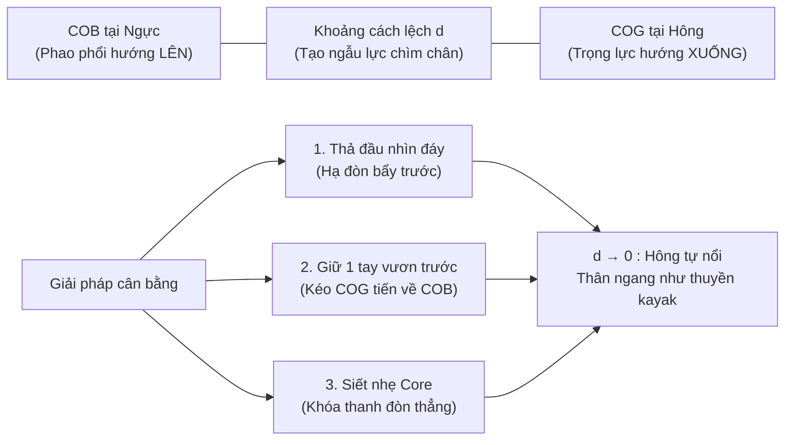

# Trọng Tâm (COG) & Tâm Nổi (COB) — Bí Mật Giúp Hông Tự Nổi

> **Thuộc phần:** `01-foundation/` | **Trình độ:** Cơ bản → Nâng cao | **Thời gian đọc:** ~11 phút

## Tổng Quan (Overview)
Hầu hết người bơi phong trào bị chìm chân không phải vì "đạp chân yếu", mà vì **sự lệch trục giữa Trọng tâm (Center of Gravity — COG) và Tâm nổi (Center of Buoyancy — COB)**. Khi hiểu cơ chế đòn bẩy nổi này, bạn có thể làm hông tự động nổi lên mặt nước mà gần như không tốn sức chân — mở khóa trạng thái bơi nhẹ, êm và lướt xa.

- **Mục tiêu cốt lõi:** Làm chủ nguyên lý cân bằng mô-men giữa COG và COB để giữ thân nằm ngang tự nhiên.
- **Cảm giác đúng:** Cảm giác "bơi hơi xuống dốc" (*downhill swimming*), phần ngực tì nhẹ vào nước, gót chân tự động lơ lửng ngay dưới mặt nước.
- **Sai lầm phổ biến nhất:** Ngẩng đầu lên và gồng đạp chân thật mạnh để kéo hông lên — làm tăng lực cản và cạn kiệt oxy cho cơ đùi.

---

## Lý Thuyết (Theory)
Mọi vật thể nằm trong nước chịu tác động đồng thời của hai lực thẳng đứng ngược chiều nhau:
1. **Trọng lực ($F_g = m \cdot g$)**: Hướng thẳng đứng xuống dưới, đặt tại **Trọng tâm (COG / COM)** — ở người trưởng thành nằm gần vùng xương chậu / hông (do xương đùi, cơ mông và cơ đùi đặc và nặng).
2. **Lực đẩy Ác-si-mét ($F_b = \rho V_{\text{sub}} g$)**: Hướng thẳng đứng lên trên, đặt tại **Tâm nổi (COB)** — nằm gần vùng lồng ngực (do hai lá phổi chứa 3–6 lít không khí hoạt động như một chiếc phao tự nhiên).

Vì **COB nằm gần đầu hơn so với COG** (thường lệch nhau `2–6 cm` dọc theo trục cột sống), cặp lực $F_b$ và $F_g$ tạo thành một **ngẫu lực xoay (Rotational Torque)** làm phần ngực nâng lên và phần chân xoay chìm xuống đáy hồ.

$$\tau_{\text{sink}} = F_g \cdot d_{\text{COB-COG}}$$

Trong đó $d_{\text{COB-COG}}$ là khoảng cách ngang giữa Tâm nổi và Trọng tâm.

---

## Cơ Sở Khoa Học (Science)
### Vật Lý & Thủy Động Lực Học (Physics & Hydrodynamics)
Để triệt tiêu ngẫu lực làm chìm chân ($\tau_{\text{sink}} \to 0$), ta chỉ có **3 cách vật lý chính xác** nhằm kéo COG tiến gần về phía COB:

1. **Hạ đầu và ấn nhẹ ngực (*Press the T / Buoy*):** Đầu người nặng khoảng `4.5–5.5 kg`. Khi bạn thả đầu chìm hoàn toàn vào nước (mặt nhìn đáy hồ), trọng lượng đầu giúp đẩy nhẹ lồng ngực xuống dưới, tạo hiệu ứng bập bênh nâng hông lên.
2. **Đưa khối lượng tay về phía trước (*Front-Quadrant Weight Shift*):** Mỗi cánh tay nặng khoảng `5%` trọng lượng cơ thể (~3–4 kg). Luôn giữ ít nhất **một tay vươn dài phía trước đầu** (Front-Quadrant) sẽ dịch chuyển COG về phía đầu từ `2–4 cm`, gần như trùng khớp với COB.
3. **Ổn định trục cột sống bằng Core:** Nếu lưng dưới bị võng, cơ thể bị "gãy" tại thắt lưng; lực nổi ở ngực không thể truyền dọc cột sống xuống hông. Siết nhẹ Core biến cột sống thành một thanh đòn cứng truyền hiệu ứng nâng ra tận cổ chân.

### Cơ Sinh Học (Biomechanics)
Sự khác biệt cấu trúc cơ thể giải thích vì sao một số người nổi dễ hơn người khác:
- Người có tỷ lệ cơ chân dày, xương đặc (như vận động viên chạy bộ/đạp xe — Triathlete) thường có COG lệch sâu về phía chân hơn, đòi hỏi kỹ thuật *Press the T* và *Front-Quadrant* kỷ luật hơn.
- Hít phổi quá căng cứng làm tăng mạnh $F_b$ tại ngực mà không thở ra đều sẽ đẩy ngực cao hơn và vô tình làm chân chìm sâu hơn.

---

## Thực Hành (Practical)
### Tại Sao Kỹ Thuật Này Hiệu Quả (Why It Works)
Khi $d_{\text{COB-COG}} \to 0$, bạn **không cần tốn 30–40% lượng oxy cơ thể chỉ để đập chân giữ nổi**. Toàn bộ sức chân có thể thu gọn lại thành một cú **2-beat kick** nhẹ nhàng để hỗ trợ xoay hông, hoặc để dành năng lượng cho nhịp **6-beat kick** thực sự tạo lực đẩy khi cần tăng tốc.

### Hướng Dẫn Từng Bước & Cảm Giác Nước (Step-by-Step & Water Cues)
1. **Thả lỏng cổ hoàn toàn**: Tưởng tượng có một dòng nước ấm chảy êm qua gáy; cằm hơi thu nhẹ, mắt nhìn thẳng xuống đường gạch đen đáy hồ.
2. **Cảm giác "Ấn chữ T" (*Press the T*)**: Tưởng tượng điểm giao giữa xương ức và đường ngang hai vai như một chiếc phao — ấn nhẹ vùng ngực này xuống sâu hơn khoảng 2–3 cm so với cảm giác thông thường.
3. **Cảm giác "Bơi xuống dốc" (*Swimming Downhill*)**: Bạn sẽ cảm thấy phần đầu và ngực hơi thấp nhẹ, còn mông và gót chân tự động nổi chạm mặt nước.
4. **Duy trì đối trọng phía trước**: Không rút cả hai tay về ngang hông cùng lúc; khi một tay đang đẩy kết thúc, tay kia phải đã vào nước và vươn dài phía trước.

<!-- IMAGE_PROMPT: Clean anatomical physics illustration comparing two underwater side views of a swimmer: Top shows head-up posture with wide horizontal gap between COB (chest, upward green arrow) and COG (hips, downward red arrow) causing legs to sink; Bottom shows head-down with one arm extended forward, aligning COB and COG so the body floats horizontally. -->

### Mẹo Nâng Cao (Advanced Tips)
- **Kiểm tra tác động của nhịp thở lên COB**: Nếu bạn thở ra liên tục dưới nước, thể tích khí trong phổi giảm dần một cách mượt mà, giúp ngực không bị "bồng bềnh" quá mức và giữ hông ổn định hơn hẳn so với thói quen nín hơi.
- **Không dùng Pull Buoy quá lạm dụng**: Pull Buoy nhân tạo đặt giữa hai đùi sẽ dịch COB về phía chân giúp bạn bơi dễ hơn, nhưng nếu tập quá nhiều với Pull Buoy mà không tập thả phao, não sẽ quên cách kích hoạt Core để tự cân bằng.

---

## Bài Tập Thực Hành (Drills)
| Tên Drill | Mục tiêu cân bằng | Cự ly / Số hiệp | Cảm giác đúng (Cue) |
| :--- | :--- | :--- | :--- |
| **Dead Man's Float → Superman Glide** | Cảm nhận trực tiếp dịch chuyển COG khi đưa tay lên trước | `5 × 10 giây` tại chỗ + `4 × 15m` | Khi thả hai tay xuôi hông chân chìm; khi vươn hai tay về trước chân tự động nổi ngang |
| **Press the T (Torpedo Kick)** | Học cách ấn nhẹ ngực để nâng hông mà không gồng cổ | `4 × 25m` (nghỉ 15s) | Hai tay xuôi hông, chân đập rất nhẹ, ấn ngực xuống cho tới khi gót chân chạm mặt nước |
| **Side-Balance Kick (Kèm chân vịt ngắn)** | Cân bằng COG–COB ở tư thế xoay nghiêng 45° | `4 × 25m` (đổi bên mỗi 25m) | Tay dưới vươn dài làm đối trọng, tai áp sát cánh tay, hông nổi cao |

### Hướng dẫn nhanh
- **Thí nghiệm tại chỗ (1 phút mở khóa tư duy)**: Đứng ở đầu hồ nông, hít vừa đủ, úp mặt xuống nước nổi thả lỏng với hai tay xuôi thân (quan sát chân chìm dần sau 3–5 giây). Lặp lại nhưng lần này từ từ đưa hai tay vươn thẳng về trước đầu — bạn sẽ thấy ngay hai chân tự nâng lên ngang mặt nước nhờ COG dịch chuyển về phía COB!

---

## Phân Tích AI & Video (AI Analysis)
- **Góc quay khuyến nghị:** Ngang dưới nước (Underwater Side View) xuyên suốt 10–15m giữa bể (tránh vùng đạp tường).
- **Điểm khớp cần trích xuất (Keypoints):** Tai (`ear`), Vai (`shoulder`), Hông (`hip`), Gối (`knee`), Cổ chân (`ankle`).
- **Ngưỡng phát hiện lỗi tự động:**
  - **Đạt chuẩn:** Độ sâu tâm hông cách mặt nước `15–25 cm`; góc tạo bởi đường thẳng `vai → cổ chân` so với mặt nước `< 5°`.
  - **Cảnh báo lỗi:** Độ sâu cổ chân lớn hơn độ sâu vai `> 30 cm` (chỉ báo chìm chân rõ rệt); góc đầu ngẩng `> 20°` so với trục cột sống ngực.

---

## Lỗi Thường Gặp & Cách Sửa (Common Errors)
| Lỗi thường gặp | Triệu chứng nhận biết | Nguyên nhân gốc | Cách sửa (Correction) |
| :--- | :--- | :--- | :--- |
| **Ngẩng đầu nhìn phía trước** | Mắt nhìn thẳng tường đích, sóng bắn vào kính, chân chìm sâu | Phản xạ sợ va tường làm đầu nhấc lên khỏi trục cân bằng | Nhìn thẳng đáy hồ, dùng vạch chữ T cách tường 2m để định vị |
| **Võng lưng dưới (Banana Back)** | Ngực nổi cao nhưng mông và đùi rơi xuống | Core hoàn toàn thả lỏng, không khóa xương chậu trung tính | Siết nhẹ bụng dưới (như chuẩn bị làm Plank), kéo nhẹ xương mu về phía rốn |
| **Hai tay kéo đuổi (Windmill)** | Chưa có tay nào vươn trước mà tay kia đã kéo về hông | Mất đối trọng phía trước khiến COG tụt về phía chân | Tập Catch-Up Drill để thiết lập lại thói quen Front-Quadrant |
| **Gồng cổ ấn đầu quá sâu** | Đau gáy, cằm tì chặt vào ngực, đường thở bị nghẹt | Hiểu nhầm "nhìn xuống" thành "cúi gập cổ" | Giữ cột sống cổ thẳng hàng tự nhiên với cột sống lưng, chỉ hạ phần ngực nhẹ |

---

## Tự Đánh Giá Tại Hồ (Self Assessment)
- [ ] Tôi có thể thực hiện thí nghiệm nổi tại chỗ và tự điều khiển chân nổi lên chỉ bằng cách vươn tay về trước.
- [ ] Khi bơi ở tốc độ chậm, gót chân tôi vẫn thỉnh thoảng chạm nhẹ mặt nước mà không cần đập mạnh.
- [ ] Gáy tôi hoàn toàn thả lỏng, không cảm thấy mỏi cổ sau 500m bơi liên tục.
- [ ] Khi xoay đầu lấy hơi, phần hông và chân của tôi không bị tụt xuống đột ngột.
- [ ] Tôi cảm nhận rõ trục cơ thể nối thẳng từ đỉnh đầu qua cột sống ngực xuống tới hông.

---

## Chỉ Số Đo Lường (KPI)
| Chỉ số (Metric) | Người mới | Trung cấp | Nâng cao (`< 1:30/100m`) |
| :--- | :---: | :---: | :---: |
| **Góc nghiêng trục cơ thể (Vai → Cổ chân)** | `12–20°` | `6–10°` | `0–5°` |
| **Chênh lệch độ sâu Vai – Cổ chân** | `> 35 cm` | `20–30 cm` | `< 18 cm` |
| **Tỷ lệ thời gian có ≥ 1 tay ở vùng Front-Quadrant** | `< 50%` | `60–75%` | `75–85%` |
| **Thời gian nổi ngang không đập chân (vươn tay)** | `< 5 giây` | `5–10 giây` | `> 10 giây` |

---

## Câu Hỏi Thường Gặp (FAQ)
**1. Tôi tập gym/chạy bộ nhiều nên chân rất nặng và đặc, liệu có tự nổi ngang được không?**
Hoàn toàn được khi cơ thể đang có vận tốc tiến tới (nhờ thêm lực nâng thủy động nhẹ). Ở trạng thái đứng yên, chân bạn có thể hơi chìm hơn người ít cơ, nhưng khi kết hợp *Press the T*, *Front-Quadrant* và một nhịp *2-beat kick* gọn, thân vẫn nằm phẳng `< 5°`.

**2. Tại sao cứ mỗi lần xoay đầu thở là chân tôi lại chìm hẳn xuống?**
Vì khi thở, bạn thường vô thức nhấc đầu lên (đẩy trọng lượng đầu lên khỏi mặt nước) đồng thời ấn tay trượt phía trước xuống quá sâu để "chống đỡ". Cả hai động tác này lập tức phá vỡ cân bằng COB–COG.

**3. Nên nhìn thẳng 90° xuống đáy hay nhìn chếch về trước?**
Với đa số người bơi, nhìn thẳng xuống đáy hoặc chếch nhẹ `10–15°` về phía trước là tối ưu nhất để giữ cổ trung tính và hông nổi cao.

---

## Tóm Tắt (Summary)
- Chân chìm xuất phát từ ngẫu lực tạo bởi khoảng cách lệch giữa **Tâm nổi (COB tại ngực)** và **Trọng tâm (COG tại hông)**.
- Ba chìa khóa cân bằng không tốn sức: **Thả đầu nhìn đáy + Ấn nhẹ ngực (*Press the T*) + Duy trì 1 tay vươn trước (*Front-Quadrant*) + Khóa Core**.
- Khi thân tự nổi ngang, bạn giải phóng hoàn toàn chân khỏi nhiệm vụ "giữ nổi" để phục vụ cân bằng và tốc độ.

**Liên kết chéo:**
- Chương trước: [Vật Lý Bơi Sải](physics-of-swimming.md)
- Chương tiếp theo: [Chuỗi Truyền Lực (Kinetic Chain)](../02-biomechanics/kinetic-chain.md)
- Kỹ thuật liên quan: [Tư Thế Thân Ngang](../04-body-position/body-position-and-alignment.md) · [Cân Bằng & Pha Trượt](../04-body-position/balance-and-glide.md)
- Tra cứu thuật ngữ: [Glossary](../24-appendix/glossary.md)

---

## Tài Liệu Tham Khảo (References)
1. Laughlin, T., & Delves, J. (2004). *Total Immersion: The Revolutionary Way to Swim Better, Faster, and Easier*. Fireside.
2. Newsome, P., & Young, A. (2012). *Swim Smooth: The Complete Coaching System for Swimmers and Triathletes*. Wiley.
3. Kjendlie, P. L., & Stallman, R. K. (2008). *Drag characteristics of competitive swimming children and adults*. Journal of Applied Biomechanics, 24(1), 35–42.

