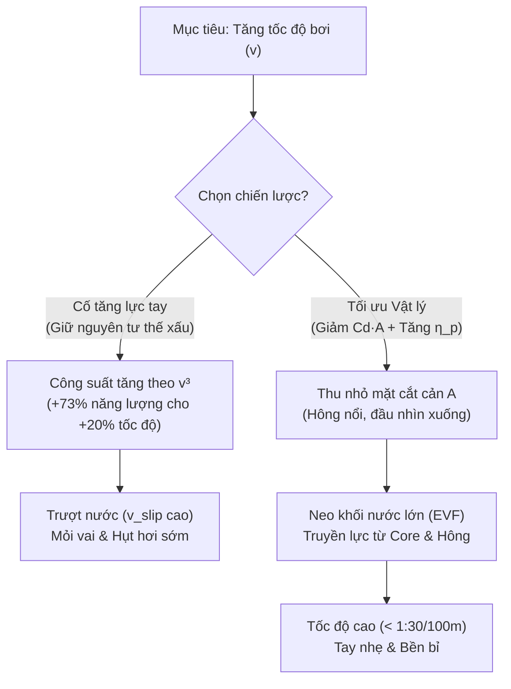

# Vật Lý Bơi Sải & Phương Trình Công Suất ($P \propto v^3$)

> **Thuộc phần:** `01-foundation/` | **Trình độ:** Cơ bản → Nâng cao | **Thời gian đọc:** ~12 phút

## Overview

Nước có mật độ xấp xỉ **800 lần không khí** ($\rho \approx 1000\text{ kg/m}^3$ so với $1.225\text{ kg/m}^3$). Chỉ một sự thay đổi nhỏ về tư thế hoặc đường kéo tay cũng tạo ra chênh lệch khổng lồ về lực cản và năng lượng tiêu hao. Chương này thiết lập nền tảng vật lý cốt lõi giải thích vì sao triết lý **giảm lực cản trước khi tăng lực đẩy** là con đường ngắn nhất để đạt tốc độ cao (`< 1:30/100m`) mà tay vẫn nhẹ.

- **Mục tiêu cốt lõi:** Hiểu quan hệ toán học giữa lực đẩy, lực cản, vận tốc ($F_d \propto v^2$) và công suất tiêu hao ($P \propto v^3$).
- **Cảm giác đúng:** Cơ thể lướt đi trơn tru với lực kéo vừa phải; tăng tốc đến từ việc thân thuôn dài và ổn định hơn thay vì guồng tay điên cuồng.
- **Sai lầm phổ biến nhất:** Cố gắng kéo tay mạnh hơn và tăng tần suất quạt tay khi hông đang chìm — dẫn tới cạn oxy cực nhanh mà tốc độ hầu như không đổi.

---

## Theory

Trong mọi chuyển động bơi sải ở vận tốc trung bình không đổi ($v = \text{const}$), cơ thể người bơi tuân theo **Định luật II Newton**:

$$\sum F = F_{\text{propulsion}} - F_{\text{drag}} = m \cdot a$$

Khi bơi đều ($a = 0$), lực đẩy trung bình phải bằng đúng lực cản trung bình:

$$F_{\text{propulsion}} = F_{\text{drag}}$$

Từ phương trình này nảy sinh **2 chiến lược duy nhất để tăng vận tốc bơi**:
1. **Tăng $F_{\text{propulsion}}$**: Tăng lực đẩy của tay và chân (tốn năng lượng sinh học, nhanh chạm trần VO2max và dễ quá tải khớp vai).
2. **Giảm $F_{\text{drag}}$**: Giảm lực cản hình học, lực cản ma sát và lực cản sóng (tiết kiệm năng lượng, mang lại tốc độ "miễn phí" bền vững).

Vì **Định luật III Newton** (*Mọi tác dụng đều có phản lực cùng độ lớn, ngược chiều*), nước không phải là điểm tựa rắn như mặt đường khi chạy bộ. Khi bạn đẩy một khối nước có khối lượng $m_w$ ra sau với vận tốc tương đối $\Delta v_w$, cơ thể bạn nhận được xung lượng tiến tới:

$$F_{\text{propulsion}} = \frac{\Delta p}{\Delta t} = \dot{m}_w \cdot \Delta v_w$$

Điều này chứng minh: **ôm được một khối nước lớn ($\dot{m}_w$ lớn) và đẩy đi ổn định** luôn hiệu quả hơn nhiều so với việc quạt nhanh một lượng nước nhỏ ($\Delta v_w$ lớn gây trượt nước và tạo bọt).

---

## Science

### Physics & Hydrodynamics

Lực cản tổng trong nước tuân theo phương trình thủy động lực học cơ bản:

$$F_d = \frac{1}{2} \rho v^2 C_d A$$

Trong đó:
- $\rho \approx 1000\text{ kg/m}^3$: Khối lượng riêng của nước ngọt.
- $v$ ($\text{m/s}$): Vận tốc tương đối của cơ thể so với dòng nước.
- $C_d$: Hệ số cản hình dạng (phụ thuộc độ thuôn, độ ổn định, ít dao động).
- $A$ ($\text{m}^2$): Diện tích mặt cắt ngang vuông góc với hướng bơi.

Công suất cơ học cần thiết để duy trì vận tốc $v$ là:

$$P = F_d \cdot v = \frac{1}{2} \rho C_d A v^3$$

**Hệ quả thực chiến của hàm lập phương ($v^3$):**
- **Ví dụ thực tế (Bể 25m):** Để cải thiện tốc độ từ `1:45/100m` ($v_1 \approx 0.95\text{ m/s}$) lên `1:28/100m` ($v_2 \approx 1.14\text{ m/s}$ — tăng **20%** vận tốc), nếu giữ nguyên tư thế (không giảm $C_d \cdot A$), công suất cơ bắp cần tạo ra phải tăng:
  $$\left(\frac{1.14}{0.95}\right)^3 = 1.2^3 = 1.728 \quad (+72.8\% \text{ công suất!})$$
- Ngược lại, nếu bạn cải thiện tư thế để giảm $C_d \cdot A$ xuống **25%** (nhờ nâng hông, giữ đầu thẳng, không đá kéo), bạn chỉ cần tăng công suất thêm ~30% là đã đạt tốc độ `1:28/100m` với cảm giác tay nhẹ hơn hẳn.

### Biomechanics

Trong nước, hiệu suất đẩy (*Propelling Efficiency — $\eta_p$*) được định nghĩa là tỷ số giữa công có ích đẩy cơ thể tiến tới và tổng công cơ học bỏ ra:

$$\eta_p = \frac{v_{\text{body}}}{v_{\text{body}} + v_{\text{slip}}}$$

Khi bạn kéo tay quá nhanh với bàn tay hở hoặc khuỷu tay sụp (*Dropped Elbow*), vận tốc trượt của nước ($v_{\text{slip}}$) tăng vọt, kéo hiệu suất $\eta_p$ xuống dưới `0.40`. Ngược lại, khi dựng cẳng tay sớm (**EVF**) và truyền lực từ hông–core, tay trở thành một "mỏ neo" ít trượt ($v_{\text{slip}}$ nhỏ), nâng $\eta_p$ lên `0.55–0.70`.

---

## Practical

### Why It Works

Áp dụng nguyên lý $P \propto C_d A v^3$ và $\eta_p$ giải thích 2 hiện tượng quen thuộc ở hồ bơi:
1. Tại sao một VĐV thanh mảnh bơi rất nhẹ nhàng lại dễ dàng vượt qua người có cơ bắp lớn nhưng bơi hông chìm: vì hệ số $C_d A$ của họ nhỏ hơn 30–40%.
2. Tại sao bơi tăng tốc mượt mà ở nửa sau pha kéo (*Acceleration through the stroke*) lại tạo xung lượng tốt hơn giật cục ngay khi tay vừa chạm nước: vì giật mạnh ngay đầu pha kéo làm tăng đột ngột vận tốc trượt $v_{\text{slip}}$ trước khi kịp ôm khối nước tĩnh.

### Step-by-Step Execution & Water Cues

1. **Ưu tiên số 1 — Thu nhỏ diện tích cản $A$**: Trước khi nghĩ tới kéo tay, luôn giữ đỉnh đầu thẳng trục, mắt nhìn xuống đáy, hông nổi sát mặt nước.
2. **Ưu tiên số 2 — Giữ vận tốc ổn định (Giảm dao động $\Delta v$)**: Vì lực cản tăng theo $v^2$, bơi giật cục (lúc quá nhanh, lúc dừng hẳn) tiêu hao năng lượng cao hơn bơi đều cùng tốc độ trung bình. Duy trì **Front-Quadrant Swimming** để giữ tốc độ lướt liên tục.
3. **Ưu tiên số 3 — Đẩy khối nước lớn, chậm và chắc**: Cảm giác đặt toàn bộ cẳng tay và lòng bàn tay lên khối nước đặc, rồi dùng xoay hông kéo thân người vượt qua điểm neo đó.

<!-- IMAGE_PROMPT: Technical MIT-style hydrodynamic diagram showing a freestyle swimmer in side profile underwater, with vector arrows for Drag (Fd = 0.5*rho*v^2*Cd*A), Propulsion (Fp), Buoyancy, and Gravity, paired with an inset graph of Power vs Velocity showing the cubic curve difference between streamlined vs dropped-hip posture. -->

### Advanced Tips

- **Quy tắc 80/20 về tốc độ**: Ở trình độ `1:45–2:15/100m`, 80% thời gian cải thiện tốc độ đến từ **giảm lực cản**; chỉ khi bạn đã bơi dưới `1:30/100m`, tăng công suất lực đẩy và ngưỡng VO2max mới chiếm tỷ trọng ngang bằng.
- **Tránh "bẫy tốc độ giả" khi quạt nhanh**: Nếu tăng nhịp tay (SPM) thêm 10% nhưng tốc độ không tăng tương ứng, tức là bạn đang làm tăng $v_{\text{slip}}$ (trượt nước) chứ không tăng lực đẩy thực.

---

## Drills

| Tên Drill | Mục tiêu vật lý | Cự ly / Số hiệp | Cảm giác đúng (Cue) |
| :--- | :--- | :--- | :--- |
| **Push & Glide Streamline** | Đo trực tiếp hệ số cản $C_d A$ qua quãng đường trượt | `6 × 15m` (nghỉ 15s) | Đạp tường một lực vừa phải, không đạp chân, trượt qua mốc 7–10m êm ru |
| **Fist Swim (Nắm đấm)** | Giảm diện tích bàn tay để ép não huy động cẳng tay ôm khối nước lớn ($\dot{m}_w$) | `4 × 25m` xen kẽ `4 × 25m` mở tay | Khi mở tay lại, cảm giác bàn tay–cẳng tay như mái chèo khổng lồ bám chặt nước |
| **Golf Swim (SWOLF Test)** | Cân bằng giữa lực cản thấp và hiệu suất đẩy $\eta_p$ | `4 × 50m` (nghỉ 30s) | Giảm tổng `Giây + Số sải` ở mỗi 50m mà không phải gồng tay |

### Hướng dẫn nhanh
- **Push & Glide Streamline**: Đạp tường ở độ sâu ~50 cm, hai tay kẹp chặt sau tai, bàn tay chồng lên nhau, mũi chân duỗi thẳng. Đo khoảng cách đi được trước khi dừng hẳn; thử nghiệm thay đổi nhẹ góc đầu (ngẩng lên vs nhìn xuống) để tự cảm nhận chênh lệch lực cản ngay lập tức.
- **Fist Swim → Open Hand**: Bơi 25m với hai bàn tay nắm hờ thành nắm đấm. Bắt buộc phải dựng cẳng tay (EVF) mới có lực tiến. Ngay 25m kế tiếp mở bàn tay thư giãn (ngón tay hơi khép tự nhiên), bạn sẽ cảm nhận rõ sự bùng nổ của lực bám nước.

---

## AI Analysis

- **Góc quay khuyến nghị:** Ngang dưới nước (Underwater Side View, 60–120 fps) để đo góc nghiêng thân và độ biến thiên vận tốc trong chu kỳ (*Intra-cyclic Velocity Variation — IVV*).
- **Keypoints cần trích xuất:** Đỉnh đầu (`nose/ear`), Vai (`shoulder`), Hông (`hip`), Gối (`knee`), Cổ chân (`ankle`), Cổ tay (`wrist`).
- **Ngưỡng phát hiện lỗi tự động:**
  - **Đạt chuẩn:** Góc nghiêng trục vai–hông so với phương ngang `< 5°`; độ biến thiên vận tốc trong chu kỳ `IVV < 15%`.
  - **Cảnh báo lỗi:** Góc nghiêng trục thân `> 10°` (diện tích cản $A$ tăng mạnh); bàn tay di chuyển nhanh về sau so với thân nhưng vận tốc hông không tăng (dấu hiệu $v_{\text{slip}}$ cao).

---

## Common Errors

| Lỗi thường gặp | Triệu chứng nhận biết | Nguyên nhân gốc | Cách sửa (Correction) |
| :--- | :--- | :--- | :--- |
| **Quạt tay điên cuồng để tăng tốc** | Nhịp tay rất cao (`> 85 SPM`), nhiều bọt trắng, hụt hơi sau 50m | Cố thắng lực cản $v^2$ bằng lực tay trong khi hông chìm | Giảm nhịp tay xuống, tập Push & Glide và nâng hông trước khi tăng tốc |
| **Kéo trượt nước (Slipping)** | Tay đi qua nước quá nhanh, không có cảm giác tì lực | Không tạo được diện tích mái chèo cẳng tay (sụp khuỷu) | Tập Fist Swim và Sculling để xây cảm giác áp lực nước lên cẳng tay |
| **Bơi giật cục (High IVV)** | Cơ thể chựng lại rõ rệt giữa các sải tay (đặc biệt khi thở) | Pha trượt quá lâu ở tốc độ chậm hoặc dừng kéo khi lấy hơi | Giữ Front-Quadrant mượt mà, vào pha Catch ngay khi tay kia hoàn tất Recovery |
| **Ngẩng đầu nhìn đích** | Sóng lớn trước trán, chân chìm sâu, đùi nhanh mỏi | Bản năng quan sát làm tăng góc tấn thân và tăng Form Drag $A$ | Nhìn thẳng xuống gạch đáy hồ, tin vào đường chữ T dưới đáy để căn tường |

---

## Self Assessment

- [ ] Tôi hiểu rõ vì sao tăng 20% tốc độ đòi hỏi tới ~73% công suất nếu không giảm lực cản.
- [ ] Khi đạp tường ở tư thế Streamline (không đập chân), tôi trượt được tối thiểu 7m.
- [ ] Khi tăng tốc trong một bài `4 × 50m`, tôi giữ được số sải tay không tăng quá 1–2 sải/25m.
- [ ] Sau bài tập Fist Swim chuyển sang mở tay, tôi cảm nhận rõ khối nước tì nặng lên toàn bộ cẳng tay.
- [ ] Hơi thở của tôi ổn định sau 200m bơi tốc độ trung bình, không bị chuột rút hay mỏi rã cơ vai.

---

## KPI

| Chỉ số (Metric) | Người mới | Trung cấp | Nâng cao (`< 1:30/100m`) |
| :--- | :---: | :---: | :---: |
| **Quãng trượt Streamline (không đập chân)** | `4–6 m` | `6–8 m` | `8–11+ m` |
| **Hiệu suất đẩy ước tính ($\eta_p$)** | `0.35–0.45` | `0.45–0.55` | `0.58–0.70` |
| **Góc nghiêng thân dưới nước** | `> 12°` | `6–10°` | `< 5°` |
| **SWOLF (bể 25m, tốc độ thoải mái)** | `> 48` | `38–45` | `< 35` |

---

## FAQ

**1. Có đúng là người cơ bắp to hơn sẽ luôn bơi nhanh hơn không?**
Không. Trong nước, khối cơ lớn làm tăng diện tích mặt cắt cản $A$ và giảm độ nổi tự nhiên. Nếu kỹ thuật giảm lực cản kém, lợi thế cơ bắp bị triệt tiêu hoàn toàn bởi phương trình $P \propto C_d A v^3$.

**2. Tại sao đạp tường trượt Streamline lại nhanh hơn tốc độ tôi bơi hết sức?**
Vì lúc đạp tường trong tư thế thuôn dài hoàn hảo, diện tích cản $A$ và hệ số $C_d$ ở mức nhỏ nhất có thể, không có lực cản sóng bề mặt và không có sự nhiễu loạn từ động tác tay/chân.

**3. Làm sao biết mình đang đẩy khối nước lớn thay vì trượt tay qua nước?**
Hãy lắng nghe và cảm nhận: tay đi qua nước **chậm lại nhẹ ở đầu pha Catch rồi tăng tốc mượt về phía hông**, nước phía sau hông yên và tạo xoáy gọn thay vì bắn bọt trắng xóa.

---

## Summary

- Nước đặc gấp ~800 lần không khí; lực cản tăng theo $v^2$ và công suất tiêu hao tăng theo $v^3$.
- **Giảm lực cản ($C_d \cdot A$)** luôn là đòn bẩy hiệu quả nhất để đạt tốc độ cao mà tay vẫn nhẹ.
- Tăng hiệu suất đẩy ($\eta_p$) bằng cách ôm khối nước lớn bằng cả cẳng tay và đẩy ổn định, hạn chế trượt nước ($v_{\text{slip}}$).

**Liên kết chéo:**
- Trang chủ: [README.md](../README.md)
- Chương tiếp theo: [Trọng Tâm (COG) & Tâm Nổi (COB)](center-of-gravity-and-buoyancy.md)
- Kỹ thuật liên quan: [Giảm Lực Cản](../03-hydrodynamics/drag-reduction.md)
- Tra cứu thuật ngữ: [Glossary](../24-appendix/glossary.md)

---

## References

1. Maglischo, E. W. (2003). *Swimming Fastest*. Human Kinetics.
2. Toussaint, H. M., & Truijens, M. (2005). *Biomechanical aspects of peak performance in human swimming*. Animal Biology, 55(1), 17–40.
3. Vogel, S. (1994). *Life in Moving Fluids: The Physical Biology of Flow*. Princeton University Press.
4. World Aquatics (FINA) & USA Swimming Technical Coaching Manuals.

