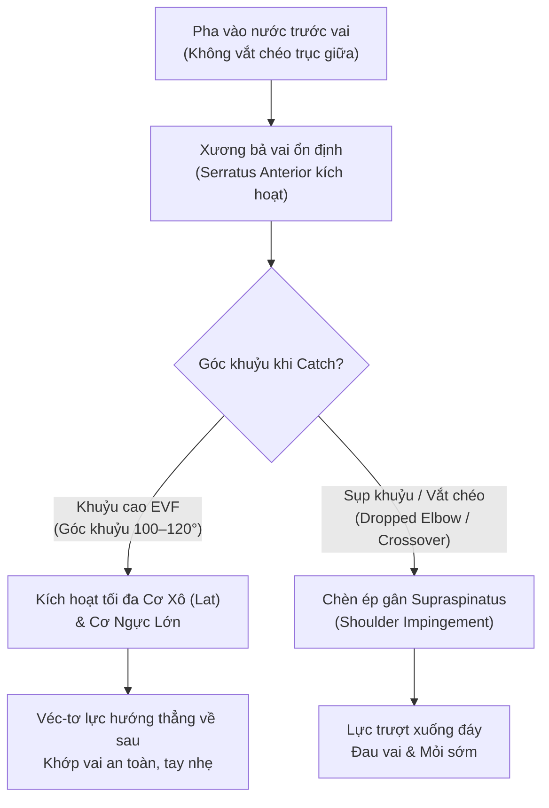

# Cơ Sinh Học Khớp Vai & Cơ Xô (*Latissimus Dorsi*)

> **Thuộc phần:** `02-biomechanics/` | **Trình độ:** Cơ bản → Nâng cao | **Thời gian đọc:** ~12 phút

## Overview

Nếu bạn cảm thấy mỏi rã mặt trước vai hoặc đau âm ỉ khớp vai sau 500–1000m bơi sải, đó là tín hiệu cơ sinh học rõ ràng nhất cho thấy **khớp vai đang làm thay việc của cơ lưng rộng (Latissimus Dorsi)**. Hiểu giải phẫu khớp vai và cách "khóa" cánh tay vào cơ xô qua kỹ thuật **Early Vertical Forearm (EVF)** là chìa khóa để bơi nhanh hơn, tay nhẹ hơn và phòng tránh tuyệt đối chấn thương *Swimmer's Shoulder*.

- **Mục tiêu cốt lõi:** Chuyển tải trọng lực kéo từ nhóm cơ vai nhỏ (Deltoid / Supraspinatus) sang động cơ chính là **cơ lưng rộng (Lat)** và **cơ ngực lớn (Pectoralis Major)**.
- **Cảm giác đúng:** Nách cảm thấy "kết nối chắc" với khung sườn khi kéo nước; mỏi tập trung ở phần lưng bên dưới nách thay vì đỉnh vai.
- **Sai lầm phổ biến nhất:** Sụp khuỷu (*Dropped Elbow*) khi bắt nước và vắt tay chéo trục giữa (*Crossover*), gây hội chứng chèn ép dưới mỏm cùng vai (*Shoulder Impingement*).

---

## Theory

Khớp ổ chảo – cánh tay (*Glenohumeral Joint*) là khớp có biên độ vận động lớn nhất cơ thể nhưng đổi lại có **độ ổn định cấu trúc thấp nhất**. Trong một buổi bơi `3.000m`, mỗi khớp vai thực hiện khoảng `1.200–1.500` vòng xoay dưới tải trọng của nước.

Để khớp vai vận hành an toàn và phát công suất tối đa, cần phối hợp đồng bộ 3 hệ cơ:
1. **Nhóm cơ ổn định xương bả vai (*Scapular Stabilizers*)**: Cơ răng trước (*Serratus Anterior*) và cơ thang dưới (*Lower Trapezius*) giữ xương bả vai áp sát lồng ngực, mở rộng khoảng trống dưới mỏm cùng vai (*Subacromial Space*).
2. **Nhóm cơ chóp xoay (*Rotator Cuff*)**: 4 cơ nhỏ (*Supraspinatus, Infraspinatus, Teres Minor, Subscapularis*) giữ chỏm xương cánh tay nằm chính giữa ổ chảo — nhiệm vụ của chúng là **ổn định**, không phải tạo lực kéo chính.
3. **Nhóm cơ phát lực chính (*Prime Movers*)**: **Cơ lưng rộng (Latissimus Dorsi)** và **Cơ ngực lớn (Pectoralis Major)** thực hiện động tác duỗi và khép cánh tay (*Shoulder Extension & Adduction*) để đẩy khối nước mạnh mẽ về phía hông.

---

## Science

### Physics & Hydrodynamics

Xét cánh tay như một đòn bẩy quay quanh khớp vai:
- **Khi kéo thẳng tay hoặc sụp khuỷu (*Straight-Arm / Dropped Elbow*)**: Khoảng cách từ tâm lực nước ở bàn tay tới khớp vai ($r$) rất lớn, tạo ra mô-men uốn cực lớn lên gân cơ chóp xoay ($\tau_{\text{stress}} = F_{\text{water}} \cdot r$). Đồng thời, ở nửa đầu pha kéo, véc-tơ lực lại hướng **xuống đáy hồ** (nâng thân người lên xuống lãng phí) thay vì hướng thẳng về sau.
- **Khi dựng cẳng tay sớm (EVF, góc khuỷu `100–120°`)**: Cánh tay trên xoay trong có kiểm soát (*Controlled Internal Rotation*) kết hợp xoay thân `35–45°`, đưa bề mặt cẳng tay + bàn tay vuông góc với hướng tiến ngay từ đầu pha kéo. Toàn bộ véc-tơ lực hướng thẳng về sau ($F_x \to \max$), đồng thời rút ngắn cánh tay đòn gây áp lực lên khớp vai.

### Biomechanics

Nghiên cứu điện cơ đồ (EMG) trên VĐV bơi sải đỉnh cao chỉ ra sự phân bổ kích hoạt cơ theo từng pha:

| Pha sải tay | Nhóm cơ hoạt động chủ đạo | Mục tiêu bảo vệ khớp |
| :--- | :--- | :--- |
| **Entry & Glide** | Cơ răng trước (*Serratus Anterior*), Cơ thang trên nhẹ | Xoay lên xương bả vai (*Upward Rotation*), không rụt vai sát tai |
| **Catch (EVF)** | Cơ dưới vai (*Subscapularis*), Cơ tròn lớn (*Teres Major*), Cơ xô bắt đầu căng | Giữ khuỷu cao, không vắt chéo trục giữa (tránh *Impingement*) |
| **Pull & Push** | **Cơ lưng rộng (Latissimus Dorsi)**, Cơ ngực lớn, Cơ tam đầu (*Triceps*) | Giữ góc nách chắc, kéo thân vượt qua điểm neo |
| **Recovery** | Cơ delta sau/giữa (nhẹ), cẳng tay **thả lỏng 100%** | Xoay thân hỗ trợ nhấc vai ra khỏi nước, tránh nhấc bằng cổ |

---

## Practical

### Why It Works

Khi bạn vào nước đúng đường thẳng trước vai (không vắt chéo) và dựng cẳng tay EVF trong khi thân đang nghiêng `35–45°`, xương cánh tay nằm trên mặt phẳng xương bả vai (*Scapular Plane* — góc tối ưu sinh học của khớp vai). Nhờ đó:
- Không gian dưới mỏm cùng vai rộng tối đa, **triệt tiêu chèn ép gân chóp xoay**.
- Cơ xô (Lat) được đặt ở chiều dài kéo căng tối ưu trước khi co rút, phát lực mạnh gấp nhiều lần cơ vai mà tiêu thụ ít năng lượng cục bộ hơn.

### Step-by-Step Execution & Water Cues

1. **Vào nước theo "đường ray đôi" (*Railroad Tracks*)**: Tay trái vào nước trước vai trái (vị trí 11 giờ), tay phải vào nước trước vai phải (vị trí 1 giờ). Tuyệt đối không để ngón cái cắm sâu vào trước mặt gây xoay trong vai quá mức.
2. **Mở rộng khung sườn khi vươn (*Reach from the Ribs*)**: Vươn dài tay nhờ độ xoay của lồng ngực chứ không rụt vai lên che kín tai.
3. **Khóa "kẹp nách" khi bắt đầu kéo**: Khi dựng cẳng tay EVF, hãy có cảm giác như bạn đang dùng cơ xô dưới nách kẹp nhẹ một quả bóng nhỏ rồi kéo toàn bộ thân người lướt qua nó.
4. **Thả lỏng tuyệt đối pha rút tay (Recovery)**: Ngay khi tay kết thúc pha đẩy ngang đùi, thả lỏng bàn tay và cẳng tay như sợi mì, để khuỷu tay dẫn hướng lướt nhẹ về trước.

<!-- IMAGE_PROMPT: Medical-grade sports biomechanics illustration showing an underwater front-quarter view of a swimmer executing an Early Vertical Forearm (EVF) catch at 110 degrees elbow flexion, highlighting the engaged Latissimus Dorsi and Serratus Anterior in blue, with a clean green arrow showing safe subacromial clearance vs a red inset warning for thumb-first crossover impingement. -->

### Advanced Tips

- **Vào nước phẳng ngón giữa/ngón trỏ trước (Flat-Hand Entry)**: Tránh thói quen cũ "ngón cái vào nước trước" (*Thumb-First Entry*) — kỹ thuật cũ này ép khớp vai xoay trong tối đa ở vị trí giơ cao trên đầu, là nguyên nhân số 1 gây viêm gân chóp xoay.
- **Kiểm tra độ linh hoạt cột sống ngực (T-Spine)**: Nếu vai bị đau khi vươn tay, 60% trường hợp gốc rễ lại nằm ở cột sống ngực bị cứng (do ngồi máy tính nhiều), buộc khớp vai phải gánh thêm biên độ xoay.

---

## Drills

| Tên Drill | Mục tiêu cơ sinh học | Cự ly / Số hiệp | Cảm giác đúng (Cue) |
| :--- | :--- | :--- | :--- |
| **Front Sculling (Vẫy nước trước)** | Kích hoạt cơ xô & cảm giác neo nước không gồng vai | `4 × 25m` (kèm Pull Buoy + Snorkel) | Khuỷu cao cố định, chỉ cẳng tay & bàn tay lắc hình số 8 tạo lực kéo tiến |
| **Dog Paddle (Bơi chó EVF dưới nước)** | Cô lập hoàn toàn pha Catch → Mid-Pull bằng cơ xô | `4 × 25m` (nghỉ 15s) | Tay không rút lên khỏi mặt nước; tập trung dựng cẳng tay sớm và kéo từ nách |
| **Resistance Band EVF Pull (Dryland)** | Xây dựng trí nhớ cơ bắp cho cơ xô ở đúng góc khuỷu 110° | `3 hiệp × 15 lần` (trước khi xuống hồ) | Khởi động kéo bằng cách dựng cẳng tay xuống trước rồi mới kéo về hông |

### Hướng dẫn nhanh
- **Resistance Band EVF Pull**: Móc dây kháng lực ngang tầm ngực, gập hông 90° mô phỏng tư thế bơi sải. Giữ khuỷu tay cao cố định, gập cẳng tay vuông góc xuống sàn (EVF), cảm nhận cơ xô căng chặt rồi kéo thẳng tay ra sau ngang hông. Thực hiện chậm 3 giây mỗi lần kéo để não ghi nhớ tín hiệu cơ xô.

---

## AI Analysis

- **Góc quay khuyến nghị:** Trước mặt dưới nước (Underwater Front View) & Ngang dưới nước (Underwater Side View).
- **Keypoints cần trích xuất:** `shoulder`, `elbow`, `wrist`, `hip`, đường trục giữa thân (`midline`).
- **Ngưỡng phát hiện lỗi tự động:**
  - **Đạt chuẩn:** Bàn tay vào nước giữ khoảng cách ngoài `midline` `≥ 10–15 cm`; góc khuỷu tại điểm Catch tối ưu `100–120°`; vị trí khuỷu luôn cao hơn cổ tay (`y_elbow < y_wrist` trong hệ tọa độ ảnh).
  - **Cảnh báo lỗi:** Cổ tay vượt qua `midline` (Crossover); `y_elbow > y_wrist` trong pha Catch (Dropped Elbow — nguy cơ đau vai cao).

---

## Common Errors

| Lỗi thường gặp | Triệu chứng nhận biết | Nguyên nhân gốc | Cách sửa (Correction) |
| :--- | :--- | :--- | :--- |
| **Vào nước ngón cái trước (Thumb-First)** | Đau nhói mặt trước/ngoài vai sau khi bơi | Xoay trong cánh tay tối đa khi giơ cao gây chèn ép gân *Supraspinatus* | Vào nước bằng đầu ngón giữa/ngón trỏ với lòng bàn tay hơi úp phẳng xuống đáy |
| **Vắt chéo trục giữa (Crossover)** | Tay vào nước trước mũi hoặc kéo cắt ngang qua bụng | Xoay đầu thở quá mức hoặc cố với quá xa ở phía trước | Tập bơi theo hình dung "2 đường ray song song" rộng bằng vai (11 giờ & 1 giờ) |
| **Sụp khuỷu (Dropped Elbow)** | Khuỷu tay tụt xuống trước, bàn tay đẩy nước xuống đáy thay vì ra sau | Thiếu sức mạnh cơ xô/xoay trong vai hoặc kéo quá vội khi chưa kịp dựng cẳng tay | Tập Front Sculling + Dog Paddle + dây kháng lực EVF trên cạn |
| **Rụt vai sát tai khi vươn tay** | Căng cứng cơ thang trên và đau mỏi cổ gáy | Cố vươn bằng nâng bả vai thay vì xoay lồng ngực | Hạ bả vai xa tai, vươn dài nhờ xoay khung sườn `35–45°` |

---

## Self Assessment

- [ ] Tôi vào nước đúng 2 đường ray trước vai (11 giờ và 1 giờ), không vắt chéo qua trước đầu.
- [ ] Lòng bàn tay tôi hướng xuống đáy (không xoay ngón cái cắm xuống trước) khi chạm nước.
- [ ] Trong pha kéo, tôi cảm nhận cơ lưng dưới nách (Lat) làm việc rõ hơn cơ đỉnh vai.
- [ ] Tôi không còn cảm giác đau nhói hay kẹt khớp vai sau các buổi tập `1.500–2.500m`.
- [ ] Tôi thực hiện khởi động xoay vai + dây kháng lực EVF tối thiểu 5 phút trước mỗi buổi bơi.

---

## KPI

| Chỉ số (Metric) | Người mới | Trung cấp | Nâng cao (`< 1:30/100m`) |
| :--- | :---: | :---: | :---: |
| **Góc khuỷu tại điểm Catch (EVF)** | `150–175°` (thẳng/sụp) | `120–140°` | `100–120°` |
| **Tỷ lệ vắt chéo trục giữa (Crossover)** | Thường xuyên | Thỉnh thoảng bên thở | `0%` (ổn định 2 đường ray) |
| **Điểm đau vai sau buổi bơi (Thang 0–10)** | `2–4` (dấu hiệu sai kỹ thuật) | `0–1` | `0` (bền bỉ ở khối lượng cao) |
| **Sức bền kéo dây kháng lực EVF chuẩn form** | `< 10 lần` | `15–20 lần` | `30+ lần` không sụp khuỷu |

---

## FAQ

**1. Tại sao dùng bàn quạt tay (Hand Paddles) cỡ lớn dễ làm đau vai?**
Bàn quạt lớn làm tăng đột ngột diện tích cản nước và mô-men tải lên khớp vai. Nếu kỹ thuật EVF chưa vững (còn sụp khuỷu hoặc vắt chéo), Hand Paddles sẽ khuếch đại chấn thương cực nhanh. Chỉ nên dùng **Finger Paddles** (quạt ngón tay) hoặc quạt cỡ nhỏ khi kỹ thuật EVF đã ổn định.

**2. Tôi bị cứng vai do ngồi văn phòng cả ngày, làm sao giữ được High Elbow Catch?**
Hãy ưu tiên mở khớp cột sống ngực (*Thoracic Foam Rolling*, *Open Book Stretch*) và kéo giãn cơ ngực (*Doorway Pec Stretch*) 10 phút mỗi ngày. Khi lồng ngực mở và xương bả vai trượt tự do, tư thế EVF sẽ đến tự nhiên không cần gồng.

**3. Nên tập tạ bài nào trên cạn để tăng lực cơ xô cho bơi sải?**
Các bài tối ưu nhất là **Pull-Up / Lat Pulldown** (tập trung cảm nhận kéo bằng khuỷu về hông), **Straight-Arm Lat Pulldown** và **Single-Arm Cable/Band EVF Pull** — tất cả đều ưu tiên kiểm soát xương bả vai hơn là tạ nặng.

---

## Summary

- Bảo vệ khớp vai và tạo lực kéo mạnh phụ thuộc vào việc **chuyển tải trọng từ cơ vai sang cơ lưng rộng (Lat)** thông qua tư thế **EVF (`100–120°`)**.
- Loại bỏ tuyệt đối 2 tác nhân gây chấn thương *Swimmer's Shoulder*: **vào nước ngón cái trước** và **vắt chéo trục giữa (Crossover)**.
- Kết hợp khởi động dây kháng lực EVF + mở cột sống ngực giúp tay nhẹ và vai bền vững suốt cả lộ trình 24 tuần.

**Liên kết chéo:**
- Chương trước: [Chuỗi Truyền Lực (Kinetic Chain)](kinetic-chain.md)
- Chương tiếp theo: [Giảm Lực Cản Thủy Động](../03-hydrodynamics/drag-reduction.md)
- Kỹ thuật liên quan: [High Elbow Catch (EVF)](../09-catch/early-vertical-forearm.md) · [Mobility Vai & Cột Sống Ngực](../19-mobility/shoulder-thoracic-ankle-mobility.md)
- Tra cứu thuật ngữ: [Glossary](../24-appendix/glossary.md)

---

## References

1. Pink, M., Perry, J., Browne, A., Scovazzo, M. L., & Kerrigan, J. (1991). *The normal shoulder during freestyle swimming: An electromyographic and cinematographic analysis of twelve muscles*. American Journal of Sports Medicine, 19(6), 569–576.
2. Rodeo, S. A. (1999). *Knee and shoulder injuries in swimmers*. Clinics in Sports Medicine.
3. Wanivenhaus, F., Fox, A. J., Chaudhury, S., & Rodeo, S. A. (2012). *Epidemiology of injuries and prevention strategies in competitive swimmers*. Sports Health, 4(3), 246–251.

