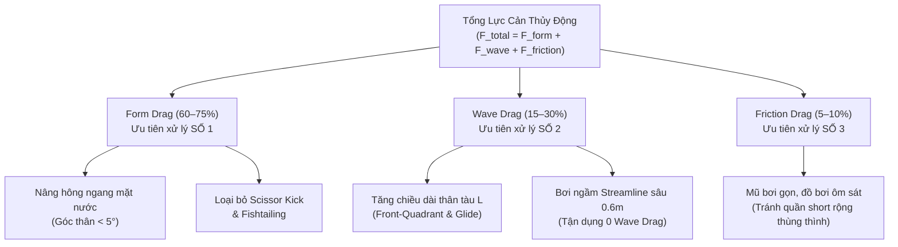

# Giảm Lực Cản Thủy Động (Form, Friction & Wave Drag)

> **Thuộc phần:** `03-hydrodynamics/` | **Trình độ:** Cơ bản → Nâng cao | **Thời gian đọc:** ~12 phút

## Tổng Quan (Overview)
Trong bơi lội, **lực cản là kẻ thù số 1 của tốc độ**. Khác với xe đạp hay chạy bộ trong không khí, cơ thể người bơi di chuyển ngay tại ranh giới giữa hai môi trường nước và không khí, nơi mọi sai lệch tư thế dù chỉ vài centimet đều làm lực cản tăng vọt. Chương này phân tách 3 thành phần của lực cản thủy động học và chỉ ra chính xác yếu tố nào mang lại lợi nhuận tốc độ lớn nhất khi tối ưu.

- **Mục tiêu cốt lõi:** Phân biệt và triệt tiêu theo thứ tự ưu tiên **Form Drag (Lực cản hình học)**, **Wave Drag (Lực cản sóng)** và **Friction Drag (Lực cản ma sát)**.
- **Cảm giác đúng:** Cơ thể xuyên qua nước như một mũi tên, mặt nước phía sau yên ả, ít bọt trắng, không có cảm giác bị "kéo níu" ở vùng bụng hay hai đùi.
- **Sai lầm phổ biến nhất:** Chi tiền mua đồ bơi đắt tiền để giảm 2% lực cản ma sát nhưng lại bỏ qua lỗi chìm hông và đá kéo vốn gây tới 40–60% lực cản hình học.

---

## Lý Thuyết (Theory)
Tổng lực cản thủy động ($F_{\text{total}}$) tác động lên người bơi là tổng hợp của **3 thành phần độc lập**:

$$F_{\text{total}} = F_{\text{form}} + F_{\text{wave}} + F_{\text{friction}}$$

1. **Form Drag (Lực cản hình học / áp suất — chiếm ~60–75% ở người bơi phong trào)**:
   - Sinh ra do **diện tích mặt cắt ngang ($A$)** hứng dòng nước ở phía trước và vùng xoáy áp suất thấp (*Wake Turbulence*) phía sau cơ thể.
   - Chỉ cần hông và chân chìm xuống 15°, diện tích mặt cắt $A$ tăng gần **gấp đôi**!
2. **Wave Drag (Lực cản sóng — chiếm ~15–30%, tăng vọt khi bơi nhanh)**:
   - Sinh ra khi người bơi di chuyển sát mặt nước, đẩy nước dâng lên tạo sóng. Năng lượng tạo ra các con sóng bề mặt chính là năng lượng bị "đánh cắp" từ vận tốc tiến tới của bạn.
   - Tỷ lệ thuận với chỉ số Froude ($Fr = \frac{v}{\sqrt{g \cdot L}}$): **thân người càng dài ($L$ lớn), tốc độ giới hạn thân tàu (*Hull Speed*) càng cao và lực cản sóng càng thấp**.
3. **Friction Drag (Lực cản ma sát bề mặt — chiếm ~5–10%)**:
   - Sinh ra do lớp biên chất lưu (*Boundary Layer*) cọ sát trực tiếp lên da, tóc và đồ bơi.

---

## Cơ Sở Khoa Học (Science)
### Vật Lý & Thủy Động Lực Học (Physics & Hydrodynamics)
#### 1. Tốc độ giới hạn thân tàu (*Hull Speed*)
Trong thủy động lực học tàu thủy, một vật thể dài $L$ di chuyển trên mặt nước có tốc độ tới hạn tỷ lệ với $\sqrt{L}$:

$$v_{\text{hull}} \approx 1.25 \sqrt{L}$$

- Khi bạn thu ngắn chiều dài hiệu dụng $L$ (do hai tay không vươn dài, co gối, hoặc rút tay sớm trước khi tay kia vào nước), tốc độ $v_{\text{hull}}$ giảm xuống — bạn sớm đụng "bức tường sóng" (*Wave Wall*) và càng cố quạt mạnh thì sóng đánh càng to mà không đi nhanh hơn.
- Khi duy trì **Front-Quadrant Swimming** (luôn có 1 tay vươn dài phía trước đầu), chiều dài hiệu dụng $L$ tăng từ `~1.75 m` lên `~2.20 m`, giúp tăng tốc độ thân tàu lên **~12%** mà không tốn thêm công suất!

#### 2. Hiệu ứng Độ sâu dưới nước (Tại sao bơi ngầm nhanh nhất?)
Ở độ sâu `≥ 0.6–0.8 m` dưới mặt nước (giai đoạn đạp tường Streamline & Dolphin Kick), **Wave Drag giảm xuống gần bằng 0**. Đó là lý do World Aquatics phải giới hạn cự ly bơi ngầm sau xuất phát và lộn vòng ở mức tối đa `15 m`.

### Cơ Sinh Học (Biomechanics)
Các hành vi cơ sinh học làm tăng đột biến lực cản trong bể bơi:
- **Hội chứng "Đạp phanh bằng chân" (Scissor Kick)**: Khi xoay đầu thở quá mạnh, hai chân dang rộng ra để giữ thăng bằng. Hai đùi mở góc 45° hoạt động y hệt hai tấm phanh gió làm vận tốc giảm tức thời 30–50%.
- **Vỗ mặt nước (Slapping Entry)**: Đập cánh tay xuống mặt nước tạo ra bọt khí và sóng nhiễu loạn ngay trước đầu, phá vỡ dòng chảy tầng (*Laminar Flow*).
- **Chuyển động nhấp nhô lên–xuống (Bobbing)**: Đẩy tay xuống đáy ở đầu pha Catch làm thân nảy lên rồi rơi xuống, liên tục sinh ra Wave Drag.

---

## Thực Hành (Practical)
### Tại Sao Kỹ Thuật Này Hiệu Quả (Why It Works)
Áp dụng nguyên tắc **Pareto (80/20)** trong giảm lực cản:
- Chỉ cần sửa 3 lỗi Form Drag + Wave Drag (hạ đầu giữ hông nổi, bỏ đá kéo khi thở, duy trì 1 tay trượt dài phía trước), một người bơi `2:00/100m` có thể rút xuống `1:40/100m` chỉ trong 4–8 tuần mà không cần tăng thêm 1% sức mạnh cơ bắp.
- Mặc quần bơi ống rộng (*board shorts*) có thể làm tăng lực cản tới `15–20%` (tương đương mất `8–12 giây/100m`).

### Hướng Dẫn Từng Bước & Cảm Giác Nước (Step-by-Step & Water Cues)
1. **Lướt qua một "đường ống hẹp" (*Swimming Through a Pipe*)**: Tưởng tượng bạn đang bơi xuyên qua một ống nước đường kính chỉ vừa bằng bề rộng vai — không để khuỷu tay, đầu gối hay bàn chân vung ra khỏi thành ống.
2. **Giữ "người dài" mọi lúc**: Giữ tay trượt dài phía trước thêm một phần nhỏ của giây (*patience in front*) trước khi bắt đầu kéo, tăng chiều dài thân tàu $L$.
3. **Bơi êm không tiếng động (*Quiet Swimming*)**: Giảm tối đa tiếng đập nước của tay và chân; ít tiếng ồn đồng nghĩa ít năng lượng bị thất thoát thành sóng và bọt.
4. **Tận dụng tối đa 5–7m đầu sau mỗi lần đạp tường**: Giữ Streamline khóa chặt ở độ sâu `0.6m` nơi Wave Drag bằng 0, chỉ bắt đầu quạt tay khi tốc độ trượt giảm về bằng tốc độ bơi bình thường.

<!-- IMAGE_PROMPT: Clean hydrodynamic engineering diagram showing a side-by-side comparison of Frontal Cross-Sectional Area (A) for a horizontal streamlined swimmer vs a dropped-hip swimmer with scissor kick, plus water surface wave profiles illustrating reduced Wave Drag when extending effective hull length (L) with Front-Quadrant glide. -->

### Mẹo Nâng Cao (Advanced Tips)
- **Kiểm tra độ "sạch" của dòng nước sau chân**: Nhờ bạn quay video từ phía sau hoặc trên cao; nếu luồng nước phía sau bạn tạo thành một dải gọn, hẹp và ít bọt trắng, hệ số $C_d$ của bạn đang ở mức xuất sắc.
- **Định luật tốc độ tối ưu sau lộn vòng**: Rất nhiều người vội vàng ngoi lên quạt tay ngay ở mét thứ 3 sau khi đạp tường khi vận tốc trượt vẫn đang là `1.8–2.0 m/s` — hành động quạt tay lúc này thực chất lại **tạo thêm lực cản** làm chậm người lại!

---

## Bài Tập Thực Hành (Drills)
| Tên Drill | Mục tiêu giảm lực cản | Cự ly / Số hiệp | Cảm giác đúng (Cue) |
| :--- | :--- | :--- | :--- |
| **Silent Swimming (Bơi không tiếng động)** | Triệt tiêu Wave Drag do đập tay và vỗ chân | `4 × 50m` (nghỉ 20s) | Tai hầu như không nghe thấy tiếng "bõm" khi tay vào nước hay chân đạp |
| **Ankle Band / Pull Buoy (Không đá kéo)** | Phát hiện và xóa bỏ tức thì lỗi Scissor Kick (Form Drag) | `4 × 25m` (có dây buộc nhẹ cổ chân hoặc kẹp Pull Buoy) | Hông giữ gọn trong ống hẹp, hai chân không được tách rộng khi thở |
| **Streamline + 3 Dolphin Kicks** | Tận dụng vùng 0 Wave Drag dưới độ sâu `0.6 m` | `6 × 15m` từ tường | Cảm giác thân lao vút êm ái trong lớp nước sâu tĩnh lặng |

### Hướng dẫn nhanh
- **Silent Swimming**: Bơi tốc độ chậm–trung bình với mục tiêu duy nhất là làm cho mặt nước yên tĩnh nhất có thể. Lướt đầu ngón tay chui ngọt qua mặt nước (không đập), chân đập kín ngay dưới mặt nước. So sánh **Stroke Count** của buổi bơi này với bình thường — bạn sẽ bất ngờ thấy số sải giảm 2–3 sải/25m dù bơi rất nhẹ!

---

## Phân Tích AI & Video (AI Analysis)
- **Góc quay khuyến nghị:** Trước mặt dưới nước (đo diện tích mặt cắt chiếu *Frontal Projected Area $A$*), Ngang dưới nước (đo góc thân & độ sâu), và Trên cao (đo biên độ sóng & độ rộng dải bọt).
- **Điểm khớp cần trích xuất (Keypoints):** Khung bao cơ thể (*Bounding Box / Silhouette Mask*) từ góc trước mặt; tọa độ `knee`, `ankle`, `hip`, `shoulder`.
- **Ngưỡng phát hiện lỗi tự động:**
  - **Đạt chuẩn:** Tỷ lệ diện tích hình chiếu mặt cắt $A_{\text{swim}} / A_{\text{streamline}} \le 1.35$; khoảng cách mở hai gối khi thở `< 25 cm`.
  - **Cảnh báo lỗi:** Khoảng cách hai gối/cổ chân tăng vọt `> 40 cm` tại khung hình xoay thở (Scissor Kick); biên độ dao động dọc của đầu `> 10 cm` (Bobbing — Wave Drag cao).

---

## Lỗi Thường Gặp & Cách Sửa (Common Errors)
| Lỗi thường gặp | Triệu chứng nhận biết | Nguyên nhân gốc | Cách sửa (Correction) |
| :--- | :--- | :--- | :--- |
| **Đá kéo khi thở (Scissor Kick)** | Cơ thể khựng lại rõ rệt sau mỗi nhịp lấy hơi | Mất thăng bằng ngang khi xoay đầu quá cao | Giữ 1 mắt kính chạm mặt nước khi thở + tập kẹp Pull Buoy giữ hai đùi gọn |
| **Đập bàn tay xuống mặt nước** | Bọt khí dày bao quanh cánh tay, tiếng đập lớn | Rút tay căng cứng rồi thả rơi tự do cả cánh tay | Tập Fingertip Drag và vào nước kiểu "xỏ kim" đầu ngón tay trước |
| **Bơi nhấp nhô (Bobbing)** | Đầu và vai trồi lên tụt xuống theo từng sải | Ấn bàn tay thẳng xuống đáy ở đầu pha Catch thay vì dựng cẳng tay EVF | Trượt song song mặt nước 10–15 cm rồi mới gập khuỷu dựng cẳng tay |
| **Mặc đồ bơi rộng / Không đội mũ** | Tốn sức hơn rõ rệt khi bơi nhanh | Tăng trực tiếp Form Drag và Friction Drag | Dùng đồ bơi ôm gọn (jammer/brief/one-piece) và mũ bơi silicon |

---

## Tự Đánh Giá Tại Hồ (Self Assessment)
- [ ] Tôi mặc đồ bơi ôm gọn và đội mũ bơi chuẩn trong mọi buổi tập kỹ thuật.
- [ ] Khi bơi tốc độ trung bình, âm thanh tay vào nước và chân đập rất êm, ít bọt trắng.
- [ ] Hai chân tôi luôn nằm gọn trong "đường ống" bề rộng của vai, không mở rộng cắt kéo khi thở.
- [ ] Sau mỗi lần đạp tường, tôi giữ Streamline ở độ sâu ~0.5–0.6m đi qua vạch 5m rồi mới bắt đầu sải tay.
- [ ] Khi cố tình tăng chiều dài thân tàu (kiên nhẫn giữ tay trượt phía trước), tôi cảm nhận rõ tốc độ lướt mượt hơn.

---

## Chỉ Số Đo Lường (KPI)
| Chỉ số (Metric) | Người mới | Trung cấp | Nâng cao (`< 1:30/100m`) |
| :--- | :---: | :---: | :---: |
| **Cự ly bơi ngầm Streamline sau tường** | `3–4 m` | `5–6 m` | `7–10 m` |
| **Độ mở tối đa hai gối khi thở** | `> 45 cm` | `25–35 cm` | `< 20 cm` |
| **Dao động lên–xuống của đầu (Bobbing)** | `> 12 cm` | `6–10 cm` | `< 5 cm` |
| **Stroke Count / 25m (giảm nhờ giảm cản)** | `> 22 sải` | `17–20 sải` | `13–16 sải` |

---

## Câu Hỏi Thường Gặp (FAQ)
**1. Bơi nhanh hơn thì lực cản sóng có quan trọng hơn lực cản hình học không?**
Có. Ở tốc độ chậm (`> 2:00/100m`), Form Drag chiếm ưu thế tuyệt đối. Khi tiến gần và vượt mốc `< 1:30/100m` ($v > 1.15\text{ m/s}$), **Wave Drag** tăng rất nhanh theo hàm mũ — lúc này việc giữ thân dài (Front-Quadrant) và khai thác tối đa giai đoạn bơi ngầm sau tường tạo ra khác biệt quyết định.

**2. Cạo lông cơ thể có thực sự giúp bơi nhanh hơn không?**
Các nghiên cứu khoa học cho thấy cạo lông giảm Friction Drag khoảng `1–2%` (chủ yếu tăng cảm giác nhạy với dòng nước khi thi đấu). Với người bơi phong trào, ưu tiên 95% công sức vào Form Drag và Wave Drag trước khi quan tâm đến Friction Drag.

**3. Tại sao bơi với chân vịt ngắn (Short Fins) lại giúp cảm nhận giảm lực cản tốt hơn?**
Chân vịt ngắn tạo vận tốc cao hơn bình thường, khiến mọi lỗi về tư thế (ngẩng đầu, lắc hông) lập tức phản hồi lực cản rõ rệt gấp đôi lên da và cơ thể, giúp bạn dễ nhận ra và tự chỉnh sửa ngay.

---

## Tóm Tắt (Summary)
- Tổng lực cản gồm **Form Drag (60–75%)**, **Wave Drag (15–30%)** và **Friction Drag (5–10%)** — luôn xử lý theo đúng thứ tự ưu tiên này.
- Giữ thân ngang trong "đường ống hẹp", xóa bỏ Scissor Kick, duy trì chiều dài thân tàu $L$ (Front-Quadrant) và tận dụng vùng **0 Wave Drag** ở độ sâu `0.6m` sau tường.
- Bơi êm, ít bọt và ít tiếng động là chỉ báo trực tiếp nhất của một hệ số lực cản $C_d$ thấp.

**Liên kết chéo:**
- Chương trước: [Cơ Sinh Học Khớp Vai & Cơ Xô](../02-biomechanics/shoulder-and-lat-mechanics.md)
- Chương tiếp theo: [Lực Đẩy, Lực Nâng & Hiệu Ứng Xoáy Nước](propulsion-and-lift.md)
- Kỹ thuật liên quan: [Kỹ Thuật Streamline](../04-body-position/streamline.md) · [Front-Quadrant & Nhịp Điệu](../12-rhythm/rhythm-and-timing.md)
- Tra cứu thuật ngữ: [Glossary](../24-appendix/glossary.md)

---

## Tài Liệu Tham Khảo (References)
1. Vennell, R., Pease, D., & Wilson, B. (2006). *Wave drag on human swimmers*. Journal of Biomechanics, 39(4), 664–671.
2. Bixler, B., Pease, D., & Fairhurst, F. (2007). *The accuracy of computational fluid dynamics analysis of the passive drag of a male swimmer*. Sports Biomechanics, 6(1), 81–98.
3. Toussaint, H. M., et al. (2002). *Effect of a Fast-skin 'body' suit on drag during front crawl swimming*. Sports Biomechanics, 1(1), 1–10.

