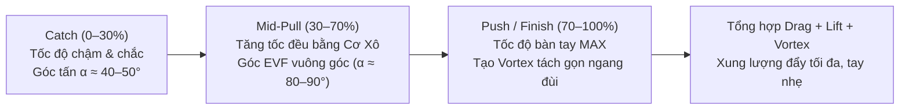

# Lực Đẩy, Lực Nâng (Bernoulli) & Hiệu Ứng Xoáy Nước

> **Thuộc phần:** `03-hydrodynamics/` | **Trình độ:** Trung cấp → Nâng cao | **Thời gian đọc:** ~12 phút

## Overview

Sau khi đã giảm tối đa lực cản, câu hỏi tiếp theo của bơi tốc độ là: **Bàn tay và cẳng tay thực sự tạo ra lực đẩy tiến về trước bằng cơ chế vật lý nào?** Bơi hiện đại không còn tranh cãi cực đoan giữa "kéo thẳng" hay "kéo chữ S" — mà kết hợp thông minh cả **Lực đẩy phản lực (Drag Propulsion)**, **Lực nâng thủy động (Lift Propulsion)** và **Cơ chế tạo xoáy (Vortex Shedding)** để giữ tay nhẹ nhưng tạo xung lượng tối đa.

- **Mục tiêu cốt lõi:** Hiểu cơ chế tạo lực của bàn tay + cẳng tay dưới nước, vai trò của góc tấn (*Angle of Attack*) và lý do cần **tăng tốc mượt từ Catch đến Push**.
- **Cảm giác đúng:** Áp lực nước tì đều, đặc và chắc trên toàn bộ lòng bàn tay và mặt trong cẳng tay; cảm giác "trượt người về trước" chứ không phải "cào nước bắn tung tóe".
- **Sai lầm phổ biến nhất:** Khép chặt các ngón tay cứng đờ, kéo giật mạnh ngay khi tay vừa vào nước rồi lại thả lỏng mất lực ở nửa sau pha đẩy.

---

## Theory

Trong thủy động lực học bơi hiện đại, lực đẩy tổng ($F_{\text{propulsion}}$) được tạo nên bởi **3 cơ chế bổ trợ nhau**:

1. **Lực đẩy dựa trên lực cản (Drag-Based Propulsion — Định luật III Newton)**:
   - Bàn tay và cẳng tay dựng vuông góc với hướng bơi (EVF) đẩy một khối nước trực tiếp về phía sau; phản lực đẩy cơ thể thẳng về phía trước.
   - Đóng góp **~65–75%** tổng lực đẩy ở pha kéo giữa (*Mid-Pull*) và pha đẩy kết thúc (*Push*).
2. **Lực nâng thủy động (Lift-Based Propulsion — Nguyên lý Bernoulli & Hiệu ứng Magnus)**:
   - Khi bàn tay di chuyển hơi chéo (pha vào nước–bắt nước *Catch* và pha *Insweep*) với **góc tấn (Angle of Attack)** khoảng `30–45°`, nước chảy qua mu bàn tay nhanh hơn lòng bàn tay, tạo chênh lệch áp suất sinh ra lực nâng vuông góc hướng về phía trước.
   - Đóng góp **~15–25%** tổng lực đẩy, đặc biệt quan trọng ở giai đoạn chuyển hướng không bị mất tốc độ (*Sculling*).
3. **Cơ chế xoáy không dừng (Unsteady Vortex Shedding — Cơ chế vây cá)**:
   - Khi bàn tay đổi hướng mượt mà và tăng tốc ở cuối pha đẩy (ngang hông), cạnh bàn tay tách ra một vòng xoáy nước (*Bound & Shed Vortex*) truyền xung lượng bổ sung về phía trước.

---

## Science

### Physics & Hydrodynamics

Phương trình lực đẩy kết hợp của mái chèo (bàn tay + cẳng tay):

$$F_{\text{hand+forearm}} = \frac{1}{2} \rho v_{\text{hand}}^2 A_{\text{paddle}} \sqrt{C_D(\alpha)^2 + C_L(\alpha)^2}$$

Trong đó $\alpha$ là **góc tấn (Angle of Attack)** của bàn tay so với dòng chảy tương đối:
- **Góc $\alpha \approx 40–50°$** (pha *Catch / Insweep*): Tối ưu hóa tổng hợp cả $C_L$ (lực nâng) lẫn $C_D$ (lực cản đẩy), giúp ôm nước "tĩnh" (nước chưa bị đẩy chuyển động).
- **Góc $\alpha \approx 75–90°$** (pha *Mid-Pull / Push*): Tối ưu hóa $C_D$ để đẩy trực diện ra sau với diện tích mái chèo lớn nhất ($A_{\text{paddle}}$ gồm **bàn tay + toàn bộ cẳng tay**).

#### Khám phá khoa học về khe hở ngón tay (*Optimal Finger Spacing*)
Các nghiên cứu CFD (*Computational Fluid Dynamics* — Lorente et al., Duke University) chứng minh:
- **Mở khe hở nhẹ giữa các ngón tay khoảng `5–10°` (2–4 mm)** thay vì ép chặt cứng các ngón tay giúp **tăng lực đẩy lên tới `8–10%`**!
- Lý do: Lớp biên nước dính (*Boundary Layer*) hình thành quanh mỗi ngón tay đóng vai trò như một "màng vô hình" lấp kín khe hở, làm tăng diện tích hiệu dụng $A_{\text{paddle}}$ mà lại giúp cơ bàn tay và cẳng tay **thả lỏng tự nhiên hơn**.

### Biomechanics

Để tối ưu hóa lực đẩy mà không làm mỏi cơ sớm, đường cong vận tốc bàn tay dưới nước phải tuân theo nguyên tắc **Tăng tốc lũy tiến (*Back-to-Front Acceleration*)**:
- **Đầu pha Catch (0–30%)**: Chậm, chắc, thiết lập góc EVF để bám vào nước tĩnh (*Still Water*).
- **Pha Pull (30–70%)**: Tăng tốc đều nhờ xoay hông và co rút cơ lưng rộng (Lat).
- **Pha Push / Finish (70–100%)**: Đạt vận tốc bàn tay lớn nhất khi duỗi cơ tam đầu (*Triceps*) đẩy nước qua hông — lúc này nước đã có vận tốc tương đối, nên tay bắt buộc phải nhanh hơn dòng nước thì mới tiếp tục sinh lực đẩy!

---

## Practical

### Why It Works

Hiểu đúng về **tăng tốc lũy tiến** và **khe hở ngón tay tự nhiên** thay đổi hoàn toàn cảm giác bơi:
- Bạn không còn phải gồng cứng bàn tay như "xẻng sắt" — bàn tay thư giãn nhẹ với khe ngón 2–4 mm vừa tạo lực đẩy lớn hơn, vừa cho phép các thụ thể cảm giác áp suất trên da lòng bàn tay hoạt động nhạy bén hơn.
- Tăng tốc mượt từ chậm đến nhanh ở cuối pha đẩy giúp cơ thể luôn giữ được cảm giác bám chắc vào khối nước đặc, không bị "hụt tay" (trượt nước) ở giữa pha kéo.

### Step-by-Step Execution & Water Cues

1. **Thả lỏng bàn tay ở tư thế tự nhiên**: Mở nhẹ các ngón tay cách nhau khoảng `2–4 mm` (độ rộng vừa bằng độ dày một chiếc thẻ ATM), cổ tay giữ thẳng trung tính (không bẻ gập quá mức ra sau hay vào trong).
2. **Dùng cả cẳng tay làm mái chèo**: Diện tích bàn tay chỉ khoảng `140–170 cm²`, nhưng khi dựng cẳng tay EVF đúng, diện tích mái chèo tăng gấp **~2.5 lần** (`350–420 cm²`).
3. **Nhịp kéo "Chậm → Vừa → Nhanh"**:
   - *Chậm* khi dựng cẳng tay ôm nước.
   - *Vừa* khi xoay hông kéo qua dưới ngực/vai.
   - *Nhanh & dứt khoát* khi đẩy qua ngang hông tới gần đùi.
4. **Kéo gần đường thẳng dưới vai (Biến thể chữ I mềm)**: Thay vì vẽ chữ S ngoằn ngoèo rộng gây lắc hông, giữ bàn tay di chuyển gần thẳng dọc dưới trục vai–hông với độ uốn tự nhiên nhẹ theo chuyển động xoay thân.

<!-- IMAGE_PROMPT: Technical fluid dynamics diagram showing three panels: (1) Hand & forearm EVF paddle area with velocity gradient arrows from slow catch to fast push; (2) Bernoulli lift & drag resultant vector at 45-degree angle of attack; (3) Close-up CFD visualization of relaxed hand with 3mm finger spacing showing boundary-layer bridging increasing effective paddle surface. -->

### Advanced Tips

- **Đừng đẩy tay quá dài lên trên mặt nước ở cuối pha Push**: Nếu tiếp tục ấn bàn tay hướng lên trên khi đã qua hông, bạn sẽ tạo ra lực đẩy hướng **xuống đáy** (làm chìm hông). Kết thúc lực đẩy ngay khi ngón cái lướt ngang túi quần/đùi, rồi lập tức chuyển sang thả lỏng Recovery.
- **Luyện cảm giác "nước đặc" bằng Sculling**: Các VĐV Olympic dành 10–15% thời lượng khởi động cho Sculling ở cả 3 vị trí (trước đầu, giữa ngực, ngang hông) để tinh chỉnh góc tấn $\alpha$ của bàn tay đến từng độ.

---

## Drills

| Tên Drill | Mục tiêu tạo lực đẩy | Cự ly / Số hiệp | Cảm giác đúng (Cue) |
| :--- | :--- | :--- | :--- |
| **3-Position Sculling** | Tối ưu hóa góc tấn $\alpha$ và cảm nhận lực nâng Bernoulli | `3 × 25m` (Front, Mid, Rear Scull) | Cơ thể tự trôi tiến về trước ổn định dù không hề quạt tay |
| **Fist → Finger-Spread Progression** | Cảm nhận sự bùng nổ diện tích mái chèo & khe hở ngón tay 3mm | `4 × 50m` (25m nắm đấm + 25m tay thả lỏng mở nhẹ ngón) | Lòng bàn tay và cẳng tay ôm chặt khối nước đặc, số sải giảm tức thì |
| **Accelerating Pull (Chậm → Nhanh)** | Luyện đường cong vận tốc lũy tiến đến pha Push | `6 × 25m` (kèm Pull Buoy) | Nhẩm trong đầu nhịp *"Ôm... Kéo... ĐẨY!"*, nước văng gọn ra sau hông |

### Hướng dẫn nhanh
- **3-Position Sculling**: Dùng ống thở (Snorkel) và Pull Buoy để không phải lo nhịp thở.
  - 25m đầu (*Front Scull*): Hai tay vươn trước vai, khuỷu cao, lắc cẳng tay và bàn tay hình số 8 nhỏ để kéo thân tiến tới.
  - 25m tiếp (*Mid Scull*): Cẳng tay dựng thẳng dưới ngực (EVF), lắc nhẹ cảm nhận lực tì cực đại vào cơ xô.
  - 25m cuối (*Rear Scull*): Tay đặt dọc ngang hông, xoay cổ tay và bàn tay tạo lực đẩy tiến từ pha Push.

---

## AI Analysis

- **Góc quay khuyến nghị:** Ngang dưới nước (Underwater Side View, 120 fps) để vẽ quỹ đạo bàn tay (*Hand Path Trajectory*) và đồ thị vận tốc bàn tay theo thời gian $v_{\text{hand}}(t)$.
- **Keypoints cần trích xuất:** `shoulder`, `elbow`, `wrist`, `index_finger_tip`.
- **Ngưỡng phát hiện lỗi tự động:**
  - **Đạt chuẩn:** Đồ thị $v_{\text{hand}}(t)$ tăng dần đều từ Catch đến Push ($v_{\text{push}} / v_{\text{catch}} \approx 1.6–2.2$); điểm cổ tay rút khỏi nước nằm ngang hông/đùi trên.
  - **Cảnh báo lỗi:** Đỉnh vận tốc bàn tay xảy ra ngay ở 20% đầu pha kéo (lỗi giật tay gây trượt nước); bàn tay rời nước sớm ngay dưới rốn (cắt cụt pha Push, mất 25–30% lực đẩy).

---

## Common Errors

| Lỗi thường gặp | Triệu chứng nhận biết | Nguyên nhân gốc | Cách sửa (Correction) |
| :--- | :--- | :--- | :--- |
| **Giật mạnh đầu pha kéo, hụt lực cuối pha** | Bọt khí quấn quanh tay ngay khi bắt nước, tốc độ không bứt | Dùng sức đột ngột trước khi kịp dựng cẳng tay ôm nước tĩnh | Tập Accelerating Pull: chậm–chắc ở Catch, tăng tốc mạnh ở Push |
| **Cắt cụt pha đẩy (Short Finish)** | Tay rút khỏi nước ngay ngang rốn/thắt lưng | Vội vàng đưa tay lên thở hoặc thiếu sức mạnh cơ tam đầu | Quẹt nhẹ ngón cái chạm mép đùi trước khi nhấc khuỷu ra khỏi nước |
| **Khép ngón tay quá gồng hoặc xòe quá rộng** | Cẳng tay nhanh mỏi hoặc cảm giác nước lọt qua kẽ tay | Hiểu sai giữa "thả lỏng mở nhẹ 2–4mm" và "xòe bàn tay căng" | Giữ bàn tay thư giãn tự nhiên như lúc buông thõng khi đứng |
| **Kéo chữ S quá rộng (Over-Sculling)** | Hông lắc mạnh sang hai bên, đường bơi ngoằn ngoèo | Cố tình vẽ đường cong lớn sang ngang thay vì đẩy ra sau | Giữ bàn tay kéo gọn trong hành lang từ vai thẳng xuống hông |

---

## Self Assessment

- [ ] Tôi giữ bàn tay thả lỏng tự nhiên với khe ngón nhỏ (~2–4 mm) thay vì gồng cứng.
- [ ] Tôi cảm nhận rõ áp lực nước tì lên cả **mặt trong cẳng tay**, không chỉ riêng lòng bàn tay.
- [ ] Nhịp kéo của tôi tăng tốc mượt từ Catch → Mid-Pull → Push, không bị giật cục ở đầu pha.
- [ ] Ngón cái của tôi luôn đi hết hành trình ngang đùi/hông trước khi chuyển sang pha rút tay.
- [ ] Tôi thực hiện được bài Front & Mid Sculling tiến về trước ổn định mà không cần đập chân.

---

## KPI

| Chỉ số (Metric) | Người mới | Trung cấp | Nâng cao (`< 1:30/100m`) |
| :--- | :---: | :---: | :---: |
| **Tỷ lệ vận tốc tay ($v_{\text{push}} / v_{\text{catch}}$)** | `< 1.0` (nhanh đầu, chậm cuối) | `1.2–1.5` | `1.6–2.2` (tăng tốc mượt) |
| **Tốc độ Front Sculling 25m (không đập chân)** | `> 45 giây` | `32–40 giây` | `< 30 giây` |
| **Độ dài pha kéo dưới nước (Entry → Finish)** | Cắt cụt ngang ngực/rốn | Qua hông | Hoàn tất gọn ngang đùi trên |
| **DPS trung bình (bể 25m, pace thoải mái)** | `< 1.1 m/sải` | `1.2–1.4 m/sải` | `1.5–1.9+ m/sải` |

---

## FAQ

**1. Nên kéo tay theo đường thẳng (chữ I) hay đường cong (chữ S)?**
Khoa học bơi hiện đại cho thấy cả hai đều hội tụ ở một nguyên lý chung: **nhìn từ dưới lên, bàn tay luôn có độ uốn nhẹ tự nhiên quanh trục vai–hông** do cơ thể xoay trục `30–45°`. Đừng cố vẽ chữ S rộng sang ngang (gây lắc hông và giảm hiệu suất đẩy trực tiếp), hãy tập trung giữ cẳng tay dựng thẳng EVF đẩy nước về sau.

**2. Tại sao tôi tập Fist Swim lại bơi rất chậm, như vậy có đúng không?**
Đúng! Fist Swim cố tình lấy đi ~40% diện tích mái chèo của bàn tay để buộc hệ thần kinh của bạn phải tìm cách dựng cẳng tay (EVF) tạo lực đẩy. Giá trị thực sự của bài tập nằm ở 25m **ngay sau đó** khi bạn mở tay ra và giữ nguyên góc cẳng tay vừa học được.

**3. Khép hờ ngón tay hay mở nhẹ ngón tay có khác biệt khi bơi nước rút (Sprint) không?**
Ở cả đường dài lẫn nước rút, mở khe cực nhẹ tự nhiên (`2–4 mm`, không xòe rộng) đều tối ưu nhờ hiệu ứng lớp biên chất lưu (*Boundary Layer*) và giảm căng cơ cẳng tay.

---

## Summary

- Lực đẩy bơi sải hiện đại kết hợp **Drag Propulsion (~70%)**, **Bernoulli Lift (~20%)** và **Vortex Shedding (~10%)**.
- Dựng cẳng tay sớm (EVF) tăng diện tích mái chèo gấp `2.5 lần`; thả lỏng bàn tay với khe ngón `2–4 mm` tăng thêm `8–10%` lực đẩy hiệu dụng.
- Luôn tuân thủ quy luật **tăng tốc lũy tiến** (*Chậm ở Catch → Vừa ở Mid-Pull → Nhanh ở Push*) và hoàn tất pha đẩy ngang đùi.

**Liên kết chéo:**
- Chương trước: [Giảm Lực Cản Thủy Động](drag-reduction.md)
- Chương tiếp theo (Phase 3): [Tư Thế Thân Ngang & Trục Đầu–Hông](../04-body-position/body-position-and-alignment.md)
- Kỹ thuật liên quan: [High Elbow Catch (EVF)](../09-catch/early-vertical-forearm.md) · [Pha Kéo & Pha Đẩy](../10-pull/pull-and-push-phase.md) · [Sculling Drill](../17-drills/sculling.md)
- Tra cứu thuật ngữ: [Glossary](../24-appendix/glossary.md)

---

## References

1. Lorente, S., Cetkin, E., Bello-Ochende, T., Meyer, J. P., & Bejan, A. (2012). *The constructal-law physics of why swimmers must spread their fingers and toes*. Journal of Theoretical Biology, 308, 141–146.
2. Sanders, R. H. (1999). *Hydrodynamic characteristics of a swimmer's hand*. Journal of Applied Biomechanics, 15(1), 3–26.
3. Gourgoulis, V., et al. (2014). *Effect of hand orientation on propulsion during front crawl swimming*. Journal of Biomechanics.
4. Maglischo, E. W. (2003). *Swimming Fastest*. Human Kinetics.

