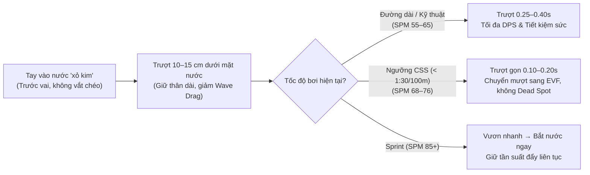

# Cân Bằng Nổi & Pha Trượt (*Balance & Glide*)

> **Thuộc phần:** `04-body-position/` | **Trình độ:** Cơ bản → Nâng cao | **Thời gian đọc:** ~11 phút

## Tổng Quan (Overview)
Sự khác biệt dễ nhận ra nhất giữa người bơi "vất vả" và người bơi "lướt đi nhẹ tênh" nằm ở **khả năng cân bằng ở tư thế nghiêng và kiểm soát pha trượt (*Glide*)**. Trượt không có nghĩa là dừng hẳn lại mất tốc độ — mà là khoảnh khắc **kéo dài thân tàu (`10–15 cm` dưới mặt nước)** để tận dụng tối đa quán tính từ sải kéo của tay đối diện trước khi bắt đầu tì nước EVF.

- **Mục tiêu cốt lõi:** Làm chủ độ sâu trượt `10–15 cm`, duy trì cân bằng ổn định ở góc nghiêng `30–45°` và căn đúng thời lượng trượt theo từng tốc độ bơi.
- **Cảm giác đúng:** Cánh tay trước lướt thẳng như mũi giáo xuyên qua làn nước êm, thân người không bị chao đảo hay chìm xuống khi tay đối diện đang rút trên không.
- **Sai lầm phổ biến nhất:** Trượt quá lâu làm vận tốc rơi về 0 (*Dead Spot*), hoặc ấn tay trượt sâu xuống đáy ngay khi đầu xoay lấy hơi.

---

## Lý Thuyết (Theory)
Trong bơi sải, pha **Glide (Trượt)** là cầu nối giữa pha vào nước (*Hand Entry*) và pha bắt nước (*Catch / EVF*). Nó đảm nhiệm đồng thời 3 chức năng thủy động và cơ sinh học:
1. **Dịch chuyển Trọng tâm (COG) về phía trước**: Giữ một cánh tay vươn dài phía trước giúp hông tự nổi ngang mặt nước (xem [COG & COB](../01-foundation/center-of-gravity-and-buoyancy.md)).
2. **Tăng chiều dài thân tàu hiệu dụng ($L$)**: Giảm lực cản sóng (*Wave Drag*) ngay trong khoảnh khắc tay đối diện đang thực hiện pha đẩy mạnh nhất (*Push*).
3. **Ổn định hệ trục nghiêng (*Side-Balance*)**: Cánh tay trượt hoạt động như sống thuyền (*Keel*) giữ thân không bị lật khi xoay `30–45°` sang lấy hơi.

---

## Cơ Sở Khoa Học (Science)
### Vật Lý & Thủy Động Lực Học (Physics & Hydrodynamics)
Thời lượng pha Glide phải tỷ lệ nghịch với vận tốc bơi để tránh **sụt giảm vận tốc trong chu kỳ (*Intra-cyclic Velocity Variation — IVV*)**:
- Khi bơi đường dài / kỹ thuật (`1:45–2:00/100m`, `SPM 55–65`): Pha trượt kéo dài khoảng **`0.25–0.40 giây`** giúp tối ưu hóa DPS và tiết kiệm năng lượng tối đa.
- Khi bơi tốc độ ngưỡng CSS (`1:25–1:35/100m`, `SPM 68–76`): Pha trượt rút gọn còn **`0.10–0.20 giây`** — vừa đủ để duỗi thẳng tay hoàn toàn, lấy vị trí đặt nước ổn định rồi chuyển mượt sang EVF ngay trước khi vận tốc kịp giảm.
- Khi bơi nước rút Sprint (`< 1:10/100m`, `SPM 85–100+`): Pha trượt gần như **`0 giây`** (chỉ có pha vươn nhanh *Extension* rồi lập tức tì nước).

#### Độ sâu trượt chuẩn `10–15 cm` dưới mặt nước
- Nếu trượt **quá nông (`0–5 cm`)**: Cánh tay nằm ngay tại lớp nhiễu loạn sóng bề mặt và dễ kéo bọt khí xuống pha Catch.
- Nếu trượt **quá sâu (`> 25–30 cm`)**: Tạo lực nâng giả ở vai làm chìm hông, đồng thời buộc vai phải vươn ở góc bất lợi khi dựng cẳng tay EVF.
- Vùng ngọt (**Sweet Spot**): **`10–15 cm` dưới mặt nước**, song song hoàn toàn với mặt hồ (ngón tay chỉ thẳng về trước, không chúc sâu xuống đáy).

### Cơ Sinh Học (Biomechanics)
Khi tay phải trượt ở phía trước trong tư thế nghiêng thân `35–45°`:
- Khớp vai được vươn dài nhờ **xoay lồng ngực** (cơ răng trước *Serratus Anterior* kích hoạt giữ bả vai ổn định), không phải nhờ nhún vai sát tai.
- Bàn tay và cẳng tay hoàn toàn thả lỏng ở trạng thái chờ (*Patient Lead Arm*), tiết kiệm năng lượng cho khoảnh khắc dựng EVF.

---

## Thực Hành (Practical)
### Tại Sao Kỹ Thuật Này Hiệu Quả (Why It Works)
Một pha trượt kiểm soát tốt ở độ sâu `10–15 cm` giúp bạn tận dụng trọn vẹn động năng sinh ra từ pha đẩy (*Push*) của tay đối diện. Thay vì vội vàng kéo tay trước xuống khi tay sau vẫn đang đẩy (gây trùng pha và tăng lực cản), bạn để cơ thể **lướt trọn vẹn trên lực đẩy vừa tạo ra**, nhờ đó mỗi sải đi xa hơn mà số lần quạt tay ít đi.

### Hướng Dẫn Từng Bước & Cảm Giác Nước (Step-by-Step & Water Cues)
1. **Vươn thẳng qua "ô cửa nhỏ"**: Tưởng tượng có một ô cửa nhỏ nằm dưới mặt nước `10–15 cm` ngay trước vai bạn; đưa bàn tay và cẳng tay chui ngọt qua đúng ô cửa đó.
2. **Giữ tay trượt kiên nhẫn khi xoay thở**: Khi bạn xoay đầu sang phải lấy hơi, tay trái ở phía trước phải **giữ nguyên độ sâu `10–15 cm`** như đang đặt trên một mặt bàn vô hình — tuyệt đối không ấn tay trái xuống đáy để "chống người lên thở"!
3. **Cảm giác "lướt trên đường ray"**: Đầu ngón tay hướng thẳng về phía tường đích, lòng bàn tay hơi úp xuống đáy, toàn bộ cánh tay duỗi tự nhiên nhưng không khóa gồng khuỷu tay cứng đờ.
4. **Chuyển pha không khựng**: Ngay khi tay đối diện đi qua ngang vai trong pha rút tay trên không, tay trượt phía trước bắt đầu uốn nhẹ cổ tay và dựng cẳng tay EVF.

<!-- IMAGE_PROMPT: Technical underwater side view of a freestyle swimmer in 40-degree body roll showing the lead arm gliding horizontally in the green 10-15cm depth Sweet Spot zone parallel to the surface, contrasted with red dashed arrows indicating common errors of shallow surface slapping and deep downward pressing. -->

### Mẹo Nâng Cao (Advanced Tips)
- **Nhận diện "Dead Spot" (Điểm chết tốc độ)**: Nếu bạn cảm thấy cơ thể gần như dừng lại rồi mới phải rướn sức kéo lại từ đầu ở mỗi sải, bạn đang trượt quá lâu (*Over-gliding*). Hãy đẩy thời điểm bắt đầu Catch lên sớm hơn khoảng `0.1 giây` (chuyển từ *Full Catch-Up* sang *3/4 Catch-Up / Front-Quadrant*).
- **Kiểm tra cân bằng nghiêng bằng tai**: Trong pha trượt nghiêng, giữ mặt bên của đầu tựa êm lên nước như đang nằm gối đầu lên cánh tay dưới; không nhấc tai rời khỏi nước.

---

## Bài Tập Thực Hành (Drills)
| Tên Drill | Mục tiêu cân bằng & trượt | Cự ly / Số hiệp | Cảm giác đúng (Cue) |
| :--- | :--- | :--- | :--- |
| **Side-Glide Kick (Trượt nghiêng 45°)** | Xây dựng sự ổn định tuyệt đối của tay trượt và trục hông | `6 × 25m` (đổi bên mỗi 25m) | Tay dưới vươn dài `10–15 cm` dưới nước, hông nổi cao, xoay nhẹ cằm lên là thở được ngay |
| **3/4 Catch-Up Drill** | Tìm điểm cân bằng giữa độ dài trượt và không bị Dead Spot | `4 × 50m` (nghỉ 20s) | Tay trượt bắt đầu Catch ngay khi tay rút trên không vừa vượt qua ngang tai |
| **Superman-to-Side Roll** | Luyện chuyển đổi từ cân bằng sấp sang cân bằng nghiêng mượt mà | `4 × 25m` (kèm chân vịt ngắn) | Đạp 6 nhịp sấp → xoay mượt sang nghiêng 45° không làm chìm hông |

### Hướng dẫn nhanh
- **Side-Glide Kick**: Nằm nghiêng `45°` sang phải, tay phải vươn thẳng trước mặt ở độ sâu `10–15 cm`, tay trái đặt thoải mái dọc đùi trái. Mắt nhìn thẳng xuống đáy hồ, đạp chân nhẹ từ hông. Khi cần thở, **chỉ xoay đầu thêm một chút theo trục cột sống** (giữ nguyên tay phải không ấn xuống), hít gọn rồi úp mặt nhìn đáy lại.

---

## Phân Tích AI & Video (AI Analysis)
- **Góc quay khuyến nghị:** Ngang dưới nước (Underwater Side View) để đo độ sâu trượt (`lead_wrist_depth_cm`) và thời lượng pha Glide (`t_glide_sec`).
- **Keypoints cần trích xuất:** `lead_shoulder`, `lead_elbow`, `lead_wrist`, `waterline_y`, `recovery_elbow`.
- **Ngưỡng phát hiện lỗi tự động:**
  - **Đạt chuẩn:** `lead_wrist_depth_cm` ổn định trong khoảng `10–18 cm` suốt pha Glide; khi `recovery_elbow` đi ngang qua đầu, `lead_wrist` bắt đầu chuyển xuống dựng EVF.
  - **Cảnh báo lỗi:** `lead_wrist_depth_cm > 30 cm` ngay tại khung hình bắt đầu thở (lỗi ấn tay trượt để nâng đầu); `t_glide_sec > 0.50 s` ở pace `< 1:40/100m` (lỗi Over-gliding tạo Dead Spot).

---

## Lỗi Thường Gặp & Cách Sửa (Common Errors)
| Lỗi thường gặp | Triệu chứng nhận biết | Nguyên nhân gốc | Cách sửa (Correction) |
| :--- | :--- | :--- | :--- |
| **Ấn tay trượt xuống sâu khi thở** | Đầu nhô cao, hông tụt xuống, mất hoàn toàn pha EVF bên đó | Thiếu cân bằng nghiêng, dùng tay trượt làm "phao chống" | Tập Side-Glide Kick với chân vịt ngắn, giữ tay trước bất động trên "mặt bàn nước" |
| **Trượt quá lâu (Over-Gliding / Dead Spot)** | Bơi kiểu Catch-Up cứng nhắc, tốc độ trồi sụt rõ rệt | Bắt chước bài tập Catch-Up Drill áp dụng nguyên xi vào bơi tốc độ | Chuyển sang nhịp 3/4 Catch-Up; bắt nước ngay khi tay hồi đi ngang đầu |
| **Trượt nổi sát mặt nước (0–5 cm)** | Bàn tay lướt trên bọt sóng, cảm giác hẫng khi bắt nước | Không xuyên đầu ngón tay xuống đủ độ sâu sau Entry | Tập "xỏ kim" chếch nhẹ xuống độ sâu `10–15 cm` rồi mới duỗi ngang |
| **Đầu ngón tay hướng lên trên (Braking)** | Lòng bàn tay hướng về phía trước như tấm bảng phanh nước | Cổ tay bẻ ngược lên khi vươn quá căng | Thả lỏng cổ tay phẳng thẳng hàng với cẳng tay, đầu ngón tay chỉ thẳng đích |

---

## Tự Đánh Giá Tại Hồ (Self Assessment)
- [ ] Tôi có thể nằm nghiêng 45° (Side-Glide Kick) suốt 25m mỗi bên mà không bị chìm hông hay mất thăng bằng.
- [ ] Tay trượt phía trước của tôi duy trì ổn định độ sâu `10–15 cm` dưới mặt nước, ngay cả khi tôi xoay đầu thở.
- [ ] Cổ tay và bàn tay tôi thẳng hàng, thả lỏng (không bẻ ngược lên gây phanh nước) trong pha trượt.
- [ ] Tôi không bị khựng tốc độ (Dead Spot) giữa các sải khi bơi ở ngưỡng `< 1:35/100m`.
- [ ] Tôi cảm nhận rõ cơ thể trượt êm về phía trước dựa trên quán tính từ tay đẩy đối diện.

---

## Chỉ Số Đo Lường (KPI)
| Chỉ số (Metric) | Người mới | Trung cấp | Nâng cao (`< 1:30/100m`) |
| :--- | :---: | :---: | :---: |
| **Độ sâu trượt của tay trước** | `0–5 cm` hoặc `> 30 cm` | `15–22 cm` | `10–15 cm` ổn định |
| **Độ tụt tay trượt khi xoay thở** | `> 20 cm` | `8–15 cm` | `< 5 cm` |
| **Thời lượng Glide ở tốc độ CSS** | `0 s` (kéo đuổi) hoặc `> 0.5 s` | `0.20–0.30 s` | `0.10–0.20 s` |
| **Side-Glide Kick 25m liên tục (không chân vịt)** | Khó giữ > 10m | Đạt 25m còn chao đảo | Đạt 25m êm, thẳng trục 2 bên |

---

## Câu Hỏi Thường Gặp (FAQ)
**1. Tổng thời gian trượt nên dài hay ngắn nếu tôi muốn bơi `< 1:30/100m`?**
Ngắn và sắc (`0.10–0.20 giây`). Mục tiêu ở tốc độ `< 1:30/100m` là **duỗi hết tầm tay để đạt chiều dài thân tàu tối đa rồi lập tức dựng cẳng tay EVF**, không nằm chờ cho vận tốc giảm xuống.

**2. Tại sao tôi tập Total Immersion (trượt rất dài) thấy bơi rất nhẹ nhưng lại không tăng tốc được?**
Total Immersion cực kỳ xuất sắc để sửa tư thế, giảm cản và xây cảm giác cân bằng ở giai đoạn đầu. Tuy nhiên, nếu giữ pha trượt quá dài khi muốn bơi nhanh, bạn sẽ rơi vào hiện tượng *Over-gliding* (Dead Spot) và nhịp SPM quá thấp (`< 55`). Khi đã cân bằng tốt, hãy rút ngắn pha trượt để chuyển sang **Front-Quadrant tốc độ**.

**3. Nên giữ khuỷu tay thẳng 100% khi trượt không?**
Duỗi dài tự nhiên khoảng `95%` (mềm khớp khuỷu, không khóa khớp gồng cứng) để ngay lập tức có thể gập nhẹ cổ tay và khuỷu tay sang pha EVF mà không bị giật cục.

---

## Tóm Tắt (Summary)
- Pha **Glide** đúng chuẩn diễn ra ở độ sâu **`10–15 cm` dưới mặt nước**, giúp kéo dài thân tàu ($L$), dịch COG về trước và giảm Wave Drag.
- Giữ tay trượt ổn định như "đặt trên mặt bàn vô hình" trong lúc xoay thở — tuyệt đối không ấn tay trượt xuống đáy.
- Điều chỉnh thời lượng Glide linh hoạt theo tốc độ: dài hơn (`0.25–0.40s`) khi bơi đường dài và gọn sắc (`0.10–0.20s`) khi hướng tới `< 1:30/100m`.

**Liên kết chéo:**
- Chương trước: [Kỹ Thuật Streamline](streamline.md)
- Chương tiếp theo: [Kích Hoạt Core](../05-core/core-engagement.md)
- Kỹ thuật liên quan: [Front-Quadrant & Nhịp Điệu](../12-rhythm/rhythm-and-timing.md) · [Catch-Up Drill](../17-drills/catch-up.md)
- Tra cứu thuật ngữ: [Glossary](../24-appendix/glossary.md)

---

## Tài Liệu Tham Khảo (References)
1. Laughlin, T. (2004). *Total Immersion*. Fireside.
2. Newsome, P., & Young, A. (2012). *Swim Smooth*. Wiley.
3. Chollet, D., Chalies, S., & Chatard, J. C. (2000). *A new index of coordination for the crawl: description and usefulness*. International Journal of Sports Medicine, 21(1), 54–59.

