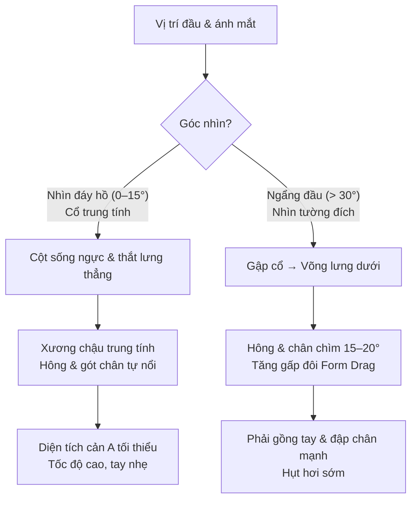
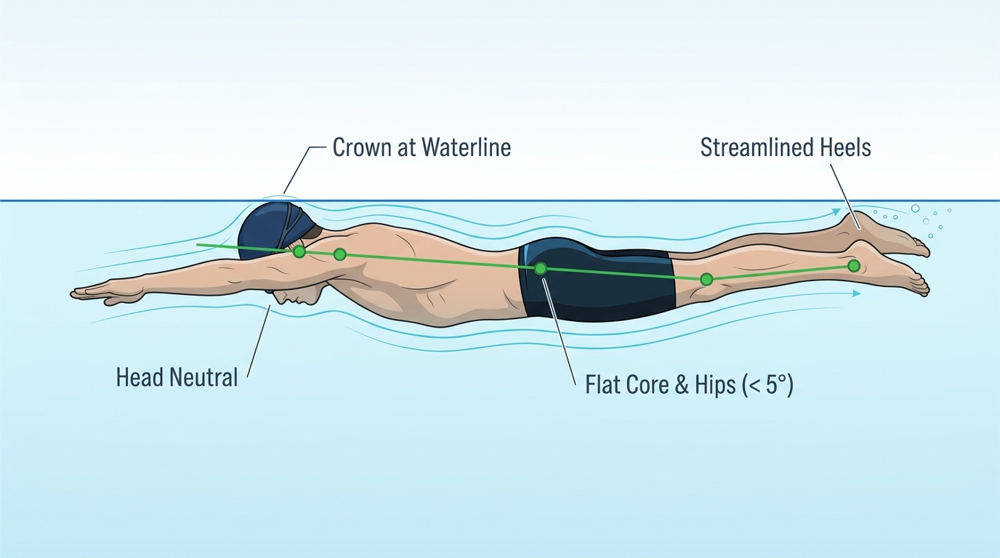

# Tư Thế Thân Ngang & Trục Đầu–Hông (*Body Position & Alignment*)

> **Thuộc phần:** `04-body-position/` | **Trình độ:** Cơ bản → Nâng cao | **Thời gian đọc:** ~11 phút

## Overview

Mọi kỹ thuật tay và chân trong bơi sải đều chỉ phát huy tối đa tác dụng khi được xây trên một **khung thân ngang, thẳng trục và ổn định**. Nếu đầu ngẩng cao 10 cm, hông lập tức rơi xuống 20–30 cm, biến cơ thể từ một chiếc thuyền kayak thuôn dài thành một chiếc sà lan chắn nước. Chương này hướng dẫn cách thiết lập tư thế thân ngang chuẩn mực để bơi nhanh hơn mà tay nhẹ hơn.

- **Mục tiêu cốt lõi:** Duy trì trục thẳng `Đỉnh đầu → Cột sống cổ → Cột sống ngực → Xương chậu → Gót chân` song song mặt nước (`< 5°`).
- **Cảm giác đúng:** Đỉnh đầu chẻ nước nhẹ, vùng gáy có dòng nước chảy qua êm ái, lưng trên và gót chân thỉnh thoảng chạm nhẹ mặt nước.
- **Sai lầm phổ biến nhất:** Nhìn chếch lên thành bể phía trước làm gập đốt sống cổ và đánh sập toàn bộ trục hông–chân.

---

## Theory

Trong hình học thủy động lực học, cơ thể người bơi được mô hình hóa như một **trục trụ dài (Longitudinal Axis)** xoay quanh đường nối từ đỉnh đầu tới giữa hai mắt cá chân.

Tư thế thân lý tưởng đạt được khi thỏa mãn đồng thời 3 điều kiện:
1. **Cân bằng dọc (Longitudinal Balance)**: Góc nghiêng giữa đường thẳng `vai → cổ chân` với mặt nước tiến về `0–5°` (dựa trên nguyên lý cân bằng [COG & COB](../01-foundation/center-of-gravity-and-buoyancy.md)).
2. **Thẳng trục ngang (Lateral Alignment)**: Không có sự bẻ gập ngang ở cổ hoặc thắt lưng; đường trục giữa cơ thể không bị uốn hình chữ S (*snaking / fishtailing*).
3. **Chiều cao thân tối ưu (Ride Height)**: Cơ thể nổi đủ cao sát mặt nước để dễ xoay thở và rút tay gọn, nhưng phần đầu và ngực vẫn chìm đủ sâu để giữ hông nổi ngang mặt nước.

---

## Science

### Physics & Hydrodynamics

Diện tích mặt cắt ngang cản nước ($A$) phụ thuộc trực tiếp vào góc nghiêng thân ($\theta$):

$$A(\theta) \approx A_0 \cos\theta + L \cdot w \cdot \sin\theta$$

- Với người cao $L = 1.75\text{ m}$, bề rộng thân $w = 0.35\text{ m}$, diện tích mặt cắt lý tưởng $A_0 \approx 0.085\text{ m}^2$:
  - Ở góc thân chuẩn **$\theta = 3°$**: $A \approx 0.117\text{ m}^2$.
  - Ở góc thân chìm **$\theta = 15°$** (chỉ do ngẩng đầu nhìn trước): $A \approx 0.241\text{ m}^2$ (**tăng hơn gấp đôi lực cản hình học Form Drag!**).
- Theo phương trình công suất [Vật lý bơi](../01-foundation/physics-of-swimming.md), tăng gấp đôi $A$ đồng nghĩa bạn phải tiêu hao **gấp đôi năng lượng** để giữ cùng một tốc độ.

### Biomechanics

- **Tư thế đầu & cột sống cổ (*Neutral Cervical Spine*)**: Đầu nặng `4.5–5.5 kg`. Khi ngẩng đầu nhìn thẳng về trước, cơ dựng sống cổ (*Cervical Extensors*) co cứng, kéo cong cột sống thắt lưng theo phản xạ chuỗi động học (*Lordosis*), làm giãn cơ bụng và đánh rơi hông.
- **Khóa xương chậu trung tính (*Neutral Pelvis*)**: Xoay nhẹ xương chậu ra sau (*Slight Posterior Pelvic Tilt*) bằng cơ bụng dưới và cơ mông nhẹ giúp làm phẳng đường cong thắt lưng, biến cột sống thành một thanh dẫn lực liên tục.

---

## Practical

### Why It Works

Khi trục đầu–hông nằm phẳng `< 5°`, nước tách đều qua đỉnh đầu (*Crown of the Head*), tạo ra sóng mũi (*Bow Wave*) mượt mà giúp bạn xoay thở dễ dàng mà không cần nhấc đầu. Cơ thể trở thành một "khung cứng thuôn dài", cho phép mỗi lực đẩy từ tay và hông chuyển hóa trực tiếp thành quãng đường tiến tới (DPS).

### Step-by-Step Execution & Water Cues

1. **Định vị đường nước trên đầu**: Mặt nước phải cắt ngang qua **đỉnh trán / đường chân tóc** (giữa trán đến đỉnh đầu), không bao giờ nằm dưới lông mày hay ở mũi.
2. **Định hướng ánh mắt**: Nhìn thẳng xuống gạch đáy hồ ngay bên dưới cằm (hoặc chếch nhẹ tối đa `10–15°` về phía trước ở tốc độ cao).
3. **Kéo dài cột sống (*Tall Posture*)**: Tưởng tượng có một sợi dây vô hình kéo nhẹ đỉnh đầu về phía tường đích và một sợi dây khác kéo hai mũi bàn chân về phía tường ngược lại.
4. **Cảm nhận gót chân "quét mặt nước"**: Khi bơi đúng tư thế, gót chân và phần mông trên thỉnh thoảng phá nhẹ mặt nước mà không cần cố đá mạnh.

<!-- IMAGE_PROMPT: Technical underwater side profile of an elite freestyle swimmer showing a straight laser reference line passing through ear, shoulder, hip, knee, and ankle at < 5 degrees to the water surface, with waterline crossing the crown of the head and subtle bow wave pocket beside the cheek. -->

### Advanced Tips

- **Bơi tốc độ cao (`< 1:25/100m`) vs Đường dài (`1:35–1:50/100m`)**: Ở tốc độ rất cao (Sprint), lực nâng thủy động tự nhiên đẩy phần vai và ngực cao hơn một chút (*Hydroplaning*), nên VĐV Sprint có thể nhìn chếch về trước `15–20°` mà hông vẫn nổi. Với người bơi dưới ngưỡng đó, nhìn thẳng đáy hồ `0–10°` luôn an toàn và hiệu quả hơn.
- **Dùng ống thở trung tâm (Center Snorkel)**: Tập 200–400m đầu buổi với Snorkel để tách hoàn toàn yếu tố xoay thở ra khỏi việc cảm nhận trục đầu–hông chuẩn.

---

## Drills

| Tên Drill | Mục tiêu tư thế | Cự ly / Số hiệp | Cảm giác đúng (Cue) |
| :--- | :--- | :--- | :--- |
| **Snorkel Alignment Swim** | Khóa cố định trục đầu–cột sống–hông không bị nhiễu bởi hơi thở | `4 × 50m` (nghỉ 15s) | Đầu hoàn toàn bất động như gắn trên trục quay, gót chân lướt sát mặt nước |
| **Head-Position Contrast** | Tự trải nghiệm tác động tức thời của góc nhìn lên độ chìm hông | `3 × 50m` (25m nhìn trước → 25m nhìn đáy) | Sự khác biệt rõ rệt: ngay khi hạ mắt nhìn đáy, cảm giác nặng ở đùi biến mất |
| **Wall Posture Check (Dryland)** | Thiết lập trí nhớ tư thế cột sống trung tính trước khi xuống hồ | `2 phút` trước buổi bơi | Đứng áp lưng vào tường: gót, mông, bả vai và gáy chạm tường; giữ bụng phẳng |

### Hướng dẫn nhanh
- **Head-Position Contrast**: Bơi 12.5m đầu cố tình nhìn thẳng về phía tường đích (cảm nhận ngay phần chân tụt sâu và tay phải kéo nặng nề). Ở giữa bể, hạ mắt nhìn thẳng xuống gạch đen đáy hồ và ấn nhẹ ngực — lập tức cảm nhận hông nổi vọt lên và thân lướt nhẹ hẳn.

---

## AI Analysis

- **Góc quay khuyến nghị:** Ngang dưới nước (Underwater Side View) và Trên cao (Overhead View).
- **Keypoints cần trích xuất:** `ear`, `shoulder`, `hip`, `knee`, `ankle`, đường mặt nước (`waterline_y`).
- **Ngưỡng phát hiện lỗi tự động:**
  - **Đạt chuẩn:** Góc đầu–vai–hông `172–180°`; góc vai–hông–cổ chân `170–180°`; độ lệch trục ngang đầu so với hông từ góc trên cao `< 5 cm`.
  - **Cảnh báo lỗi:** Góc cổ gập ra sau `> 25°`; độ sâu `hip_y` thấp hơn `shoulder_y` quá `15 cm`.

---

## Common Errors

| Lỗi thường gặp | Triệu chứng nhận biết | Nguyên nhân gốc | Cách sửa (Correction) |
| :--- | :--- | :--- | :--- |
| **Nhìn về phía trước tường** | Đau gáy, sóng đánh vào trán, chân chìm sâu | Sợ đụng tường hoặc thói quen bơi ếch/bơi đầu nổi | Nhìn thẳng đáy hồ, đếm nhịp từ vạch chữ T cách tường 2m |
| **Cúi đầu gập cằm sát ngực** | Ngạt mũi, vai chìm quá sâu, khó xoay thở | Hiểu sai "nhìn xuống" thành "cúi gập cổ" | Giữ khoảng cách 1 nắm tay giữa cằm và xương ức, giữ cổ thẳng hàng lưng |
| **Lắc đầu theo từng sải tay** | Đường bơi ngoằn ngoèo, chóng mặt khi bơi xa | Đầu bị kéo xoay theo vai thay vì giữ cố định trên trục dọc | Tưởng tượng có 1 quả bóng tennis đặt trên đỉnh đầu, chỉ xoay vai quanh trục cổ |
| **Chìm hông do võng lưng** | Bụng ưỡn xuống đáy, mông thấp dù đầu đã nhìn xuống | Core chưa kích hoạt, xương chậu đổ trước (*Anterior Pelvic Tilt*) | Kéo nhẹ xương mu về rốn, kích hoạt Core 20–30% lực |

---

## Self Assessment

- [ ] Mặt nước luôn chạm vào vùng đỉnh trán / chân tóc khi tôi đang bơi bình thường.
- [ ] Đầu tôi giữ cố định hoàn toàn (không lắc trái–phải) giữa các nhịp thở.
- [ ] Tôi có cảm giác phần gót chân và bắp chân sát mặt nước mà không cần đập chân mạnh.
- [ ] Cổ và gáy tôi hoàn toàn thoải mái sau buổi bơi dài.
- [ ] Tôi biết cách dùng vạch chữ T đáy hồ để căn tường mà không cần ngẩng đầu nhìn trước.

---

## KPI

| Chỉ số (Metric) | Người mới | Trung cấp | Nâng cao (`< 1:30/100m`) |
| :--- | :---: | :---: | :---: |
| **Góc thẳng trục Đầu–Vai–Hông** | `< 160°` | `165–172°` | `174–180°` |
| **Độ nghiêng thân so với mặt nước ($\theta$)** | `> 12°` | `6–10°` | `< 5°` |
| **Độ dao động ngang của đầu** | `> 10 cm` | `5–8 cm` | `< 3 cm` |
| **Tốc độ bơi với Snorkel vs không Snorkel** | Chênh `> 10s/100m` | Chênh `4–8s/100m` | Chênh `< 3s/100m` |

---

## FAQ

**1. Khi bơi ngoài trời / Open Water cần nhìn phao thì giữ đầu thế nào?**
Trong Open Water, bạn vẫn giữ tư thế nhìn đáy 90% thời gian, chỉ nâng nhẹ mắt vừa qua mặt nước ("mắt cá sấu" — *Sighting*) trong `0.5 giây` mỗi 6–10 sải rồi hạ ngay về trục chuẩn. Xem chi tiết tại [Open Water Skills](../15-open-water/open-water-skills.md).

**2. Tại sao tôi đeo kính bơi cứ bị nước tràn vào khi nhìn thẳng xuống?**
Thường do bạn bị trượt dây kính hoặc lực sóng khi ngẩng đầu trước đó. Khi nhìn thẳng xuống đáy, dòng nước chảy êm dọc theo sống mũi giúp kính ít bị giật nhất — hãy kiểm tra lại cỡ cầu mũi và độ khít silicon.

**3. Người bị gù lưng trên (Kyphosis nhẹ) có giữ được trục đầu–hông thẳng không?**
Có, bằng cách ưu tiên tập mở cột sống ngực (*Thoracic Extension* trên con lăn xốp) trước khi bơi để lồng ngực phẳng hơn trong nước.

---

## Summary

- Tư thế thân ngang (`< 5°`) là nền móng số 1 cắt giảm tới **50% Form Drag** mà không cần thêm lực tay.
- Ba điểm neo tư thế: **Mặt nước ngang đỉnh trán + Mắt nhìn đáy hồ + Xương chậu trung tính**.
- Đầu đóng vai trò "bánh lái cố định" — giữ đầu bất động giữa các nhịp thở giúp toàn bộ chuỗi xoay hông–vai vận hành trơn tru.

**Liên kết chéo:**
- Chương trước: [Lực Đẩy & Lực Nâng](../03-hydrodynamics/propulsion-and-lift.md)
- Chương tiếp theo: [Kỹ Thuật Streamline](streamline.md)
- Kỹ thuật liên quan: [Trọng Tâm & Tâm Nổi](../01-foundation/center-of-gravity-and-buoyancy.md) · [Kích Hoạt Core](../05-core/core-engagement.md)
- Tra cứu thuật ngữ: [Glossary](../24-appendix/glossary.md)

---

## References

1. Newsome, P., & Young, A. (2012). *Swim Smooth: The Complete Coaching System for Swimmers and Triathletes*. Wiley.
2. Maglischo, E. W. (2003). *Swimming Fastest*. Human Kinetics.
3. USA Swimming Coaching Education — *Freestyle Body Position & Alignment Standards*.

