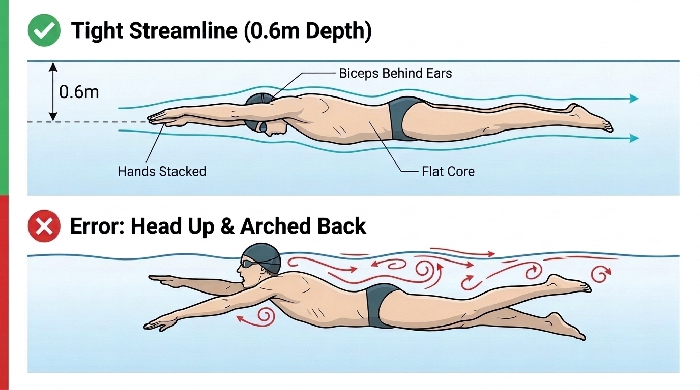

# Kỹ Thuật Streamline — Tư Thế Thuôn Dài Tối Thiểu Lực Cản

> **Thuộc phần:** `04-body-position/` | **Trình độ:** Cơ bản → Nâng cao | **Thời gian đọc:** ~11 phút

## Tổng Quan (Overview)
**Streamline** không chỉ là động tác đạp tường ở đầu mỗi chiều bể — đó là **tư thế nhanh nhất mà cơ thể con người có thể đạt được trong nước** (thường vượt `2.0–2.5 m/s`), đồng thời là "khuôn mẫu chuẩn" định hình lại trục thân thuôn dài của bạn trước mỗi 25m hay 50m bơi. Làm chủ Streamline có thể giúp bạn rút ngay **3–6 giây mỗi 100m** trong bể 25m mà gần như không tốn thêm oxy.

- **Mục tiêu cốt lõi:** Tạo hình dáng cơ thể giống một **ngư lôi (Torpedo)** sắc gọn, ép chặt diện tích mặt cắt ngang $A$ xuống mức thấp nhất có thể.
- **Cảm giác đúng:** Hai cánh tay khóa chặt sau tai, xương sườn thu gọn, cơ thể xé nước lao vút đi êm ái ở độ sâu `0.5–0.7 m`.
- **Sai lầm phổ biến nhất:** Để hai tay tách rộng chữ V trước mặt, ngẩng đầu nhìn lên làm "phanh nước", hoặc đạp tường quá nông ngay sát mặt nước (gặp Wave Drag cực lớn).

---

## Lý Thuyết (Theory)
Trong một cự ly `100m` bể `25m`, bạn có **1 lần xuất phát + 3 lần đạp tường lộn vòng = 4 pha Streamline**.
- Nếu mỗi pha Streamline của bạn đi xa thêm được `2 m` với vận tốc cao hơn tốc độ bơi mặt nước `0.4 m/s`, bạn vừa đạt được `8 m` (gần 1/10 quãng đường thi đấu!) với mức tiêu thụ oxy gần như bằng 0.
- Quan trọng hơn, Streamline thiết lập **tín hiệu cảm thụ bản thể (Proprioceptive Reset)**: mỗi lần đạp tường trong tư thế hoàn hảo là một lần bạn "cài đặt lại" trục thẳng cột sống trước khi bước vào sải tay đầu tiên.

---

## Cơ Sở Khoa Học (Science)
### Vật Lý & Thủy Động Lực Học (Physics & Hydrodynamics)
Khi đạp tường với vận tốc ban đầu $v_0 \approx 2.2\text{ m/s}$, cơ thể giảm tốc theo phương trình cản thủy động:

$$m \frac{dv}{dt} = -\frac{1}{2} \rho C_d A v^2 \implies v(t) = \frac{v_0}{1 + \frac{\rho C_d A v_0}{2m} t}$$

Hệ số giảm tốc tỷ lệ trực tiếp với $C_d \cdot A$:
- **Streamline chặt (Tight Streamline)**: Hai bắp tay kẹp sát sau tai, bàn tay chồng khít lên nhau, đầu giấu gọn giữa hai cánh tay, chân khép sát mũi duỗi thẳng → $C_d \cdot A$ đạt mức tối thiểu (`~0.025–0.032 m²`).
- **Streamline lỏng (Loose V-Shape)**: Hai tay mở rộng bằng vai và đầu nhô lên khỏi cánh tay → $C_d \cdot A$ tăng **35–55%**, vận tốc rơi tự do chỉ sau `2–3 m`!
- **Độ sâu tối ưu**: Theo nghiên cứu của Vennell et al. (2006), ở độ sâu **`≥ 0.6 m`** (khoảng 2.5 lần chiều dày thân người), lực cản sóng (*Wave Drag*) gần như triệt tiêu hoàn toàn (`< 5%`).

### Cơ Sinh Học (Biomechanics)
Khóa Streamline chuẩn đòi hỏi sự kết hợp của **3 khớp then chốt**:
1. **Gập vai tối đa (*Shoulder Flexion ≥ 180°*) & Duỗi cột sống ngực (*T-Spine Extension*)**: Cho phép đưa hai bắp tay ra **phía sau tai** mà không phải ưỡn võng lưng dưới.
2. **Khóa khung sườn – xương chậu (*Rib-to-Pelvis Lock*)**: Siết nhẹ cơ bụng thẳng và cơ bụng ngang để giữ lưng phẳng, tránh tạo "bụng thuyền" chắn nước.
3. **Duỗi thẳng cổ chân (*Plantar Flexion*)**: Mũi chân hướng thẳng ra sau, hai ngón chân cái gần chạm nhau.

---

## Thực Hành (Practical)
### Tại Sao Kỹ Thuật Này Hiệu Quả (Why It Works)
Cấu trúc "mũi nhọn hai bàn tay chồng lên nhau" đóng vai trò như **mũi tên tách dòng nước (*Laminar Flow Splitter*)**, dẫn dòng nước trượt mượt qua đỉnh đầu, vai và hông mà không tạo ra xoáy áp suất âm ở vùng cổ và nách. Nhờ đó, bạn giữ được quán tính cực lớn từ cú đạp tường và bước vào sải tay đầu tiên (*Breakout*) với vận tốc nền cao sẵn.

### Hướng Dẫn Từng Bước & Cảm Giác Nước (Step-by-Step & Water Cues)
1. **Khóa hai bàn tay**: Đặt bàn tay phải chồng khít lên mu bàn tay trái (hoặc ngược lại), ngón cái tay trên móc chặt vào cạnh ngoài của bàn tay dưới để hai tay không bị lực nước tách rời.
2. **Giấu đầu sau hai bắp tay**: Kẹp sát hai bắp tay vào **phía sau tai** (không phải trước trán), mặt nhìn thẳng xuống đáy hồ, cổ thẳng hàng cột sống.
3. **Đạp tường dứt khoát theo phương ngang sâu `0.5–0.7 m`**: Hướng mũi tay thẳng song song đáy hồ (tránh đạp chéo lên mặt nước quá sớm).
4. **Chờ đúng khoảnh khắc *Breakout***: Không vội quạt tay ngay! Đếm nhịp lướt (hoặc thực hiện 2–4 cú Dolphin Kick gọn) và chỉ bắt đầu sải tay đầu tiên khi cảm nhận vận tốc trượt vừa giảm xuống ngang bằng tốc độ bơi bình thường.

<!-- IMAGE_PROMPT: Clean hydrodynamic comparison diagram: Top shows tight torpedo Streamline underwater at 0.6m depth with hands stacked, biceps behind ears, flat lower back, pointed toes, and smooth laminar streamlines; Bottom shows loose V-arms, lifted head, arched back, and red turbulent wake vortices. -->

### Mẹo Nâng Cao (Advanced Tips)
- **Đừng thở ở sải tay đầu tiên sau Streamline (*No Breath on First Stroke*)**: Lấy hơi ngay ở sải đầu tiên sau Breakout làm đánh rơi toàn bộ quán tính quý giá vừa tích lũy được. Hãy luyện thói quen **bơi ít nhất 1–2 sải đầu không thở** sau mỗi lần đạp tường.
- **Kiểm tra độ mở vai trên cạn**: Nếu bạn đứng dựa lưng vào tường mà không thể đưa hai cánh tay kẹp sau tai mà không bị võng thắt lưng, hãy bổ sung bài tập mở vai và cột sống ngực ở chương [Mobility](../19-mobility/shoulder-thoracic-ankle-mobility.md).

---

## Bài Tập Thực Hành (Drills)
| Tên Drill | Mục tiêu Streamline | Cự ly / Số hiệp | Cảm giác đúng (Cue) |
| :--- | :--- | :--- | :--- |
| **Max-Distance Wall Push** | Tối ưu độ chặt Streamline và độ sâu `0.6 m` | `6 × 15m` (đo vạch đáy hồ) | Không đạp chân, chỉ điều chỉnh độ chặt tay–vai–core để trượt xa hơn mỗi lần |
| **Streamline + 3 Dolphin Kicks + Breakout** | Đồng bộ pha lướt ngầm với sải tay đầu tiên không mất tốc độ | `6 × 25m` (nghỉ 20s) | Trồi lên mặt nước ngay giữa sải tay đầu tiên, không ngẩng đầu thở ngay |
| **Wall Streamline Hold (Dryland)** | Mở khớp vai & khóa xương sườn chống võng lưng | `3 hiệp × 30 giây` | Gót, mông, lưng dưới, bả vai và mu bàn tay cùng chạm sát tường |

### Hướng dẫn nhanh
- **Max-Distance Wall Push**: Đứng sát tường, lặn xuống sâu `0.6 m`, khóa Streamline chuẩn rồi đạp tường vừa lực. Giữ nguyên tư thế không cử động cho tới khi dừng hẳn và ghi nhớ vị trí mốc gạch đáy hồ. Lần sau thử siết chặt bắp tay sau tai hơn và thu bụng phẳng hơn — bạn sẽ thấy mình trượt xa thêm `1–2 m` ngay lập tức.

---

## Phân Tích AI & Video (AI Analysis)
- **Góc quay khuyến nghị:** Ngang dưới nước (Underwater Side View) tại đoạn `0–10 m` tính từ thành bể.
- **Điểm khớp cần trích xuất (Keypoints):** `wrist`, `elbow`, `ear`, `shoulder`, `hip`, `ankle`.
- **Ngưỡng phát hiện lỗi tự động:**
  - **Đạt chuẩn:** Đường nối `wrist → shoulder → hip → ankle` thẳng gần tuyệt đối (`175–180°`); độ sâu tâm thân `0.5–0.8 m`; khoảng cách hai cổ tay `< 5 cm`.
  - **Cảnh báo lỗi:** Khoảng cách hai khuỷu/cổ tay `> 15 cm` (mở tay chữ V); độ sâu `< 0.3 m` (quá nông, bị Wave Drag); đầu nhô cao hơn đường nối `wrist–shoulder`.

---

## Lỗi Thường Gặp & Cách Sửa (Common Errors)
| Lỗi thường gặp | Triệu chứng nhận biết | Nguyên nhân gốc | Cách sửa (Correction) |
| :--- | :--- | :--- | :--- |
| **Hai tay mở chữ V hoặc không chồng khít** | Trượt dừng lại rất nhanh chỉ sau 3–4m | Không khóa ngón cái hoặc khớp vai cứng không ép được sau tai | Chồng khít 2 bàn tay, móc ngón cái cố định + giãn cơ xô/ngực hàng ngày |
| **Đạp tường quá nông sát mặt nước** | Sóng lớn đánh ngay trên lưng, mất quán tính nhanh | Sợ áp lực nước hoặc không chìm đủ sâu trước khi đạp tường | Chìm hẳn người xuống `0.6 m` rồi mới đạp ngang song song đáy |
| **Võng lưng dưới khi vươn tay** | Cảm giác nước "đập" vào bụng, chệch hướng lên mặt nước | Cơ vai cứng buộc cột sống thắt lưng phải ưỡn bù trừ | Siết bụng kéo nhẹ xương sườn xuống, tập Wall Streamline Hold trên cạn |
| **Thở ngay ở sải Breakout đầu tiên** | Khựng tốc độ tức thì khi vừa nổi lên mặt nước | Thiếu quản lý hơi thở (không thở ra dần trong lúc lướt ngầm) | Thở ra êm bằng mũi khi lướt ngầm, giữ đầu úp qua tối thiểu 1–2 sải đầu |

---

## Tự Đánh Giá Tại Hồ (Self Assessment)
- [ ] Tôi thực hiện Streamline chặt ở **100% các lần đạp tường** (kể cả lúc bơi thả lỏng khởi động).
- [ ] Hai bàn tay tôi luôn chồng khít và có móc ngón cái cố định, bắp tay kẹp sau tai.
- [ ] Tôi đạp tường ở độ sâu khoảng `0.5–0.7 m` song song đáy hồ.
- [ ] Tôi có thể trượt qua vạch 5m (không đạp chân) chỉ bằng một cú đạp tường chuẩn.
- [ ] Tôi không xoay đầu lấy hơi ngay ở sải tay đầu tiên sau khi trồi lên mặt nước.

---

## Chỉ Số Đo Lường (KPI)
| Chỉ số (Metric) | Người mới | Trung cấp | Nâng cao (`< 1:30/100m`) |
| :--- | :---: | :---: | :---: |
| **Cự ly trượt Streamline (không đạp chân)** | `4–5 m` | `6–8 m` | `8–11+ m` |
| **Cự ly Breakout (Streamline + Dolphin Kick)** | `4–6 m` | `6–8 m` | `8–12 m` |
| **Độ sâu trung bình khi lướt ngầm** | `< 0.3 m` | `0.4–0.5 m` | `0.5–0.8 m` |
| **Số sải không thở sau Breakout** | `0 sải` | `1 sải` | `2 sải` |

---

## Câu Hỏi Thường Gặp (FAQ)
**1. Trong bơi nước mở (Open Water) không có tường thì tập Streamline để làm gì?**
Streamline rèn luyện **trục thẳng cột sống, độ mở khớp vai và cảm giác cắt nước tối thiểu lực cản** — những thứ bạn áp dụng trực tiếp vào mỗi pha vươn tay trượt (*Glide*) của từng sải bơi ngoài biển/hồ.

**2. Khi lướt ngầm bị nước vào mũi thì xử lý thế nào?**
Hãy tạo một áp lực khí nhẹ liên tục đẩy ra bằng mũi (thở ra thật mảnh thành dòng bong bóng nhỏ) — áp suất dương trong khoang mũi sẽ ngăn tuyệt đối nước tràn vào.

**3. Nên đạp chân sải hay chân bướm (Dolphin Kick) trong lúc Streamline?**
Dolphin Kick tạo lực đẩy mạnh hơn và giữ thân thuôn gọn hơn khi đang ở độ sâu `0.6 m` (xem chi tiết ở [Dolphin & Kick Timing](../08-kicking/dolphin-and-kick-timing.md)). Tuy nhiên, chỉ dùng Dolphin Kick khi bạn đã giữ được Streamline phẳng; nếu Dolphin làm lắc ngực và mở tay thì hãy trượt thẳng trước.

---

## Tóm Tắt (Summary)
- Streamline là **tư thế nhanh nhất trong bơi lội** và là thao tác cài đặt lại trục thân ở đầu mỗi chiều bể.
- 4 nguyên tắc vàng: **Tay chồng khóa ngón cái + Bắp tay kẹp sau tai + Core phẳng không võng lưng + Lướt sâu `0.5–0.7 m`**.
- Không bao giờ lấy hơi ở sải Breakout đầu tiên để bảo toàn trọn vẹn vận tốc từ thành bể.

**Liên kết chéo:**
- Chương trước: [Tư Thế Thân Ngang & Trục Đầu–Hông](body-position-and-alignment.md)
- Chương tiếp theo: [Cân Bằng Nổi & Pha Trượt (Glide)](balance-and-glide.md)
- Kỹ thuật liên quan: [Giảm Lực Cản](../03-hydrodynamics/drag-reduction.md) · [Sprint, Starts & Flip Turns](../16-sprint/sprint-starts-and-turns.md)
- Tra cứu thuật ngữ: [Glossary](../24-appendix/glossary.md)

---

## Tài Liệu Tham Khảo (References)
1. Vennell, R., Pease, D., & Wilson, B. (2006). *Wave drag on human swimmers*. Journal of Biomechanics, 39(4), 664–671.
2. Lyttle, A., Blanksby, B., Elliott, B., & Lloyd, D. (1998). *The effect of depth and velocity on drag during the streamlined glide*. Journal of Swimming Research, 13, 15–22.
3. USA Swimming — *Underwater Streamline & Breakout Technical Guidelines*.

