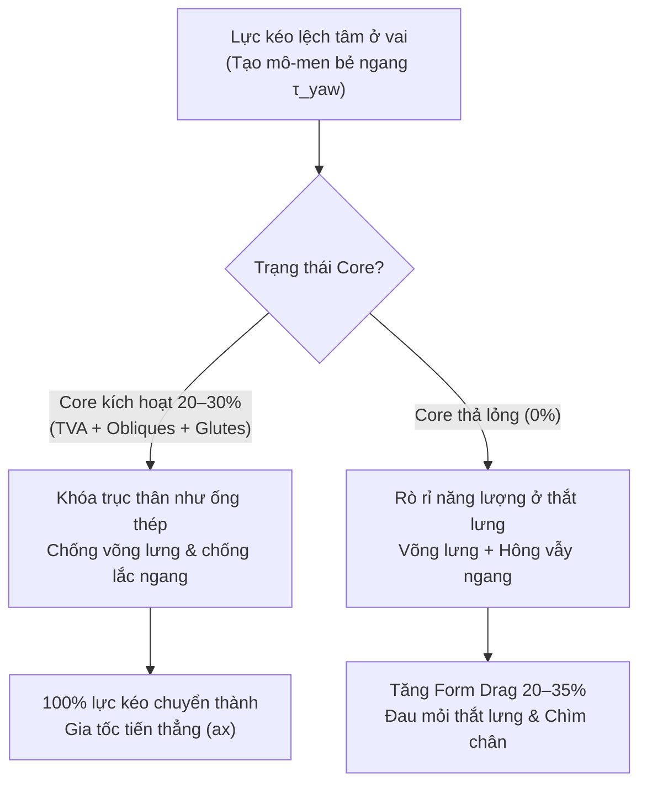

# Kích Hoạt Core & Liên Kết Hông–Vai (*Core Engagement*)

> **Thuộc phần:** `05-core/` | **Trình độ:** Cơ bản → Nâng cao | **Thời gian đọc:** ~11 phút

## Tổng Quan (Overview)
Bạn không thể bắn một khẩu đại bác từ một chiếc xuồng cao su mềm nhũn. Trong bơi sải, **Core (nhóm cơ lõi)** chính là "bệ phóng cứng vững" kết nối phần thân trên (vai–cánh tay) với phần thân dưới (hông–chân). Khi Core được kích hoạt đúng mức (`20–30%` lực), nó ngăn võng lưng dưới, triệt tiêu hoàn toàn hiện tượng lắc hông (*fishtailing*) và truyền trọn vẹn mô-men xoắn từ hông lên cánh tay mà không bị rò rỉ năng lượng.

- **Mục tiêu cốt lõi:** Giữ cột sống và xương chậu ở vị trí trung tính (*Neutral Pelvis*), tạo trục truyền lực liền khối từ vai xuống hông mà vẫn thở tự do.
- **Cảm giác đúng:** Rốn hơi thu nhẹ về phía cột sống, vùng thắt lưng phẳng và êm, thân người chắc gọn như một khối trụ lướt thẳng tắp.
- **Sai lầm phổ biến nhất:** Hiểu nhầm Core chỉ là "gập bụng 6 múi" hoặc gồng cứng bụng 100% làm nghẹt hơi thở và khóa cứng nhịp xoay hông.

---

## Lý Thuyết (Theory)
Trong giải phẫu chức năng, **Core** không chỉ là cơ bụng thẳng (*Rectus Abdominis*), mà là một **hình trụ cơ 360°** bảo vệ cột sống và truyền lực xoay:
- **Mặt trước & sâu**: Cơ bụng ngang (*Transverse Abdominis — TVA*, hoạt động như đai lưng sinh học) và cơ bụng thẳng.
- **Hai bên sườn**: Cơ chéo bụng ngoài & trong (*External & Internal Obliques*) — động cơ chính tạo và hãm lực xoay trục dọc `30–45°`.
- **Mặt sau**: Cơ dựng sống (*Erector Spinae*), cơ nhiều chân (*Multifidus*) và cơ mông lớn/nhỡ (*Gluteus Maximus & Medius*).
- **Nắp trên & đáy dưới**: Cơ hoành (*Diaphragm*) và cơ sàn chậu (*Pelvic Floor*).

Trong môi trường không có mặt đất làm điểm tựa như nước, Core phải đảm nhiệm đồng thời **2 chức năng đối lập nhưng bổ trợ nhau**:
1. **Chống duỗi & Chống nghiêng ngang (*Anti-Extension & Anti-Lateral Flexion*)**: Ngăn lưng dưới bị võng (*Banana Back*) và ngăn hông vẫy ngang khi tay kéo mạnh.
2. **Truyền & Khuếch đại lực xoay (*Rotational Power Transfer*)**: Truyền mô-men từ hông lên khung sườn theo [Chuỗi Truyền Lực](../02-biomechanics/kinetic-chain.md).

---

## Cơ Sở Khoa Học (Science)
### Vật Lý & Thủy Động Lực Học (Physics & Hydrodynamics)
Xét thân người như một dầm đàn hồi chịu tác dụng của lực nổi ở ngực và lực kéo lệch tâm ở hai vai:
- Khi cánh tay phải kéo nước mạnh ở phía bên phải trục cơ thể (cách trục giữa `d ≈ 25 cm`), nó tạo ra một **mô-men bẻ ngang (*Yaw Torque*)**:
  $$\tau_{\text{yaw}} = F_{\text{pull}} \cdot d$$
- Nếu Core thả lỏng, mô-men $\tau_{\text{yaw}}$ lập tức làm hông và hai chân vẫy văng sang bên đối diện (*Fishtailing*), khiến diện tích cản $A$ tăng vọt `20–35%` và tiêu tán lực đẩy theo phương ngang.
- Khi cơ bụng ngang (TVA) và cơ chéo bụng siết nhẹ đồng bộ (*Bracing*), độ cứng chống uốn của thân người tăng lên gấp nhiều lần, chuyển hóa toàn bộ $F_{\text{pull}}$ thành gia tốc tiến thẳng về trước ($a_x$).

### Cơ Sinh Học (Biomechanics)
- **Mức kích hoạt tối ưu (`20–30% MVC`)**: Nghiên cứu cơ sinh học cột sống (McGill, *Ultimate Back Fitness and Performance*) chỉ ra rằng chỉ cần kích hoạt `20–30%` lực co tối đa của TVA và Obliques đã đủ để tạo ra `> 85%` độ ổn định cột sống, trong khi vẫn để cơ hoành (*Diaphragm*) co giãn thoải mái cho hô hấp hiếu khí.
- **Vị trí xương chậu trung tính**: Siết nhẹ cơ bụng dưới kết hợp siết nhẹ cơ mông (khoảng 15–20%) đưa xương chậu về trung tính, kéo dài thắt lưng và tự động nâng đùi lên thêm `5–10 cm` sát mặt nước.

---

## Thực Hành (Practical)
### Tại Sao Kỹ Thuật Này Hiệu Quả (Why It Works)
Khi Core hoạt động liên tục như một "khớp nối cứng thông minh":
- Lực nổi từ lồng ngực được truyền thẳng xuống hông và gót chân (không bị "gãy" ở thắt lưng).
- Bạn có thể bơi với một cú đạp chân cực nhỏ (**2-beat kick**) mà hông vẫn nổi phẳng lì và đi thẳng tắp.
- Áp lực lên đốt sống thắt lưng L4–L5 giảm về 0, đặc biệt quan trọng với người bơi Masters hoặc người làm việc văn phòng.

### Hướng Dẫn Từng Bước & Cảm Giác Nước (Step-by-Step & Water Cues)
1. **Tín hiệu "Kéo khóa quần" (*Zip Up*)**: Trước khi đạp tường, nhẹ nhàng thu rốn vào trong và hơi hướng lên phía xương ức khoảng `20–30%` lực — giống cảm giác kéo khóa một chiếc quần jeans hơi ôm.
2. **Thu nhẹ hai xương sườn dưới (*Ribs Down*)**: Không ưỡn ngực phình bụng xuống đáy; giữ khung sườn thẳng hàng với xương chậu.
3. **Thở bằng cơ hoành trong khi giữ Core**: Luyện hít thở sâu vào hai bên lồng ngực mà không thả lỏng bung bụng dưới.
4. **Liên kết mông nhẹ**: Cảm nhận cơ mông hơi căng nhẹ giúp hai đùi khép gọn trong "đường ống" bề rộng vai.

<!-- IMAGE_PROMPT: Anatomical sports science illustration of a freestyle swimmer in underwater side-oblique view highlighting the 360-degree core cylinder (Transverse Abdominis, Obliques, Glutes) keeping the lumbar spine flat and resisting yaw torque during the underwater pull phase. -->

### Mẹo Nâng Cao (Advanced Tips)
- **Bài kiểm tra "Bơi không phao, buộc cổ chân" (Ankle Band Swim)**: Nếu bạn buộc một sợi dây cao su nhẹ quanh hai cổ chân (không được đập chân) mà vẫn bơi được `25m` không chìm hẳn hông, Core của bạn đã đạt chuẩn nâng cao. Đây là công cụ phản hồi trung thực nhất thế giới về sức mạnh Core trong nước!
- **Giữ Core trong lúc mệt mỏi**: 80% người bơi giữ được Core rất tốt ở 200m đầu nhưng để lỏng hoàn toàn sau 600m. Hãy cài một "điểm kiểm tra tâm trí" (*Mental Checkpoint*) tại mỗi lần lộn vòng đạp tường: *"Thu rốn – Phẳng lưng – Đạp tường!"*.

---

## Bài Tập Thực Hành (Drills)
| Tên Drill | Mục tiêu Core | Cự ly / Số hiệp | Cảm giác đúng (Cue) |
| :--- | :--- | :--- | :--- |
| **Pull Buoy + Ankle Band** | Khóa chặt trục hông–vai chống lắc ngang khi kéo mạnh | `4 × 50m` (nghỉ 20s) | Dù kéo tay mạnh, hông và hai chân vẫn đi thẳng một đường không vẫy |
| **No-Kick Band Swim (Nâng cao)** | Thử thách tối đa khả năng giữ nổi bằng Core + Front-Quadrant | `4 × 25m` (chỉ buộc dây cổ chân, không phao) | Thu rốn chặt, ấn nhẹ ngực, nhịp tay hơi nhanh để lướt phẳng |
| **Dead Bug & Bird Dog (Dryland)** | Tách biệt chuyển động tay–chân trong khi giữ thắt lưng bất động | `3 hiệp × 12 lần/bên` | Lưng dưới áp phẳng xuống sàn (Dead Bug), hông không nghiêng (Bird Dog) |

### Hướng dẫn nhanh
- **Dead Bug (Tập cạn chuẩn bơi sải)**: Nằm ngửa, hai tay giơ thẳng lên trần, hai gối gập 90°. Ép sát thắt lưng xuống sàn (không để khe hở). Thở ra chậm đồng thời duỗi thẳng tay phải qua đầu và chân trái sát sàn (mô phỏng chính xác phối hợp chéo bơi sải), giữ thắt lưng tuyệt đối không bật lên khỏi sàn, rồi đổi bên.

---

## Phân Tích AI & Video (AI Analysis)
- **Góc quay khuyến nghị:** Ngang dưới nước (đo độ võng thắt lưng *Lumbar Lordosis Angle*) và Trên cao (đo biên độ lắc ngang của hông *Lateral Hip Sway*).
- **Keypoints cần trích xuất:** `shoulder`, `mid_torso`, `hip`, `knee`, `ankle`.
- **Ngưỡng phát hiện lỗi tự động:**
  - **Đạt chuẩn:** Góc `shoulder–mid_torso–hip` duy trì `172–180°`; biên độ lắc ngang của điểm `hip` so với đường trục bơi `< 8 cm`.
  - **Cảnh báo lỗi:** Góc `shoulder–mid_torso–hip < 165°` hướng võng xuống đáy (Banana Back); `hip` lắc ngang `> 15 cm` đồng pha với tay kéo.

---

## Lỗi Thường Gặp & Cách Sửa (Common Errors)
| Lỗi thường gặp | Triệu chứng nhận biết | Nguyên nhân gốc | Cách sửa (Correction) |
| :--- | :--- | :--- | :--- |
| **Võng lưng dưới (Banana Back)** | Đau mỏi thắt lưng sau buổi bơi, hông chìm dù đầu đã nhìn đáy | Core lỏng, cơ gấp hông (*Hip Flexors*) căng cứng kéo đổ xương chậu | Tập Dead Bug + giãn cơ gấp hông trước khi bơi, thu nhẹ xương sườn dưới |
| **Gồng cứng bụng 100%** | Khó thở, nhịp tim tăng nhanh, thân bị cứng đơ khó xoay | Cố siết bụng quá mức làm khóa luôn cơ hoành | Giảm lực siết xuống mức `20–30%` ("kéo khóa quần nhẹ"), tập thở đều |
| **Lắc hông khi kéo tay (Fishtailing)** | Hai chân văng sang trái–phải mỗi lần quạt tay | Cơ chéo bụng (Obliques) không hãm được mô-men bẻ ngang $\tau_{\text{yaw}}$ | Tập Side Plank + bơi kẹp Pull Buoy giữ hai đùi đi thẳng đường ray |
| **Mất Core khi xoay đầu thở** | Thân bị "gãy đôi" tại eo mỗi khi lấy hơi | Hông ngừng xoay trong khi vai và cổ cố vặn lên thở | Xoay đồng trục cả vai lẫn hông như một khối, giữ rốn thu gọn khi hít |

---

## Tự Đánh Giá Tại Hồ (Self Assessment)
- [ ] Tôi có thể duy trì mức kích hoạt Core nhẹ `20–30%` suốt buổi bơi mà vẫn thở êm ái.
- [ ] Lưng dưới tôi hoàn toàn phẳng và không bao giờ bị đau mỏi sau khi bơi `1.500–2.000m`.
- [ ] Khi bơi với Pull Buoy, hông tôi không bị lắc ngang dù tôi tăng tốc độ kéo tay.
- [ ] Tôi thực hiện được `3 × 12` Dead Bug và Bird Dog trên cạn với thắt lưng hoàn toàn bất động.
- [ ] Tôi luôn "khóa lại Core" trước mỗi lần đạp tường Streamline.

---

## Chỉ Số Đo Lường (KPI)
| Chỉ số (Metric) | Người mới | Trung cấp | Nâng cao (`< 1:30/100m`) |
| :--- | :---: | :---: | :---: |
| **Độ thẳng cột sống thắt lưng dưới nước** | `< 162°` (võng) | `165–172°` | `174–180°` |
| **Biên độ lắc ngang hông (Overhead View)** | `> 18 cm` | `10–15 cm` | `< 8 cm` |
| **Giữ Side Plank chuẩn form mỗi bên (Dryland)** | `< 30 giây` | `45–60 giây` | `75–90+ giây` |
| **Bơi 25m với dây buộc cổ chân (không phao)** | Chưa đạt | Đạt 25m mệt | Đạt 4 × 25m ổn định, giữ phẳng thân |

---

## Câu Hỏi Thường Gặp (FAQ)
**1. Tập gập bụng (Sit-ups / Crunches) 100 cái mỗi ngày có giúp Core bơi khỏe hơn không?**
Không hiệu quả bằng các bài **ổn định cột sống (Anti-Extension & Anti-Rotation)** như *Dead Bug, Bird Dog, Plank, Side Plank Rotation* và *Pallof Press*. Bơi sải cần Core giữ cột sống thẳng và truyền lực xoay, không cần gập cong cột sống liên tục.

**2. Tại sao tôi bị đau thắt lưng khi dùng chân vịt (Fins) dài?**
Chân vịt dài tạo lực cản đòn bẩy lớn ở cổ chân; nếu Core không đủ khỏe để giữ xương chậu trung tính, thắt lưng sẽ bị kéo võng liên tục gây đau. Hãy chuyển sang **chân vịt ngắn (Short Zoomers)** và siết nhẹ Core khi đạp.

**3. Người có bụng hơi lớn có kích hoạt được Core 20–30% không?**
Hoàn toàn được. Cơ bụng ngang (TVA) nằm ở lớp cơ sâu nhất sát cột sống — mọi cơ địa đều có thể tập cảm nhận thu nhẹ bụng dưới và khóa xương chậu trung tính bằng bài Dead Bug.

---

## Tóm Tắt (Summary)
- **Core** là hình trụ cơ 360° đóng vai trò bệ phóng chống võng lưng, chống lắc ngang (*fishtailing*) và truyền mô-men xoắn từ hông lên tay.
- Chỉ cần kích hoạt **`20–30%` lực** (tín hiệu *"kéo khóa quần nhẹ"* + *"thu xương sườn"*) để vừa khóa chắc cột sống vừa thở thoải mái.
- Ưu tiên các bài tập chống duỗi và chống xoay (*Dead Bug, Bird Dog, Side Plank Rotation, Pull Buoy + Ankle Band*) thay vì gập bụng truyền thống.

**Liên kết chéo:**
- Chương trước: [Cân Bằng Nổi & Pha Trượt](../04-body-position/balance-and-glide.md)
- Chương tiếp theo: [Xoay Trục Dọc 30–45°](../06-rotation/body-rotation.md)
- Kỹ thuật liên quan: [Chuỗi Truyền Lực](../02-biomechanics/kinetic-chain.md) · [Sức Mạnh Core Chuyên Biệt](../18-strength/core-training.md)
- Tra cứu thuật ngữ: [Glossary](../24-appendix/glossary.md)

---

## Tài Liệu Tham Khảo (References)
1. McGill, S. M. (2015). *Ultimate Back Fitness and Performance*. Backfitpro.
2. McLeod, I. (2010). *Swimming Anatomy*. Human Kinetics.
3. Weston, M., Hibbs, A. E., Thompson, K. G., & Spears, I. R. (2015). *Isolated core training improves sprint performance in national-level junior swimmers*. International Journal of Sports Physiology and Performance, 10(2), 204–210.

