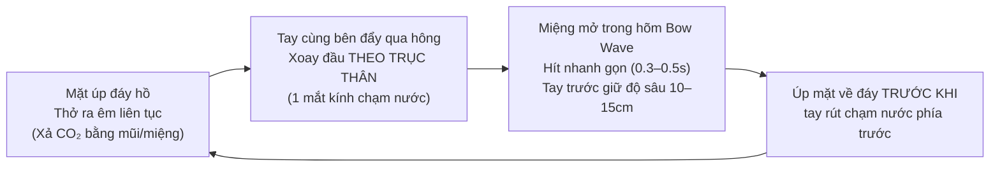
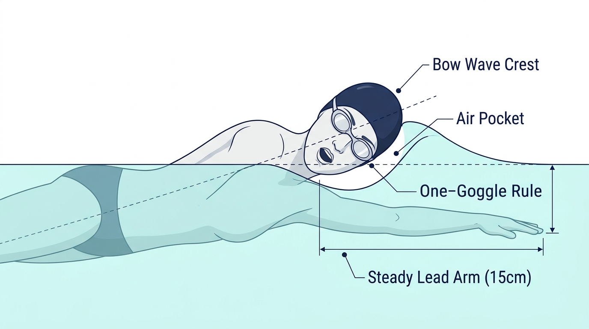

# Kỹ Thuật Thở & Nhịp Thở Theo Tốc Độ (*Breathing Mechanics*)

> **Thuộc phần:** `07-breathing/` | **Trình độ:** Cơ bản → Nâng cao | **Thời gian đọc:** ~12 phút

## Tổng Quan (Overview)
Hơn **70% lỗi kỹ thuật bơi sải** (chìm hông, đá cắt kéo, tay trượt ấn sâu, vắt chéo trục giữa, nhanh đuối sức) đều có chung một nguyên nhân kích hoạt: **sai kỹ thuật thở**. Thở đúng không phải là "ngoi đầu lên khỏi mặt nước để tìm không khí", mà là **thở ra liên tục dưới nước** rồi **xoay gọn trong hõm sóng (*Bow Wave Pocket*)** để hít nhanh mà không hề làm xáo trộn tư thế thân ngang.

- **Mục tiêu cốt lõi:** Thành thạo chu trình `Thở ra liên tục dưới nước → Xoay trục lấy hơi (1 mắt kính chạm nước) → Hít nhanh gọn → Úp mặt ngay`, và chọn nhịp thở (1:2, 1:3, 2:3) phù hợp cường độ.
- **Cảm giác đúng:** Hơi thở êm ái, nhịp tim ổn định, hoàn toàn không có cảm giác ngộp hay vội vàng; thân người vẫn lướt thẳng tắp trong lúc lấy hơi.
- **Sai lầm phổ biến nhất:** Nín hơi dưới nước rồi khi xoay đầu lên mới vừa thở ra vừa hít vào — khiến bạn không đủ thời gian lấy oxy, phải nhấc đầu cao và làm chìm toàn bộ phần chân.

---

## Lý Thuyết (Theory)
Sinh lý hô hấp trong bơi sải tuân theo 2 nguyên tắc nền tảng:

1. **Nguyên nhân gây cảm giác "ngộp thở" không phải thiếu $O_2$, mà là tích tụ $CO_2$**:
   - Khi bạn nín hơi dưới nước, nồng độ khí cacbonic ($CO_2$) trong máu tăng nhanh, kích thích trung tâm hô hấp ở hành não phát tín hiệu hoảng loạn (*Air Hunger*).
   - **Thở ra liên tục, đều đặn dưới nước** (bằng mũi hoặc cả mũi–miệng) giúp xả sạch $CO_2$ liên tục, giữ tâm trí bình tĩnh và giúp phổi sẵn sàng **hít vào ngay lập tức** trong `0.3–0.5 giây` khi miệng vừa mở ra không khí.
2. **Hiệu ứng Hõm Sóng Mũi (*Bow Wave Pocket*)**:
   - Khi đầu di chuyển tiến tới trong nước, một sóng mũi dâng nhẹ ngay trước trán và tạo ra một **vùng trũng thấp hơn mặt nước tĩnh `2–5 cm`** ngay bên cạnh má và miệng.
   - Bạn chỉ cần xoay đầu quanh trục dọc (giữ nửa mặt dưới vẫn chìm trong nước) là miệng đã nằm gọn trong hõm khí đó để hít thoải mái **mà không cần nhấc đầu lên dù chỉ 1 cm**!

---

## Cơ Sở Khoa Học (Science)
### Vật Lý & Thủy Động Lực Học (Physics & Hydrodynamics)
- **Chi phí lực cản của việc nhấc đầu khi thở**: Nếu bạn nhấc đầu cao thêm `8–10 cm` mỗi lần thở, trọng lượng `~5 kg` của đầu mất lực nổi Ác-si-mét và đè mạnh xuống ngực, làm hông chìm ngay `15–25 cm`. Diện tích cản Form Drag $A$ tăng vọt `40–60%`, kéo vận tốc rơi tự do ở mỗi chu kỳ thở!
- **Thời điểm vàng của cửa sổ thở (*Breathing Window*)**:
  - Bắt đầu xoay đầu **cùng nhịp với thân** khi tay cùng bên bắt đầu pha **Push** (đẩy qua ngang hông).
  - Hít gọn khi tay cùng bên vừa nhấc khỏi nước bắt đầu pha **Recovery**.
  - Úp mặt trở về đáy hồ **trước khi** tay đó chạm nước trở lại ở phía trước (nhờ vậy tay vào nước và pha Glide diễn ra trên một trục thân hoàn toàn cân bằng).

### Cơ Sinh Học (Biomechanics)
So sánh các **nhịp thở (Breathing Patterns)** theo cường độ vận động:

| Nhịp thở | Tần suất lấy hơi | Ưu điểm sinh lý & cơ sinh học | Khi nào sử dụng? |
| :--- | :--- | :--- | :--- |
| **1:3 (Bilateral — Song phương)** | Mỗi 3 sải (luân phiên trái–phải) | Cân bằng xoay thân 2 bên hoàn hảo; quan sát được 2 bên trong Open Water | Khởi động, bơi kỹ thuật, tốc độ nhẹ–trung bình (Zone 1–2) |
| **1:2 (Unilateral — Mỗi chu kỳ)** | Mỗi 2 sải (cùng 1 bên) | Cung cấp lượng oxy tối đa (`+50%` so với 1:3), giữ pH máu ổn định ở pace cao | Ngưỡng CSS, tốc độ `< 1:30/100m`, đua 200m–1500m |
| **2:2 / 3:2 (Hybrid)** | 2 nhịp bên phải → chuyển sang 2 nhịp bên trái | Vừa đủ oxy như 1:2, vừa giữ cân bằng đối xứng 2 bên như 1:3 | Bơi đường dài tốc độ cao & Triathlon (Rất khuyến nghị!) |
| **1:4 / 1:5 (Hypoxic nhẹ)** | Mỗi 4–5 sải | Giảm tối đa số lần gián đoạn Streamline đầu | Nước rút Sprint 50m (không lạm dụng tập nín thở kéo dài) |

---

## Thực Hành (Practical)
### Tại Sao Kỹ Thuật Này Hiệu Quả (Why It Works)
Khi bạn xả sạch `70–80%` lượng khí cũ dưới nước trước khi xoay đầu, áp suất trong phổi trở nên âm nhẹ — chỉ cần mở miệng trong hõm sóng mũi là không khí tự động tràn vào phổi trong chớp mắt mà không cần rướn cổ hít sâu căng cứng. Kết hợp với việc **giữ tay trượt phía trước ở độ sâu `10–15 cm`**, cả cơ thể bạn vẫn trôi thẳng băng không sụt tốc độ.

### Hướng Dẫn Từng Bước & Cảm Giác Nước (Step-by-Step & Water Cues)
1. **Thở ra liên tục kiểu "Ngân nga" (*Humming Exhale*)**: Ngay khi mặt úp xuống nước, phát âm thanh *"ừm..."* nhẹ qua mũi để dòng bọt khí thoát ra đều đặn, không bao giờ nín hơi.
2. **Quy tắc "1 Mắt Kính Chạm Nước" (*One-Goggle Rule*)**: Khi xoay sang phải để thở, mắt kính bên trái vẫn phải **chìm hoặc chạm mặt nước**, chỉ mắt kính bên phải nổi lên. Đỉnh đầu không nhấc lên mà chỉ xoay tròn tại chỗ.
3. **Nhìn ngang sang tường bên, không nhìn lên trần nhà**: Nếu bạn nhìn thấy trần nhà hoặc bầu trời khi thở, nghĩa là bạn đã xoay lố (`> 60°`)! Hãy chỉ nhìn ngang mặt nước hoặc hơi chếch nhẹ về phía sau vai.
4. **Hít qua miệng, thả lỏng hàm**: Miệng hơi kéo nhẹ khóe môi về phía trên để tránh uống nước, hít gọn một hơi vừa đủ (~75% dung tích phổi, không hít căng tức ngực).
5. **Đưa đầu về sớm (*Early Head Return*)**: Ngay khi khuỷu tay rút trên không đi ngang qua đầu, úp mặt nhìn đáy ngay — đầu về trước tay!

<!-- IMAGE_PROMPT: Technical close-up waterline cross-section illustration of a freestyle swimmer breathing to the right: top view & front-quarter view showing the bow wave cresting at the crown of the head and forming a depressed air pocket around the mouth, with the left goggle submerged (One-Goggle Rule) and lead left arm holding steady at 10-15cm depth. -->

### Mẹo Nâng Cao (Advanced Tips)
- **Đừng ép mình thở 1:3 ở tốc độ `< 1:30/100m` nếu bị thiếu oxy**: Ngay cả các VĐV Olympic 400m–1500m (như Katie Ledecky, Sun Yang, David Popovici) đa số đều dùng **nhịp 1:2** khi đua tốc độ cao để tối đa hóa cung cấp $O_2$ cho cơ bắp. Hãy tập **1:3 trong phần khởi động/kỹ thuật** để giữ cân bằng hai bên, và chuyển sang **1:2 hoặc 2:2 đổi bên** khi bơi các bài tốc độ ngưỡng CSS!
- **Chiến thuật "Thở 2:2 theo chiều bể"**: Chiều đi thở 1:2 bên phải, chiều về thở 1:2 bên trái (luôn nhìn về cùng một bên thành bể). Đây là cách cực kỳ thông minh giúp bạn vừa nhận tối đa oxy, vừa cân bằng tuyệt đối khớp vai và cột sống cổ.

---

## Bài Tập Thực Hành (Drills)
| Tên Drill | Mục tiêu kỹ thuật thở | Cự ly / Số hiệp | Cảm giác đúng (Cue) |
| :--- | :--- | :--- | :--- |
| **Sink-Downs (Thở bọt đứng chỗ)** | Xây phản xạ thở ra liên tục bằng mũi & xóa cảm giác sợ nước | `10 lần` ở đầu hồ nông | Ngồi chìm xuống nước thở ra đều qua mũi, ngoi lên hít gọn 1 giây rồi chìm ngay |
| **Side-Kick One-Goggle Breathing** | Luyện xoay đầu quanh trục dọc, giữ 1 mắt kính chạm nước và không ấn tay trượt | `6 × 25m` (3 trái, 3 phải) | Tai tựa sát cánh tay dưới, xoay nhẹ cằm lấy hơi không nhấc đầu |
| **Single-Arm Breathing (Bên nghịch)** | Cải thiện khả năng thở mượt ở bên không thuận | `4 × 25m` mỗi bên | Tay trước giữ bất động ở độ sâu `10–15 cm`, xoay thân theo đúng nhịp đẩy |

### Hướng dẫn nhanh
- **Side-Kick One-Goggle Breathing**: Đeo chân vịt ngắn, nằm nghiêng `45°` với tay dưới vươn dài `10–15 cm` dưới nước, tay trên đặt dọc đùi. Thở ra đều đặn bằng mũi trong khi nhìn đáy hồ 4–6 nhịp chân → xoay nhẹ đầu quanh trục sao cho **mắt kính dưới vẫn chạm nước**, hít gọn rồi úp mặt nhìn đáy ngay. Kiểm tra: tay dưới không được chìm xuống khi bạn hít!

---

## Phân Tích AI & Video (AI Analysis)
- **Góc quay khuyến nghị:** Trước mặt ngang mặt nước (Waterline Front View) và Ngang dưới nước (Underwater Side View).
- **Điểm khớp cần trích xuất (Keypoints):** `left_eye`, `right_eye`, `mouth`, `waterline_y`, `lead_wrist`, `recovery_elbow`.
- **Ngưỡng phát hiện lỗi tự động:**
  - **Đạt chuẩn:** Tại đỉnh nhịp thở, tọa độ mắt thấp hơn nằm sát hoặc dưới `waterline_y`; góc nâng đầu theo phương dọc `< 10°`; `lead_wrist` không tụt sâu quá `5 cm`; mặt úp lại trước khi `recovery_wrist` chạm mặt nước.
  - **Cảnh báo lỗi:** Cả 2 mắt cao hơn `waterline_y > 8 cm` (ngẩng đầu thở); đầu vẫn xoay ngang sau khi tay rút đã vào nước (thở muộn — *Late Breathing*).

---

## Lỗi Thường Gặp & Cách Sửa (Common Errors)
| Lỗi thường gặp | Triệu chứng nhận biết | Nguyên nhân gốc | Cách sửa (Correction) |
| :--- | :--- | :--- | :--- |
| **Nín hơi dưới nước rồi thở hắt khi ngoi lên** | Hụt hơi cực nhanh chỉ sau 50–100m, tim đập dồn dập | Phản xạ nín thở tự nhiên làm tích tụ $CO_2$ và mất thời gian thở ra trên không | Thực hành *Humming Exhale* (ngân nga "ừm..." xả bọt liên tục dưới nước) |
| **Ngẩng đầu lên trước rồi mới xoay** | Cả 2 mắt và cằm nhô cao khỏi mặt nước, chân chìm sâu tức thì | Sợ uống nước và chưa tin tưởng hõm sóng mũi *Bow Wave* | Tập Side-Kick One-Goggle Breathing, ép giữ tai dưới luôn chìm trong nước |
| **Thở muộn (Late Breathing)** | Tay rút đã chạm nước phía trước mà đầu vẫn còn ngoảnh sang bên | Chờ tay rút ra khỏi nước mới bắt đầu xoay đầu lấy hơi | Bắt đầu xoay đầu sớm ngay khi tay cùng bên đẩy ngang hông; đưa đầu về trước tay |
| **Ấn tay trượt xuống sâu khi thở** | Mất hoàn toàn lực kéo tay đối diện, thân trồi sụt | Dùng tay trượt làm điểm chống đẩy đầu lên không khí | Tập Single-Arm Drill giữ tay trước đặt nhẹ trên "mặt bàn nước" `10–15 cm` |

---

## Tự Đánh Giá Tại Hồ (Self Assessment)
- [ ] Tôi thở ra liên tục thành dòng bọt mịn dưới nước ở 100% thời gian mặt úp xuống, không bao giờ nín hơi.
- [ ] Khi xoay đầu lấy hơi, mắt kính bên dưới của tôi vẫn chạm mặt nước (One-Goggle Rule).
- [ ] Tôi có thể thở thoải mái ở cả hai bên trái và phải (nhịp 1:3 hoặc 2:2 đổi bên theo chiều bể).
- [ ] Tay trượt phía trước của tôi không bị tụt xuống sâu trong lúc tôi hít hơi.
- [ ] Mặt tôi đã quay trở về nhìn đáy hồ trước khi tay rút trên không chạm mặt nước.

---

## Chỉ Số Đo Lường (KPI)
| Chỉ số (Metric) | Người mới | Trung cấp | Nâng cao (`< 1:30/100m`) |
| :--- | :---: | :---: | :---: |
| **Thời gian mở miệng hít hơi** | `> 0.8 giây` | `0.5–0.7 giây` | `0.3–0.45 giây` |
| **Độ cao nâng đỉnh đầu khi thở** | `> 10 cm` | `4–8 cm` | `< 3 cm` (xoay tại chỗ) |
| **Chênh lệch tốc độ thở bên thuận vs bên nghịch** | `> 8s/100m` | `3–6s/100m` | `< 2s/100m` |
| **Cự ly bơi liên tục không bị hụt hơi (Zone 2)** | `50–100 m` | `400–800 m` | `1.500–3.000+ m` |

---

## Câu Hỏi Thường Gặp (FAQ)
**1. Nên thở ra bằng mũi hay bằng miệng dưới nước?**
Tốt nhất là **thở ra chủ yếu bằng mũi** (tạo áp suất dương ngăn nước vào mũi và kiểm soát lưu lượng khí mịn), và xả nhẹ thêm bằng miệng ở `0.2 giây` cuối ngay trước khi xoay lên hít nếu đang bơi ở cường độ rất cao (VO2max).

**2. Tôi rất hay bị sặc nước khi tập thở 1 mắt kính chạm nước, phải làm sao?**
Hõm sóng mũi (*Bow Wave*) chỉ hình thành rõ khi bạn có một vận tốc tiến nhất định! Nếu bạn bơi quá chậm hoặc bị dừng hẳn (Dead Spot) lúc thở, nước sẽ tràn vào miệng. Hãy đeo **chân vịt ngắn** khi tập Side-Kick One-Goggle để duy trì vận tốc lướt ổn định và hơi kéo khóe miệng lên trên về phía mặt trời.

**3. Khi bơi nước rút 50m có nên nín thở cả chiều bể không?**
Với cự ly 50m thi đấu chuyên nghiệp, VĐV thường chỉ thở `0–2 lần` để không giảm tốc. Nhưng trong tập luyện hàng ngày, tuyệt đối **không tập nín thở kéo dài (Hyperventilation / Shallow Water Blackout)** vì cực kỳ nguy hiểm; luôn thở đủ oxy theo nhịp 1:2 hoặc 1:3.

---

## Tóm Tắt (Summary)
- **Thở ra liên tục dưới nước** là bí quyết số 1 xóa bỏ hoàn toàn cảm giác ngộp thở (xả $CO_2$) và giúp hít vào chớp nhoáng trong `0.3–0.45 giây`.
- Áp dụng **One-Goggle Rule** tận dụng hõm sóng mũi (*Bow Wave*) — xoay quanh trục, không ngẩng đầu, và úp mặt trở lại trước khi tay rút chạm nước.
- Linh hoạt chọn nhịp thở: **1:3** cho kỹ thuật/khởi động và **1:2 (hoặc 2:2 đổi bên)** cho tốc độ ngưỡng `< 1:30/100m`.

**Liên kết chéo:**
- Chương trước: [Xoay Trục Dọc 30–45°](../06-rotation/body-rotation.md)
- Chương tiếp theo: [Pha Vào Nước "Xỏ Kim" & Vươn Tay](../09-catch/hand-entry-and-extension.md)
- Kỹ thuật liên quan: [Cân Bằng & Pha Trượt](../04-body-position/balance-and-glide.md) · [Kỹ Thuật Chân 2-Beat](../08-kicking/two-beat-kick.md)
- Tra cứu thuật ngữ: [Glossary](../24-appendix/glossary.md)

---

## Tài Liệu Tham Khảo (References)
1. Newsome, P., & Young, A. (2012). *Swim Smooth: The Complete Coaching System for Swimmers and Triathletes*. Wiley.
2. Pedersen, T., & Kjendlie, P. L. (2006). *The effect of the breathing action on velocity in front crawl sprinting*. Biomechanics and Medicine in Swimming X.
3. USA Swimming — *Freestyle Breathing Mechanics & Safety Guidelines*.

