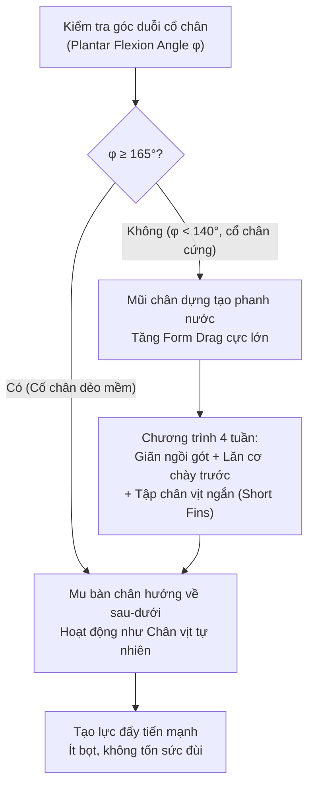

# Độ Dẻo Cổ Chân & Kỹ Thuật Đạp Ít Bọt (*Ankle Mobility*)

> **Thuộc phần:** `08-kicking/` | **Trình độ:** Cơ bản → Nâng cao | **Thời gian đọc:** ~11 phút

## Tổng Quan (Overview)
Bạn có thể có đôi chân khỏe nhất phòng gym, nhưng nếu **cổ chân cứng vuông góc 90°** (thường gặp ở người chạy bộ, đạp xe, đá bóng hoặc ngồi làm việc nhiều), mỗi cú đạp chân dưới nước sẽ hoạt động như một **cái phanh kéo ngược bạn lại** thay vì tạo lực đẩy! Cải thiện độ dẻo duỗi cổ chân (**Plantar Flexion**) thêm chỉ `15–20°` là nâng cấp có tỷ suất sinh lời cao nhất giúp cú đạp chân trở nên êm ái, ít bọt và tự động tăng tốc độ bơi.

- **Mục tiêu cốt lõi:** Đạt góc duỗi cổ chân tối thiểu **`165–180°`** (mu bàn chân thẳng hàng ống chân) để bàn chân hoạt động như một chiếc **chân vịt tự nhiên (Natural Fin)** đẩy nước ra sau.
- **Cảm giác đúng:** Bàn chân hoàn toàn mềm mại, lắc theo dòng nước như đuôi cá; khi đạp xuống cảm nhận rõ áp lực nước vuốt dọc mu bàn chân từ cổ chân tới đầu ngón chân.
- **Sai lầm phổ biến nhất:** Gồng cứng bàn chân hoặc dựng mũi chân vuông góc (*Dorsiflexion*) làm tăng lực cản hình học và thậm chí tự đẩy cơ thể trôi lùi.

---

## Lý Thuyết (Theory)
Trong thủy động lực học của cú đạp chân sải (*Flutter Kick*), bàn chân đóng vai trò là **cánh tạo lực (Hydrofoil)** ở cuối đòn bẩy chân. Hướng của lực đẩy phụ thuộc hoàn toàn vào **góc nghiêng của mu bàn chân** ở pha đạp xuống (*Downbeat*):
- **Khi cổ chân cứng (Góc ống chân – bàn chân $\approx 95–120°$, *Dorsiflexion*)**: Ở pha đạp xuống, mặt trước bàn chân hướng **về phía trước–dưới** → thành phần lực ngang hướng **ngược về phía sau** (hãm cơ thể lại hoặc đẩy bạn trôi lùi khi cầm ván tập chân!).
- **Khi cổ chân dẻo (Góc ống chân – bàn chân $\approx 165–185°$, *Plantar Flexion*)**: Ở pha đạp xuống, mu bàn chân hướng **về phía sau–dưới** → tạo ra lực phản hồi và vòng xoáy (*Vortex*) đẩy cơ thể lao thẳng về phía trước!

---

## Cơ Sở Khoa Học (Science)
### Vật Lý & Thủy Động Lực Học (Physics & Hydrodynamics)
Phân tích véc-tơ lực đẩy tiến ($F_x$) của mu bàn chân theo góc duỗi cổ chân ($\phi$):

$$F_x = F_{\text{foot}} \cdot \sin(\phi - 90°)$$

- Nếu cổ chân dựng đứng ($\phi = 90°$): $\sin(0°) = 0 \implies$ **0 lực đẩy tiến**, trong khi diện tích mặt phẳng lòng bàn chân hứng trực diện dòng nước tạo ra **Form Drag cực đại**!
- Nếu cổ chân duỗi đạt $\phi = 160°$: $\sin(70°) \approx 0.94$ — hơn **94% lực quất bàn chân** chuyển hóa thành véc-tơ đẩy tiến và lực nâng giữ hông nổi.
- Nghiên cứu của Willems et al. (2014) chứng minh rằng **cải thiện độ dẻo Plantar Flexion** có tương quan trực tiếp mạnh nhất ($r > 0.72$) với vận tốc đạp chân không ván của VĐV bơi — thậm chí quan trọng hơn cả sức mạnh cơ đùi!

### Cơ Sinh Học (Biomechanics)
Các cấu trúc giải phẫu giới hạn độ duỗi cổ chân (*Plantar Flexion*) ở người trưởng thành:
1. **Cơ chày trước (*Tibialis Anterior*) & Dải gân duỗi ngón chân**: Thường bị co rút ngắn ở người chạy bộ và đạp xe (vì hai môn này liên tục kéo mũi chân lên).
2. **Bao khớp trước cổ chân (*Anterior Ankle Capsule*)**: Trở nên xơ cứng theo thời gian nếu ít ngồi gập mũi chân.
3. **Thói quen thần kinh (*Neuromuscular Tension*)**: Nhiều người có cổ chân đủ dẻo trên cạn nhưng xuống nước lại vô thức gồng căng bàn chân vì sợ bị chuột rút hoặc cố "đạp mạnh".

---

## Thực Hành (Practical)
### Tại Sao Kỹ Thuật Này Hiệu Quả (Why It Works)
Cổ chân dẻo không chỉ giúp bạn đạp nhanh hơn ở 6-beat kick — mà còn làm **giảm mạnh lực cản thụ động ngay cả khi bạn đang bơi 2-beat kick hoặc trượt Streamline**! Một bàn chân duỗi thẳng mềm mại tạo thành điểm kết thúc thuôn nhọn (như đuôi ngư lôi) giúp dòng nước khép lại mượt mà phía sau gót chân mà không sinh ra vùng xoáy áp suất âm (*Wake Drag*).

### Hướng Dẫn Từng Bước & Cảm Giác Nước (Step-by-Step & Water Cues)
1. **Bài tự kiểm tra 10 giây trên sàn (*Seated Heel-Sit Test*)**: Quỳ gối trên thảm, duỗi thẳng mu bàn chân áp sát sàn và từ từ ngồi mông lên hai gót chân.
   - Nếu mu bàn chân áp phẳng hoàn toàn xuống sàn và không đau tức mặt trước cổ chân → Độ dẻo tốt (`≥ 170°`).
   - Nếu cổ chân bị hở cao khỏi sàn `> 3–5 cm` hoặc đau căng tức ngay lập tức → Bạn cần ưu tiên lộ trình giãn cổ chân 10 phút/ngày!
2. **Thả lỏng bàn chân như "vớ rỗng"**: Đừng gồng cố "duỗi thật cứng" mũi chân trong nước (dễ gây chuột rút lòng bàn chân!). Hãy để **áp lực dòng nước tự đẩy bàn chân bạn duỗi thẳng ra sau** khi bạn đánh đùi lên–xuống.
3. **Giữ đầu ngón chân hơi xoay vào trong (`5–10°`)**: Hai ngón chân cái hướng nhẹ vào nhau giúp mu bàn chân phẳng hơn và đón trọn dòng nước ở pha đạp xuống.
4. **Đạp kín dưới mặt nước (Ít bọt)**: Giữ toàn bộ bàn chân ngập dưới nước, chỉ để gót chân khẽ lướt qua mặt nước tạo tiếng sủi êm ái.

<!-- IMAGE_PROMPT: Technical biomechanical comparison diagram of two swimmer feet during the freestyle downbeat kick: Top shows flexible 175-degree plantar flexion acting like a smooth hydrofoil fin with green backward-pushing water vortices; Bottom shows stiff 110-degree dorsiflexed ankle creating red frontal drag and braking turbulence. -->

### Mẹo Nâng Cao (Advanced Tips)
- **Chống chuột rút lòng bàn chân khi tập dẻo cổ chân**: Chuột rút xảy ra khi bạn cố tình co các cơ nội tại lòng bàn chân để bẻ mũi chân xuống. Giải pháp: **uống đủ nước + điện giải**, tập thả lỏng các ngón chân (không quắp ngón chân), và tăng thời lượng dùng chân vịt ngắn từ từ (`200m → 400m`).
- **Tác dụng kép của chân vịt ngắn (*Short Silicone Fins*)**: Chân vịt ngắn mềm tạo lực cản nước nhẹ nhàng kéo dãn bao khớp trước cổ chân ở mọi nhịp đạp — đây là bài tập **giãn động cổ chân hiệu quả nhất trong nước** (tránh chân vịt lặn quá dài và cứng vì dễ gây đau cổ chân và gập gối).

---

## Bài Tập Thực Hành (Drills)
| Tên Drill | Mục tiêu độ dẻo cổ chân | Thời lượng / Cự ly | Cảm giác đúng (Cue) |
| :--- | :--- | :--- | :--- |
| **Seated Heel-Sit Stretch (Dryland)** | Kéo giãn cơ chày trước & bao khớp trước cổ chân | `3 hiệp × 45–60 giây` mỗi ngày | Mu bàn chân áp dần xuống thảm, căng êm không đau nhói |
| **Foam Roll Tibialis Anterior (Dryland)** | Giải phóng điểm co cứng cơ mặt trước ống chân | `2 phút` mỗi bên trước khi bơi | Lăn chậm dọc mặt ngoài xương chày, giữ 20s ở điểm căng |
| **Short-Fin Streamline Kick** | Giãn động cổ chân dưới áp lực nước & rèn cảm giác roi da | `6 × 25m` (đeo chân vịt ngắn) | Cổ chân hoàn toàn mềm, cảm nhận chân vịt uốn sóng nhẹ theo từng nhịp đùi |
| **Kick-No-Fin Contrast** | Chuyển cảm giác chân vịt sang bàn chân trần ngay lập tức | `4 × 50m` (25m có fins + tháo fins 25m trần) | Giữ nguyên cảm giác cổ chân mềm và nhịp quất nhanh như khi còn đeo fins |

### Hướng dẫn nhanh
- **Seated Heel-Sit Stretch (Tăng tiến an toàn)**: Quỳ trên thảm tập yoga (nếu quá cứng, cuộn một chiếc khăn nhỏ kê dưới cổ chân để giảm áp lực). Ngồi nhẹ mông lên gót chân trong `45 giây`, thở chậm thả lỏng. Khi đã ngồi phẳng dễ dàng không cần khăn, bạn có thể chống tay ra sau và **nhấc nhẹ hai đầu gối lên khỏi thảm `2–5 cm`** để tăng sâu biên độ Plantar Flexion lên `180°+`!

---

## Phân Tích AI & Video (AI Analysis)
- **Góc quay khuyến nghị:** Ngang dưới nước (Underwater Side View, 120 fps) zoom sát vùng cẳng chân–bàn chân.
- **Keypoints cần trích xuất:** `knee`, `ankle`, `heel`, `toe_tip`.
- **Ngưỡng phát hiện lỗi tự động:**
  - **Đạt chuẩn:** Góc `∠knee–ankle–toe_tip` tại giữa pha Downbeat đạt **`165–185°`**; diện tích bọt trắng phía sau chân thấp.
  - **Cảnh báo lỗi:** Góc `∠knee–ankle–toe_tip < 140°` (cổ chân cứng/gập mũi chân); bàn chân xoay ngoài (chữ V kiểu chân vịt ếch) thay vì xoay nhẹ vào trong.

---

## Lỗi Thường Gặp & Cách Sửa (Common Errors)
| Lỗi thường gặp | Triệu chứng nhận biết | Nguyên nhân gốc | Cách sửa (Correction) |
| :--- | :--- | :--- | :--- |
| **Dựng mũi chân vuông góc (Dorsiflexion)** | Đạp chân vất vả nhưng đứng yên hoặc trôi lùi | Cổ chân cứng hoặc thói quen chạy bộ/đạp xe kéo mũi chân lên | Tập Seated Heel-Sit + lăn cơ chày trước hàng ngày + tập Short-Fin Kick |
| **Quắp ngón chân gồng cứng gây chuột rút** | Bị chuột rút đột ngột ở gan bàn chân sau 100m | Cố dùng sức cơ bàn chân ép duỗi thay vì thả lỏng theo dòng nước | Thả lỏng hoàn toàn các ngón chân, để nước tự vuốt thẳng bàn chân |
| **Bẻ bàn chân xoay ra ngoài (Duck Feet)** | Chân đạp loạng choạng, giảm lực đẩy, dễ mỏi mặt trong gối | Thói quen đứng/đi xoay mũi chân ngoài hoặc cơ khép hông yếu | Tập tín hiệu "quẹt hai ngón chân cái" (*Brush Big Toes*) giữ mũi chân hơi xoay trong |
| **Đập gót lên cao tạo bọt trắng xóa** | Tiếng đập ầm ầm, nhiều bọt nhưng không tiến nhanh | Gập gối quá sâu ở pha Upbeat kéo cả bàn chân lên không khí | Hạ biên độ chân gọn dưới mặt nước, tập Streamline Kick không ván |

---

## Tự Đánh Giá Tại Hồ (Self Assessment)
- [ ] Tôi có thể ngồi mông lên gót chân với mu bàn chân áp phẳng xuống thảm trong `60 giây` không đau.
- [ ] Khi đạp chân trần không ván, tôi tiến đều về phía trước một cách mượt mà (không đứng yên hay trôi lùi).
- [ ] Bàn chân và các ngón chân của tôi hoàn toàn thả lỏng trong nước, không bị chuột rút gan bàn chân.
- [ ] Mặt nước phía sau hai chân tôi chỉ sủi gọn nhẹ, ít bọt trắng và ít tiếng động.
- [ ] Tôi dành ít nhất `5 phút` giãn cổ chân/cơ chày trước mỗi ngày (đặc biệt nếu tôi cũng chạy bộ hoặc đạp xe).

---

## Chỉ Số Đo Lường (KPI)
| Chỉ số (Metric) | Người mới | Trung cấp | Nâng cao (`< 1:30/100m`) |
| :--- | :---: | :---: | :---: |
| **Góc duỗi cổ chân Plantar Flexion (dưới nước)** | `< 140°` | `150–162°` | `165–185°` |
| **Khoảng hở cổ chân – sàn khi Seated Heel-Sit** | `> 4 cm` | `1–3 cm` | `0 cm` (áp phẳng hoàn toàn) |
| **Tốc độ 25m Kick trần (không ván, không fins)** | `> 38 giây` | `26–34 giây` | `< 23 giây` |
| **Tần suất bị chuột rút bàn chân khi bơi** | Thường xuyên | Thỉnh thoảng | `0 lần` |

---

## Câu Hỏi Thường Gặp (FAQ)
**1. Tôi là người chạy bộ / Triathlete, giãn cổ chân dẻo cho bơi có làm dễ lật cổ chân khi chạy không?**
Không, miễn là bạn **kết hợp giãn Plantar Flexion với tăng cường sức mạnh ổn định cổ chân** (như đứng 1 chân thăng bằng, nhón gót *Calf Raises*). Độ linh hoạt có kiểm soát thực tế còn giúp giảm nguy cơ đau ống đồng (*Shin Splints*) khi chạy bộ!

**2. Mất bao lâu để cải thiện độ dẻo cổ chân từ cứng (130°) lên chuẩn (165°)?**
Với `5–10 phút/ngày` tập Seated Heel-Sit + lăn cơ chày trước kết hợp bơi với chân vịt ngắn `2–3 buổi/tuần`, hầu hết người trưởng thành thấy cải thiện rõ rệt sau **3–4 tuần** và đạt chuẩn ổn định sau **8–12 tuần**.

**3. Nên chọn loại chân vịt nào để tập dẻo cổ chân tốt nhất?**
Chọn **chân vịt ngắn bằng silicon mềm (Short Blade Silicone Fins)** — ví dụ dòng Finis Zoomers Gold, Arena Powerfin Pro hoặc tương đương. Tuyệt đối tránh chân vịt lặn dài vì chúng làm hỏng nhịp đạp và gây quá tải gân cổ chân.

---

## Tóm Tắt (Summary)
- **Độ dẻo cổ chân (*Plantar Flexion ≥ 165°*)** là yếu tố quyết định biến bàn chân từ "tấm phanh nước" thành "chân vịt tự nhiên" tạo lực đẩy ít bọt.
- Không gồng cứng duỗi mũi chân — hãy **thả lỏng hoàn toàn** để áp lực nước vuốt thẳng mu bàn chân, kết hợp xoay nhẹ ngón chân cái vào trong (`5–10°`).
- Lộ trình 3 bước nhanh nhất: **Seated Heel-Sit Stretch + Lăn cơ chày trước hàng ngày + Short-Fin Contrast Kick**.

**Liên kết chéo:**
- Chương trước: [6-Beat Kick](six-beat-kick.md)
- Chương tiếp theo: [Dolphin Kick Dưới Nước & Đồng Bộ Nhịp Chân](dolphin-and-kick-timing.md)
- Kỹ thuật liên quan: [Mobility Vai, Cột Sống Ngực & Cổ Chân](../19-mobility/shoulder-thoracic-ankle-mobility.md)
- Tra cứu thuật ngữ: [Glossary](../24-appendix/glossary.md)

---

## Tài Liệu Tham Khảo (References)
1. Willems, T. M., Cornelis, J. A., De Deurwaerder, L. E., Roelandt, F., & De Mits, S. (2014). *The effect of ankle muscle strength and flexibility on dolphin kick performance in competitive swimmers*. Human Movement Science, 36, 167–176.
2. McLeod, I. (2010). *Swimming Anatomy*. Human Kinetics.
3. USA Swimming — *Ankle Flexibility & Kicking Mechanics Guidelines*.

