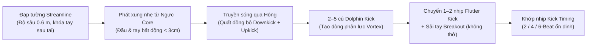

# Dolphin Kick Dưới Nước & Đồng Bộ Nhịp Chân (*Dolphin & Kick Timing*)

> **Thuộc phần:** `08-kicking/` | **Trình độ:** Trung cấp → Nâng cao | **Thời gian đọc:** ~12 phút

## Tổng Quan (Overview)
Trong bơi bể (`25m` và `50m`), giai đoạn **Dolphin Kick dưới nước (*Underwater Dolphin Kick — UDK / SDK*)** ngay sau xuất phát và sau mỗi lần lộn vòng được mệnh danh là **"kiểu bơi thứ 5"** — bởi đây là thời điểm cơ thể đạt vận tốc cao nhất mà không chịu lực cản sóng bề mặt (*Wave Drag ≈ 0*). Bên cạnh đó, việc **đồng bộ hóa thời điểm chuyển tiếp** từ Dolphin Kick sang Flutter Kick và khớp nhịp chân với tay (*Kick Timing*) quyết định bạn có giữ trọn vẹn tốc độ xuyên suốt cự ly `< 1:30/100m` hay không.

- **Mục tiêu cốt lõi:** Thực hiện 2–5 cú **Dolphin Kick uốn sóng từ ngực–core–hông** ở độ sâu `0.6 m` sau mỗi thành bể, rồi chuyển mượt sang sải tay Breakout và giữ đồng bộ nhịp chân–hông không bị lạc pha.
- **Cảm giác đúng:** Toàn thân uốn lượn như một con cá heo gọn gàng trong ống nước hẹp, hai bàn chân quất đồng bộ cả hai chiều (lên và xuống) phóng cơ thể qua vạch 7–10m êm ru.
- **Sai lầm phổ biến nhất:** Uốn sóng bằng cách gập đầu gối quá sâu hoặc vung hai cánh tay Streamline lên xuống làm phá vỡ mũi tên cắt nước.

---

## Lý Thuyết (Theory)
**Underwater Dolphin Kick (UDK)** dựa trên nguyên lý **truyền sóng dọc trục cơ thể (*Undulatory Propulsion*)** giống loài cá heo và cá voi:
1. Sóng bắt đầu nhỏ từ **xương ức / lồng ngực trên** (*Chest Press*), truyền qua **Core & Hông** với biên độ tăng dần, và giải phóng năng lượng cực đại bằng cú **quất roi của hai bàn chân khép sát**.
2. Khác với suy nghĩ cũ chỉ tập trung đạp xuống (*Downkick*), Dolphin Kick hiện đại là **động cơ 2 chiều (*Bi-Directional Propulsion*)**: cả cú quất xuống (cơ bụng + gập hông + đùi trước) lẫn cú kéo lên (cơ lưng dưới + cơ mông + gân kheo) đều tạo ra vòng xoáy đẩy (*Reverse Kármán Vortex Street*) phóng cơ thể tiến tới!

### Nguyên tắc Đồng Bộ Nhịp Chân (*Kick Timing*)
Dù là giai đoạn chuyển tiếp từ Dolphin sang bơi mặt nước hay trong suốt quá trình bơi sải:
- **Quy tắc Chuyển Tiếp Breakout**: Thực hiện `1–2 nhịp Flutter Kick` chuyển giao ngay ở `0.5 giây` cuối khi cơ thể trồi gần sát mặt nước để nâng hông và kích hoạt sải tay đầu tiên (*First Pull*) mà không bị khựng tốc độ.
- **Quy tắc Khóa Pha Tay–Chân**: Nhịp đạp chân mạnh nhất (**Accent Beat**) luôn phải trùng khớp với khoảnh khắc **tay đối bên vào nước–trượt** và **hông xoay xuống `35–45°`**.

---

## Cơ Sở Khoa Học (Science)
### Vật Lý & Thủy Động Lực Học (Physics & Hydrodynamics)
- **Lợi thế "0 Wave Drag"**: Ở độ sâu `0.6–0.8 m` (xem [Streamline](../04-body-position/streamline.md)), lực cản sóng gần như bằng 0. Một VĐV có UDK tốt có thể duy trì vận tốc **`1.6–2.0 m/s`** trong `5–10 m` đầu sau tường — nhanh hơn tốc độ bơi mặt nước từ `0.3–0.6 m/s`!
- **Cơ chế Xoáy Kármán Ngược (*Reverse Kármán Vortex Street*)**: Khi hai bàn chân khép sát quất lên–xuống với biên độ gọn (`40–50 cm`) và tần suất cao (`1.8–2.5 Hz`), mỗi lần đổi chiều của mũi chân tách ra một cặp xoáy nước ngược chiều nhau tạo thành một **luồng phản lực (Jet Flow)** bắn thẳng về phía sau, đẩy cơ thể tiến thẳng về trước với hiệu suất đẩy $\eta_p$ vượt trội so với Flutter Kick.
- **Cảnh báo biên độ quá lớn**: Nếu bạn uốn sóng quá to ở phần vai và đầu gối, diện tích mặt cắt cản $A$ tăng vọt làm triệt tiêu toàn bộ lợi ích của Dolphin Kick — khi đó **trượt Streamline im lìm thậm chí còn nhanh hơn Dolphin Kick sai kỹ thuật!**

### Cơ Sinh Học (Biomechanics)
Sự phân bố biên độ sóng chuẩn dọc theo cơ thể (tính từ mũi tay tới mũi chân):
- **Hai bàn tay & Đầu (Streamline Lock)**: Gần như **bất động (`< 3 cm`)** — giữ mũi tên cắt nước sắc bén.
- **Lồng ngực & Core**: Biên độ nhỏ (`5–8 cm`), đóng vai trò phát xung nhịp.
- **Hông**: Biên độ trung bình (`10–15 cm`), dẫn động trực tiếp hai đùi.
- **Đầu gối**: Hơi mềm thụ động (`135–150°` ở pha chuyển), tuyệt đối không gập sâu `90°`.
- **Hai bàn chân khép sát**: Biên độ lớn nhất (`35–50 cm`), cổ chân duỗi dẻo tối đa (`≥ 170°`).

---

## Thực Hành (Practical)
### Tại Sao Kỹ Thuật Này Hiệu Quả (Why It Works)
Trong một cự ly `100m` bể `25m`, chỉ cần thêm **3 cú Dolphin Kick gọn** sau mỗi lần đạp tường (4 lần/100m), bạn rút ngắn quãng đường phải quạt tay từ `100m` xuống chỉ còn **`~65–72m`**! Điều này không chỉ giúp bạn dễ dàng vượt qua cột mốc `< 1:30/100m`, mà còn cho đôi tay thêm vài giây nghỉ ngơi quý giá sau mỗi chiều bể.

### Hướng Dẫn Từng Bước & Cảm Giác Nước (Step-by-Step & Water Cues)
1. **Khóa chặt Streamline trước, uốn sóng sau**: Đạp tường sâu `0.6 m`, lướt thẳng `1–1.5 m` để tận dụng tốc độ đỉnh từ thành bể (đừng đạp Dolphin ngay lập tức ở mét đầu tiên khi vận tốc đang lớn hơn tốc độ Dolphin!).
2. **Tín hiệu "Bụng ép xuống → Mông đẩy lên"**: Cảm nhận nhịp sóng phát ra từ vùng giữa thân (*Core–Hông*), không phải từ việc đá cẳng chân.
3. **Chú trọng pha Kéo Lên (*Upkick*)**: Hầu hết người bơi chỉ có lực ở cú đập xuống. Hãy chủ động dùng **cơ mông và gân kheo** quất hai gót chân lên sát mặt phẳng thân — đây là bí mật nhân đôi lực đẩy Dolphin Kick.
4. **Quy tắc "Đi qua vạch 5m"**: Đặt mục tiêu tối thiểu cho mọi chiều bể tập luyện là giữ Streamline + `2–3 cú Dolphin Kick` vượt qua vạch cờ 5m rồi mới Breakout.
5. **Canh chuẩn nhịp Breakout**: Ở cú Dolphin cuối cùng, hơi hướng mũi tay chếch lên `10°`, chuyển sang 1 nhịp Flutter Kick cùng lúc kéo sải tay đầu tiên ngay khi lưng vừa chạm mặt nước.

<!-- IMAGE_PROMPT: Technical underwater side-view sequence diagram of Underwater Dolphin Kick at 0.6m depth: showing rigid motionless Streamline hands/head (<3cm oscillation), progressive wave amplitude expanding from chest (6cm) -> hips (12cm) -> feet (45cm), bi-directional green propulsion vectors for both downkick and upkick, and trailing Reverse Karman Vortex Street. -->

### Mẹo Nâng Cao (Advanced Tips)
- **Số cú Dolphin Kick tối ưu theo cự ly**:
  - `50m–100m` (Tốc độ cao): **4–6 cú** (đi tới `8–12 m`) nếu vận tốc Dolphin của bạn nhanh hơn vận tốc bơi mặt nước.
  - `400m–1.500m` (Đường dài / Triathlon): **1–3 cú gọn** (đi tới `5–7 m`) để bảo toàn oxy và tránh tích tụ $CO_2$ sớm.
- **Tập Dolphin Kick ở tư thế nằm NGỬA và NGHIÊNG**: Tập Dolphin nằm ngửa (*Backstroke Underwater*) và nằm nghiêng (*Side Dolphin*) buộc bạn phải dùng đều cả cơ bụng lẫn cơ lưng–mông (vì trọng lực không còn "giúp" bạn ở pha đạp xuống nữa).

---

## Bài Tập Thực Hành (Drills)
| Tên Drill | Mục tiêu Dolphin & Timing | Cự ly / Số hiệp | Cảm giác đúng (Cue) |
| :--- | :--- | :--- | :--- |
| **Side & Back Dolphin (Có Short Fins)** | Rèn lực 2 chiều (Downkick = Upkick) & triệt tiêu lỗi gập gối | `4 × 25m` (25m nghiêng trái, 25m nghiêng phải, 25m ngửa, 25m sấp) | Hai bàn chân quất đều cả hai hướng trước–sau, tay Streamline bất động |
| **Vertical Dolphin Kick (Nước sâu)** | Cảm nhận sóng xuất phát từ Core–Hông, giữ đầu đứng yên | `6 × 15 giây` (nghỉ 20s) | Giữ cằm ngang mặt nước bằng nhịp uốn hông nhỏ và nhanh, không gập gối |
| **Wall Push + 3 Dolphin + Breakout** | Chuẩn hóa chuỗi chuyển tiếp từ tường vào sải tay đầu tiên | `8 × 15m` (nghỉ 20s) | Trượt 1.5m → 3 Dolphin gọn → 1 sải tay Breakout không thở vượt vạch 7m |

### Hướng dẫn nhanh
- **Side Dolphin (Với Short Fins)**: Nằm nghiêng hoàn toàn 90° dưới mặt nước, tay dưới vươn thẳng Streamline, tay trên áp dọc đùi. Uốn sóng Dolphin theo phương ngang (đạp về phía trước bụng và quất ngược về phía sau lưng bằng nhau). Bài tập này sửa lỗi "chỉ biết đạp xuống" chỉ sau 2 buổi tập!

---

## Phân Tích AI & Video (AI Analysis)
- **Góc quay khuyến nghị:** Ngang dưới nước (Underwater Side View, 120 fps) bao quát đoạn `0–12 m` tính từ thành bể.
- **Điểm khớp cần trích xuất (Keypoints):** `wrist`, `shoulder`, `hip`, `knee`, `ankle`, `toe_tip`.
- **Ngưỡng phát hiện lỗi tự động:**
  - **Đạt chuẩn:** Biên độ dọc của `wrist` `< 5 cm`; biên độ dọc của `toe_tip` `35–50 cm`; vận tốc trung bình đoạn `2–7 m` lớn hơn vận tốc bơi mặt nước (`v_udk ≥ v_swim`); góc gập gối tối thiểu `≥ 135°`.
  - **Cảnh báo lỗi:** `wrist` dao động lên xuống `> 10 cm` (lỗi lắc tay phá Streamline); góc gập gối `< 115°` (đạp xe dưới nước); vận tốc giảm sâu ngay tại khung hình Breakout (chuyển pha muộn hoặc thở ngay sải đầu).

---

## Lỗi Thường Gặp & Cách Sửa (Common Errors)
| Lỗi thường gặp | Triệu chứng nhận biết | Nguyên nhân gốc | Cách sửa (Correction) |
| :--- | :--- | :--- | :--- |
| **Vung tay Streamline lên xuống theo sóng** | Mũi tay chao đảo, tốc độ trượt tụt rất nhanh | Để sóng truyền ngược lên vai và cánh tay do thiếu kiểm soát Core | Khóa cứng bắp tay sau tai, tập cảm giác tay đâm xuyên một đường thẳng cố định |
| **Gập gối sâu (> 60°) thay vì uốn hông** | Đùi kéo phanh cực mạnh, nổi lên sớm ngay ở mét thứ 4 | Không biết phát sóng từ xương ức và khớp hông | Tập Vertical Dolphin Kick và Side Dolphin với chân vịt ngắn |
| **Chỉ đạp xuống, bỏ quên pha kéo lên (Upkick)** | Cơ thể trồi sụt nhấp nhô lên xuống thay vì lao thẳng ngang | Yếu cơ mông–gân kheo hoặc chưa có ý thức quất gót chân lên | Tập Back & Side Dolphin để cân bằng 50/50 lực hai chiều |
| **Lạm dụng quá nhiều cú Dolphin khi thiếu oxy** | Ngoi lên mặt nước hụt hơi, 15m sau bơi cực chậm | Cố đạp 6–8 cú trong khi nền hiếu khí chưa đủ hoặc tốc độ UDK chậm hơn bơi thường | Giới hạn `2–3 cú` gọn trong cự ly dài; luôn đo thời gian 15m để chọn số cú tối ưu |

---

## Tự Đánh Giá Tại Hồ (Self Assessment)
- [ ] Tôi thực hiện tối thiểu `2–3 cú` Dolphin Kick gọn sau mỗi lần đạp tường ở độ sâu `0.5–0.7 m`.
- [ ] Hai cánh tay và đầu của tôi giữ bất động hoàn toàn khi đang uốn sóng Dolphin dưới nước.
- [ ] Tôi cảm nhận rõ lực đẩy ở cả pha đập xuống (*Downkick*) lẫn pha kéo lên (*Upkick*).
- [ ] Giai đoạn chuyển tiếp từ Dolphin Kick sang sải tay Breakout diễn ra mượt mà, không khựng tốc độ và không thở ở sải đầu tiên.
- [ ] Tôi biết điều chỉnh số cú Dolphin Kick phù hợp: ít hơn (`2–3 cú`) cho 400m–1500m và nhiều hơn (`4–6 cú`) cho 50m–100m.

---

## Chỉ Số Đo Lường (KPI)
| Chỉ số (Metric) | Người mới | Trung cấp | Nâng cao (`< 1:30/100m`) |
| :--- | :---: | :---: | :---: |
| **Cự ly Breakout chuẩn sau tường (Streamline + UDK)** | `4–5 m` | `6–8 m` | `8–11+ m` |
| **Thời gian từ tường tới mốc 10m (UDK + Breakout)** | `> 8.0 giây` | `6.5–7.5 giây` | `< 6.0 giây` |
| **Biên độ dao động dọc của mũi tay Streamline** | `> 12 cm` | `6–10 cm` | `< 4 cm` |
| **Tốc độ 25m Underwater Dolphin (với Short Fins)** | `> 22 giây` | `17–20 giây` | `< 15 giây` |

---

## Câu Hỏi Thường Gặp (FAQ)
**1. Nếu tốc độ Dolphin Kick của tôi hiện tại chậm hơn tốc độ bơi mặt nước thì sao?**
Trong thi đấu, chỉ thực hiện số cú Dolphin mà bạn vẫn duy trì tốc độ cao hơn bơi mặt nước (thường là `1–2 cú` sau khi trượt Streamline). Trong tập luyện, hãy dành `100–150m` mỗi buổi tập **Side/Back Dolphin với Short Fins** — sau 6–8 tuần, Dolphin Kick sẽ trở thành vũ khí nhanh nhất của bạn!

**2. Khi bơi bể 25m, tôi nên đạp Dolphin Kick trên lưng (ngửa) hay trên bụng (sấp)?**
Trong bơi sải, sau khi lộn vòng (*Flip Turn*), nhiều VĐV rời tường ở tư thế hơi nghiêng/ngửa rồi **xoay dần về sấp trong 1–2 cú Dolphin đầu tiên** để tiết kiệm thời gian xoay người tại tường và tránh mất quán tính.

**3. Nên thở ra lúc nào trong lúc đang đạp Dolphin Kick dưới nước?**
Thở ra thật chậm và mảnh bằng mũi ngay từ cú Dolphin thứ 2 để giữ áp suất dương ngăn nước vào mũi và xả $CO_2$ sớm, giúp bạn không bị ngộp khi bước vào 2 sải Breakout không thở.

---

## Tóm Tắt (Summary)
- **Underwater Dolphin Kick** ở độ sâu `0.6 m` khai thác vùng **0 Wave Drag**, giúp bạn đạt vận tốc cao nhất của cả chiều bể và tiết kiệm sức tay đáng kể.
- Kỹ thuật chuẩn: **Tay & Đầu bất động (`< 4 cm`) + Phát sóng từ Ngực–Core–Hông + Quất đều 2 chiều (Downkick & Upkick) + Cổ chân dẻo**.
- Kết hợp chuyển tiếp mượt sang **Breakout không thở** để giữ trọn vẹn đà lướt vào nhịp chân bơi mặt nước (2/4/6-beat).

**Liên kết chéo:**
- Chương trước: [Độ Dẻo Cổ Chân](ankle-mobility.md)
- Chương tiếp theo (Phase 5): [Front-Quadrant Swimming & Nhịp Điệu Sải Tay](../12-rhythm/rhythm-and-timing.md)
- Kỹ thuật liên quan: [Streamline](../04-body-position/streamline.md) · [Sprint, Starts & Flip Turns](../16-sprint/sprint-starts-and-turns.md)
- Tra cứu thuật ngữ: [Glossary](../24-appendix/glossary.md)

---

## Tài Liệu Tham Khảo (References)
1. Loebbecke, A., Mittal, R., Mark, R., & Hahn, J. (2009). *A computational method for analysis of underwater dolphin kick hydrodynamics in human swimming*. Sports Biomechanics, 8(1), 60–77.
2. Connaboy, C., Coleman, S., & Sanders, R. H. (2009). *Hydrodynamics of undulatory underwater swimming: A review*. Sports Biomechanics, 8(4), 360–380.
3. USA Swimming — *Underwater Dolphin Kick & Breakout Progression Manual*.

