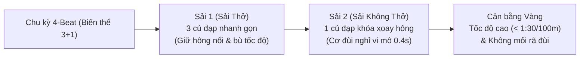

# Kỹ Thuật Chân 4 Nhịp (*4-Beat Kick*) — Cầu Nối Tốc Độ & Chuyển Nhịp

> **Thuộc phần:** `08-kicking/` | **Trình độ:** Trung cấp → Nâng cao | **Thời gian đọc:** ~10 phút

## Tổng Quan (Overview)
Nếu **2-Beat Kick** là số 2 tiết kiệm nhiên liệu và **6-Beat Kick** là số 6 tăng tốc hết ga, thì **4-Beat Kick** chính là **hộp số trung gian linh hoạt nhất** của bơi sải hiện đại. Rất nhiều VĐV bơi `200m–800m` (kể cả những nhà vô địch Olympic như Ian Thorpe hay Katie Ledecky ở nhịp Gallop) sử dụng biến thể 4-beat kick để vừa **tăng thêm lực ổn định & tốc độ**, vừa **không bị kiệt sức cơ đùi** như 6-beat liên tục.

- **Mục tiêu cốt lõi:** Hiểu cấu trúc bất đối xứng tự nhiên của 4-beat kick (thường là `3 nhịp bên kéo/thở + 1 nhịp bên trượt` hoặc `2 nhịp đều mỗi sải`) và biết cách chuyển số mượt từ `2 → 4 → 6-beat`.
- **Cảm giác đúng:** Nhịp chân có "độ nảy" tự nhiên, hỗ trợ nâng hông rõ rệt ở pha thở và tạo đà tăng tốc mượt khi bơi ở ngưỡng tốc độ CSS (`1:25–1:35/100m`).
- **Sai lầm phổ biến nhất:** Cố đếm máy móc từng cú đạp 1-2-3-4 làm mất tự nhiên, hoặc đạp rộng chân ở nhịp chuyển sang thở.

---

## Lý Thuyết (Theory)
Trong 1 chu kỳ tay đầy đủ (1 sải trái + 1 sải phải), **4-Beat Kick** thực hiện tổng cộng **4 cú đạp xuống**. Trên thực tế cơ sinh học, 4-beat kick tồn tại dưới **2 biến thể chính**:

1. **4-Beat Bất Đối Xứng (*Asymmetric / Gallop 4-Beat — 3+1*)**:
   - Đây là dạng phổ biến nhất ở các VĐV bơi `200m–800m` tốc độ cao (nhất là khi thở nhịp 1:2).
   - **Sải bên thở (hoặc bên kéo mạnh)**: Đạp **3 nhịp nhanh** giúp ổn định hông tuyệt đối trong lúc xoay đầu lấy hơi và phóng cơ thể đi mạnh mẽ.
   - **Sải bên không thở**: Đạp **1 nhịp gọn** (như 2-beat) để chân kịp nghỉ nhẹ `0.4 giây` trước khi lặp lại chu kỳ.
2. **4-Beat Đối Xứng (*Symmetric 4-Beat — 2+2*)**:
   - Đạp 2 nhịp gọn cho mỗi sải tay — thường xuất hiện tự nhiên ở người bơi tốc độ trung bình–cao (`1:30–1:40/100m`) có nhịp tay vừa phải (`65–72 SPM`).

---

## Cơ Sở Khoa Học (Science)
### Vật Lý & Thủy Động Lực Học (Physics & Hydrodynamics)
Tại sao **4-Beat Kick (3+1)** lại cực kỳ hiệu quả ở ngưỡng tốc độ `1:25–1:35/100m`?
- **Lấp đầy "hố sụt tốc độ" khi thở**: Trong bơi sải, khoảnh khắc xoay đầu lấy hơi thường là lúc vận tốc tiến tới giảm nhẹ (`-5–8%`). Cú đạp 3 nhịp nhanh đúng vào sải thở giúp **bù đắp trực tiếp phần vận tốc bị sụt**, giữ cho biểu đồ vận tốc trong chu kỳ (*IVV*) phẳng hơn hẳn so với 2-beat kick.
- **Tối ưu hóa tỷ số Lực đẩy / Tiêu hao Oxy**:
  - Tiêu hao oxy của 4-beat nằm chính giữa 2-beat và 6-beat (tiết kiệm ~15% oxy so với 6-beat).
  - Đồng thời tăng thêm ~3–5% lực ổn định và đẩy tiến so với 2-beat khi bạn cần giữ tốc độ `< 1:30/100m` qua cự ly `400m–800m`.

### Cơ Sinh Học (Biomechanics)
Sự luân phiên giữa **pha đạp nhanh (3 nhịp)** và **pha nghỉ ngắn (1 nhịp)** trong 4-beat bất đối xứng tạo ra chu kỳ **Co – Xả vi mô (*Micro-Recovery*)** cho cơ tứ đầu đùi (*Quadriceps*) và cơ thắt lưng chậu (*Iliopsoas*):
- Máu được bơm lưu thông qua cơ đùi ngay trong nhịp nghỉ 1-beat, làm chậm đáng kể quá trình tích tụ axit lactic (*Lactate Accumulation*) so với 6-beat liên tục.
- **Cảnh báo kỹ thuật**: Vì 4-beat (3+1) có tính bất đối xứng, người bơi nên định kỳ đổi bên thở (ví dụ chiều đi thở phải, chiều về thở trái) để tránh lệch cơ hông–vai lâu dài.

---

## Thực Hành (Practical)
### Tại Sao Kỹ Thuật Này Hiệu Quả (Why It Works)
Bạn **không cần ép não đếm "1-2-3-4"**! 4-beat kick là nhịp điệu tự nhiên hình thành khi bạn biết cách **điều tốc nhịp chân theo nhu cầu của từng pha**. Với nhiều người bơi phong trào đang chuyển từ `1:45/100m` xuống `< 1:30/100m`, 4-beat kick là bước đệm hoàn hảo: nó giúp hông không bị chìm ở tốc độ cao mà vẫn không khiến bạn hụt hơi sau 100m đầu tiên.

### Hướng Dẫn Từng Bước & Cảm Giác Nước (Step-by-Step & Water Cues)
1. **Tập chuyển số (*Gear Shifting*) từ 2-Beat lên 4-Beat**: Bắt đầu bơi 25m với 2-beat kick êm ái. Ở 25m tiếp theo, tăng tốc độ tay nhẹ và **thêm 2 cú đạp nhỏ** ngay trong sải thở — bạn sẽ thấy cơ thể lướt bật lên rõ rệt.
2. **Giữ biên độ nhỏ và sắc**: Cả 4 nhịp đều phải nằm gọn trong biên độ `20–30 cm`, cổ chân mềm, không mở gối rộng.
3. **Cảm nhận "nhịp trống" (*Drumbeat Rhythm*)**: Với biến thể 3+1, nhịp chân nghe trong đầu giống tiếng trống: *"Tùm-tách-tách... TÙM... Tùm-tách-tách... TÙM..."*.
4. **Duy trì Core khóa phẳng**: Khi tăng số nhịp chân lên 4, giữ xương chậu trung tính để hông không bị nảy lên xuống theo nhịp đạp.

<!-- IMAGE_PROMPT: Clean sports science timeline chart comparing 2-Beat, 4-Beat (3+1 asymmetric), and 6-Beat kick pulses aligned against one complete freestyle arm cycle (Left Entry -> Left Pull -> Right Entry -> Right Pull), highlighting the micro-recovery window and breathing stability zone in the 4-Beat rhythm. -->

### Mẹo Nâng Cao (Advanced Tips)
- **Chiến thuật "Chuyển số trong thi đấu 400m–800m"**:
  - 100m đầu (tạo nhịp): **2-beat kick** giữ nhịp tim thấp.
  - 200m–600m giữa (giữ pace CSS): **4-beat kick** duy trì tốc độ `< 1:30/100m` ổn định.
  - 100m cuối (nước rút về đích): **6-beat kick** bung hết công suất!
- **Đừng quá ám ảnh nếu nhịp chân bạn tự nhiên rơi vào 4-beat**: Rất nhiều VĐV chuyên nghiệp không hề cố tình tập 4-beat — cơ thể họ tự chọn 4-beat như giải pháp tối ưu năng lượng nhất cho chiều dài chân và tần suất tay của riêng họ.

---

## Bài Tập Thực Hành (Drills)
| Tên Drill | Mục tiêu 4-Beat Kick | Cự ly / Số hiệp | Cảm giác đúng (Cue) |
| :--- | :--- | :--- | :--- |
| **Kick Gear-Shift (2 → 4 → 6)** | Kiểm soát chủ động việc tăng/giảm nhịp chân không phá dáng tay | `4 × 75m` (25m 2-beat + 25m 4-beat + 25m 6-beat) | Tay giữ nguyên độ dài DPS, chỉ cảm nhận "động cơ phía sau" tăng dần số vòng tua |
| **Breathing-Side 3-Kick Burst** | Dùng 3 nhịp chân gọn nâng hông đúng vào khoảnh khắc xoay thở | `4 × 50m` (nghỉ 20s) | Hông không tụt dù chỉ 1 cm khi xoay mặt lấy hơi |
| **Tempo Trainer 4-Beat Pace** | Giữ tốc độ ngưỡng CSS ổn định với nhịp chân 4-beat tiết kiệm sức | `4 × 100m` @ CSS (nghỉ 20s) | Hơi thở đều, tốc độ từng 25m chênh nhau `< 0.5 giây` |

### Hướng dẫn nhanh
- **Kick Gear-Shift (`4 × 75m`)**:
  - 25m đầu: Bơi 2-beat kick cực êm, đếm số sải tay (ví dụ `15 sải`).
  - 25m giữa: Tăng lên 4-beat kick (nhịp tự nhiên hơn), giữ nguyên `15 sải` nhưng cảm nhận thời gian nhanh hơn `1–1.5 giây`.
  - 25m cuối: Đẩy lên 6-beat kick mạnh mẽ, vẫn giữ tay nhẹ không loạn nhịp.

---

## Phân Tích AI & Video (AI Analysis)
- **Góc quay khuyến nghị:** Ngang dưới nước (Underwater Side View, 120 fps) ghi hình tối thiểu 4 chu kỳ tay liên tiếp để phân tích chu kỳ lặp lại.
- **Keypoints cần trích xuất:** `left_ankle`, `right_ankle`, `left_wrist`, `right_wrist`, `hip`.
- **Ngưỡng phát hiện lỗi tự động:**
  - **Đạt chuẩn:** Tỷ lệ số cú đạp trên mỗi chu kỳ tay = `4.0 ± 0.2`; biên độ cổ chân ổn định `20–35 cm`; độ sụt độ cao hông tại khung hình thở `< 5 cm`.
  - **Cảnh báo lỗi:** Một nhịp đạp đột ngột mở rộng `> 50 cm` (lỗi đá kéo xen kẽ giả dạng 4-beat); góc gập gối `< 135°` ở nhịp tăng tốc.

---

## Lỗi Thường Gặp & Cách Sửa (Common Errors)
| Lỗi thường gặp | Triệu chứng nhận biết | Nguyên nhân gốc | Cách sửa (Correction) |
| :--- | :--- | :--- | :--- |
| **Đá kéo 1 nhịp lớn ở bên thở** | Trông giống 4-beat nhưng 1 nhịp mở toang hai chân làm phanh nước | Dùng chân làm đối trọng sai cách khi xoay thở | Giữ hai đùi luôn lướt sát trong "đường ống" bề rộng vai |
| **Cố đếm nhịp gây cứng tay** | Sải tay bị khựng, mất tự nhiên khi cố đếm "1-2-3-4" | Não bị quá tải khi điều khiển ý thức từng cú đạp chân | Không đếm máy móc; tập **Kick Gear-Shift** để cảm nhận theo cường độ |
| **Tăng nhịp chân nhưng tay cũng loạn theo** | Vừa tăng lên 4-beat là tay vội quạt nhanh hơn, sụp khuỷu EVF | Thiếu khả năng tách biệt tần suất tay và tần suất chân | Tập giữ nguyên Stroke Count trong suốt bài `75m Gear-Shift` |
| **Lệch cơ 1 bên do 3+1 kéo dài** | Đau mỏi 1 bên hông hoặc lưng dưới sau nhiều tuần | Luôn bơi 3+1 và chỉ thở 1 bên duy nhất | Đổi bên thở theo chiều bể (2:2) hoặc xen kẽ bơi 1:3 trong khởi động |

---

## Tự Đánh Giá Tại Hồ (Self Assessment)
- [ ] Tôi có thể chủ động chuyển mượt từ 2-beat sang 4-beat rồi lên 6-beat ngay trong một lần bơi 75m.
- [ ] Khi tăng nhịp chân lên 4-beat, số sải tay (Stroke Count) của tôi giữ ổn định và không bị sụp khuỷu EVF.
- [ ] Phần hông của tôi giữ độ cao ổn định ngay cả ở pha xoay đầu thở trong tốc độ CSS.
- [ ] Tôi không bị mỏi rã cơ đùi sau chuỗi bài tập `4 × 100m` ở tốc độ mục tiêu.
- [ ] Biên độ chân của tôi vẫn gọn và ít bọt trắng dù tăng tốc độ đạp.

---

## Chỉ Số Đo Lường (KPI)
| Chỉ số (Metric) | Người mới | Trung cấp | Nâng cao (`< 1:30/100m`) |
| :--- | :---: | :---: | :---: |
| **Khả năng chuyển số (2 → 4 → 6 beat)** | Chưa phân biệt được | Chuyển được 2 ↔ 6 | Chuyển mượt 3 cấp độ giữ nguyên DPS |
| **Độ ổn định tốc độ 4 × 100m @ CSS (4-Beat)** | Chênh `> 5s/100m` | Chênh `2–4s/100m` | Chênh `< 1.5s/100m` |
| **Biên độ dọc cổ chân ở 4-Beat** | `> 45 cm` | `30–40 cm` | `22–32 cm` |
| **Mức tăng tốc độ (2-Beat → 4-Beat / 25m)** | Không đổi / chậm đi | Nhanh hơn `0.5–1s` | Nhanh hơn `1–1.5s` giữ nguyên nhịp thở |

---

## Câu Hỏi Thường Gặp (FAQ)
**1. 4-Beat Kick có phải là lỗi kỹ thuật không?**
Tuyệt đối không! Trước đây nhiều sách cũ chỉ dạy 2-beat hoặc 6-beat, nhưng phân tích video tốc độ cao trên hàng trăm VĐV Olympic 200m–1500m cho thấy **4-beat (đặc biệt là biến thể 3+1)** là một trong những nhịp chân hiệu quả nhất thế giới ở cự ly trung bình và dài.

**2. Tôi nên chọn 2-Beat hay 4-Beat cho mục tiêu bơi 100m dưới `1:30`?**
Với cự ly **100m**, bạn có thể dùng **4-beat hoặc 6-beat** để tối ưu tốc độ. Nhưng nếu mục tiêu là giữ pace **`< 1:30/100m` liên tục cho 400m–1.500m**, hãy chọn **2-beat hoặc 4-beat** tùy theo cảm giác nhịp tim và độ nổi tự nhiên của chân bạn.

**3. Làm sao biết mình đang bơi 4-beat chuẩn hay đang bị loạn nhịp chân?**
Quay một đoạn video 15 giây ngang dưới nước rồi phát chậm 0.25x: nếu 4 cú đạp có **mẫu lặp lại đồng nhất** qua mọi chu kỳ tay và không có cú đá kéo mở gối nào thì đó là 4-beat chuẩn.

---

## Tóm Tắt (Summary)
- **4-Beat Kick** (gồm biến thể `3+1` bất đối xứng và `2+2` đối xứng) là cầu nối tối ưu giữa tiết kiệm oxy của 2-beat và lực ổn định/tốc độ của 6-beat.
- Cực kỳ hiệu quả cho cự ly **`200m–800m`** và các bài tập tốc độ ngưỡng CSS (`1:25–1:35/100m`).
- Rèn luyện khả năng **chuyển số chủ động (2 → 4 → 6)** bằng bài `Kick Gear-Shift` giúp bạn làm chủ hoàn toàn chiến thuật phân phối sức.

**Liên kết chéo:**
- Chương trước: [2-Beat Kick](two-beat-kick.md)
- Chương tiếp theo: [6-Beat Kick](six-beat-kick.md)
- Kỹ thuật liên quan: [SWOLF, CSS & Hệ Năng Lượng](../14-stroke-count/swolf-and-energy-systems.md) · [Katie Ledecky Analysis](../athletes/katie-ledecky.md)
- Tra cứu thuật ngữ: [Glossary](../24-appendix/glossary.md)

---

## Tài Liệu Tham Khảo (References)
1. Maglischo, E. W. (2003). *Swimming Fastest*. Human Kinetics.
2. Chollet, D., et al. (2000). *Index of coordination and kicking patterns in front crawl*. International Journal of Sports Medicine.
3. SwimSmooth Technical Library — *2-Beat vs 4-Beat vs 6-Beat Kicking*.

