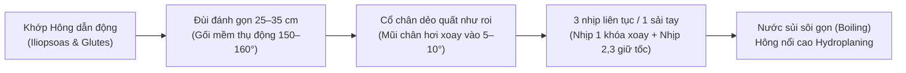
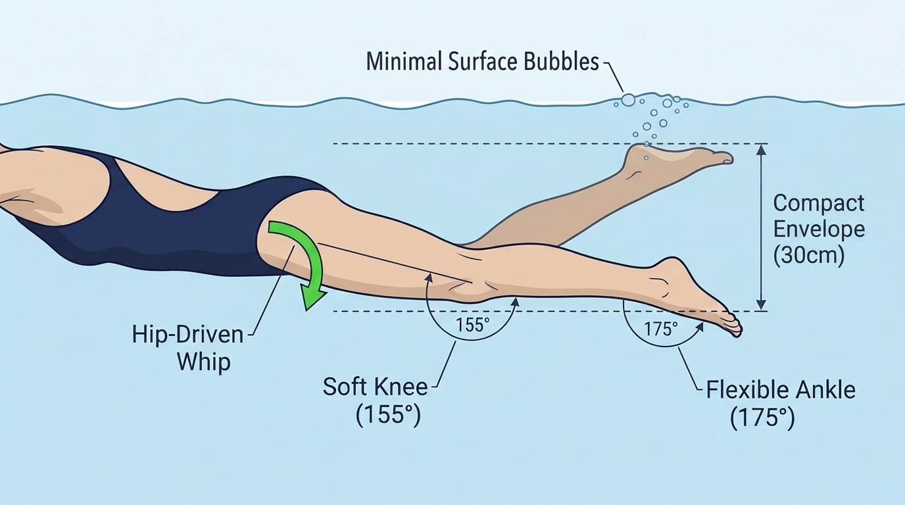

# Kỹ Thuật Chân 6 Nhịp (*6-Beat Kick*) — Động Cơ Tốc Độ Cao & Nước Rút

> **Thuộc phần:** `08-kicking/` | **Trình độ:** Trung cấp → Nâng cao | **Thời gian đọc:** ~11 phút

## Overview

Khi tốc độ bơi vượt ngưỡng `1:20/100m` hoặc trong các cự ly nước rút `50m–200m`, **6-Beat Kick** (3 cú đạp liên tục cho mỗi 1 sải tay) trở thành **động cơ ổn định và tăng tốc không thể thay thế**. Khác với suy nghĩ sai lầm rằng 6-beat là "đạp chân thật to và mạnh bắn bọt tung tóe", một cú 6-beat đẳng cấp Olympic phải **nhanh, gọn, liên tục như chân vịt tàu cao tốc**, giữ hông nổi ngang mặt nước và biến mọi lực kéo tay thành tốc độ tối đa.

- **Mục tiêu cốt lõi:** Thực hiện 6 cú đạp đều đặn, gọn nhẹ trong mỗi chu kỳ tay (3 nhịp/sải) với **cả pha đạp xuống (Downbeat) và pha kéo lên (Upbeat)** đều tạo lực ổn định.
- **Cảm giác đúng:** Đôi chân rung nhịp nhanh, đều và liên tục dưới mặt nước tạo một dải nước sủi sôi nhẹ (*Boiling Water*, không văng tung tóe), thân người nổi cao lướt băng băng trên mặt nước (*Hydroplaning*).
- **Sai lầm phổ biến nhất:** Đạp quá sâu từ đầu gối làm tăng lực cản đùi, hoặc dùng 6-beat hết sức ngay từ 50m đầu của bài 400m khiến axit lactic tràn ngập cơ đùi.

---

## Theory

Trong **6-Beat Kick**, có **6 cú đạp xuống cho mỗi chu kỳ 2 sải tay** (tức **3 cú đạp trên 1 sải tay**):
- **Nhịp 1 (Đạp mạnh nhất — Accent Beat)**: Trùng khớp với khoảnh khắc tay đối bên vào nước và xoay hông xuống.
- **Nhịp 2 & Nhịp 3**: Hai cú đạp nhanh kế tiếp duy trì vận tốc nền cao, giữ hông phẳng và nâng đỡ thân người suốt pha Pull–Push.

Nghiên cứu cơ sinh học trên các VĐV Sprint 50m–100m (như Caeleb Dressel, David Popovici) chỉ ra rằng 6-beat kick đóng góp tới **15–25% tổng lực đẩy trực tiếp** ở tốc độ tối đa, và quan trọng hơn, nó **tăng hiệu suất pha kéo tay thêm 10–15%** nhờ giữ thân nằm ngang tuyệt đối và tạo điểm tựa vững chắc cho hông xoay tốc độ cao!

---

## Science

### Physics & Hydrodynamics

- **Hiệu ứng Lướt Mặt Nước (*Hydroplaning*)**: Khi vận tốc bơi vượt `1.4–1.6 m/s` kết hợp với lực nâng liên tục từ 6-beat kick, phần thân trên và hông nổi cao hơn `3–5 cm`, làm giảm diện tích bề mặt ướt (*Wetted Surface Area*) và giảm mạnh cả Form Drag lẫn Friction Drag.
- **Vai trò của pha Đá Lên (*Upbeat*)**: Rất nhiều người chỉ tập trung vào cú đạp xuống (*Downbeat* — cơ đùi trước & gập hông) mà bỏ quên pha đá lên (*Upbeat* — cơ mông & gân kheo). Giữ chân thẳng kéo lên sát mặt nước trong pha Upbeat không chỉ chuẩn bị cho cú quất xuống tiếp theo mà còn **ngăn hông chìm xuống** giữa các nhịp.
- **Chi phí năng lượng**: Ở 6-beat kick cường độ cao, các nhóm cơ lớn ở chân tiêu thụ lượng oxy và glycogen rất nhanh — vì vậy 6-beat đòi hỏi nền thể lực kỵ khí/hiếu khí tốt và chỉ nên triển khai ở cường độ phù hợp cự ly.

### Biomechanics

- **Truyền sóng kiểu Roi Da (*Whip-Like Action*)**: Chuyển động bắt đầu từ **khớp hông** (cơ thắt lưng chậu *Iliopsoas* và cơ mông lớn *Gluteus Maximus*), truyền qua đùi, gối hơi gập thụ động `~150–160°` do áp lực nước, và kết thúc bằng cú **quất dứt khoát của mu bàn chân** với cổ chân duỗi mềm tối đa (*Plantar Flexion*).
- **Xoay nhẹ mũi chân vào trong (*Slight Pigeon-Toed*)**: Hơi xoay trong khớp hông và cổ chân (`5–10°`) giúp diện tích mặt phẳng mu bàn chân hướng tối đa về phía sau–dưới thay vì chém chéo sang hai bên, tăng lực đẩy thêm `10–15%`.

---

## Practical

### Why It Works

Nếu bạn từng thắc mắc tại sao ở `50m` cuối cùng của một bài test `100m`, người bơi 6-beat kick tốt có thể "bật công tắc" lao vút đi dù tay đã hơi mỏi: đó là vì **6-beat kick giữ cho vận tốc thân không bị rơi giữa các sải tay** (*Minimal IVV*). Hông được khóa cứng phẳng ở độ cao lý tưởng, cho phép từng cú tì nước EVF phát huy 100% lực đẩy mà không bị mất đà.

### Step-by-Step Execution & Water Cues

1. **Tín hiệu "Sôi nước, không bắn nước" (*Boil, Don't Splash*)**: Gót chân và đầu ngón chân cái chỉ vừa phá nhẹ mặt nước tạo dải nước sủi trắng mịn phía sau — nếu nguyên cả bàn chân văng lên khỏi mặt nước là bạn đang lãng phí lực vào không khí!
2. **Tín hiệu "Quẹt hai ngón chân cái" (*Brush Big Toes*)**: Khi hai chân lướt qua nhau ở biên độ gọn, hai ngón chân cái thỉnh thoảng chạm nhẹ nhau (giúp mũi chân hơi xoay trong tự nhiên và tránh mở rộng chân).
3. **Đồng bộ nhịp "1-2-3, 1-2-3"**: Mỗi khi 1 tay vào nước, đếm nhanh `1-2-3` theo nhịp chân rồi chuyển sang tay kia `1-2-3`.
4. **Duy trì Core chắc**: Siết nhẹ cơ bụng dưới và cơ mông để lực đạp chân không làm lắc hoặc võng vùng thắt lưng.

<!-- IMAGE_PROMPT: Technical underwater side profile of a competitive sprinter performing a crisp 6-Beat Kick: showing hip-driven whip motion, 155-degree soft knee bend, hyper-extended plantar-flexed ankles, narrow 30cm vertical kick envelope inside the body shadow, and clean "boiling" water turbulence at the surface without excessive splashing. -->

### Advanced Tips

- **Đừng tập 6-Beat Kick bằng ván nổi (Kickboard) quá nhiều nếu hay bị đau lưng**: Cầm ván nổi ngẩng đầu dễ làm võng thắt lưng và tạo thói quen gập gối sâu. Hãy tập **60–70% bài tập chân ở tư thế Streamline không ván (có ống thở Snorkel)** hoặc **Side-Kick** — vừa đúng tư thế thân ngang thực tế, vừa phát triển độ sắc bén của 6-beat nhanh gấp đôi!
- **Bài tập "Vertical Kick" (Đạp chân đứng nước sâu)**: Đạp chân sải ở tư thế thẳng đứng tại khu vực nước sâu (hai tay khoanh trước ngực hoặc giơ lên trời `20–30 giây`). Đây là bài tập "không thể gian lận": nếu bạn đạp bằng gối hoặc cổ chân cứng, bạn sẽ chìm ngay lập tức!

---

## Drills

| Tên Drill | Mục tiêu 6-Beat Kick | Cự ly / Số hiệp | Cảm giác đúng (Cue) |
| :--- | :--- | :--- | :--- |
| **Streamline Snorkel Kick** | Xây sức bền 6-beat ở đúng tư thế thân ngang không võng lưng | `6 × 25m` (nghỉ 15s) | Hai tay kẹp Streamline, nước sủi đều sau gót, thân đi thẳng tắp |
| **Vertical Kick (Nước sâu)** | Sửa triệt để lỗi gập gối & kích hoạt cả Downbeat lẫn Upbeat | `6 × 20 giây` (nghỉ 20s) | Giữ cằm cố định trên mặt nước bằng nhịp quất cổ chân nhỏ, nhanh, liên tục |
| **Fast-Kick / Slow-Arms** | Tách biệt tần suất chân cao khỏi nhịp tay, giữ tay nhẹ EVF | `4 × 25m` (nghỉ 20s) | Chân chạy tốc độ 6-beat rào rào nhưng tay vẫn kéo chậm, dài, chắc nước |

### Hướng dẫn nhanh
- **Vertical Kick**: Sang đầu hồ sâu `≥ 2 m`. Giữ thân thẳng đứng, hai tay khoanh chéo trước ngực (mức khó hơn: giơ hai cẳng tay khỏi mặt nước). Đạp chân sải nhỏ, nhanh và đều từ hông sao cho mặt nước luôn nằm ngang cằm trong `20 giây`. Nếu bạn cảm thấy mình bị trồi sụt mạnh, hãy thu nhỏ biên độ gối và quất cổ chân nhanh hơn.

---

## AI Analysis

- **Góc quay khuyến nghị:** Ngang dưới nước (Underwater Side View, 120 fps) và Phía sau dưới nước (Rear View).
- **Keypoints cần trích xuất:** `hip`, `knee`, `ankle`, `toe_tip`, `left_wrist`, `right_wrist`.
- **Ngưỡng phát hiện lỗi tự động:**
  - **Đạt chuẩn:** Tỷ lệ cú đạp / chu kỳ tay = `6.0`; tần suất đạp ở tốc độ cao `3.5–5.0 Hz` (`210–300 nhịp/phút`); biên độ dọc cổ chân `25–38 cm`; góc gập gối tối thiểu `≥ 145°`.
  - **Cảnh báo lỗi:** Góc gập gối `< 130°` (đạp xe — tăng Form Drag mạnh); mũi bàn chân nhô khỏi mặt nước `> 10 cm` (đạp vào không khí); biên độ ngang hai bàn chân `> 30 cm`.

---

## Common Errors

| Lỗi thường gặp | Triệu chứng nhận biết | Nguyên nhân gốc | Cách sửa (Correction) |
| :--- | :--- | :--- | :--- |
| **Đạp bằng gối (Knee-Driven / Bicycle Kick)** | Đùi trên gần như đứng yên, cẳng chân gập sâu, bơi rất nặng | Thiếu cảm giác dẫn động từ khớp hông và cơ mông | Tập Vertical Kick + Streamline Kick, giữ cảm giác "đùi đánh trước, bàn chân quất sau" |
| **Vung chân cao khỏi mặt nước** | Bọt bắn tung tóe như động cơ xuồng máy nhưng không đi nhanh | Gập gối quá mức kéo cả cẳng chân lên khỏi nước ở pha Upbeat | Giữ gót chân chỉ vừa chạm mặt nước tạo độ "sôi" gọn (*Boil, don't splash*) |
| **Cổ chân cứng vuông góc 90°** | Đạp mãi vẫn đứng yên tại chỗ hoặc thậm chí trôi lùi | Thiếu độ dẻo duỗi cổ chân (*Plantar Flexion*) | Tập giãn cổ chân hàng ngày + đeo chân vịt ngắn ([Ankle Mobility](ankle-mobility.md)) |
| **Đạp 6-beat hết sức ở cự ly dài** | Đuối hơi và cứng đùi ngay sau 100–150m đầu | Phân phối nhịp chân sai cự ly | Chỉ dùng 6-beat cho Sprint (`50–200m`) hoặc 50–100m nước rút cuối |

---

## Self Assessment

- [ ] Tôi có thể đạp `25m` Streamline Kick (không ván, không chân vịt) dưới `25 giây` với tư thế phẳng.
- [ ] Tôi giữ được `20 giây` Vertical Kick ở khu vực nước sâu với hai tay khoanh trước ngực.
- [ ] Mặt nước sau chân tôi khi bơi 6-beat chỉ "sôi" gọn, không bắn tung tóe lên cao.
- [ ] Hai ngón chân cái của tôi hơi xoay vào trong và đi sát nhau trong suốt nhịp đạp.
- [ ] Tôi biết cách duy trì 6-beat kick mạnh ở `50m` nước rút cuối mà không làm loạn nhịp EVF của tay.

---

## KPI

| Chỉ số (Metric) | Người mới | Trung cấp | Nâng cao (`< 1:30/100m`) |
| :--- | :---: | :---: | :---: |
| **Thời gian 25m Streamline Kick (không chân vịt)** | `> 35 giây` | `25–32 giây` | `< 22 giây` |
| **Thời gian 50m Kick (không chân vịt)** | `> 75 giây` | `55–68 giây` | `< 48 giây` |
| **Vertical Kick (hai tay khoanh ngực)** | `< 15 giây` | `20–30 giây` | `45–60+ giây` |
| **Góc gập gối tối thiểu khi 6-Beat** | `< 125°` | `135–145°` | `150–160°` |

---

## FAQ

**1. Tại sao tôi đạp chân với ván nổi 25m mất tận 45 giây — có phải tôi không hợp 6-beat kick không?**
Không hẳn! 90% trường hợp đạp chân cực chậm đến từ **cổ chân cứng (dựng góc 90°)** và **gập gối sâu**. Chỉ cần cải thiện độ dẻo cổ chân thêm 15° và sửa lỗi đạp từ hông trong 4–6 tuần, tốc độ 25m Kick của bạn có thể rút ngay từ 45 giây xuống dưới 28 giây!

**2. Khi bơi 100m để phá mốc `< 1:30`, tôi nên dùng 6-beat cả 100m hay chỉ 50m cuối?**
Nếu tốc độ 25m Kick của bạn dưới `25 giây` và bạn có nền thể lực tốt, dùng **6-beat nhẹ 50m đầu + 6-beat mạnh 50m cuối** sẽ cho thời gian tốt nhất. Nếu chân bạn còn yếu (25m Kick `> 32 giây`), hãy bơi **4-beat 75m đầu + 6-beat bung sức 25m cuối** để không bị "chết đùi" giữa đường.

**3. Đeo chân vịt (Fins) tập 6-beat có làm mình bị phụ thuộc không?**
Chân vịt ngắn (*Short Fins*) là công cụ tuyệt vời để **ép cổ chân dẻo ra và dạy não cảm giác lực đẩy từ hông**. Nguyên tắc vàng: chỉ dùng chân vịt tối đa `20–30%` khối lượng buổi tập, luôn xen kẽ ngay 1 hiệp tháo chân vịt để giữ lại cảm giác nước thật.

---

## Summary

- **6-Beat Kick** (3 nhịp/sải) là động cơ tối ưu cho **Sprint (`50m–200m`)**, tạo độ nổi *Hydroplaning* và tăng hiệu suất pha kéo tay.
- Kỹ thuật chuẩn: **Dẫn động từ hông + Gối mềm `150–160°` + Cổ chân dẻo quất như roi + Mũi chân hơi xoay vào trong + Nước sủi gọn (*Boil, don't splash*)**.
- Xây sức mạnh 6-beat chuẩn xác nhất qua **Streamline Snorkel Kick**, **Vertical Kick** và **Fast-Kick / Slow-Arms**.

**Liên kết chéo:**
- Chương trước: [4-Beat Kick](four-beat-kick.md)
- Chương tiếp theo: [Độ Dẻo Cổ Chân & Kỹ Thuật Đạp Ít Bọt](ankle-mobility.md)
- Kỹ thuật liên quan: [Caeleb Dressel Analysis](../athletes/caleb-dressel.md) · [Sprint, Starts & Turns](../16-sprint/sprint-starts-and-turns.md)
- Tra cứu thuật ngữ: [Glossary](../24-appendix/glossary.md)

---

## References

1. Maglischo, E. W. (2003). *Swimming Fastest*. Human Kinetics.
2. Gourgoulis, V., et al. (2014). *Effect of the kick on the kinematics and kinetics of front crawl swimming*. Journal of Sports Sciences.
3. USA Swimming — *Six-Beat Kick Mechanics & Vertical Kicking Protocols*.

