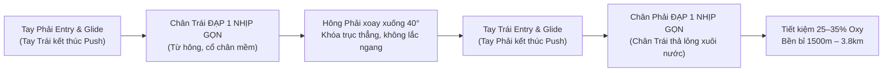

# Kỹ Thuật Chân 2 Nhịp (*2-Beat Kick*) — Vũ Khí Bơi Đường Dài & Triathlon

> **Thuộc phần:** `08-kicking/` | **Trình độ:** Cơ bản → Nâng cao | **Thời gian đọc:** ~11 phút

## Overview

Cơ đùi trước và cơ mông là những nhóm cơ tiêu thụ oxy lớn nhất cơ thể con người, nhưng trong bơi sải đường dài, **85–90% lực đẩy thực tế lại đến từ phần thân trên và cánh tay**. **2-Beat Kick** (chỉ 2 cú đạp chân gọn nhẹ cho mỗi chu kỳ 2 sải tay) là giải pháp tối ưu năng lượng số 1 cho cự ly từ `400m` trở lên, Open Water và Triathlon — giúp giữ nhịp tim cực thấp, bảo toàn sức chân cho đạp/chạy, đồng thời **khóa chuẩn nhịp xoay hông `35–45°`**.

- **Mục tiêu cốt lõi:** Đồng bộ chính xác **1 cú đạp chân nhẹ cho mỗi 1 sải tay** theo nguyên tắc phối hợp chéo (tay phải vào nước ↔ chân trái đập xuống).
- **Cảm giác đúng:** Đôi chân thả lỏng, gọn gàng nằm trong bóng thân người, mặt nước phía sau gần như yên lặng không bọt trắng, nhịp tim êm ái dù bơi liên tục hàng kilômét.
- **Sai lầm phổ biến nhất:** Đạp quá yếu/sai nhịp làm chân chìm dần, hoặc nhầm lẫn 2-beat kick với việc "đạp 6 nhịp chậm rãi không khớp với hông".

---

## Theory

Trong hệ thống phân loại nhịp chân bơi sải, số "beat" được tính bằng **tổng số cú đạp xuống (downbeat) của cả hai chân trong 1 chu kỳ tay đầy đủ (1 sải trái + 1 sải phải)**:
- **2-Beat Kick** = **1 cú đập chân cho mỗi 1 sải tay**.
- Chức năng cốt lõi của 2-beat kick **không phải là tạo lực đẩy chính**, mà là **3 nhiệm vụ sinh cơ học tinh tế**:
  1. **Kích hoạt & Phanh xoay hông (*Rotation Trigger & Brake*)**: Cú đập xuống của chân trái ngay khi tay phải vươn vào nước tạo phản lực xoay hông phải xuống `40°`, đồng thời chặn không cho hông xoay lố.
  2. **Triệt tiêu lực văng ngang (*Anti-Fishtailing*)**: Hấp thụ mô-men bẻ ngang $\tau_{\text{yaw}}$ sinh ra bởi pha kéo tay đối bên.
  3. **Duy trì độ cao gót chân**: Giữ hai chân nằm phẳng sát mặt nước với mức tiêu thụ năng lượng chỉ bằng ~15–20% so với 6-beat kick.

---

## Science

### Physics & Hydrodynamics

- **Chi phí oxy (*Oxygen Cost of Kicking*)**: Nghiên cứu sinh lý học bơi cho thấy khi bơi cùng một tốc độ dưới ngưỡng (`1:35–1:50/100m`), việc đạp chân 6 nhịp liên tục tiêu thụ thêm **`25–35%` lượng oxy ($\dot{V}O_2$)** nhưng chỉ đóng góp thêm `< 10%` vận tốc!
- **Hiệu ứng giảm lực cản nhiễu loạn**: Ở 2-beat kick, hai chân phần lớn thời gian nằm khép gọn trong dòng chảy thuôn sau hông (*Drafting Behind the Hips*), biên độ dao động dọc nhỏ (`20–30 cm`), giảm tối đa vùng xoáy đuôi (*Wake Drag*).

### Biomechanics

Sự đồng bộ của **2-Beat Kick** gắn liền với **dải cơ chéo sau (*Posterior Oblique Sling*)** đã phân tích tại [Chuỗi Truyền Lực](../02-biomechanics/kinetic-chain.md):
- **Khi Tay Phải vươn vào nước (Entry/Glide) & Tay Trái kết thúc pha Push**: **Chân Trái** tung một cú đạp xuống gọn từ hông (đùi dẫn động, gối mềm, cổ chân thả lỏng) → đẩy hông trái xoay lên, hông phải xoay xuống `40°`.
- **Khi Tay Trái vươn vào nước & Tay Phải kết thúc pha Push**: **Chân Phải** tung cú đạp xuống tương ứng → đẩy hông phải xoay lên, hông trái xoay xuống `40°`.
- Trong khoảng giữa hai cú đạp, hai chân **thả lỏng gần như bất động** (chỉ giữ mũi chân duỗi nhẹ xuôi theo dòng nước).

---

## Practical

### Why It Works

Các huyền thoại đường dài như **Katie Ledecky** (nhiều chặng trong 1500m), **Grant Hackett**, **Sun Yang** (đầu chặng 1500m) hay hầu hết VĐV Ironman hàng đầu đều sử dụng 2-beat kick (hoặc biến thể 2-beat lai) để bơi ở tốc độ **`1:10–1:25/100m`** liên tục trong 20–50 phút! Điều này chứng minh: **nếu tư thế thân ngang tốt và EVF chắc, bạn hoàn toàn có thể bơi dưới `1:30/100m` chỉ với 2-beat kick nhẹ nhàng**.

### Step-by-Step Execution & Water Cues

1. **Điều kiện tiên quyết — Thân phải tự nổi**: 2-beat kick **chỉ hoạt động hiệu quả** khi bạn đã giữ được trục đầu–hông phẳng (`< 5°`, xem [COG & COB](../01-foundation/center-of-gravity-and-buoyancy.md)). Nếu đầu vẫn ngẩng cao, 2-beat kick sẽ không đủ lực nâng đôi chân bị chìm.
2. **Tín hiệu "Chân đối bên chạm nhịp" (*Opposite Hand-Foot Tap*)**: Nhẩm trong đầu: *"Tay phải vào — Đạp trái! Tay trái vào — Đạp phải!"*.
3. **Đạp từ hông, không gập gối**: Cảm giác như bạn đang dùng mu bàn chân gõ nhẹ vào một quả bóng nhỏ nằm ngay dưới nước, biên độ chỉ khoảng `20–30 cm`.
4. **Thả lỏng ở khoảng nghỉ**: Giữa hai nhịp đạp, hai ngón chân cái gần như lướt chạm nhẹ vào nhau, đùi hoàn toàn thả lỏng.

<!-- IMAGE_PROMPT: Technical underwater side-oblique diagram of a freestyle swimmer performing a 2-Beat Kick: showing right hand entering/extending forward in sync with a crisp downward flick of the left foot from the hip (green sync arc), while the right leg trails relaxed and streamlined with minimal surface bubbles. -->

### Advanced Tips

- **2-Beat Kick biến thể "Bất đối xứng" (Gallop / Hybrid 2-Beat)**: Nhiều người bơi có nhịp tự nhiên hơi lệch ở bên thở (ví dụ: 1 cú đạp mạnh hơn một chút khi xoay thở). Điều này hoàn toàn bình thường miễn là hai chân không bị tách rộng thành *Scissor Kick*.
- **Khi nào nên chuyển từ 2-Beat sang 4-Beat hoặc 6-Beat?**: Khi bạn cần vượt đối thủ, bơi ngược sóng/dòng chảy mạnh ở Open Water, hoặc ở `100m` nước rút cuối cùng của bài thi.

---

## Drills

| Tên Drill | Mục tiêu 2-Beat Kick | Cự ly / Số hiệp | Cảm giác đúng (Cue) |
| :--- | :--- | :--- | :--- |
| **2-Beat Timing Drill (Tốc độ chậm)** | Đồng bộ chính xác tay phải vào ↔ chân trái đạp | `6 × 25m` (nghỉ 15s) | Mỗi sải tay chỉ nghe đúng 1 nhịp "bụp" rất khẽ của chân đối diện |
| **Catch-Up + Single Kick** | Cô lập hoàn toàn phản xạ 1 nhịp chân kích hoạt xoay hông | `4 × 50m` (nghỉ 20s) | Giữ hai chân im lìm trong pha trượt; chỉ đạp đúng 1 cái khi đổi tay |
| **Pull Buoy → No Buoy Contrast** | Chuyển cảm giác thân nổi từ Pull Buoy sang 2-Beat tự nhiên | `4 × 50m` (25m phao + 25m không phao) | Giữ nguyên mặt nước yên ả và nhịp tim êm khi tháo phao ra |

### Hướng dẫn nhanh
- **Catch-Up + Single Kick**: Bơi bài Catch-Up chậm. Trong khi tay trái đang kéo, giữ hai chân hoàn toàn xuôi thẳng im lìm. Đúng khoảnh khắc tay trái chạm vào tay phải phía trước và tay phải bắt đầu vươn/kéo, tung **đúng 1 cú đạp chân gọn** của chân đối bên rồi lại giữ im hai chân. Bài tập này cài đặt nhịp 2-beat vào hệ thần kinh cực nhanh!

---

## AI Analysis

- **Góc quay khuyến nghị:** Ngang dưới nước (Underwater Side View, 60–120 fps) xuyên suốt 2–3 chu kỳ tay liên tục.
- **Keypoints cần trích xuất:** `left_wrist`, `right_wrist`, `left_ankle`, `right_ankle`, `hip`.
- **Ngưỡng phát hiện lỗi tự động:**
  - **Đạt chuẩn:** Tỷ lệ số đỉnh dao động xuống của `ankle` trên số lần `wrist` vào nước = **`1.0`** (2 cú đạp / 1 chu kỳ 2 tay); độ lệch thời gian giữa `right_wrist_entry` và `left_ankle_downbeat` `< 80 ms`; biên độ dọc cổ chân `20–35 cm`.
  - **Cảnh báo lỗi:** Tỷ lệ dao động không đều (nhịp vỡ); góc gập gối `< 130°` (đạp xe bằng gối); chân chìm sâu hơn hông `> 25 cm`.

---

## Common Errors

| Lỗi thường gặp | Triệu chứng nhận biết | Nguyên nhân gốc | Cách sửa (Correction) |
| :--- | :--- | :--- | :--- |
| **Chìm chân khi giảm xuống 2-beat** | Đùi và bàn chân rơi sâu xuống đáy chỉ sau 10m | Đầu còn ngẩng, Core lỏng hoặc mất Front-Quadrant | Củng cố [COG & COB](../01-foundation/center-of-gravity-and-buoyancy.md) & Press the T trước khi tập 2-beat |
| **Đạp ngược bên (Same-Side Kick)** | Hông bị giật khựng, xoay thân mất tự nhiên | Tay phải vào nước nhưng lại đạp chân phải | Tập chậm Catch-Up + Single Kick, nhẩm rõ *"Phải–Trái, Trái–Phải"* |
| **Gập gối sâu để lấy lực (Bicycle Kick)** | Đùi trước mỏi nhanh, nước cản mạnh ở ống chân | Cố dùng 1 cú đạp để đẩy mạnh thay vì dùng để kích hoạt xoay hông | Giữ đùi dẫn động từ hông, gối chỉ hơi mềm `155–165°` |
| **Đá cắt kéo khi thở (Scissor Kick)** | Hai chân mở toang mỗi khi xoay đầu lấy hơi | Dùng chân giữ thăng bằng thay vì giữ ổn định tay trượt trước | Giữ 1 mắt kính chạm nước khi thở + tập kẹp Pull Buoy 25m chuyển sang 2-beat |

---

## Self Assessment

- [ ] Tôi có thể bơi liên tục `400m+` bằng 2-beat kick mà hông và gót chân vẫn nổi ngang mặt nước.
- [ ] Tôi cảm nhận rõ sự đồng bộ chéo: tay phải vào nước ↔ chân trái đạp 1 nhịp gọn (và ngược lại).
- [ ] Mặt nước phía sau chân tôi rất êm, ít bọt trắng và gần như không phát ra tiếng đập nước lớn.
- [ ] Nhịp tim của tôi khi bơi 2-beat kick thấp hơn rõ rệt (`10–15 bpm`) so với khi cố đạp 6-beat cùng tốc độ.
- [ ] Tôi không bị đau mỏi cơ đùi sau các buổi bơi đường dài `1.500–2.500m`.

---

## KPI

| Chỉ số (Metric) | Người mới | Trung cấp | Nâng cao (`< 1:30/100m`) |
| :--- | :---: | :---: | :---: |
| **Tỷ lệ Nhịp Chân / Chu Kỳ Tay** | Không ổn định | ~2 nhịp (còn lạc khi thở) | Chuẩn xác `2.0` suốt 100% cự ly |
| **Biên độ dọc của bàn chân** | `> 45 cm` | `30–40 cm` | `20–30 cm` (gọn trong bóng thân) |
| **Góc gập gối tối đa khi đạp xuống** | `< 130°` | `140–150°` | `155–165°` (đạp từ hông) |
| **Tốc độ bền bỉ bằng 2-Beat (1.000m)** | `> 2:00/100m` | `1:40–1:55/100m` | `1:22–1:32/100m` |

---

## FAQ

**1. Bơi 2-beat kick có thể đạt tốc độ dưới `1:30/100m` không?**
Hoàn toàn có thể! Ở tốc độ `1:25–1:30/100m`, lực đẩy đến 85–90% từ tư thế giảm cản + xoay hông + EVF chắc. Rất nhiều Triathlete và VĐV Masters bơi `1:20/100m` liên tục 1500m chỉ bằng 2-beat kick để giữ đôi chân hoàn toàn tươi mới.

**2. Tại sao tôi cố tập 2-beat kick thì chân cứ tự động đạp nhanh lên thành 4 hoặc 6 nhịp?**
Đó là phản xạ tự nhiên của não bộ khi **hông hơi chìm hoặc tốc độ trượt bị chậm lại**. Hãy tập 2-beat ở tốc độ vừa phải kết hợp kiểm soát tốt tư thế đầu nhìn đáy và pha trượt Front-Quadrant; khi cơ thể đủ phẳng, não sẽ tự yên tâm "buông" đôi chân xuống 2 nhịp.

**3. Người mới học bơi nên học 2-beat hay 6-beat trước?**
Người mới nên bắt đầu với **nhịp chân nhẹ liên tục (Flutter Kick gọn)** để xây cảm giác nổi và độ dẻo cổ chân trong 2–4 tuần đầu, sau đó chuyển ngay sang học **2-beat kick** để tối ưu hóa nhịp xoay hông và tiết kiệm oxy.

---

## Summary

- **2-Beat Kick** (1 cú đạp chân đối bên cho mỗi 1 sải tay) là công cụ tiết kiệm năng lượng đỉnh cao (`-25–35%` tiêu thụ oxy) cho bơi đường dài, Triathlon và Open Water.
- Vai trò chính của nó là **kích hoạt xoay hông `35–45°` và chống lắc ngang**, không phải tạo lực đẩy chính.
- Yêu cầu nền tảng: tư thế thân ngang phẳng (`< 5°`), đạp gọn từ hông (`20–30 cm`) và cổ chân thả lỏng.

**Liên kết chéo:**
- Chương trước: [Pha Rút Tay Thả Lỏng](../11-recovery/relaxed-recovery.md)
- Chương tiếp theo: [4-Beat Kick](four-beat-kick.md)
- Kỹ thuật liên quan: [Chuỗi Truyền Lực](../02-biomechanics/kinetic-chain.md) · [Xoay Trục Dọc](../06-rotation/body-rotation.md)
- Tra cứu thuật ngữ: [Glossary](../24-appendix/glossary.md)

---

## References

1. Newsome, P., & Young, A. (2012). *Swim Smooth: The Complete Coaching System for Swimmers and Triathletes*. Wiley.
2. Maglischo, E. W. (2003). *Swimming Fastest*. Human Kinetics.
3. Adrian, M. J., Singh, M., & Karpovich, P. V. (1966). *Energy cost of leg kick, arm stroke, and whole crawl stroke*. Journal of Applied Physiology.

