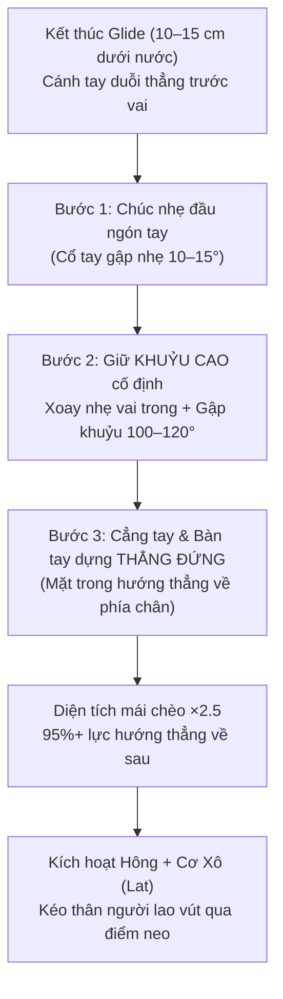
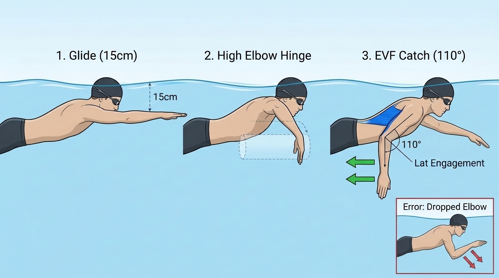

# High Elbow Catch — Dựng Cẳng Tay Sớm (*Early Vertical Forearm — EVF*)

> **Thuộc phần:** `09-catch/` | **Trình độ:** Trung cấp → Nâng cao | **Thời gian đọc:** ~13 phút

## Tổng Quan (Overview)
Nếu phải chọn **một kỹ thuật duy nhất** tạo nên ranh giới giữa người bơi phong trào (`1:50–2:10/100m`) và người bơi tốc độ cao tay nhẹ (`< 1:30/100m`), đó chính là **High Elbow Catch — Early Vertical Forearm (EVF)**. EVF không phải là động tác dùng sức kéo, mà là kỹ thuật **dựng thẳng cẳng tay sớm như một bức tường chắn nước** ngay phía trước vai, biến cả bàn tay + cẳng tay thành mái chèo khổng lồ và kích hoạt trọn vẹn động cơ **cơ lưng rộng (Lat)**.

- **Mục tiêu cốt lõi:** Giữ khuỷu tay ở vị trí cao gần mặt nước, xoay trong cánh tay trên có kiểm soát để dựng cẳng tay + bàn tay gần thẳng đứng (`góc khuỷu 100–120°`) trước khi bắt đầu kéo mạnh.
- **Cảm giác đúng:** Cảm giác "với qua một thùng gỗ tròn" hoặc "bám vào thành bể để kéo người trồi lên" — nước bỗng trở nên đặc quánh, bám chắc vào cả cẳng tay.
- **Sai lầm phổ biến nhất:** Kéo thẳng tay xuống đáy hồ (*Straight-Arm Push Down*) hoặc để khuỷu tay tụt về phía sau trước bàn tay (*Dropped Elbow*).

---

## Lý Thuyết (Theory)
Để hiểu vì sao **EVF** là chuẩn mực tuyệt đối của bơi sải hiện đại, hãy phân tích hình học của véc-tơ lực:
- Khi cánh tay vừa duỗi thẳng phía trước (`10–15 cm` dưới mặt nước), nếu bạn bắt đầu kéo ngay với cánh tay thẳng (*Straight-Arm*), ở `45°` đầu tiên, lòng bàn tay hướng gần như **thẳng xuống đáy hồ**.
  - Theo phân tích véc-tơ: $F_{\text{down}} = F \cos(30°) \approx 87\%$ lực bị lãng phí vào việc **nhấc đầu/vai lên khỏi nước** (tạo sóng Bobbing), chỉ có $F_{\text{back}} = F \sin(30°) \approx 50\%$ đẩy bạn tiến về trước!
- Ngược lại, khi bạn thực hiện **EVF** (giữ cánh tay trên cao và gập khuỷu dựng cẳng tay hướng thẳng xuống đáy ngay ở phía trước vai):
  - Lòng bàn tay và mặt trong cẳng tay lập tức quay mặt thẳng về phía sau (**hướng về phía bàn chân**).
  - Gần như **90–100% lực đẩy** hướng thẳng về phía sau ngay từ nửa đầu pha kéo — đồng thời diện tích mái chèo tăng gấp **2.5 lần** so với chỉ dùng bàn tay!

---

## Cơ Sở Khoa Học (Science)
### Vật Lý & Thủy Động Lực Học (Physics & Hydrodynamics)
So sánh hiệu suất tạo lực đẩy tiến tới ($F_x$) giữa **Dropped Elbow** và **EVF** ở cùng một mức lực cơ bắp:

$$F_x = \frac{1}{2} \rho v_{\text{paddle}}^2 C_D A_{\text{eff}} \cos\beta$$

Trong đó $\beta$ là góc lệch của mặt phẳng cẳng tay so với phương thẳng đứng (vuông góc hướng bơi):
- **Dropped Elbow** ($\beta \approx 55–70°$, chỉ có bàn tay đẩy nước): $\cos\beta \approx 0.34–0.57$, $A_{\text{eff}} \approx 160\text{ cm}^2$.
- **EVF chuẩn** ($\beta \approx 0–15°$, cả bàn tay + cẳng tay dựng đứng): $\cos\beta \approx 0.97–1.00$, $A_{\text{eff}} \approx 380\text{ cm}^2$.
- **Kết quả vật lý:** EVF tạo ra **lực đẩy tiến hiệu dụng lớn hơn gấp 2.5–3 lần** tại cùng một tốc độ kéo tay — đó chính là lý do bạn thấy **tay cực nhẹ nhưng tốc độ lại tăng vọt**!

### Cơ Sinh Học (Biomechanics)
Cơ chế giải phẫu để dựng EVF đúng mà **không gây chấn thương vai**:
1. **Gập nhẹ cổ tay (*Wrist Flexion 10–15°*)**: Đầu ngón tay chúc nhẹ xuống đáy hồ đầu tiên để "mở khóa" cảm giác bám nước.
2. **Xoay trong khớp vai có kiểm soát (*Controlled Internal Rotation*) + Gập khuỷu (`100–120°`)**: Khuỷu tay giữ cao và hướng nhẹ ra phía thành bể bên cạnh (tưởng tượng đang ôm quanh một chiếc thùng phuy lớn), bàn tay và cẳng tay hạ thẳng xuống bên dưới khuỷu.
3. **Liên kết cơ xô (Lat) và cơ ngực lớn**: Ngay khi cẳng tay đạt phương thẳng đứng, góc nách đã đóng ở vị trí hoàn hảo để **cơ lưng rộng (Latissimus Dorsi)** và cú xoay hông phối hợp kéo cả thân người vượt qua điểm neo.

---

## Thực Hành (Practical)
### Tại Sao Kỹ Thuật Này Hiệu Quả (Why It Works)
EVF biến nước từ một chất lỏng "trơn tuột" thành một điểm tựa rắn chắc. Thay vì cố kéo tay ra sau thật nhanh (gây trượt nước), bạn **khóa bàn tay và cẳng tay tại một tọa độ cố định trong không gian bể bơi** rồi dùng sức mạnh của hông, core và cơ xô **kéo thân mình vượt qua tọa độ đó** — y hệt động tác leo thang ngang hoặc trèo lên thành bể bơi!

### Hướng Dẫn Từng Bước & Cảm Giác Nước (Step-by-Step & Water Cues)
1. **Cảm giác "Vươn qua thùng gỗ" (*Reach Over a Barrel*)**: Tưởng tượng có một chiếc thùng gỗ lớn nổi ngay dưới nách bạn; khi bắt đầu Catch, bạn giữ khuỷu tay đặt trên đỉnh thùng và gập cẳng tay ôm dọc theo mặt ngoài thùng hướng xuống đáy hồ.
2. **Cảm giác "Bám thành bể trèo lên"**: Hãy thử đứng sát thành bể, đặt hai bàn tay lên mép gạch và dùng lực cơ xô đẩy người trèo lên bờ — hãy quan sát góc khuỷu tay và cẳng tay bạn lúc đó: **đó chính là góc EVF tự nhiên 100%!**
3. **Chậm để ôm nước, rồi mới kéo**: Đừng vội kéo ngược khuỷu tay về phía hông ngay! Dành `0.15 giây` đầu tiên chỉ để **hạ đầu ngón tay và dựng thẳng cẳng tay** trong khi khuỷu tay vẫn ở phía trước vai.
4. **Kiểm tra vị trí bàn tay**: Ở đỉnh của pha EVF, bàn tay nằm thẳng dưới khuỷu tay (hơi lệch vào trong một chút nhưng **không bao giờ vượt quá trục giữa cơ thể**).

<!-- IMAGE_PROMPT: Technical 3-frame underwater side-and-front biomechanical sequence showing Early Vertical Forearm (EVF): Frame 1 Glide at 15cm depth; Frame 2 Wrist hinge & high elbow staying near surface while forearm drops to vertical (110 deg elbow angle) like reaching over a barrel; Frame 3 Vertical forearm-hand paddle pushing water straight back; paired with a red inset showing Dropped Elbow error. -->

### Mẹo Nâng Cao (Advanced Tips)
- **EVF không đòi hỏi tay phải gập 90° cứng nhắc**: Tùy độ dài cánh tay và độ linh hoạt vai, góc khuỷu tối ưu dao động từ **`100°` đến `125°`**. Điều quan trọng nhất không phải con số tuyệt đối, mà là **cẳng tay dựng càng sớm càng tốt và khuỷu luôn cao hơn cổ tay**.
- **Kết hợp với ống thở Snorkel**: Rất khó học EVF nếu bạn phải liên tục ngoảnh đầu thở. Hãy tập `200–300m` EVF mỗi buổi với **Center Snorkel** để mắt bạn có thể liếc nhìn trực tiếp cẳng tay mình đang dựng vuông góc ngay trước mặt!

---

## Bài Tập Thực Hành (Drills)
| Tên Drill | Mục tiêu EVF | Cự ly / Số hiệp | Cảm giác đúng (Cue) |
| :--- | :--- | :--- | :--- |
| **Front Sculling (Khuỷu cao)** | Xây cảm giác nước đặc trên cẳng tay & giữ khuỷu bất động | `4 × 25m` (Snorkel + Pull Buoy) | Khuỷu như gác lên thanh xà ngang, chỉ cẳng tay & bàn tay lắc kéo thân đi |
| **Dog Paddle (Underwater EVF)** | Bắt buộc dựng cẳng tay sớm ở phía trước mặt mới tiến được | `4 × 25m` (nghỉ 15s) | Tay luôn dưới nước, vươn trước → dựng thẳng cẳng tay → kéo tới ngang ngực rồi vươn lại |
| **Fist Swim → Open Hand** | Loại bỏ thói quen chỉ dựa vào lòng bàn tay, kích hoạt cẳng tay | `4 × 50m` (25m nắm đấm + 25m mở tay) | Ngay khi mở tay ở 25m sau, giữ nguyên góc khuỷu cao vừa tập ở 25m trước |
| **Single-Arm EVF (Với Snorkel)** | Tập trung 100% sự chú ý vào từng tay, quan sát trực tiếp dưới nước | `4 × 50m` (25m tay trái / 25m tay phải) | Nhìn thấy rõ cẳng tay mình dựng thẳng đứng ngay trước vai trước khi kéo |

### Hướng dẫn nhanh
- **Dog Paddle EVF**: Đeo Snorkel, kẹp Pull Buoy. Bơi chậm với hai tay luôn nằm dưới nước (không rút lên trên không). Vươn tay phải thẳng về trước → gập khuỷu dựng thẳng cẳng tay hướng xuống đáy → kéo mạnh tới ngang bụng → khép tay trượt thẳng lại về trước. Bài tập này cho phản hồi tức thì: nếu bạn sụp khuỷu, bạn sẽ đứng yên tại chỗ!

---

## Phân Tích AI & Video (AI Analysis)
- **Góc quay khuyến nghị:** Ngang dưới nước (Underwater Side View) và Chính diện dưới nước (Underwater Front View).
- **Điểm khớp cần trích xuất (Keypoints):** `shoulder`, `elbow`, `wrist`, `middle_finger_tip`.
- **Ngưỡng phát hiện lỗi tự động:**
  - **Đạt chuẩn:** Tại thời điểm bàn tay đi ngang qua mặt phẳng vai (`wrist_x ≈ shoulder_x`), góc khuỷu `∠shoulder–elbow–wrist` nằm trong **`100–125°`**; góc nghiêng cẳng tay so với phương thẳng đứng $\beta \le 20°$; `elbow_y` cao hơn `wrist_y` tối thiểu `20–30 cm`.
  - **Cảnh báo lỗi:** `elbow_x` tụt về phía sau `wrist_x` trong nửa đầu pha Catch (**Dropped Elbow**); góc khuỷu `> 155°` khi tay đi qua dưới vai (**Straight-Arm Pull**).

---

## Lỗi Thường Gặp & Cách Sửa (Common Errors)
| Lỗi thường gặp | Triệu chứng nhận biết | Nguyên nhân gốc | Cách sửa (Correction) |
| :--- | :--- | :--- | :--- |
| **Sụp khuỷu (Dropped Elbow)** | Khuỷu tay tụt xuống và lùi về sau trước bàn tay, cảm giác trượt nước hụt hẫng | Kéo khuỷu về phía hông quá vội khi cẳng tay chưa kịp dựng thẳng | Tập Front Sculling + Dog Paddle + dây kháng lực EVF trên cạn trước khi bơi |
| **Kéo thẳng tay (Straight-Arm Pull)** | Vai nhấp nhô lên xuống (Bobbing), đau khớp vai, tốn sức | Không gập khuỷu khi bắt nước, đẩy nước thẳng xuống đáy hồ | Hình dung "với qua thùng gỗ" + tập Fist Swim để ép gập khuỷu dựng cẳng tay |
| **Gập cổ tay bẻ ngược ra sau** | Cổ tay mỏi, lực nước trượt qua kẽ ngón tay | Cố ấn đầu ngón tay xuống quá mạnh hoặc cổ tay yếu | Giữ cổ tay thẳng hàng hoặc hơi gập nhẹ `5–10°` về phía lòng bàn tay |
| **Thiếu độ linh hoạt vai để giữ khuỷu cao** | Không thể dựng cẳng tay mà không bị đau nhói vai | Cứng cơ ngực, cứng cơ xô và cứng cột sống ngực (*T-Spine*) | Kéo giãn cơ ngực + xoay cột sống ngực hàng ngày ([Mobility](../19-mobility/shoulder-thoracic-ankle-mobility.md)) |

---

## Tự Đánh Giá Tại Hồ (Self Assessment)
- [ ] Tôi hiểu rõ vì sao EVF tăng diện tích mái chèo gấp `2.5 lần` và hướng 95% lực đẩy về phía sau.
- [ ] Khi tập với Snorkel, tôi có thể tự quan sát thấy cẳng tay mình dựng gần thẳng đứng trước khi tay đi qua dưới vai.
- [ ] Tôi cảm nhận rõ áp lực nước tì nặng lên **cả cẳng tay lẫn lòng bàn tay**, và lực kéo phát ra từ cơ xô (Lat).
- [ ] Khuỷu tay tôi luôn cao hơn cổ tay trong suốt nửa đầu pha kéo.
- [ ] Khi chuyển từ 25m Fist Swim sang 25m mở tay, số sải tay (Stroke Count) của tôi giảm rõ rệt `2–3 sải/25m`.

---

## Chỉ Số Đo Lường (KPI)
| Chỉ số (Metric) | Người mới | Trung cấp | Nâng cao (`< 1:30/100m`) |
| :--- | :---: | :---: | :---: |
| **Góc khuỷu tại giữa pha Catch (EVF)** | `150–175°` | `125–140°` | `100–120°` |
| **Góc nghiêng cẳng tay so với phương thẳng đứng ($\beta$)** | `> 45°` | `25–40°` | `< 18°` |
| **Chênh lệch độ cao Khuỷu – Cổ tay tại Catch** | `< 10 cm` | `15–22 cm` | `25–35 cm` |
| **Mức giảm Stroke Count (Fist → Open Hand / 25m)** | `0–1 sải` | `1–2 sải` | `2–4 sải` (bám nước cực tốt) |

---

## Câu Hỏi Thường Gặp (FAQ)
**1. Mất bao lâu để hình thành phản xạ tự động dựng cẳng tay EVF?**
Thông thường cần **4–8 tuần tập có chủ đích** (kết hợp dây kháng lực EVF trên cạn 5 phút trước mỗi buổi bơi + 200m Sculling/Dog Paddle với Snorkel). EVF là kỹ năng thần kinh–cơ (*neuromuscular*), nên tần suất lặp lại chuẩn form quan trọng hơn cố bơi thật nhiều mét sai form.

**2. Có nên dùng kẹp chống sụp khuỷu (Finis Forearm Fulcrum) khi tập EVF không?**
Rất hữu ích cho giai đoạn làm quen (Tuần 1–6) để cảm nhận chính xác khóa cổ tay–cẳng tay. Tuy nhiên chỉ nên dùng trong các bài Drill ngắn (`4 × 25m` hoặc `4 × 50m`) rồi tháo ra bơi tự do ngay để não tự ghi nhớ cảm giác, không lệ thuộc vào dụng cụ.

**3. Người bơi nước rút 50m có cần EVF không?**
**Có!** Ngay cả các VĐV Sprint kéo tay thẳng trong pha rút trên không (*Straight-Arm Recovery*) như Caeleb Dressel vẫn thực hiện **EVF cực kỳ sâu và sắc nét ở dưới nước** để tối đa hóa diện tích đẩy và bảo vệ khớp vai dưới công suất cực đại.

---

## Tóm Tắt (Summary)
- **Early Vertical Forearm (EVF)** là kỹ thuật tạo lực quan trọng nhất của bơi sải hiện đại: giữ khuỷu cao, dựng cẳng tay thẳng đứng (`góc khuỷu 100–120°`) để tăng gấp **2.5 lần** diện tích mái chèo và hướng gần 100% lực về sau.
- Nguyên tắc vàng: **Ôm nước chậm–chắc trước, rồi mới dùng hông và cơ xô (Lat) kéo thân người vượt qua điểm neo**.
- Bộ 3 bài tập vàng làm chủ EVF: **Dây kháng lực EVF trên cạn + Front Sculling + Dog Paddle với Snorkel**.

**Liên kết chéo:**
- Chương trước: [Pha Vào Nước "Xỏ Kim" & Vươn Tay](hand-entry-and-extension.md)
- Chương tiếp theo: [Pha Kéo (Pull) & Pha Đẩy Kết Thúc (Push)](../10-pull/pull-and-push-phase.md)
- Kỹ thuật liên quan: [Cơ Sinh Học Khớp Vai & Cơ Xô](../02-biomechanics/shoulder-and-lat-mechanics.md) · [Sculling Drill](../17-drills/sculling.md)
- Tra cứu thuật ngữ: [Glossary](../24-appendix/glossary.md)

---

## Tài Liệu Tham Khảo (References)
1. Maglischo, E. W. (2003). *Swimming Fastest*. Human Kinetics.
2. Newsome, P., & Young, A. (2012). *Swim Smooth*. Wiley.
3. Payton, C., & Bartlett, R. (2008). *Biomechanical Evaluation of Movement in Sport and Exercise*. Routledge.
4. USA Swimming — *Early Vertical Forearm (EVF) Coaching Curriculum*.

