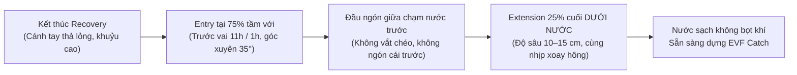

# Pha Vào Nước "Xỏ Kim" & Vươn Tay (*Hand Entry & Extension*)

> **Thuộc phần:** `09-catch/` | **Trình độ:** Cơ bản → Nâng cao | **Thời gian đọc:** ~11 phút

## Overview

Pha vào nước (*Hand Entry*) và vươn tay (*Extension*) thiết lập **nền móng hình học** cho toàn bộ pha kéo dưới nước phía sau. Nếu tay vào nước quá sớm (đập bẹp mặt nước), quá rộng, hoặc vắt chéo qua trục giữa cơ thể (*Crossover*), bạn sẽ kéo theo bọt khí, làm lắc hông và tự khóa mất góc dựng cẳng tay EVF ngay từ giây đầu tiên. Ngược lại, vào nước kiểu **"xỏ kim"** êm ái trước vai mở ra một hành trình vươn dài mượt mà, tay nhẹ và nước yên.

- **Mục tiêu cốt lõi:** Xuyên đầu ngón tay xuống nước gọn gàng ở đường thẳng trước vai (**11 giờ & 1 giờ**), rồi vươn duỗi thẳng dưới mặt nước `10–15 cm`.
- **Cảm giác đúng:** Bàn tay, cổ tay và cẳng tay nối đuôi nhau chui qua **cùng một lỗ nhỏ** trên mặt nước, không tiếng đập, hầu như không có bọt khí bám theo.
- **Sai lầm phổ biến nhất:** Vươn hết tay trên không rồi thả rơi cả cánh tay đập xuống nước (*Over-reaching in Air*), hoặc vắt chéo qua trước đỉnh đầu (*Crossover*).

---

## Theory

Pha Entry & Extension bao gồm **2 tiểu pha liên hoàn**:
1. **Điểm chạm & Xuyên nước (*Entry Point*)**: Đầu ngón tay (ngón giữa và ngón trỏ) chạm mặt nước ở vị trí **trước đỉnh đầu khoảng 15–25 cm** (tương đương ~75% tầm với của cánh tay) và thẳng trục với khớp vai cùng bên — **không phải** duỗi hết cỡ 100% trên mặt nước rồi mới đặt xuống.
2. **Vươn duỗi dưới nước (*Underwater Extension*)**: 25% tầm với cuối cùng được thực hiện **ở dưới mặt nước** (độ sâu `10–15 cm`) cùng lúc với nhịp xoay vai–hông xuống `35–45°`.

Tại sao 25% cuối phải vươn *dưới nước* thay vì *trên không*?
- Vươn hết cỡ trên không buộc cánh tay rơi bẹp xuống mặt nước gây sóng cản (*Slapping*) và tạo phanh hãm khi cổ tay va mặt nước.
- Chui đầu ngón tay xuống nước sớm hơn một chút rồi **vươn duỗi thẳng ở độ sâu `10–15 cm`** giúp cơ thể xuyên thủng lớp sóng mặt, trượt vào tầng nước tĩnh và kéo dài chiều dài thân tàu $L$ không tạo bọt.

---

## Science

### Physics & Hydrodynamics

- **Triệt tiêu bọt khí bám (*Air Entrainment*)**: Khi bàn tay đập bẹp xuống nước, một lớp túi khí bao quanh lòng bàn tay và cẳng tay. Vì mật độ không khí nhỏ hơn nước 800 lần, kéo một cánh tay bọc đầy bọt khí làm **giảm 15–25% lực bám nước** ngay đầu pha Catch!
- **Góc xuyên nước tối ưu (`30–45°`)**: Đầu ngón tay xuyên mặt nước ở góc nghiêng `30–45°` rồi lập tức san phẳng thành phương ngang `0°` ở độ sâu `10–15 cm` giúp dòng chảy tách mượt (dòng tầng *Laminar Flow*) không tạo sóng mũi phụ.

### Biomechanics

- **Tư thế bàn tay vào nước an toàn cho khớp vai**: Lòng bàn tay hơi úp phẳng xuống đáy hồ (đầu ngón giữa/ngón trỏ chạm nước trước — *Flat-Hand Entry*), cổ tay thẳng trung tính.
- **Tuyệt đối tránh *Thumb-First Entry*** (ngón cái cắm xuống trước): Tư thế xoay trong cực đại này ép gân cơ trên gai (*Supraspinatus*) cọ xát mạnh vào mỏm cùng vai ngay lúc cánh tay giơ cao nhất — tác nhân chính gây viêm khớp vai ở người bơi phong trào (xem [Cơ Sinh Học Khớp Vai & Cơ Xô](../02-biomechanics/shoulder-and-lat-mechanics.md)).
- **Vươn bằng lồng ngực (*Thoracic Reach*)**: Tầm với tối đa không đến từ việc nhún vai sát tai mà từ sự xoay đồng trục của khung sườn `35–45°`.

---

## Practical

### Why It Works

Khi bàn tay "xỏ kim" vào đúng điểm `11 giờ` (tay trái) và `1 giờ` (tay phải) rồi vươn duỗi 25% cuối dưới nước:
- Lực rơi trọng trường của cánh tay hồi về được chuyển hóa mượt mà thành **động lượng tiến về phía trước** thay vì đập vuông góc xuống đáy hồ.
- Không có bọt khí bám vào cẳng tay, giúp khoảnh khắc chuyển sang pha Catch tiếp theo có cảm giác nước "đặc và chắc" ngay lập tức.
- Khớp vai luôn nằm trong mặt phẳng xương bả vai an toàn, triệt tiêu hoàn toàn nguy cơ đau vai mãn tính.

### Step-by-Step Execution & Water Cues

1. **Hình dung 2 đường ray song song (11 giờ & 1 giờ)**: Tay trái chỉ vào nước trên đường ray thẳng trước vai trái; tay phải trên đường ray thẳng trước vai phải. Nếu thấy tay mình che khuất mắt nhìn xuống vạch đen đáy hồ nghĩa là bạn đã vắt chéo (*Crossover*).
2. **Kỹ thuật "Xỏ ống tay áo" (*Mail-Slot Entry*)**: Tưởng tượng có một khe thư nhỏ nằm nghiêng phía trước đầu — đưa đầu ngón tay, rồi cổ tay, rồi cẳng tay lần lượt trượt gọn qua đúng khe thư đó.
3. **Đặt nhẹ → Vươn dài dưới nước**: Không ném tay về trước! Đặt đầu ngón tay vào nước ở khoảng ngang đỉnh đầu/trước đầu 20 cm, sau đó chủ động duỗi dài thẳng về phía tường đích dưới mặt nước `10–15 cm`.
4. **Kiểm tra độ mở cổ tay**: Cổ tay phẳng, đầu ngón tay chỉ thẳng về phía trước (hơi chúc nhẹ xuống `5–10°` để tránh tạo mặt phẳng phanh nước).

<!-- IMAGE_PROMPT: Dual-panel sports technique diagram: Left (Overhead View) showing two parallel green railroad tracks aligned with shoulder width (11 o'clock and 1 o'clock) vs red midline crossover zone; Right (Side View) showing fingers entering at 75% reach at a 35-degree angle like threading a needle, then extending smoothly horizontally at 10-15cm depth without splash bubbles. -->

### Advanced Tips

- **Điều chỉnh điểm vào nước theo tốc độ**:
  - Bơi đường dài / Triathlon: Vào nước êm ái, góc xuyên `35–40°`, vươn dài tối đa dưới nước để tối ưu DPS.
  - Bơi Sprint (50m–100m — Straight-Arm Recovery): Tay vào nước xa hơn một chút (~85–90% tầm với) với tốc độ cao hơn nhưng **vẫn giữ thẳng trục trước vai** (không vắt chéo) để chuyển tức thì sang Catch.
- **Mẹo sửa nhanh lỗi vắt chéo**: Nếu bạn hay bị vắt chéo tay trái khi xoay thở sang phải, hãy cố tình cảm giác như đang đặt tay trái vào nước ở vị trí **"10 giờ 30"** (rộng hơn cảm giác bình thường 1 chút) — khi quay video lại, thực tế nó sẽ nằm đúng chuẩn 11 giờ!

---

## Drills

| Tên Drill | Mục tiêu Entry & Extension | Cự ly / Số hiệp | Cảm giác đúng (Cue) |
| :--- | :--- | :--- | :--- |
| **Fingertip Drag → Mail-Slot** | Tập vào nước êm, khuỷu cao, không đập tay | `4 × 25m` (nghỉ 15s) | Đầu ngón tay lướt nhẹ mặt nước rồi chui tọt qua một khe nhỏ không gây bọt |
| **Wide-Track Swim (10:30 & 1:30)** | Phá vỡ thói quen thần kinh vắt chéo trục giữa | `4 × 50m` (25m rộng nhẹ + 25m chuẩn 11h/1h) | Cảm giác vai mở thoáng, thân đi thẳng tắp không lắc hông |
| **Zipper → Silent Entry** | Giữ khuỷu tay cao cho tới tận khoảnh khắc ngón tay xuyên nước | `4 × 25m` (nghỉ 15s) | Ngón cái lướt dọc sườn lên nách rồi thả đầu ngón tay xuyên ngọt xuống nước |

### Hướng dẫn nhanh
- **Wide-Track Swim**: Bơi chậm và tập trung nhìn qua kính bơi thấy bàn tay phải vào nước ở bên **phải** vạch đen đáy hồ và bàn tay trái vào nước ở bên **trái** vạch đen đáy hồ — tuyệt đối không để bất kỳ ngón tay nào chạm hay vượt qua vạch đen trung tâm!

---

## AI Analysis

- **Góc quay khuyến nghị:** Trên cao (Overhead View) và Trước mặt ngang mặt nước (Front Waterline View).
- **Keypoints cần trích xuất:** `nose`, `left_shoulder`, `right_shoulder`, `entry_wrist`, `entry_elbow`, đường trục giữa (`midline_x`).
- **Ngưỡng phát hiện lỗi tự động:**
  - **Đạt chuẩn:** Tọa độ ngang điểm vào nước `entry_wrist_x` nằm trong hành lang `[shoulder_x - 5cm, shoulder_x + 10cm]` (không vượt `midline_x`); góc khuỷu lúc ngón tay chạm nước `130–155°` (còn dư độ duỗi để vươn dưới nước).
  - **Cảnh báo lỗi:** `entry_wrist_x` vượt qua `midline_x` (Crossover); góc khuỷu chạm nước `≈ 180°` kèm vùng bọt trắng lớn (Slapping / Over-reaching in Air).

---

## Common Errors

| Lỗi thường gặp | Triệu chứng nhận biết | Nguyên nhân gốc | Cách sửa (Correction) |
| :--- | :--- | :--- | :--- |
| **Vắt chéo trục giữa (Crossover)** | Tay vào nước trước mũi/trán, hông lắc ngang, đau vai | Xoay đầu thở quá mức kéo theo vai trước vặn vào trong | Tập Wide-Track Swim (10:30 & 1:30), giữ vạch đen đáy hồ nằm giữa 2 bàn tay |
| **Đập bẹp tay xuống mặt nước (Slapping)** | Bọt trắng bắn tung tóe, tiếng vỗ lớn, tay bị trượt nước khi kéo | Duỗi thẳng tay 100% trên không rồi thả rơi tự do | Vào nước sớm hơn ở ~75% tầm với, đầu ngón tay chạm nước trước cổ tay & khuỷu |
| **Vào nước ngón cái trước (Thumb-First)** | Đau nhói mặt trước khớp vai | Áp dụng kỹ thuật cũ từ thập niên 1980 | Xoay nhẹ bàn tay phẳng hơn, để ngón giữa & ngón trỏ chạm nước trước |
| **Cắm tay quá sâu (> 30 cm) ngay khi vào** | Cơ thể chựng lại, vai chìm sâu, khó dựng EVF | Góc xuyên mặt nước quá dốc (`> 60°`) | Giảm góc xuyên về `30–40°` và san phẳng ngay ở độ sâu `10–15 cm` |

---

## Self Assessment

- [ ] Tôi nhìn thấy vạch đen đáy hồ luôn nằm giữa hai bàn tay khi vào nước (không vắt chéo).
- [ ] Đầu ngón tay tôi luôn chạm nước trước cổ tay và khuỷu tay (vào nước kiểu "xỏ kim").
- [ ] Âm thanh khi tay tôi chạm mặt nước rất êm, gần như không có tiếng vỗ nước.
- [ ] 25% tầm vươn cuối cùng của tôi diễn ra mượt mà ở độ sâu `10–15 cm` dưới mặt nước.
- [ ] Lòng bàn tay tôi hơi úp xuống đáy (không xoay ngón cái cắm trước) khi chạm nước.

---

## KPI

| Chỉ số (Metric) | Người mới | Trung cấp | Nâng cao (`< 1:30/100m`) |
| :--- | :---: | :---: | :---: |
| **Độ lệch điểm vào nước so với trục vai** | Vắt chéo `> 10 cm` qua trục giữa | Lệch nhẹ bên thở | `± 5 cm` quanh trục vai (0% Crossover) |
| **Góc xuyên mặt nước của bàn tay** | `0°` (đập bẹp) hoặc `> 60°` | `20–30°` | `30–45°` |
| **Góc khuỷu tại thời điểm chạm nước** | `175–180°` (duỗi cứng trên không) | `155–165°` | `135–155°` (duỗi nốt dưới nước) |
| **Lượng bọt khí kéo theo cẳng tay** | Dày đặc suốt pha Catch | Trung bình | Rất ít / Nước trong sạch |

---

## FAQ

**1. Nên để khuỷu tay chạm nước trước hay ngón tay chạm nước trước?**
Luôn luôn là **đầu ngón tay chạm nước trước**, sau đó đến cổ tay, cẳng tay và cuối cùng là khuỷu tay ("xỏ kim"). Nếu khuỷu tay chạm nước trước (lỗi *Dropped Elbow Entry*), cánh tay sẽ đập bẹp mặt nước tạo phanh hãm cực lớn.

**2. Điểm vào nước cách đỉnh đầu bao xa là chuẩn?**
Thông thường từ **15–25 cm phía trước đỉnh đầu** (ngang khoảng giữa trán đến quá đỉnh đầu 1 gang tay tùy chiều dài cánh tay), rồi vươn duỗi hết tầm ở dưới mặt nước.

**3. Tại sao tôi chỉ bị vắt chéo tay trái khi thở sang phải?**
Đây là lỗi phổ biến nhất thế giới! Khi bạn xoay đầu sang phải để thở, mắt bạn rời khỏi tay trái và toàn bộ thân trên có xu hướng vặn quá đà sang phải, kéo tay trái lấn sang trục giữa. Cách sửa dứt điểm là tập **Single-Arm Breathing** và luôn giữ tay trái hướng thẳng vào mục tiêu `11 giờ` trước vai trái.

---

## Summary

- Vào nước chuẩn là **kỹ thuật "xỏ kim"** (đầu ngón tay giữa/trỏ chạm trước, góc `30–45°`) trên hai đường ray **11 giờ và 1 giờ**, tuyệt đối không vắt chéo và không cắm ngón cái trước.
- Thực hiện **25% tầm vươn cuối ở dưới nước (`10–15 cm`)** đồng bộ với nhịp xoay thân `35–45°` để không tạo bọt khí bám vào cẳng tay.
- Một pha Entry & Extension sạch sẽ tạo tiền đề hoàn hảo cho pha **Early Vertical Forearm (EVF)** mạnh mẽ và nhẹ tay.

**Liên kết chéo:**
- Chương trước: [Kỹ Thuật Thở & Nhịp Thở](../07-breathing/breathing-mechanics.md)
- Chương tiếp theo: [High Elbow Catch — Early Vertical Forearm (EVF)](early-vertical-forearm.md)
- Kỹ thuật liên quan: [Cân Bằng & Pha Trượt](../04-body-position/balance-and-glide.md) · [Fingertip Drag Drill](../17-drills/fingertip-drag.md)
- Tra cứu thuật ngữ: [Glossary](../24-appendix/glossary.md)

---

## References

1. Newsome, P., & Young, A. (2012). *Swim Smooth*. Wiley.
2. Maglischo, E. W. (2003). *Swimming Fastest*. Human Kinetics.
3. USA Swimming — *Hand Entry & Shoulder Injury Prevention Guidelines*.

