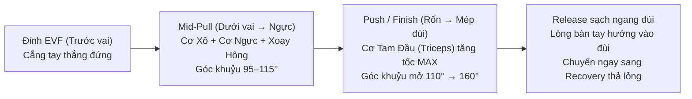

# Pha Kéo (*Pull*) & Pha Đẩy Kết Thúc (*Push / Finish*)

> **Thuộc phần:** `10-pull/` | **Trình độ:** Cơ bản → Nâng cao | **Thời gian đọc:** ~12 phút

## Overview

Nếu **Catch (EVF)** là khoảnh khắc bạn cắm chắc chiếc mái chèo xuống dòng nước, thì **Pull (Pha kéo)** và **Push (Pha đẩy kết thúc)** chính là giai đoạn **giải phóng toàn bộ công suất động cơ thân–cơ xô** để phóng cơ thể lao vút về phía trước. Điều làm nên đẳng cấp của người bơi `< 1:30/100m` là **tăng tốc mượt mà xuyên suốt từ dưới ngực ra sau đùi** — tuyệt đối không bỏ phí 30% quãng đẩy cuối cùng ở ngang hông.

- **Mục tiêu cốt lõi:** Kéo thân người vượt qua điểm neo EVF bằng cơ xô (Lat) + xoay hông, sau đó tăng tốc đẩy nước dứt khoát qua ngang hông tới mép đùi trước khi rút tay.
- **Cảm giác đúng:** Tay đi qua nước ngày càng nhanh và gọn hơn (*Chậm → Vừa → Nhanh*), cảm giác "đẩy cả khối nước bắn về phía chân" ở cuối pha Push.
- **Sai lầm phổ biến nhất:** Rút tay ra khỏi nước quá sớm ngang bụng/rốn (cắt cụt pha Push), hoặc đẩy bàn tay hất ngược lên mặt nước ở cuối pha làm chìm hông.

---

## Theory

Hành trình tạo lực dưới nước sau khi dựng EVF gồm **2 pha nối tiếp không ngừng nghỉ**:

1. **Pha Kéo giữa (*Mid-Pull / Insweep*)**:
   - Từ lúc cẳng tay dựng thẳng trước vai cho đến khi bàn tay đi qua ngang vùng ngực dưới / sườn.
   - Cơ lưng rộng (**Latissimus Dorsi**), cơ ngực lớn (**Pectoralis Major**) và lực xoay ngược của hông–core đồng loạt co rút mạnh mẽ.
   - Bàn tay di chuyển dọc trong hành lang dưới vai–ngực (hơi khép nhẹ về gần trục giữa nhưng **không vắt chéo qua giữa bụng**).
2. **Pha Đẩy kết thúc (*Push / Finish*)**:
   - Từ ngang xương sườn dưới / rốn kéo dài tới ngang **mép ngoài đùi trên (vị trí túi quần)**.
   - Cơ tam đầu cánh tay (**Triceps Brachii**) phối hợp với cơ xô duỗi khuỷu tay tăng tốc tối đa để đẩy khối nước ra thẳng phía sau.
   - Kết thúc ngay khi bàn tay vượt qua khớp hông: xoay nhẹ lòng bàn tay hướng vào đùi (ngón cái hướng lên/vào trong) để **cắt nước sạch** chuyển sang pha Recovery.

---

## Science

### Physics & Hydrodynamics

Tại sao **tăng tốc về cuối pha Push** lại bắt buộc về mặt vật lý?
- Theo nguyên lý động lượng trong [Lực Đẩy & Lực Nâng](../03-hydrodynamics/propulsion-and-lift.md), lực đẩy sinh ra tỷ lệ với bình phương hiệu vận tốc giữa bàn tay và dòng nước xung quanh:
  $$F_{\text{push}} \propto (v_{\text{hand}} - v_{\text{water}})^2$$
- Đến pha Push, khối nước xung quanh tay đã bắt đầu di chuyển ngược về sau cùng tay bạn ($v_{\text{water}} > 0$). Nếu bạn giữ nguyên tốc độ kéo tay hoặc giảm tốc độ ở cuối pha, hiệu $(v_{\text{hand}} - v_{\text{water}}) \to 0$ và lực đẩy biến mất hoàn toàn!
- Do đó, bàn tay **bắt buộc phải tăng tốc đạt vận tốc cực đại ở 30% cuối cùng** (giai đoạn đẩy ngang hông) để tiếp tục truyền xung lượng và tách vòng xoáy (*Vortex Shedding*) đẩy thân người vọt tới.

### Biomechanics

Sự phối hợp chuyển giao nhóm cơ hoàn hảo dọc pha Pull–Push:
- **Đầu Mid-Pull**: Góc khuỷu giữ quanh `95–115°` (cánh tay đòn ngắn nhất, tối ưu mô-men của cơ xô và cơ ngực lớn).
- **Chuyển sang Push**: Cánh tay trên áp sát về phía sườn, khớp khuỷu bắt đầu mở duỗi nhanh từ `~105° → 155–165°` nhờ sức mạnh bùng nổ của **cơ tam đầu (Triceps)**.
- **Thời điểm cắt nước (*Release*)**: Không cố duỗi thẳng cứng 180° hất nước lên trời! Khi bàn tay vừa ngang mép đùi trên (góc khuỷu `~155–165°`), lập tức thả lỏng bàn tay xoay nghiêng cạnh ngón út lên trước để rút ra khỏi nước không tạo lực cản ngược.

---

## Practical

### Why It Works

Rất nhiều người bơi phong trào bỏ phí đúng **30% mạnh nhất của sải tay** vì vội rút tay lên khỏi nước ngay ngang rốn. Khi bạn hoàn tất trọn vẹn pha Push tới mép đùi với gia tốc tăng dần:
- Mỗi sải tay đẩy bạn tiến xa thêm **`15–25 cm`** (tăng thẳng DPS mà không tốn thêm nhịp tay).
- Động lượng lớn tạo ra ở cuối pha Push giúp pha trượt (*Glide*) của tay đối diện ở phía trước trở nên dài, êm và nhẹ hơn hẳn.

### Step-by-Step Execution & Water Cues

1. **Kéo "Thân vượt qua Tay"**: Giữ cảm giác neo nước chắc ở pha Pull; thay vì kéo khuỷu tay ép chặt vào bụng, giữ một khoảng thoáng tự nhiên bằng ~1 nắm tay giữa khuỷu và sườn để cơ xô phát lực tối đa.
2. **Tín hiệu "Quẹt túi quần" (*Thumb-to-Thigh Brush*)**: Đẩy mạnh bàn tay dọc sát hông sao cho **đầu ngón cái lướt nhẹ ngang mép ngoài đùi (vị trí túi quần)** ở mọi sải tay.
3. **Nhịp âm thanh trong đầu**: *"Ôm (chậm)... Kéo (vừa)... ĐẨY! (nhanh)"* — điểm nhấn năng lượng lớn nhất nằm ngay tại chữ *"ĐẨY!"* khi bàn tay tăng tốc vượt qua hông.
4. **Cắt nước bằng cạnh tay**: Ngay sau khi quẹt qua đùi, xoay nhẹ lòng bàn tay hướng vào trong đùi để rút tay lên như rút thanh kiếm khỏi vỏ, không múc nước hất lên trên.

<!-- IMAGE_PROMPT: Technical underwater side profile of a freestyle swimmer illustrating the Pull-to-Push underwater phase with color-coded hand velocity trail: blue (slow EVF catch), yellow (medium mid-pull driven by lats), orange-red (maximum acceleration push driven by triceps finishing at upper thigh with thumb-to-thigh cue and clean pinkie-first release). -->

### Advanced Tips

- **Đừng đẩy nước hướng lên trời ở cuối pha Push**: Nếu bạn hất lòng bàn tay hướng lên mặt nước khi kết thúc, phản lực theo định luật III Newton sẽ **ép hông bạn chìm xuống đáy**. Luôn hướng lòng bàn tay thẳng về phía tường phía sau cho đến sát mép đùi rồi xoay cạnh bàn tay rút lên.
- **Tối ưu điểm dừng cho Đường dài vs Sprint**:
  - Đường dài (`1500m` / Triathlon): Kết thúc gọn ở ngang hông/đùi trên (`góc khuỷu ~155°`), ưu tiên chuyển nhanh sang thả lỏng Recovery để giữ nhịp tim thấp.
  - Nước rút (`50m–100m`): Duỗi mạnh Triceps hết biên độ (`~165–170°`) ngang giữa đùi để vắt kiệt từng giọt xung lượng.

---

## Drills

| Tên Drill | Mục tiêu Pull & Push | Cự ly / Số hiệp | Cảm giác đúng (Cue) |
| :--- | :--- | :--- | :--- |
| **Thumb-to-Thigh Drill** | Xóa bỏ triệt để lỗi cắt cụt pha đẩy (Short Finish) | `4 × 50m` (nghỉ 15s) | Mỗi sải tay đều chạm nhẹ ngón cái vào mép đùi trước khi khuỷu tay nhấc lên |
| **Rear Sculling + Push** | Cảm nhận áp lực nước ở 30% cuối cùng & sức mạnh cơ tam đầu | `4 × 25m` (Pull Buoy + Snorkel) | Hai tay đặt ngang hông, vẫy nước và đẩy dứt khoát cảm nhận thân lao vọt tới |
| **Band Triceps Push-Back (Dryland)** | Tăng sức bền bùng nổ cho pha Push ở đúng góc khuỷu 110° → 165° | `3 hiệp × 15 lần` | Kéo dây kháng lực từ ngang ngực duỗi tăng tốc nhanh ra sau hông, giữ vai cố định |

### Hướng dẫn nhanh
- **Thumb-to-Thigh Drill**: Bơi tốc độ chậm–trung bình. Tập trung duy nhất vào việc đưa ngón cái chạm nhẹ vào mép ngoài đùi/quần bơi ở 100% số sải. Ngay lập tức bạn sẽ cảm thấy mỗi sải đi xa hơn rõ rệt và số sải tay trên 25m giảm xuống `1–2 sải`.

---

## AI Analysis

- **Góc quay khuyến nghị:** Ngang dưới nước (Underwater Side View, 120 fps) và Dưới lên (Bottom-Up View).
- **Keypoints cần trích xuất:** `shoulder`, `elbow`, `wrist`, `hip`, `mid_thigh`.
- **Ngưỡng phát hiện lỗi tự động:**
  - **Đạt chuẩn:** Bàn tay đạt vận tốc cực đại trong đoạn `hip_x → mid_thigh_x`; tọa độ điểm rời nước `release_wrist_x` nằm sau khớp hông (`hip_x`); góc khuỷu tại điểm rời nước `150–170°`.
  - **Cảnh báo lỗi:** `release_wrist_x` nằm phía trước `hip_x` (**Short Finish / Cắt cụt pha đẩy**); véc-tơ vận tốc bàn tay hướng thẳng lên trên `> 45°` trong khi lòng bàn tay vẫn úp ngửa lên mặt nước (lỗi múc nước hất lên).

---

## Common Errors

| Lỗi thường gặp | Triệu chứng nhận biết | Nguyên nhân gốc | Cách sửa (Correction) |
| :--- | :--- | :--- | :--- |
| **Cắt cụt pha đẩy (Short Finish)** | Tay nhấc lên khỏi nước ngay ngang rốn/eo, DPS ngắn | Vội vã đưa tay lên thở hoặc muốn quạt nhịp thật nhanh | Tập Thumb-to-Thigh Drill, ép chạm nhẹ ngón cái vào mép đùi mỗi sải |
| **Hất nước lên trời ở cuối pha** | Bọt nước bắn tung tóe sau hông, mông bị chìm nhẹ sau mỗi sải | Giữ lòng bàn tay hướng lên trên khi rút tay ra khỏi nước | Xoay lòng bàn tay hướng vào đùi (cạnh ngón út lên trước) để cắt nước sạch |
| **Kéo rộng ra ngoài (Wide Sweep)** | Khuỷu tay và bàn tay đi quá xa ra ngoài thân người | Sợ chạm sườn hoặc thiếu độ xoay thân | Xoay thân `35–45°` để đưa điểm kéo gọn thẳng dưới trục vai–ngực |
| **Giảm tốc ở nửa sau pha kéo** | Cảm giác "hụt lực" khi tay đi qua bụng | Dồn toàn bộ sức giật ở đầu pha Catch nên hết lực ở pha Push | Luyện nhịp *"Chậm → Vừa → NHANH!"* với bài Accelerating Pull |

---

## Self Assessment

- [ ] Tôi luôn đẩy hết hành trình để ngón cái lướt qua ngang hông/mép đùi ở mọi sải tay.
- [ ] Tốc độ bàn tay của tôi tăng tốc mượt mà từ dưới vai ra đến đùi (nhanh nhất ở pha Push).
- [ ] Khi rút tay khỏi nước, tôi xoay nhẹ lòng bàn tay vào trong đùi nên không bị múc nước hất lên trời.
- [ ] Tôi cảm nhận rõ cơ lưng rộng (Lat) làm việc ở Mid-Pull và cơ tam đầu (Triceps) dứt điểm ở Push.
- [ ] Khi tăng tốc trong bài tập `4 × 50m`, tôi vẫn giữ trọn vẹn chiều dài pha đẩy ngang đùi không bị cắt cụt.

---

## KPI

| Chỉ số (Metric) | Người mới | Trung cấp | Nâng cao (`< 1:30/100m`) |
| :--- | :---: | :---: | :--- |
| **Vị trí kết thúc pha Push** | Ngang ngực/rốn | Ngang khớp hông | Ngang mép đùi trên (túi quần) |
| **Góc khuỷu tại điểm Release** | `110–130°` (rút sớm) | `135–150°` | `155–170°` |
| **Gia tốc pha Pull → Push ($v_{\text{push}}/v_{\text{pull}}$)** | `< 1.0` | `1.1–1.3` | `1.4–1.8` |
| **Mức tăng DPS khi sửa Short Finish** | `+10–15 cm/sải` | `+8–12 cm/sải` | Ổn định `1.5–1.9 m/sải` |

---

## FAQ

**1. Có nên để ngón tay cái chạm hẳn vào đùi trong lúc bơi bình thường không?**
Trong lúc tập Drill (*Thumb-to-Thigh*), hãy chạm nhẹ để tạo phản xạ không gian. Khi bơi bình thường ở tốc độ cao, bàn tay lướt cách mép đùi khoảng `2–5 cm` là đẹp nhất để không gây cản trở nhịp rút tay.

**2. Tại sao cơ tay sau (Triceps) của tôi rất nhanh mỏi khi tập đẩy hết pha Push?**
Đó là dấu hiệu rất tích cực cho thấy bạn đã bắt đầu kích hoạt đúng cơ tam đầu vốn trước đây bị "bỏ quên"! Sau 2–3 tuần tập bơi kết hợp `Band Triceps Push-Back` trên cạn, sức bền Triceps sẽ thích nghi rất nhanh.

**3. Khi xoay đầu sang phải thở, tay phải đang ở pha nào?**
Tay phải đang ở **cuối pha Push** (đẩy ngang hông phải) và chuẩn bị rút khỏi nước! Đây chính là nhịp phối hợp giúp cú xoay vai phải lên mở cửa sổ thở tự nhiên nhất.

---

## Summary

- **Pull (Cơ xô + Xoay hông)** và **Push (Cơ tam đầu tăng tốc tối đa)** là giai đoạn chuyển hóa điểm neo EVF thành tốc độ thực tế.
- Tuân thủ quy luật **tăng tốc lũy tiến** (*Chậm → Vừa → Nhanh*) và hoàn tất hành trình ngang mép đùi (*Thumb-to-Thigh*) để không bỏ phí 30% lực đẩy cuối cùng.
- Kết thúc pha Push bằng cách xoay lòng bàn tay hướng vào đùi để cắt nước sạch, mở đầu cho pha Recovery thả lỏng hoàn toàn.

**Liên kết chéo:**
- Chương trước: [High Elbow Catch (EVF)](../09-catch/early-vertical-forearm.md)
- Chương tiếp theo: [Pha Rút Tay Thả Lỏng (Recovery)](../11-recovery/relaxed-recovery.md)
- Kỹ thuật liên quan: [Lực Đẩy & Lực Nâng](../03-hydrodynamics/propulsion-and-lift.md) · [Sức Mạnh Cơ Xô & Kéo Nước](../18-strength/lat-and-pull-strength.md)
- Tra cứu thuật ngữ: [Glossary](../24-appendix/glossary.md)

---

## References

1. Maglischo, E. W. (2003). *Swimming Fastest*. Human Kinetics.
2. Rouard, A. H., & Billat, R. P. (1990). *Influences of sex and level of performance on freestyle stroke: an electromyography and kinematic study*. International Journal of Sports Medicine.
3. Newsome, P., & Young, A. (2012). *Swim Smooth*. Wiley.

