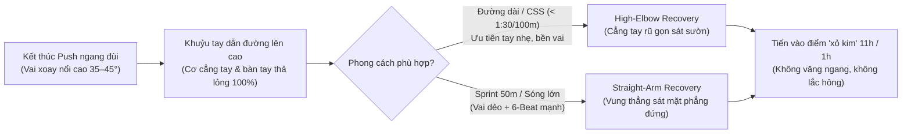

# Pha Rút Tay Thả Lỏng (*Relaxed Recovery*)

> **Thuộc phần:** `11-recovery/` | **Trình độ:** Cơ bản → Nâng cao | **Thời gian đọc:** ~11 phút

## Overview

Pha rút tay trên không (**Recovery**) không tạo ra bất kỳ lực đẩy nào về phía trước — nhưng nó quyết định trực tiếp việc bạn có giữ được **tay nhẹ và vai không mỏi suốt 1.500–3.800m** hay không. Đây là "kỳ nghỉ ngắn" quý giá (`~0.4–0.5 giây`) trong mỗi chu kỳ sải để cơ cẳng tay, bàn tay và cơ vai được xả hoàn toàn áp lực máu và axit lactic trước khi bước vào pha Catch tiếp theo.

- **Mục tiêu cốt lõi:** Đưa tay từ hông về trước qua không khí trong trạng thái **thả lỏng hoàn toàn cẳng tay & bàn tay**, sử dụng **xoay thân `35–45°`** làm bệ nâng vai thay vì gồng cơ vai nhấc tay lên.
- **Cảm giác đúng:** Khuỷu tay dẫn hướng lướt nhẹ lên cao, cẳng tay và bàn tay buông lơi như "sợi mì ướt" lắc nhẹ theo quán tính.
- **Sai lầm phổ biến nhất:** Vung tay rộng ngang sát mặt nước (*Wide Swinging Recovery*) gây lắc hông ngược chiều, hoặc gồng cứng cổ tay và vai suốt cả quãng đường trên không.

---

## Theory

Mặc dù diễn ra trên không khí (không chịu lực cản nước trực tiếp), pha Recovery lại tuân theo **Định luật bảo toàn mô-men động lượng (Conservation of Angular Momentum)** trong nước:
- Mọi chuyển động vung ngang rộng của cánh tay nặng `~3–4 kg` trên mặt nước sẽ lập tức sinh ra một **phản lực văng ngang ngược chiều** đẩy hông và hai chân dưới nước vẫy sang bên đối diện (*Fishtailing*), làm tăng mạnh Form Drag!
- Do đó, quỹ đạo Recovery càng **gọn sát đường trục vai** và càng **ít gồng cơ**, thân dưới nước càng đi thẳng băng và tiết kiệm năng lượng tối đa.

### Hai phong cách Recovery chuẩn quốc tế
1. **High-Elbow Bent-Arm Recovery (Khuỷu cao gập nhẹ — Chuẩn cho Đường dài, Triathlon & Phong trào `< 1:30/100m`)**:
   - Khuỷu tay dẫn đường lên cao, cẳng tay và bàn tay rũ tự nhiên bên dưới khuỷu, đi gọn sát bên sườn.
   - Ưu điểm: Mô-men quán tính ngắn nhất, cực kỳ tiết kiệm sức, giảm tối đa áp lực lên gân chóp xoay vai.
2. **Straight-Arm Recovery (Vung tay thẳng — Dùng cho Sprint 50m–100m & Open Water sóng lớn)**:
   - Cánh tay vung gần thẳng theo mặt phẳng đứng sát tai nhờ độ linh hoạt vai rất cao và nhịp chân 6-beat cực mạnh giữ ổn định hông.
   - Ưu điểm: Tạo xung lượng đòn bẩy lớn khi rơi xuống nước ở tần suất cực cao (`90–110 SPM`), vượt qua sóng cao dễ dàng.
   - Lưu ý: Không khuyến nghị cho người bị cứng vai hoặc đang có dấu hiệu đau khớp vai.

---

## Science

### Physics & Hydrodynamics

So sánh mô-men quán tính ($I = m \cdot r^2$) quanh khớp vai khi rút tay:
- Khi gập khuỷu tự nhiên (**High-Elbow Recovery**), khoảng cách từ tâm khối lượng cánh tay đến khớp vai ($r$) giảm khoảng **35–40%** so với vung rộng ngang.
- Do $I \propto r^2$, năng lượng cơ bắp cần để đưa cánh tay về trước giảm tới **`~55–60%`**, đồng thời mô-men văng ngang gây lắc hông giảm xuống gần như bằng 0!

### Biomechanics

Tại sao nhiều người bị mỏi vai dữ dội ở pha Recovery?
- **Bơi thân phẳng (không xoay vai)**: Khi vai không xoay nổi lên khỏi mặt nước, cơ delta giữa (*Middle Deltoid*) và cơ thang trên (*Upper Trapezius*) phải gồng cực mạnh để nhấc cánh tay thoát khỏi mặt nước.
- **Xoay thân chuẩn `35–45°`**: Vai bên rút tay được nâng cao tự nhiên trên mặt nước `10–15 cm`. Khuỷu tay chỉ cần nhấc nhẹ lên theo quán tính cuối pha Push, trọng lực tự làm nốt phần thả lỏng cẳng tay và bàn tay rơi nhẹ về trước!

---

## Practical

### Why It Works

Cơ bắp chỉ có thể bơm máu giàu oxy vào nuôi tế bào khi nó được **thả lỏng giữa hai nhịp co**. Trong một cự ly `1.500m` (~1.200 sải tay), mỗi `0.45 giây` thả lỏng hoàn toàn ở pha Recovery cộng dồn thành **hơn 4.5 phút nghỉ ngơi thực sự cho mỗi cánh tay ngay trong khi đang bơi!** Đó là bí mật sinh lý giúp các VĐV bơi đường dài giữ được cảm giác tay nhẹ tênh đến tận mét cuối cùng.

### Step-by-Step Execution & Water Cues

1. **Nhấc từ khuỷu, không từ bàn tay (*Lead with the Elbow*)**: Tưởng tượng có một sợi dây rối buộc vào **khuỷu tay** kéo nhẹ nó lên trời ngay khi ngón cái vừa lướt qua đùi.
2. **Thả lỏng bàn tay & cổ tay như "sợi mì ướt"**: Trong suốt quá trình tay di chuyển từ hông lên ngang vai, bàn tay buông rũ mềm mại dưới khuỷu, đầu ngón tay gần như lướt sát mặt nước.
3. **Vung gọn sát sườn (*Narrow Recovery*)**: Không vung cánh tay dang ngang rộng như cánh chim; giữ khuỷu tay và bàn tay đi gọn trong hành lang ngay sát thân mình.
4. **Dùng quán tính đưa tay vào điểm Entry**: Khi khuỷu tay vượt qua ngang vai, cẳng tay tự động vung nhẹ về trước theo quán tính để đầu ngón tay "xỏ kim" vào đúng điểm `11 giờ` / `1 giờ`.

<!-- IMAGE_PROMPT: Clean sports biomechanics illustration showing an above-water side and front view of High-Elbow Relaxed Recovery: shoulder lifted by 40-degree body roll, elbow pointing upward like a marionette string, forearm and hand dangling completely relaxed near the water surface (fingertip drag), compared with a red inset showing wide stiff-arm swinging causing hip fishtailing. -->

### Advanced Tips

- **Đừng cố nâng khuỷu tay cao quá mức tự nhiên (Over-Exaggerated High Elbow)**: Nếu khớp vai bạn không quá dẻo mà bạn cố gồng nâng khuỷu cao chót vót như trong sách cũ, bạn sẽ lại làm chèn ép gân chóp xoay vai! Hãy giữ **khuỷu cao tự nhiên và thoải mái** nhờ độ xoay của vai `35–45°` — nếu cảm thấy cấn khớp vai, hãy mở góc khuỷu ra ngoài thêm một chút (*Slightly Wider Relaxed Recovery*).
- **Kiểm tra độ thả lỏng bằng "lắc cổ tay"**: Trong bài tập khởi động, thử lắc nhẹ bàn tay khi đang rút trên không; nếu không thể lắc nhẹ được nghĩa là cẳng tay bạn đang bị gồng cứng.

---

## Drills

| Tên Drill | Mục tiêu pha Recovery | Cự ly / Số hiệp | Cảm giác đúng (Cue) |
| :--- | :--- | :--- | :--- |
| **Fingertip Drag (Lê đầu ngón tay)** | Ép khuỷu tay dẫn hướng lên cao & thả lỏng hoàn toàn cẳng tay | `4 × 25m` (nghỉ 15s) | Đầu ngón tay vẽ một vệt mảnh êm ái trên mặt nước từ hông lên tận điểm vào nước |
| **Zipper Drill (Kéo khóa áo)** | Giữ quỹ đạo rút tay gọn sát sườn, loại bỏ lỗi vung ngang rộng | `4 × 25m` (nghỉ 15s) | Ngón cái lướt dọc từ đùi lên sát sườn đến nách như kéo khóa áo khoác rồi vươn vào nước |
| **Shark Fin Drill (Vây cá mập)** | Kiểm tra cân bằng thân nghiêng khi giữ tay Recovery trên không | `4 × 25m` (kèm chân vịt ngắn) | Dừng 3 giây với khuỷu tay dựng cao như vây cá mập, bàn tay thả lỏng hoàn toàn sát nách |

### Hướng dẫn nhanh
- **Fingertip Drag**: Bơi chậm rãi, trong suốt pha rút tay trên không, giữ đầu ngón tay chạm nhẹ lướt trên mặt nước tạo ra một đường sóng mảnh liên tục. Để làm được điều này, vai bạn bắt buộc phải xoay, khuỷu tay phải dẫn lên cao và cổ tay–bàn tay phải buông lỏng hoàn toàn!

---

## AI Analysis

- **Góc quay khuyến nghị:** Trên mặt nước góc ngang (Above-Water Side View) và Trên cao (Overhead View).
- **Keypoints cần trích xuất:** `recovery_shoulder`, `recovery_elbow`, `recovery_wrist`, `hip_center`.
- **Ngưỡng phát hiện lỗi tự động:**
  - **Đạt chuẩn:** `recovery_elbow` luôn cao hơn `recovery_wrist` từ lúc rời nước đến ngang đầu (`y_elbow < y_wrist`); khoảng cách vung ngang của `recovery_wrist` so với trục vai `< 30 cm` (với High-Elbow Recovery).
  - **Cảnh báo lỗi:** `recovery_wrist` vung rộng ngang `> 50 cm` ngoài vai kèm `hip_center` văng ngược chiều (Wide Swinging Recovery); góc cổ tay bẻ căng cứng suốt pha trên không.

---

## Common Errors

| Lỗi thường gặp | Triệu chứng nhận biết | Nguyên nhân gốc | Cách sửa (Correction) |
| :--- | :--- | :--- | :--- |
| **Vung tay rộng ngang (Wide Swinging)** | Hông và chân vẫy ngược sang bên kia mỗi lần rút tay | Không xoay vai đủ `35–45°` nên phải vung ngang vòng qua mặt nước | Xoay vai cao hơn + tập Zipper Drill và Fingertip Drag |
| **Gồng cứng bàn tay & vai trên không** | Cẳng tay và cơ thang trên mỏi rã nhanh sau 300m | Không chủ động ngắt lực cơ sau khi kết thúc pha Push | Tập thả lỏng bàn tay như "sợi mì", kiểm tra bằng Shark Fin Drill |
| **Khuỷu tay thấp hơn bàn tay (Hand-Led)** | Bàn tay nhấc vống lên cao rồi đập mạnh xuống nước khi Entry | Nhấc tay bằng cơ vai/bàn tay thay vì để khuỷu dẫn đường | Tập Fingertip Drag ép đầu ngón tay luôn nằm sát mặt nước bên dưới khuỷu |
| **Cố ép khuỷu quá cao gây đau vai** | Cảm giác cấn/kẹt mặt ngoài khớp vai khi tay đi ngang đầu | Cứng khớp vai hoặc xoay thân chưa đủ nhưng vẫn ép khuỷu thẳng đứng | Tăng độ xoay thân `40°` và cho phép cánh tay mở góc thoải mái hơn một chút |

---

## Self Assessment

- [ ] Tôi cảm nhận rõ cẳng tay và bàn tay mình hoàn toàn thả lỏng (như được nghỉ ngơi) trong suốt pha Recovery.
- [ ] Khuỷu tay của tôi dẫn đường lên trước và cao hơn bàn tay trong pha rút tay.
- [ ] Quỹ đạo rút tay đi gọn sát thân, không làm lắc hông hay văng chân dưới nước.
- [ ] Tôi thực hiện được bài Fingertip Drag 50m êm ái mà không cảm thấy căng cứng cổ hay vai.
- [ ] Tôi biết khi nào nên dùng High-Elbow Recovery (đường dài/CSS) và khi nào có thể dùng Straight-Arm (Sprint/sóng lớn).

---

## KPI

| Chỉ số (Metric) | Người mới | Trung cấp | Nâng cao (`< 1:30/100m`) |
| :--- | :---: | :---: | :---: |
| **Độ vung ngang tối đa của bàn tay (High-Elbow)** | `> 55 cm` | `30–45 cm` | `< 28 cm` (gọn sát trục vai) |
| **Độ lệch hông do pha Recovery (Overhead)** | `> 15 cm` | `8–12 cm` | `< 5 cm` |
| **Cảm giác mỏi vai sau 1.000m bơi đều** | Mỏi rõ sau 300m | Mỏi nhẹ sau 800m | Nhẹ tênh, không căng cơ thang trên |
| **Fingertip Drag 50m không ngắt vệt nước** | Đứt quãng nhiều | Ổn định bên thuận | Mượt đều 100% cả 2 tay |

---

## FAQ

**1. Tôi thấy nhiều VĐV Olympic bơi 1500m (như Katie Ledecky hay Sun Yang) đôi khi dùng tay rút gần thẳng — tôi có nên bắt chước không?**
Họ sở hữu **độ linh hoạt khớp vai và cột sống ngực bẩm sinh cực lớn** cùng sức mạnh Core phi thường để triệt tiêu phản lực văng ngang. Với 90% người bơi phong trào, Masters và Triathlete, **High-Elbow Relaxed Recovery** an toàn hơn hẳn cho khớp vai và tiết kiệm năng lượng hơn rõ rệt.

**2. Khi tập Fingertip Drag mà ngón tay tôi cứ bị móc sâu vào nước thì sao?**
Điều đó cho thấy vai bên rút tay của bạn **chưa xoay đủ cao khỏi mặt nước**. Hãy tăng góc xoay thân lên `35–45°` và nhấc nhẹ khuỷu tay cao thêm 5 cm.

**3. Tốc độ rút tay trên không nên nhanh hay chậm?**
Rút tay **gọn và có nhịp điệu** theo tốc độ bơi — không lê thê quá chậm (gây Dead Spot), cũng không ném tay giật cục (gây đập nước khi Entry). Khi bạn muốn tăng tốc độ bơi (tăng SPM), rút tay gọn hơn một chút nhưng vẫn phải giữ nguyên sự thả lỏng của bàn tay.

---

## Summary

- Pha **Recovery** là khoảng nghỉ sinh lý quý giá giúp xả mỏi cơ tay và bảo vệ khớp vai trong suốt cự ly dài.
- 3 nguyên tắc vàng: **Xoay vai `35–45°` làm bệ nâng + Khuỷu tay dẫn hướng lên cao + Cẳng tay & bàn tay thả lỏng hoàn toàn gọn sát sườn**.
- Bộ 3 Drill kinh điển: **Fingertip Drag**, **Zipper Drill** và **Shark Fin Drill**.

**Liên kết chéo:**
- Chương trước: [Pha Kéo (Pull) & Pha Đẩy Kết Thúc (Push)](../10-pull/pull-and-push-phase.md)
- Chương tiếp theo (Phase 4): [2-Beat Kick](../08-kicking/two-beat-kick.md)
- Kỹ thuật liên quan: [Xoay Trục Dọc](../06-rotation/body-rotation.md) · [Fingertip Drag Drill](../17-drills/fingertip-drag.md) · [Shark Fin Drill](../17-drills/shark-fin.md)
- Tra cứu thuật ngữ: [Glossary](../24-appendix/glossary.md)

---

## References

1. Newsome, P., & Young, A. (2012). *Swim Smooth*. Wiley.
2. Maglischo, E. W. (2003). *Swimming Fastest*. Human Kinetics.
3. Yanai, T., & Hay, J. G. (2000). *Shoulder impingement in front-crawl swimming: II. Analysis of stroking technique*. Medicine & Science in Sports & Exercise, 32(1), 30–40.

