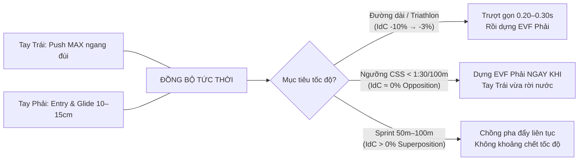

# Front-Quadrant Swimming & Nhịp Điệu Sải Tay (*Rhythm & Timing*)

> **Thuộc phần:** `12-rhythm/` | **Trình độ:** Trung cấp → Nâng cao | **Thời gian đọc:** ~12 phút

## Overview

Bạn có thể sở hữu từng pha động tác riêng lẻ rất đẹp (Streamline thẳng, EVF chắc, Recovery thả lỏng), nhưng nếu **thời điểm phối hợp giữa tay trái và tay phải (*Arm-to-Arm Coordination*)** bị lệch nhịp, tốc độ vẫn bị kẹt lại. Bí mật biến các mảnh ghép rời rạc thành một cỗ máy lướt nước êm ru và tốc độ `< 1:30/100m` nằm ở **Front-Quadrant Swimming** và **Chỉ số Phối hợp (*Index of Coordination — IdC*)**.

- **Mục tiêu cốt lõi:** Duy trì tối thiểu một cánh tay ở nửa trước cơ thể (tính từ vai trở lên đầu) trong 75–85% chu kỳ bơi, đồng thời điều chỉnh **IdC** linh hoạt từ *Catch-Up nhẹ* (đường dài) sang *Opposition / Superposition* (tốc độ cao).
- **Cảm giác đúng:** Cơ thể di chuyển với một nhịp điệu trôi chảy, đều đặn như con lắc đồng hồ — không bao giờ cảm thấy phải "chới với" hay khựng lại giữa hai sải.
- **Sai lầm phổ biến nhất:** Bơi kiểu **"Cối xay gió" (*Windmill*)** (hai tay đối xứng 180° làm mất đối trọng phía trước, hông chìm) hoặc **Over-Gliding** (chờ quá lâu kiểu Catch-Up cứng làm vận tốc rơi về 0).

---

## Theory

Trong khoa học cơ sinh học bơi lội, Chollet et al. (2000) đã định nghĩa **Chỉ số Phối hợp (*Index of Coordination — IdC*)** — đo khoảng thời gian trễ (hoặc chồng lấn) giữa lúc **tay 1 kết thúc pha đẩy (Push)** và **tay 2 bắt đầu pha kéo (Pull)**:

$$\text{IdC} = \frac{t_{\text{pull\_start}(2)} - t_{\text{push\_end}(1)}}{T_{\text{cycle}}} \times 100\%$$

Dựa trên giá trị IdC, mọi kiểu nhịp tay bơi sải trên thế giới chia thành **3 chế độ phối hợp**:

| Chế độ (Mode) | Giá trị IdC | Đặc điểm hình học | Ứng dụng tối ưu |
| :--- | :---: | :--- | :--- |
| **Catch-Up (Đuổi nhẹ)** | `IdC < 0%` (tối ưu `-10%` đến `-3%`) | Có một khoảng trượt ngắn giữa 2 pha tạo lực | Bơi đường dài (`800m–3.8km`), Triathlon, tiết kiệm năng lượng tối đa |
| **Opposition (Liên hoàn)** | `IdC ≈ 0%` (`-2%` đến `+2%`) | Tay này vừa dứt pha Push là tay kia lập tức kéo Pull | Tốc độ ngưỡng **CSS (`1:20–1:35/100m`)**, cự ly `200m–400m` |
| **Superposition (Chồng pha)** | `IdC > 0%` (`+3%` đến `+10%`) | Tay kia đã bắt đầu kéo khi tay này vẫn đang hoàn tất pha Push | Nước rút **Sprint (`50m–100m`)**, tạo lực đẩy liên tục không gián đoạn |

**Nguyên tắc bất biến — Front-Quadrant Swimming:**
Dù ở chế độ `Catch-Up nhẹ` hay `Opposition`, **tay đang rút trên không phải tiến vào vùng nửa trước (ngang vai/đầu) trước khi tay dưới nước bắt đầu kéo qua mặt phẳng vai**. Điều này bảo đảm thân tàu luôn dài ($L$ lớn) và Trọng tâm (COG) luôn được kéo về phía Tâm nổi (COB).

---

## Science

### Physics & Hydrodynamics

Vì lực cản tăng theo $v^2$, chi phí năng lượng để duy trì vận tốc trung bình $\bar{v}$ tăng tỷ lệ thuận với **độ biến thiên vận tốc trong chu kỳ (*Intra-cyclic Velocity Variation — IVV*)**:
- Nếu bạn bơi quá chậm ở kiểu Catch-Up cứng (`IdC < -18%`), vận tốc dao động mạnh từ `1.3 m/s` (khi đẩy) tụt xuống `0.7 m/s` (khi dừng trượt), khiến bạn phải tốn thêm **15–20% công cơ học** chỉ để gia tốc lại khối lượng cơ thể sau mỗi sải!
- Khi vận tốc bơi vượt ngưỡng `~1.20–1.35 m/s` (`~1:15–1:25/100m`), các VĐV giỏi tự động chuyển từ `IdC = -8%` sang `IdC ≈ 0%` (*Opposition*) để triệt tiêu khoảng chết tốc độ (*Dead Spot*).

### Biomechanics

Sự đồng bộ giữa **Nhịp Tay – Nhịp Xoay – Nhịp Chân** tạo ra hiệu ứng **Cộng hưởng Đàn hồi (*Elastic Rhythm*)**:
- Khoảnh khắc tay phải vừa "xỏ kim" vào nước ở phía trước (`Entry`) trùng khớp với khoảnh khắc tay trái đang đạt tốc độ đỉnh của pha `Push` ngang đùi.
- Chính cú "ném" trọng lượng của tay phải trượt thẳng về trước kết hợp cú xoay hông phải xuống `40°` đóng vai trò **đòn bẩy cộng hưởng** giúp tay trái tăng tốc kết thúc pha đẩy mạnh hơn mà không cần gồng thêm cơ tam đầu!

---

## Practical

### Why It Works

Rất nhiều người bơi tập bài **Catch-Up Drill** quá kỹ rồi mang luôn tư thế "chờ 2 bàn tay chạm nhau mới kéo" vào bơi tốc độ — kết quả là bơi rất đẹp nhưng bị kẹt mãi ở mốc `1:45/100m`. Hiểu rõ **Front-Quadrant** và **IdC** giúp bạn giữ được toàn bộ lợi ích "thân dài, hông nổi" của Catch-Up mà vẫn phóng đi ở tốc độ `< 1:30/100m` mượt mà không hề khựng!

### Step-by-Step Execution & Water Cues

1. **Quy tắc "Gặp nhau ngang tai" (*Meet at the Ear*)**: Khi bơi tốc độ ngưỡng (`1:25–1:35/100m`), thời điểm vàng để tay trượt phía trước bắt đầu dựng EVF là ngay khi **khuỷu tay đang rút trên không đi ngang qua mang tai của bạn**.
2. **Xóa bỏ thói quen "Cối xay gió" (*Windmill*)**: Đừng bao giờ kéo tay trước xuống ngay khi tay sau vừa rời khỏi đùi — nếu làm vậy, ở giữa chu kỳ cả hai tay đều nằm ngang vai/hông, phần đầu mất đối trọng khiến hông sụp xuống lập tức.
3. **Đồng bộ tiếng "bíp" với Tempo Trainer**: Cài máy đếm nhịp (Finis Tempo Trainer Pro) dưới mũ bơi để khóa nhịp tay đều tăm tắp giữa chiều đi và chiều về, không bị hụt nhịp ở 25m cuối.
4. **Cảm nhận nhịp "Cân bằng vs Lệch nhịp (Gallop)"**: Giữ nhịp hai bên đều nhau (*Symmetric Rhythm*) làm nền tảng; chỉ cân nhắc nhịp *Gallop* (nhịp hơi lệch nhẹ ở bên thở kiểu Ledecky/Phelps) khi bạn đã bơi thuần thục dưới `1:25/100m`.

<!-- IMAGE_PROMPT: Technical biomechanical phase diagram comparing three Index of Coordination (IdC) freestyle timing modes: (1) Catch-Up (IdC -6%, slight overlap in Front-Quadrant glide); (2) Opposition (IdC 0%, continuous propulsion handoff for <1:30/100m CSS); (3) Superposition (IdC +5%, sprint overlap); contrasted with a red warning showing Windmill arms losing Front-Quadrant balance. -->

### Advanced Tips

- **Kiểm tra "Nhịp thở phá Rhythm"**: 90% lỗi mất nhịp điệu xảy ra ở **sải thở** (tay trượt chờ quá lâu hoặc tụt xuống sâu). Hãy đếm nhẩm *"1 – 2 – 3 – 4"* thật đều qua cả sải thở và sải không thở; nếu nhịp bị giãn ra ở sải thở, bạn cần quay lại tập [Breathing Mechanics](../07-breathing/breathing-mechanics.md).
- **Chuyển số IdC theo cự ly trong cùng 1 buổi tập**: Khởi động với `IdC ≈ -10%` (lướt dài thư giãn), vào bài chính CSS chuyển sang `IdC ≈ 0%` (tay này vừa dứt là tay kia vào EVF ngay).

---

## Drills

| Tên Drill | Mục tiêu Rhythm & Timing | Cự ly / Số hiệp | Cảm giác đúng (Cue) |
| :--- | :--- | :--- | :--- |
| **3/4 Catch-Up Drill** | Thiết lập chuẩn Front-Quadrant không bị Dead Spot | `4 × 50m` (nghỉ 15s) | Tay trước bắt đầu dựng EVF đúng lúc tay rút trên không đi ngang tai |
| **Metronome (Tempo Trainer) Build** | Giữ nhịp điệu ổn định không vỡ dáng khi tăng tốc | `4 × 50m` (tăng nhịp `0.05s` mỗi 50m) | Tay vào nước chuẩn xác theo tiếng bíp, không vội kéo sớm ở sải thở |
| **Windmill → Front-Quadrant Contrast** | Tự cảm nhận chênh lệch độ dài và độ nổi giữa 2 kiểu phối hợp | `3 × 50m` (15m Windmill + 35m Front-Quadrant) | Chuyển sang Front-Quadrant thấy hông nổi bật lên và số sải giảm ngay `3–4 sải` |

### Hướng dẫn nhanh
- **3/4 Catch-Up Drill**: Khác với Catch-Up truyền thống (phải chạm hai bàn tay vào nhau trước mặt), ở **3/4 Catch-Up**, ngay khi khuỷu tay rút trên không đi qua đỉnh đầu và bàn tay sắp chạm mặt nước phía trước, tay trượt đang chờ lập tức gập cổ tay dựng EVF bắt nước! Đây là bài tập cầu nối tốt nhất để bơi nhanh mà vẫn dài người.

---

## AI Analysis

- **Góc quay khuyến nghị:** Ngang dưới nước (Underwater Side View, 120 fps) để xác định chính xác khung hình bắt đầu Pull (`t_pull_start`) và kết thúc Push (`t_push_end`) của cả 2 tay.
- **Keypoints cần trích xuất:** `left_wrist`, `right_wrist`, `left_shoulder`, `right_shoulder`, `hip`.
- **Ngưỡng phát hiện lỗi tự động:**
  - **Đạt chuẩn:** Tỷ lệ thời gian Front-Quadrant `≥ 75%`; chỉ số `IdC` nằm trong `[-10%, -2%]` ở tốc độ đường dài và `[-2%, +3%]` ở tốc độ `< 1:30/100m`; độ lệch chu kỳ giữa sải trái và sải phải `< 8%`.
  - **Cảnh báo lỗi:** `IdC < -18%` (Over-Gliding / Dead Spot); tỷ lệ Front-Quadrant `< 55%` (Windmill Arms).

---

## Common Errors

| Lỗi thường gặp | Triệu chứng nhận biết | Nguyên nhân gốc | Cách sửa (Correction) |
| :--- | :--- | :--- | :--- |
| **Bơi kiểu Cối xay gió (Windmill)** | Hai tay luôn ngược nhau 180°, hông chìm, nhịp tay nhanh nhưng đi ngắn | Vội kéo tay trước xuống ngay khi vừa chạm nước, bỏ qua pha trượt | Tập Catch-Up → 3/4 Catch-Up để học sự kiên nhẫn ở vùng Front-Quadrant |
| **Trượt chết tốc độ (Over-Gliding)** | Cơ thể gần dừng hẳn mới bắt đầu kéo, `IdC < -18%` | Áp dụng máy móc Full Catch-Up Drill vào bơi tốc độ | Chuyển sang quy tắc *"Meet at the Ear"* (kéo ngay khi tay hồi ngang tai) |
| **Vỡ nhịp ở sải thở (Breathing Hitch)** | Sải không thở rất nhanh, sải thở bị kéo dài lê thê | Ngẩng đầu thở muộn làm đình trệ tay trượt phía trước | Tập với Tempo Trainer ép hai sải có thời lượng bằng nhau tuyệt đối |
| **Tăng tốc bằng cách rút ngắn pha Push** | Tần suất tay tăng nhưng tốc độ không tăng | Rút tay sớm ngang bụng thay vì tăng tốc độ xoay và giữ nhịp IdC | Giữ nguyên quy tắc *Thumb-to-Thigh* ngay cả khi đẩy nhịp SPM lên cao |

---

## Self Assessment

- [ ] Tôi luôn duy trì ít nhất một tay ở vùng Front-Quadrant (trước vai) khi bơi tốc độ trung bình và CSS.
- [ ] Tôi hiểu rõ sự khác biệt giữa Catch-Up Drill (bài tập) và 3/4 Catch-Up / Opposition (bơi thực tế).
- [ ] Nhịp tay của tôi giữ đều tăm tắp, không bị khựng hay giãn nhịp ở các sải lấy hơi.
- [ ] Tôi có thể chủ động chuyển đổi mượt giữa nhịp lướt dài (`IdC < 0`) và nhịp liên hoàn (`IdC ≈ 0`) khi tăng tốc.
- [ ] Cơ thể tôi lướt đi liên tục không có cảm giác "dừng lại rồi giật lên" giữa các sải.

---

## KPI

| Chỉ số (Metric) | Người mới | Trung cấp | Nâng cao (`< 1:30/100m`) |
| :--- | :---: | :---: | :---: |
| **Chỉ số phối hợp IdC (ở pace CSS)** | `< -20%` hoặc Windmill | `-12%` đến `-5%` | `-4%` đến `+2%` (Opposition) |
| **Tỷ lệ thời gian Front-Quadrant** | `< 55%` | `65–74%` | `75–85%` |
| **Độ lệch nhịp thời gian giữa sải thở & không thở** | `> 20%` | `10–18%` | `< 7%` |
| **Biến thiên vận tốc trong chu kỳ (IVV)** | `> 25%` | `16–22%` | `< 14%` |

---

## FAQ

**1. Tại sao tôi thấy David Popovici bơi 100m kỷ lục thế giới nhưng vẫn giữ nhịp Front-Quadrant cực dài?**
Popovici có sải tay rất dài và độ lướt thủy động học siêu việt, cho phép anh giữ `IdC` gần `0%` với vùng Front-Quadrant cực kỳ sạch sẽ (gần giống kiểu *Kayak / 3/4 Catch-Up* tốc độ cao), giúp anh tối đa hóa DPS và giữ tay nhẹ ở 50m cuối. Xem chi tiết tại [David Popovici Analysis](../athletes/david-popovici.md).

**2. Người bơi phong trào có nên học nhịp Gallop (nhịp khập khiễng cố ý) không?**
Chưa nên cho đến khi bạn bơi ổn định dưới `1:25/100m` với nhịp đối xứng hoàn hảo. Nếu tập Gallop quá sớm khi kỹ thuật còn yếu, nó rất dễ biến thành lỗi mất đối xứng, lệch vai và vắt chéo trục giữa.

**3. Tempo Trainer có thực sự đáng mua để tập Rhythm không?**
Rất đáng! Đây là một trong 3 dụng cụ hiệu quả nhất (cùng với Center Snorkel và Short Fins) giúp bạn kiểm soát chính xác nhịp độ đến `0.01 giây` và khắc phục triệt để lỗi vỡ nhịp khi mệt.

---

## Summary

- **Front-Quadrant Swimming** và **Chỉ số Phối hợp (IdC)** là bộ điều khiển nhịp giúp kết nối toàn bộ kỹ thuật tay–hông–chân thành dòng chuyển động liên tục không có *Dead Spot*.
- Áp dụng quy tắc **"Gặp nhau ngang tai" (3/4 Catch-Up → Opposition, `IdC ≈ 0%`)** cho mục tiêu `< 1:30/100m`.
- Luôn giữ nhịp đều xuyên suốt cả sải thở và sải không thở; tránh cả hai thái cực *Windmill* lẫn *Over-Gliding*.

**Liên kết chéo:**
- Chương trước: [Dolphin Kick & Đồng Bộ Nhịp Chân](../08-kicking/dolphin-and-kick-timing.md)
- Chương tiếp theo: [Distance Per Stroke (DPS)](../13-dps/distance-per-stroke.md)
- Kỹ thuật liên quan: [Cân Bằng & Pha Trượt](../04-body-position/balance-and-glide.md) · [Catch-Up Drill](../17-drills/catch-up.md)
- Tra cứu thuật ngữ: [Glossary](../24-appendix/glossary.md)

---

## References

1. Chollet, D., Chalies, S., & Chatard, J. C. (2000). *A new index of coordination for the crawl: description and usefulness*. International Journal of Sports Medicine, 21(1), 54–59.
2. Seifert, L., Chollet, D., & Bardy, B. G. (2004). *Effect of swimming velocity on arm coordination in the front crawl: a dynamic analysis*. Journal of Sports Sciences.
3. Newsome, P., & Young, A. (2012). *Swim Smooth*. Wiley.

