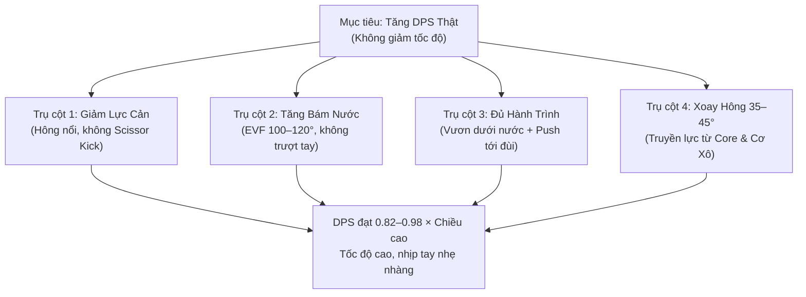

# Tối Đa Hóa Quãng Đường Mỗi Sải (*Distance Per Stroke — DPS*)

> **Thuộc phần:** `13-dps/` | **Trình độ:** Cơ bản → Nâng cao | **Thời gian đọc:** ~11 phút

## Tổng Quan (Overview)
Vận tốc bơi của bất kỳ ai trên hành tinh này đều bị chi phối bởi một phương trình tối giản và tuyệt đối: **$\text{Vận tốc} = \text{DPS} \times \text{Tần suất sải tay}$**. Trong khi đa số người bơi phong trào chỉ biết cố gắng tăng tần suất quạt tay (khiến nhịp tim vọt lên đỉnh và tay mỏi rã), bí mật của các VĐV bơi nhanh mà **tay vẫn nhẹ tênh** là tối ưu hóa **Distance Per Stroke (DPS)** — đi được quãng đường xa nhất sau mỗi một sải tay với nỗ lực ít nhất.

- **Mục tiêu cốt lõi:** Nâng DPS từ mức trung bình (`1.0–1.2 m/sải`) lên mức hiệu suất cao (`1.45–1.85 m/sải` tùy chiều cao) **mà không đánh đổi bằng lỗi trượt chết (*Over-Gliding*)**.
- **Cảm giác đúng:** Mỗi cú đẩy tay như phóng một chiếc thuyền kayak lướt dài, mượt mà và chắc chắn trên mặt nước; bơi hết 25m chỉ trong `14–17 sải` nhẹ nhàng.
- **Sai lầm phổ biến nhất:** Cố tình kéo dài DPS bằng cách dừng trượt thật lâu (`SPM < 48`) — kết quả là số sải rất ít nhưng thời gian bơi lại cực chậm!

---

## Lý Thuyết (Theory)
**Distance Per Stroke (DPS)** được định nghĩa là quãng đường (tính bằng mét) mà cơ thể tiến được sau **1 lần sải tay đơn** (1 tay trái hoặc 1 tay phải) — lưu ý: một số tài liệu tính theo **Stroke Length (SL)** cho 1 chu kỳ 2 tay ($\text{SL} = 2 \times \text{DPS}$). Trong bộ sách này, ta thống nhất chuẩn thực chiến tại hồ bơi:

$$\text{DPS (m/sải)} = \frac{\text{Quãng đường bơi mặt nước (m)}}{\text{Số sải tay (Stroke Count)}}$$

*(Ví dụ bể 25m: Nếu bạn đạp tường trượt Streamline hết `5 m` và quạt `14 sải tay` cho `20 m` còn lại, thì $\text{DPS} = \frac{20}{14} = 1.43\text{ m/sải}$.)*

### Phương trình Tốc Độ Bơi Cốt Lõi

$$v \text{ (m/s)} = \text{DPS (m/sải)} \times \frac{\text{SPM (sải/phút)}}{60}$$

Hãy xem sức mạnh toán học của **DPS**:
- **Người bơi A**: `DPS = 1.05 m/sải`, phải quạt tới `SPM = 65` → $v = 1.05 \times \frac{65}{60} = 1.137\text{ m/s}$ (`1:28/100m`) — cực kỳ mệt và khó giữ quá 100m.
- **Người bơi B**: `DPS = 1.35 m/sải`, chỉ cần quạt `SPM = 55` → $v = 1.35 \times \frac{55}{60} = 1.237\text{ m/s}$ (`1:21/100m`) — **nhanh hơn 7 giây/100m nhưng số nhịp quạt tay lại ít hơn 10 lần mỗi phút!**

---

## Cơ Sở Khoa Học (Science)
### Vật Lý & Thủy Động Lực Học (Physics & Hydrodynamics)
Từ phương trình cân bằng động lượng, **DPS tỷ lệ thuận với Xung lượng đẩy ($J_{\text{prop}}$) và tỷ lệ nghịch với Lực cản thủy động ($C_d \cdot A$)**:

$$\text{DPS} \propto \frac{\eta_p \cdot F_{\text{catch-pull-push}}}{C_d \cdot A}$$

Điều này khẳng định **4 trụ cột duy nhất làm tăng DPS thật (Real DPS)**:
1. **Giảm $C_d \cdot A$**: Hông nổi ngang `< 5°`, không đá cắt kéo, không lắc hông (*Fishtailing*), giữ thân dài Front-Quadrant.
2. **Tăng độ bám nước $\eta_p$**: Dựng cẳng tay sớm (**EVF `100–120°`**) để tay không bị trượt qua nước.
3. **Kéo dài hành trình tạo lực**: Vươn dài 25% cuối dưới nước + hoàn tất trọn vẹn pha **Push** ngang mép đùi (*Thumb-to-Thigh*).
4. **Huy động lực từ thân**: Xoay hông–vai đồng trục `35–45°` truyền mô-men từ Core và cơ xô (Lat).

### Cơ Sinh Học (Biomechanics)
**Ngưỡng DPS tối ưu theo chiều cao cơ thể (*Height-Normalized DPS*)**:
Người cao `1.90 m` tự nhiên có sải tay dài hơn người cao `1.62 m`. Do đó, tiêu chuẩn khoa học chính xác để đánh giá DPS là **tỷ lệ DPS trên chiều cao cơ thể ($H$)** — hoặc **SL/H** (*Stroke Length / Height*):
- **Mức Cơ bản**: $\text{DPS} \approx 0.55–0.65 \times H$ (người cao 1.70m đi được `0.95–1.10 m/sải`).
- **Mức Trung cấp**: $\text{DPS} \approx 0.70–0.80 \times H$ (người cao 1.70m đi được `1.19–1.36 m/sải`).
- **Mức Nâng cao (`< 1:30/100m`)**: $\text{DPS} \approx 0.82–0.98 \times H$ (người cao 1.70m đi được `1.40–1.67 m/sải`).
- **Đẳng cấp Olympic**: $\text{DPS} \ge 1.00–1.15 \times H$ (nhiều VĐV cao 1.90m đi tới `2.0–2.2 m/sải`!).

---

## Thực Hành (Practical)
### Tại Sao Kỹ Thuật Này Hiệu Quả (Why It Works)
Khi bạn tập trung phát triển **DPS thật** trước khi đẩy nhịp tay (SPM), bạn đang xây dựng một chiếc xe có **khí động học xuất sắc và mô-men xoắn cực lớn**. Sau khi đã có DPS dài ổn định ở tốc độ thoải mái (`1:35–1:40/100m`), bạn chỉ cần tăng nhẹ nhịp tay thêm `5–8 SPM` là lập tức phá mốc `< 1:30/100m` một cách nhẹ nhàng và bền bỉ!

### Hướng Dẫn Từng Bước & Cảm Giác Nước (Step-by-Step & Water Cues)
1. **Đo chuẩn DPS của riêng bạn trong 2 phút**: Bơi 50m tốc độ thoải mái ở bể 25m, đếm tổng số sải tay ở chiều bể thứ 2 (để loại bỏ quán tính nhảy xuất phát). Trừ đi khoảng `5 m` đạp tường Streamline, lấy `20 m / Số sải` = **DPS thực tế của bạn**.
2. **Tối ưu "Đầu vào" & "Đầu ra" của sải tay**:
   - *Đầu vào*: Xỏ kim êm ái + vươn dài dưới nước `10–15 cm` kết hợp xoay vai `40°`.
   - *Đầu ra*: Đẩy tăng tốc trọn vẹn cho tới khi ngón cái lướt ngang mép đùi.
3. **Tránh "DPS giả" (Fake DPS)**: Nếu bạn giảm được từ 18 sải xuống 14 sải/25m nhưng thời gian bơi 25m lại chậm đi từ `21 giây` xuống `26 giây`, đó là **DPS giả** (do dừng trượt quá lâu tạo Dead Spot). **DPS thật** phải đi kèm với thời gian giữ nguyên hoặc nhanh hơn!
4. **Duy trì DPS khi mệt mỏi (*DPS Retention*)**: Ở nửa sau của một bài `400m` hay `1.000m`, hãy tự nhắc đếm số sải ở 25m cuối mỗi 100m — mục tiêu là số sải không được tăng quá `+1 sải/25m` so với 100m đầu!

<!-- IMAGE_PROMPT: Clean MIT-style engineering contour graph with Stroke Rate (SPM, 50 to 90) on the X-axis and Distance Per Stroke (DPS, 0.9 to 1.9 m/stroke) on the Y-axis, plotting curved iso-velocity lines for 2:00/100m, 1:45/100m, 1:30/100m (highlighted in bold green), and 1:15/100m, illustrating the efficient "Sweet Spot" zone vs High-Churn burnout zone and Over-Gliding dead-spot zone. -->

### Mẹo Nâng Cao (Advanced Tips)
- **Nguyên tắc "Bánh răng DPS" trong bài tập Pyramid**: Tập `4 × 50m` với yêu cầu giữ **cùng một số sải tay cố định** (ví dụ `16 sải/25m`) nhưng **tăng tốc độ nhanh dần `1 giây` mỗi 50m** (`48s → 47s → 46s → 45s`). Bài tập này buộc não bạn phải tăng lực tì nước EVF và độ sắc của pha Push thay vì quạt loạn nhịp!
- **Bơi DPS ngắn lại một chút khi gặp sóng/dòng chảy Open Water**: Trong nước mở có sóng đánh trực diện, giữ pha trượt dài sẽ làm sóng đánh tụt tốc độ. Khi đó hãy chủ động rút ngắn DPS khoảng `8–10%` và tăng SPM thêm `5–8 nhịp` để xuyên qua sóng hiệu quả hơn.

---

## Bài Tập Thực Hành (Drills)
| Tên Drill | Mục tiêu DPS | Cự ly / Số hiệp | Cảm giác đúng (Cue) |
| :--- | :--- | :--- | :--- |
| **Stroke-Count Descend (Giảm sải giữ tốc)** | Tìm ra cảm giác ôm nước đặc và hoàn tất pha Push | `4 × 25m` (ví dụ: 18 → 17 → 16 → 15 sải) | Mỗi 25m giảm 1 sải nhưng thời gian vẫn giữ nguyên không chậm đi |
| **Hold-Count Speed Build (Giữ sải tăng tốc)** | Xây dựng DPS thật ở tốc độ ngưỡng `< 1:30/100m` | `4 × 50m` (nghỉ 20s) | Khóa cứng số sải/25m, tăng dần áp lực EVF và độ bật của hông mỗi 50m |
| **Fist → Open Hand DPS Check** | Mở khóa diện tích mái chèo cẳng tay tăng DPS tức thì | `4 × 50m` (25m nắm đấm + 25m mở tay đếm sải) | Quan sát số sải giảm đột ngột `2–4 sải` khi mở tay mà nước cực êm |

### Hướng dẫn nhanh
- **Hold-Count Speed Build (`4 × 50m`)**: Xác định số sải thoải mái của bạn (ví dụ `16 sải/25m`).
  - `50m #1`: Bơi `48 giây` với `16 sải/25m`.
  - `50m #2`: Bơi `46 giây` **vẫn giữ đúng `16 sải/25m`**.
  - `50m #3`: Bơi `44 giây` **vẫn giữ đúng `16 sải/25m`**.
  - `50m #4`: Bơi `42 giây` (chấp nhận tăng tối đa `17 sải`). Đây là bài tập đỉnh cao nhất để biến DPS thành tốc độ thực tế!

---

## Phân Tích AI & Video (AI Analysis)
- **Góc quay khuyến nghị:** Trên cao dọc chiều bể (Overhead Pool-Length Camera) hoặc đồng hồ bơi thông minh có gia tốc kế 3 trục (Garmin / Apple Watch / FORM Goggles).
- **Điểm khớp cần trích xuất (Keypoints):** Tọa độ `hip_center` dọc theo trục bể ($x$) tại 2 thời điểm liên tiếp của `right_wrist_entry` và `left_wrist_entry`.
- **Ngưỡng phát hiện lỗi tự động:**
  - **Đạt chuẩn:** $\text{DPS} = x(t_{i+1}) - x(t_i) \ge 0.82 \times H$; độ suy giảm DPS từ 100m đầu đến 100m cuối trong bài `400m` (`DPS Drop-off`) `< 6%`.
  - **Cảnh báo lỗi:** `DPS < 0.65 × H` (trượt nước / cắt cụt pha đẩy); `DPS` tăng cao nhưng vận tốc `v < 0.95 m/s` (Fake DPS do Over-Gliding).

---

## Lỗi Thường Gặp & Cách Sửa (Common Errors)
| Lỗi thường gặp | Triệu chứng nhận biết | Nguyên nhân gốc | Cách sửa (Correction) |
| :--- | :--- | :--- | :--- |
| **Chạy theo DPS giả (Over-Gliding)** | Chỉ 12 sải/25m nhưng bơi mất 27 giây | Dừng trượt quá lâu để "ăn gian" số sải | Luôn đo DPS đi kèm **thời gian (SWOLF)**; không được chậm đi khi giảm sải |
| **DPS sụt mạnh khi bơi nhanh** | Bơi chậm 15 sải, vừa tăng tốc lập tức nhảy lên 22 sải | Sụp khuỷu EVF và cắt cụt pha Push khi tăng nhịp tay | Tập bài *Hold-Count Speed Build* khóa số sải khi tăng tốc |
| **DPS hai tay không đều** | Tay thuận đi `1.5m`, tay nghịch chỉ đi `1.1m` | Chỉ xoay thân và bám nước tốt ở 1 bên | Tập Single-Arm Freestyle nhiều hơn cho bên nghịch + thở đối xứng |
| **Bỏ quên cự ly Streamline khi tính DPS** | Ảo tưởng DPS tăng mạnh chỉ vì đạp tường khỏe hơn | Tính `25m / Số sải` thay vì trừ đi quãng đạp tường | Đo chuẩn từ vạch cờ 5m đến vạch cờ 5m đối diện (`15m` bơi mặt nước thuần) |

---

## Tự Đánh Giá Tại Hồ (Self Assessment)
- [ ] Tôi biết chính xác chỉ số **DPS thực tế** và tỷ lệ **DPS / Chiều cao** của bản thân.
- [ ] Tôi phân biệt rõ ràng giữa **DPS thật** (tăng nhờ giảm cản + EVF + Push) và **DPS giả** (do dừng trượt quá lâu).
- [ ] Tôi có thể giữ nguyên số sải tay (sai số `≤ 1 sải/25m`) khi tăng tốc độ lên ngưỡng CSS.
- [ ] Trong một bài bơi liên tục `400m`, số sải tay của tôi ở 100m cuối không tăng quá `+1–2 sải/25m` so với 100m đầu.
- [ ] Tôi thường xuyên theo dõi DPS trên đồng hồ bơi hoặc đếm thủ công ở ít nhất 1 bài tập mỗi buổi.

---

## Chỉ Số Đo Lường (KPI)
| Chỉ số (Metric) | Người mới | Trung cấp | Nâng cao (`< 1:30/100m`) |
| :--- | :---: | :---: | :---: |
| **Tỷ lệ DPS / Chiều cao ($H$)** | `0.55–0.65` | `0.70–0.80` | `0.82–0.98+` |
| **DPS tuyệt đối (người cao ~1.70m)** | `0.95–1.10 m/sải` | `1.19–1.36 m/sải` | `1.40–1.67 m/sải` |
| **Độ suy giảm DPS sau 400m (DPS Drop-off)** | `> 15%` | `8–14%` | `< 6%` |
| **Mức tăng số sải khi tăng tốc từ Easy → CSS** | `+4–6 sải/25m` | `+2–3 sải/25m` | `+0–1 sải/25m` |

---

## Câu Hỏi Thường Gặp (FAQ)
**1. Tôi cao 1.60m, liệu tôi có thể đạt cùng số sải tay (13–14 sải/25m) như người cao 1.85m không?**
Không cần thiết và không nên ép! Người cao `1.60m` có chiều dài cánh tay và thân tàu ngắn hơn, nên chiến lược tối ưu của bạn để đạt `< 1:30/100m` là tối ưu tỷ lệ `DPS ≈ 0.85–0.92 × H` (`~1.38–1.48 m/sải`, tương đương `15–17 sải/25m`) kết hợp với một **nhịp tay (SPM) linh hoạt hơn** (`72–80 SPM`) — giống hệt cách các VĐV bơi tầm vóc nhỏ như Janet Evans hay Laure Manaudou thống trị đường đua!

**2. Tại sao sau khi tập đẩy hết pha Push ngang đùi, DPS của tôi tăng ngay nhưng vai lại hơi mỏi lúc đầu?**
Vì bạn vừa kích hoạt thêm 30% biên độ làm việc của cơ xô và cơ tam đầu vốn chưa quen tải. Hãy tăng dần khối lượng tập trong 2–3 tuần và đảm bảo bạn luôn thả lỏng tuyệt đối ở pha Recovery.

**3. Nên ưu tiên tăng DPS hay tăng nhịp tay (SPM) trước?**
**Luôn luôn tối ưu DPS trước** (qua giảm lực cản, xoay hông và EVF) cho đến khi đạt tối thiểu `0.80 × H`. Sau đó mới dùng Tempo Trainer để đẩy dần SPM lên tìm điểm tốc độ đỉnh cao nhất!

---

## Tóm Tắt (Summary)
- Phương trình tốc độ: **$v = \text{DPS} \times \frac{\text{SPM}}{60}$** — tăng **DPS thật** giúp bạn bơi nhanh hơn với số nhịp quạt tay ít hơn và nhịp tim thấp hơn.
- Đánh giá DPS công bằng theo chiều cao cơ thể: mục tiêu nâng cao là **`0.82–0.98 × H`**.
- Tránh bẫy **Fake DPS** (Over-Gliding); luôn kiểm chứng DPS bằng bài tập *Hold-Count Speed Build* và chỉ số *SWOLF*.

**Liên kết chéo:**
- Chương trước: [Front-Quadrant & Nhịp Điệu](../12-rhythm/rhythm-and-timing.md)
- Chương tiếp theo: [Giảm Stroke Count & Tối Ưu Tempo (SPM)](../14-stroke-count/stroke-count-and-tempo.md)
- Kỹ thuật liên quan: [SWOLF & CSS](../14-stroke-count/swolf-and-energy-systems.md) · [Bảng Chuẩn Benchmarks](../benchmarks/performance-benchmarks.md)
- Tra cứu thuật ngữ: [Glossary](../24-appendix/glossary.md)

---

## Tài Liệu Tham Khảo (References)
1. Craig, A. B., & Pendergast, D. R. (1979). *Relationships of stroke rate, distance per stroke, and velocity in competitive swimming*. Medicine and Science in Sports, 11(3), 278–283.
2. Maglischo, E. W. (2003). *Swimming Fastest*. Human Kinetics.
3. Newsome, P., & Young, A. (2012). *Swim Smooth*. Wiley.

