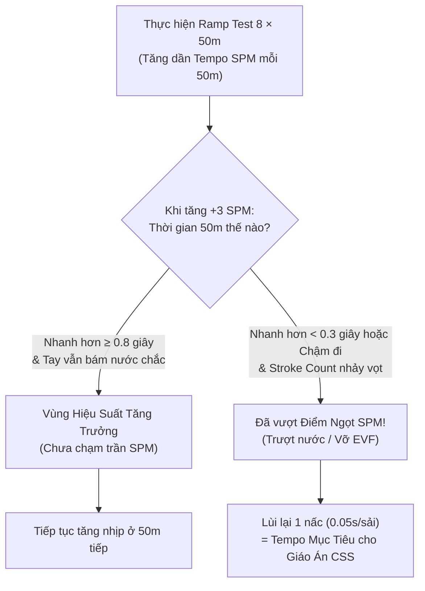

# Giảm Stroke Count & Tối Ưu Tempo (*Stroke Count & SPM*)

> **Thuộc phần:** `14-stroke-count/` | **Trình độ:** Cơ bản → Nâng cao | **Thời gian đọc:** ~11 phút

## Tổng Quan (Overview)
Nếu **DPS** là độ dài mỗi bước chạy, thì **Tempo (Stroke Rate — SPM)** là guồng chân và **Stroke Count** là tổng số sải bạn cần để hoàn thành 1 chiều bể `25m` hoặc `50m`. Rất nhiều người bơi phong trào mắc kẹt ở hai thái cực sai lầm: hoặc **quạt quá nhanh nhưng sải cực ngắn** (`SPM > 85`, `24 sải/25m`), hoặc **giảm Stroke Count quá mức bằng cách lờ đờ trượt** (`SPM < 50`, `13 sải/25m` nhưng bơi mất 26 giây). Chương này hướng dẫn bạn tìm ra **điểm ngọt tối ưu giữa Stroke Count thấp và Tempo đủ sắc** để chinh phục `< 1:30/100m`.

- **Mục tiêu cốt lõi:** Giảm **Stroke Count** xuống vùng hiệu suất tối ưu theo chiều cao (thường `14–18 sải/25m`), đồng thời làm chủ công cụ **Tempo (SPM)** từ `60 → 80+ SPM` mà không làm vỡ kỹ thuật EVF.
- **Cảm giác đúng:** Guồng tay đều đặn, linh hoạt như hộp số ô tô — tăng số (tăng SPM) là xe lập tức vọt lên chứ không bị "trượt côn".
- **Sai lầm phổ biến nhất:** Chỉ đếm Stroke Count mà quên nhìn đồng hồ thời gian, hoặc tăng Tempo quá đột ngột khiến tay trượt nước và Stroke Count tăng vọt.

---

## Lý Thuyết (Theory)
Mối liên hệ thực tế giữa **Stroke Count (SC)**, **Tempo (SPM)** và **Thời gian 25m ($t_{25}$)**:
- Trong một chiều bể `25m` (giả sử bạn trượt Streamline từ tường được `5 m` trong `3.0 giây`, còn `20 m` bơi mặt nước):
  $$t_{\text{swim}} = \frac{\text{SC}}{\text{SPM}} \times 60 \implies t_{25} \approx 3.0 + \frac{60 \cdot \text{SC}}{\text{SPM}}$$

**Bảng mô phỏng thực chiến để đạt mốc `< 1:30/100m` (`22.5 giây/25m` bể 25m):**

| Chiến lược | Streamline (5m) | Stroke Count (`SC/25m`) | Tempo (`SPM`) | Thời gian 25m | Pace 100m tương đương |
| :--- | :---: | :---: | :---: | :---: | :---: |
| **Kiểu "Đường dài tay dài"** (cao ~1.78m+) | `3.0s` | `15 sải` | `50 SPM` | `21.0s` | `1:24/100m` *(nhưng dễ mất đà nếu có sóng)* |
| **Kiểu "Cân bằng Vàng"** (cao ~1.68–1.78m) | `3.0s` | `17 sải` | `58–62 SPM` | `19.5–20.6s` | `1:18–1:22/100m` *(Rất bền & linh hoạt)* |
| **Kiểu "Tempo cao / Thể hình gọn"** (cao ~1.58–1.68m) | `3.0s` | `19 sải` | `66–70 SPM` | `19.3–20.3s` | `1:17–1:21/100m` *(Hiệu quả cao ở Open Water)* |
| **Kiểu "Quạt trượt nước" (Sai lầm)** | `3.5s` | `25 sải` | `72 SPM` | `24.3s` | `1:37/100m` *(Rất mệt nhưng vẫn chậm)* |

*(Lưu ý: Khi bơi thực tế `100m–1.500m`, cần cộng thêm ~1.5–2.0s cho mệt mỏi tích lũy và thời gian quay đầu ở mỗi 25m).*

---

## Cơ Sở Khoa Học (Science)
### Vật Lý & Thủy Động Lực Học (Physics & Hydrodynamics)
Tại sao tồn tại một **"Tần suất tới hạn" (*Critical Stroke Rate*)** mà nếu bạn vượt qua nó, bạn lại bơi chậm đi?
- Ở tần suất tối ưu (`SPM_opt`), thời gian dành cho pha Catch đủ dài để thiết lập góc EVF chắc chắn, nên **DPS giữ nguyên** khi SPM tăng → $v$ tăng tuyến tính.
- Khi bạn ép SPM vượt quá ngưỡng kiểm soát thần kinh–cơ của mình (`SPM > SPM_opt`), bạn không còn đủ thời gian dựng cẳng tay EVF và hoàn tất pha Push → **DPS sụp đổ nhanh hơn mức tăng của SPM** → vận tốc $v = \text{DPS} \times \text{SPM}/60$ thực tế **giảm xuống** trong khi nhịp tim tăng vọt!

### Cơ Sinh Học (Biomechanics)
**Phương pháp "Ramp Test" (Tìm Điểm Ngọt SPM cá nhân của SwimSmooth):**
Bơi liên tiếp `8 × 50m` với **Tempo Trainer** (nghỉ 20s mỗi 50m), bắt đầu từ nhịp chậm thoải mái (ví dụ `1.15 giây/sải` ≈ `52 SPM`) và tăng nhanh dần `0.05 giây/sải` sau mỗi 50m (`1.10 → 1.05 → 1.00 → 0.95 → 0.90 → 0.85 → 0.80`).
- Ghi lại **Thời gian 50m** và **Cảm nhận nỗ lực (RPE 1–10)** ở từng mức.
- Bạn sẽ thấy một đồ thị chữ U cực kỳ rõ nét: vận tốc tăng dần tới một đỉnh ngọt (thường rơi vào **`0.90–0.80 giây/sải`**, tức **`66–75 SPM`** cho đa số người bơi đường dài/CSS), sau đó tốc độ ngừng tăng hoặc chậm lại dù bạn thở hổn hển. Đó chính là **trần SPM kỹ thuật hiện tại của bạn**!

---

## Thực Hành (Practical)
### Tại Sao Kỹ Thuật Này Hiệu Quả (Why It Works)
Biết chính xác **Stroke Count mục tiêu** và **Tempo ngọt (SPM)** giúp bạn loại bỏ hoàn toàn sự mơ hồ khi tập luyện:
- Nếu Stroke Count của bạn đang cao (`> 21 sải/25m` ở chiều cao 1.70m): Bạn biết ngay mình cần ưu tiên **giảm lực cản, sửa EVF và đẩy hết pha Push** trước.
- Nếu Stroke Count của bạn đã rất thấp (`14–16 sải/25m`) nhưng pace vẫn chậm (`1:45/100m`): Bạn biết ngay vấn đề là **Tempo quá chậm (`< 55 SPM`)** gây Dead Spot — chỉ cần tập tăng nhẹ nhịp tay lên `65–72 SPM` bằng Tempo Trainer là tốc độ lập tức nhảy vọt `10–15 giây/100m`!

### Hướng Dẫn Từng Bước & Cảm Giác Nước (Step-by-Step & Water Cues)
1. **Quy tắc Đếm Sải Đúng**: Đếm mỗi lần **1 bàn tay chạm nước** là 1 sải (`1, 2, 3, 4...`). Luôn bắt đầu đếm từ sải đầu tiên sau khi Breakout khỏi tường cho tới khi chạm tường đối diện.
2. **Cách Giảm Stroke Count đúng chuẩn**:
   - Đạp tường Streamline + 2–3 Dolphin Kick vượt qua vạch `5m` (giảm ngay 2–3 sải "miễn phí").
   - Kiên nhẫn vươn dài dưới nước `10–15 cm`, dựng EVF sớm và quẹt ngón cái qua mép đùi.
3. **Cách Tăng Tempo (SPM) mà KHÔNG làm mất DPS**:
   - **Không** cắt ngắn pha Push để tăng nhịp!
   - Tăng Tempo bằng cách: **(a) Rút ngắn nhẹ pha chờ trượt phía trước** (từ `0.30s → 0.12s`) và **(b) Đưa tay hồi trên không (Recovery) gọn, dứt khoát hơn một chút** trong khi vẫn giữ tay thả lỏng.
4. **Học cách "Giữ số sải" dưới áp lực mệt mỏi**: Ở 200m cuối buổi tập, cơ thể có xu hướng tự giảm DPS và tăng Stroke Count lên `+2–3 sải/25m`. Chủ động đếm sải ở chiều bể cuối giúp rèn tinh thần kỷ luật kỹ thuật.

<!-- IMAGE_PROMPT: Clean sports analytics dual-axis line graph illustrating a SwimSmooth Ramp Test (8 x 50m): X-axis shows Tempo increasing from 52 to 85 SPM; Left Y-axis shows 50m Time dropping then plateauing/rising after the green "Sweet Spot" (68-74 SPM); Right Y-axis shows Stroke Count staying flat through the Sweet Spot before spiking sharply in the red "Slipping/Burnout Zone". -->

### Mẹo Nâng Cao (Advanced Tips)
- **Quy đổi giữa giây/sải (Tempo Trainer Mode 1) và SPM**:
  $$\text{SPM} = \frac{60}{\text{Giây/sải}}$$
  - `1.00 s/sải` = `60 SPM` (Khởi động / Đường dài thong thả)
  - `0.90 s/sải` = `66.7 SPM` (Đường dài tốc độ trung bình)
  - `0.85 s/sải` = `70.6 SPM` (Vùng ngọt CSS phổ biến nhất cho `< 1:30/100m`)
  - `0.80 s/sải` = `75.0 SPM` (CSS nhanh / Open Water có sóng)
  - `0.70 s/sải` = `85.7 SPM` (Tốc độ cao / Nước rút)
- **Không sao chép Stroke Count của người khác**: VĐV cao `1.95 m` bơi `12 sải/25m`, VĐV cao `1.65 m` bơi `17 sải/25m` ở cùng tốc độ `1:20/100m` — cả hai đều hiệu quả như nhau!

---

## Bài Tập Thực Hành (Drills)
| Tên Drill | Mục tiêu Stroke Count & Tempo | Cự ly / Số hiệp | Cảm giác đúng (Cue) |
| :--- | :--- | :--- | :--- |
| **Ramp Test (Tìm Điểm Ngọt SPM)** | Xác định chính xác trần SPM kỹ thuật cá nhân | `8 × 50m` (nghỉ 20s, tăng 0.05s/sải) | Tìm ra nhịp nhanh nhất mà cảm giác tì nước EVF vẫn chắc đặc |
| **Stroke-Count Golf** | Giảm Stroke Count đi đôi với giảm thời gian thực tế | `6 × 50m` (nghỉ 30s) | Tổng `Giây + Số sải` giảm dần mỗi 50m mà hơi thở vẫn kiểm soát |
| **Tempo-Locked 100s** | Duy trì nhịp SPM ổn định không bị rơi nhịp khi mệt | `5 × 100m` @ CSS (dùng Tempo Trainer) | Tay chạm nước đúng nhịp bíp từ mét đầu tiên đến mét thứ 100 |

### Hướng dẫn nhanh
- **Stroke-Count Golf (`6 × 50m`)**: Bơi 50m đầu thoải mái, ghi nhận **Thời gian** (ví dụ `46s`) và **Tổng số sải** (ví dụ `34 sải`) → Điểm Golf = `46 + 34 = 80`. Năm hiệp tiếp theo, thử nghiệm các tổ hợp khác nhau (giảm 2 sải nhưng tăng nhẹ lực đẩy, hoặc tăng nhẹ SPM để giảm 2 giây) với mục tiêu **hạ điểm Golf thấp nhất có thể** (ví dụ xuống `75–76`).

---

## Phân Tích AI & Video (AI Analysis)
- **Góc quay khuyến nghị:** Trên cao (Overhead View) hoặc dữ liệu cảm biến IMU đeo cổ tay/kính bơi.
- **Điểm khớp cần trích xuất (Keypoints):** Chuỗi thời điểm chạm nước `t_entry[i]` của cổ tay trái/phải.
- **Ngưỡng phát hiện lỗi tự động:**
  - **Đạt chuẩn:** Độ biến thiên `SPM` giữa đầu và cuối bài `400m` `< 4%`; `Stroke Count` ổn định trong biên độ `± 1 sải/25m` ở cùng tốc độ; chỉ số **Stroke Index** ($\text{SI} = v \times \text{DPS}$) tăng đều qua các tuần tập.
  - **Cảnh báo lỗi:** `SPM` tăng `> 10%` nhưng vận tốc `v` tăng `< 2%` (vượt ngưỡng trượt nước); `Stroke Count` tăng vọt `+3–4 sải/25m` sau 200m (vỡ kỹ thuật do mệt mỏi).

---

## Lỗi Thường Gặp & Cách Sửa (Common Errors)
| Lỗi thường gặp | Triệu chứng nhận biết | Nguyên nhân gốc | Cách sửa (Correction) |
| :--- | :--- | :--- | :--- |
| **Quá ám ảnh giảm Stroke Count** | Bơi 12–13 sải/25m nhưng cực kỳ chậm (`> 2:00/100m`) | Lướt chờ quá lâu (`SPM < 50`) làm mất toàn bộ đà tiến | Dùng Tempo Trainer nâng dần SPM lên `65–72` giữ nguyên độ dài EVF |
| **Quạt điên cuồng (High Churn)** | `SPM > 85`, `24+ sải/25m`, hụt hơi sau 50m | Thiếu kỹ năng bám nước EVF và hông chìm | Tạm ngừng đua tốc độ, quay lại Phase 2–3 sửa tư thế & Fist Swim |
| **Chết nhịp (Tempo Decay) ở cuối bài** | 100m đầu `70 SPM`, 100m cuối tụt xuống `58 SPM` | Mỏi cơ vai/core hoặc mất tập trung | Dùng Tempo Trainer khóa nhịp cố định trong các bài `5 × 100m` |
| **Tăng SPM bằng cách cắt cụt pha Push** | Nhịp tay nhanh lên nhưng cảm giác hụt lực | Rút tay khỏi nước ngang bụng thay vì rút ngắn pha trượt | Giữ *Thumb-to-Thigh* cố định, chỉ rút gọn pha Glide & làm gọn Recovery |

---

## Tự Đánh Giá Tại Hồ (Self Assessment)
- [ ] Tôi biết chính xác **Stroke Count trung bình / 25m** của mình ở tốc độ thoải mái và tốc độ CSS.
- [ ] Tôi đã từng thực hiện bài **Ramp Test** (hoặc đếm SPM bằng đồng hồ) để biết điểm ngọt Tempo cá nhân.
- [ ] Tôi biết cách tăng Tempo bằng cách rút gọn pha trượt và Recovery thay vì cắt cụt pha Push.
- [ ] Số sải tay của tôi ổn định (không tăng quá `+1 sải/25m`) trong suốt một bài bơi `400m`.
- [ ] Tôi đo hiệu suất dựa trên cả **Thời gian lẫn Số sải**, không bao giờ tối ưu một vế đơn lẻ.

---

## Chỉ Số Đo Lường (KPI)
| Chỉ số (Metric) | Người mới | Trung cấp | Nâng cao (`< 1:30/100m`) |
| :--- | :---: | :---: | :---: |
| **Stroke Count / 25m (chiều cao ~1.70m)** | `22–28 sải` | `18–21 sải` | `14–17 sải` |
| **Tempo (SPM) ở tốc độ đường dài / CSS** | `< 50` hoặc `> 85` | `56–64 SPM` | `66–76 SPM` (tùy chiều cao) |
| **Độ ổn định SPM suốt 400m (Tempo Drift)** | `> 10%` | `5–9%` | `< 4%` |
| **Stroke Index ($\text{SI} = v \times \text{DPS}$, m²/s)** | `< 1.0` | `1.2–1.5` | `1.65–2.20+` |

---

## Câu Hỏi Thường Gặp (FAQ)
**1. Nên đặt mục tiêu bao nhiêu sải tay trên 25m là đẹp nhất?**
Công thức tham khảo nhanh theo chiều cao (bể 25m, trượt tường 5m, ở tốc độ CSS):
- Cao `1.60–1.68 m`: `16–19 sải/25m`
- Cao `1.69–1.78 m`: `14–17 sải/25m`
- Cao `1.79–1.90 m`: `12–15 sải/25m`

**2. Tại sao khi tôi bơi bể 50m (Long Course) thì Stroke Count cao hơn gấp đôi bể 25m?**
Rất bình thường! Ở bể 25m, mỗi 50m bạn có **2 lần đạp tường Streamline** (`~10 m` không cần quạt tay, chỉ bơi `40 m`). Ở bể 50m, bạn chỉ có **1 lần đạp tường** (`~5 m`, phải bơi mặt nước `45 m`), nên số sải trên 50m bể dài luôn nhiều hơn `3–5 sải` và thời gian chậm hơn `2–3 giây/100m` so với bể 25m.

**3. Không có Finis Tempo Trainer thì đo SPM bằng cách nào?**
Bạn có thể dùng đồng hồ bơi (Garmin/Apple Watch có sẵn trường dữ liệu `Stroke Rate`), hoặc nhờ bạn bấm giờ **10 sải tay liên tục giữa bể** (ví dụ mất `8.5 giây`) rồi tính: $\text{SPM} = \frac{10}{8.5} \times 60 = 70.6\text{ SPM}$.

---

## Tóm Tắt (Summary)
- Tốc độ thực chiến là bài toán tối ưu hóa đồng thời **Stroke Count thấp (nhờ DPS thật)** và **Tempo (SPM) nằm đúng Điểm Ngọt cá nhân (`66–76 SPM`)**.
- Thực hiện **Ramp Test** định kỳ mỗi 6–8 tuần để cập nhật trần SPM khi kỹ thuật EVF và thể lực tiến bộ.
- Tăng Tempo bằng cách **rút gọn pha Glide và làm gọn Recovery**, tuyệt đối không cắt cụt pha Push.

**Liên kết chéo:**
- Chương trước: [Distance Per Stroke (DPS)](../13-dps/distance-per-stroke.md)
- Chương tiếp theo: [SWOLF, CSS & Hệ Năng Lượng](swolf-and-energy-systems.md)
- Kỹ thuật liên quan: [Front-Quadrant & Nhịp Điệu](../12-rhythm/rhythm-and-timing.md) · [Tổng Quan Giáo Án & Test CSS](../22-training-plan/overview-and-css-testing.md)
- Tra cứu thuật ngữ: [Glossary](../24-appendix/glossary.md)

---

## Tài Liệu Tham Khảo (References)
1. Newsome, P., & Young, A. (2012). *Swim Smooth: The Complete Coaching System for Swimmers and Triathletes*. Wiley.
2. Costill, D. L., Kovaleski, J., Porter, D., Kirwan, J., Fielding, R., & King, D. (1985). *Energy expenditure during front crawl swimming: predicting success in middle-distance events* (Stroke Index). International Journal of Sports Medicine.
3. Craig, A. B., et al. (1985). *Velocity, stroke rate, and distance per stroke during elite swimming competition*. Medicine & Science in Sports & Exercise.

