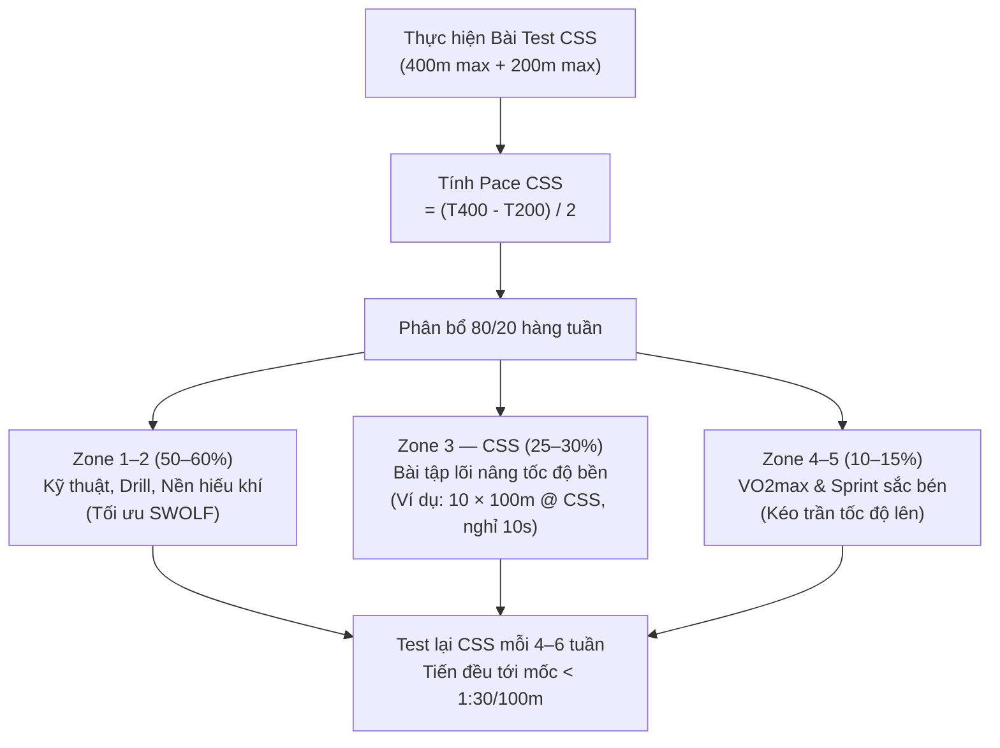

# SWOLF, Critical Swim Speed (CSS) & Hệ Năng Lượng

> **Thuộc phần:** `14-stroke-count/` | **Trình độ:** Cơ bản → Nâng cao | **Thời gian đọc:** ~12 phút

## Overview

Để tiến từ người bơi phong trào lên cột mốc **`< 1:30/100m`** một cách khoa học và không bị tập quá tải (Overtraining), bạn cần **hai thước đo vàng** để quản trị buổi tập hàng tuần: **SWOLF** (đo hiệu suất kỹ thuật) và **CSS — Critical Swim Speed** (đo tốc độ ngưỡng hiếu khí để thiết lập chính xác từng vùng tập luyện). Chương này giải mã toàn bộ hệ thống chỉ số và sinh lý năng lượng giúp bạn tập ít hơn nhưng tiến bộ nhanh gấp đôi.

- **Mục tiêu cốt lõi:** Biết cách tính và tối ưu **SWOLF**, tự thực hiện **bài test CSS (400m + 200m)** và phân bổ khối lượng tập luyện theo đúng **5 vùng năng lượng (Training Zones)**.
- **Cảm giác đúng:** Mọi buổi tập đều có đích đến định lượng rõ ràng — biết chính xác hôm nay cần bơi pace bao nhiêu giây/100m, nghỉ bao nhiêu giây, không còn bơi "cảm tính cho mệt".
- **Sai lầm phổ biến nhất:** Bơi tất cả các buổi ở cùng một tốc độ "lưng chừng" (*Junk Miles* — không đủ chậm để sửa kỹ thuật, cũng không đủ nhanh để nâng ngưỡng CSS).

---

## Theory

### 1. Chỉ số SWOLF (*Swim + Golf*)
SWOLF kết hợp đồng thời **Tốc độ** và **Hiệu suất sải tay** vào một con số duy nhất trên 1 chiều bể (`25m` hoặc `50m`):

$$\text{SWOLF}_{25} = \text{Thời gian 25m (giây)} + \text{Stroke Count (số sải/25m)}$$

- Ví dụ: Bơi 25m hết `21 giây` với `16 sải` → $\text{SWOLF}_{25} = 21 + 16 = 37$.
- Giống môn Golf, **điểm SWOLF càng thấp càng tốt**. SWOLF ngăn chặn cả hai căn bệnh kinh điển: quạt điên cuồng (giây thấp nhưng số sải rất cao → SWOLF cao) lẫn trượt lờ đờ (số sải thấp nhưng giây rất cao → SWOLF cao).

### 2. Tốc Độ Ngưỡng Hiếu Khí Bơi (*Critical Swim Speed — CSS*)
**CSS** là tốc độ bơi trung bình cao nhất bạn có thể duy trì liên tục ở ngưỡng chuyển hóa axit lactic (*Lactate Threshold*, tương đương pace đua `1.500m`).

**Công thức chuẩn từ bài test 400m & 200m hết sức (nghỉ đủ 5–10 phút giữa 2 bài):**

$$\text{CSS (m/s)} = \frac{400 - 200}{T_{400} - T_{200}} = \frac{200}{T_{400} - T_{200}}$$

Quy đổi trực tiếp sang **Pace CSS (giây / 100m)**:

$$\text{Pace CSS (giây/100m)} = \frac{T_{400} - T_{200}}{2}$$

- **Ví dụ thực tế:** Bạn bơi `400m` hết `6:40` (`400 giây`) và `200m` hết `3:08` (`188 giây`).
  $$\text{Pace CSS} = \frac{400 - 188}{2} = \frac{212}{2} = 106\text{ giây/100m} = \mathbf{1:46/100m}$$

---

## Science

### Physics & Hydrodynamics

Khi bạn tăng tốc độ bơi qua ngưỡng CSS, chi phí năng lượng tăng vọt không chỉ vì $P \propto v^3$ mà còn do **sự chuyển dịch sinh lý từ hiếu khí sang kỵ khí**:
- Dưới ngưỡng CSS: Cơ thể oxy hóa chất béo và glycogen sạch sẽ, nồng độ lactate máu ổn định (`< 4 mmol/L`), bạn duy trì được kỹ thuật EVF và Streamline bền bỉ.
- Trên ngưỡng CSS quá nhiều ở cự ly dài: Lactate tích tụ nhanh gây toan hóa cơ (*Acidosis*), làm sụp đổ hệ thần kinh–cơ → khuỷu tay sụp, hông chìm, diện tích cản $A$ tăng vọt tạo vòng xoáy đuối sức cực nhanh!

### Biomechanics & Energy Systems (5 Vùng Tập Luyện Chuẩn Theo CSS)

| Vùng (Zone) | Tên hệ năng lượng | Pace so với CSS | Thời gian nghỉ (100m) | Mục tiêu sinh lý & kỹ thuật |
| :--- | :--- | :---: | :---: | :--- |
| **Zone 1** | Hồi phục & Kỹ thuật (*Recovery / Drill*) | `CSS + 10 đến +15s` | `15–20s` | Khởi động, tập Drill, thả lỏng, cải thiện SWOLF |
| **Zone 2** | Nền Hiếu Khí (*Aerobic Endurance*) | `CSS + 5 đến +8s` | `10–15s` | Tăng mật độ ty thể & mao mạch, xây sức bền đường dài |
| **Zone 3** | **Ngưỡng CSS (*Threshold / Sweet Spot*)** | **`CSS ± 1s`** | **`10–15s`** | **Nâng trực tiếp trần tốc độ bền vững hướng tới `< 1:30/100m`** |
| **Zone 4** | Sức Bền Tốc Độ (*VO2max / Aerobic Power*) | `CSS - 3 đến -5s` | `20–30s` | Tăng công suất bơm tim & hấp thụ oxy tối đa (`50m–100m` lặp) |
| **Zone 5** | Tốc Độ Tối Đa (*Sprint / Anaerobic*) | `CSS - 8s` trở lên (95–100%) | `45–60s+` | Phát triển công suất nổ thần kinh–cơ, 6-beat kick (`25m–50m`) |

---

## Practical

### Why It Works

Hầu hết người bơi phong trào tập luyện suốt nhiều năm vẫn dậm chân tại chỗ ở mốc `2:00/100m` vì họ **chỉ bơi liên tục `1.000–1.500m` không nghỉ ở một tốc độ đều đều**.
Chuyển sang tập theo **Interval dựa trên CSS** (ví dụ `10 × 100m @ CSS` nghỉ ngắn `10–15 giây`) mang lại hiệu quả vượt trội vì:
- Quãng nghỉ ngắn `10–15 giây` giúp bạn **cài đặt lại tư thế Streamline, giữ chuẩn EVF và duy trì tốc độ cao hơn** so với bơi liền mạch 1.000m.
- Kích thích sinh lý vào đúng ngưỡng *Lactate Threshold* — đòn bẩy mạnh nhất giúp kéo pace `100m` xuống từng `2–3 giây` sau mỗi chu kỳ 4–6 tuần!

### Step-by-Step Execution & Water Cues

1. **Cách thực hiện Bài Test CSS chuẩn xác (Mỗi 4–6 tuần)**:
   - Khởi động kỹ `400–600m` (kèm vài đoạn 25m tăng tốc nhẹ).
   - **Bài 1 — 400m Time Trial**: Bơi đều sức hết khả năng (không bung hết sức 100m đầu rồi đuối ở 200m cuối!). Ghi lại chính xác `T400`.
   - Nghỉ hoàn toàn và bơi thả lỏng cực nhẹ trong **8–10 phút**.
   - **Bài 2 — 200m Time Trial**: Bơi hết sức mạnh mẽ, đều nhịp. Ghi lại `T200`.
   - Áp dụng công thức `Pace CSS = (T400 - T200) / 2`.
2. **Cách dùng SWOLF đúng cách**:
   - **Chỉ so sánh SWOLF của bạn với chính bạn** ở cùng 1 chiều dài bể (`25m` vs `25m`) và cùng 1 tốc độ/vùng tập.
   - Đừng so sánh SWOLF của người cao `1.62 m` với người cao `1.88 m`.
3. **Ứng dụng Bài tập Lõi CSS (*Red Mist Prevention*)**: Bắt đầu các bài tập `100m @ CSS` với pace chuẩn xác (không nhanh hơn CSS `3–4 giây` ở 2 hiệp đầu!). Nếu 2 hiệp cuối bạn vẫn giữ đúng pace CSS mà kỹ thuật không vỡ, đó là một buổi tập hoàn hảo.

<!-- IMAGE_PROMPT: Clean sports physiology chart showing Blood Lactate (mmol/L) vs Swim Pace (min/100m) across 5 color-coded Training Zones (Z1 Recovery, Z2 Aerobic, Z3 CSS Threshold inflection point highlighted at 4 mmol/L, Z4 VO2max, Z5 Sprint), with sample interval prescriptions for each zone. -->

### Advanced Tips

- **Đo chỉ số "Hiệu suất SWOLF ở ngưỡng CSS"**: Khi bạn giảm được SWOLF từ `42` xuống `36` ở cùng một nhịp tim, nghĩa là kỹ thuật của bạn đã bước lên một đẳng cấp mới.
- **Chu kỳ hồi phục (3 tuần tăng tải + 1 tuần giảm tải)**: Cứ sau 3 tuần tập đúng vùng CSS, dành tuần thứ 4 giảm `25–30%` khối lượng để cơ thể siêu bù trừ (*Supercompensation*) — sau đó thực hiện bài test CSS mới, bạn sẽ thấy kết quả bứt phá rõ rệt!

---

## Drills

| Tên Bài Tập | Mục tiêu SWOLF & CSS | Cấu trúc bài tập | Cảm giác đúng (Cue) |
| :--- | :--- | :--- | :--- |
| **CSS Test Protocol** | Xác định chính xác Pace CSS & 5 vùng tập cá nhân | `400m TT` + nghỉ 10p + `200m TT` | Phân phối sức đều (*Even Split*), 100m cuối bằng hoặc nhanh hơn 100m đầu |
| **Classic CSS Threshold Set** | Nâng trực tiếp tốc độ ngưỡng hướng tới `< 1:30/100m` | `10 × 100m @ CSS` (nghỉ `10–15s`) | 3 hiệp đầu thấy hơi dễ, 4 hiệp giữa tập trung cao, 3 hiệp cuối thử thách nhưng giữ nguyên form |
| **SWOLF Reduction Set** | Tối ưu hóa đồng thời tốc độ và số sải tay | `8 × 50m` (nghỉ 20s), hạ 1 điểm SWOLF mỗi 2 hiệp | Streamline sâu, EVF chắc, đẩy hết pha Push để hạ tổng `Giây + Sải` |

### Hướng dẫn nhanh
- **Classic CSS Threshold Set (`10 × 100m`)**: Nếu Pace CSS của bạn là `1:40/100m`, hãy cài **Tempo Trainer** hoặc nhìn đồng hồ tường để chạm đích mỗi 100m đúng từ `1:39` đến `1:41`, nghỉ đúng `10–15 giây` rồi xuất phát tiếp. Nếu bạn bơi hiệp 1 hết `1:34` (quá nhanh) rồi hiệp 7 tụt xuống `1:46`, bài tập đã thất bại về mặt phân phối năng lượng!

---

## AI Analysis

- **Góc quay / Cảm biến khuyến nghị:** Đồng hồ bơi (Garmin Swim / Forerunner / Fenix, Apple Watch) hoặc kính bơi thông minh (FORM Smart Swim) xuất file `.FIT` / `.TCX`.
- **Chỉ số cần trích xuất:** `lap_time`, `stroke_count`, `swolf`, `heart_rate_bpm`, `pace_100m` qua từng hiệp tập.
- **Ngưỡng phát hiện lỗi tự động:**
  - **Đạt chuẩn:** Độ lệch pace giữa hiệp 1 và hiệp 10 trong bài `10 × 100m @ CSS` `< 2.5%` (*Even/Negative Split*); xu hướng `SWOLF` trung bình giảm đều `1–2 điểm` sau mỗi 4–6 tuần.
  - **Cảnh báo lỗi:** Hiệp 1–2 nhanh hơn CSS `> 4s/100m` theo sau bởi sự sụp đổ tốc độ và `SWOLF` tăng vọt `+4–6 điểm` ở nửa sau (*Positive Split / Blow-up*).

---

## Common Errors

| Lỗi thường gặp | Triệu chứng nhận biết | Nguyên nhân gốc | Cách sửa (Correction) |
| :--- | :--- | :--- | :--- |
| **Chỉ bơi "Junk Miles" một tốc độ đều** | Bơi 2km/buổi suốt 6 tháng nhưng pace không đổi | Không tạo đủ kích thích lên ngưỡng CSS (Z3) và VO2max (Z4) | Chia rõ cấu trúc buổi tập theo Interval chuẩn 5 vùng năng lượng |
| **Xuất phát quá nhanh (Fly & Die)** | 100m đầu trong bài test 400m nhanh hơn hẳn 300m sau | Không kiểm soát pace, tích tụ lactate quá sớm | Dùng Tempo Trainer hoặc tập giữ nhịp `Negative Split` (nửa sau nhanh hơn nửa đầu) |
| **So sánh SWOLF máy móc với người khác** | Tự ti hoặc cố trượt quá lâu để ép SWOLF thấp hơn bạn cao 1m85 | Bỏ qua yếu tố chiều cao và chiều dài bể | Chỉ so sánh SWOLF theo thời gian của chính bạn ở cùng 1 bể |
| **Bỏ qua bài Test CSS định kỳ** | Vẫn tập theo pace cũ dù thể lực đã khỏe hơn (hoặc ngược lại) | Không có mốc đo định lượng cập nhật vùng tập | Thực hiện lại CSS Test mỗi **4–6 tuần** (tích hợp sẵn trong Giáo án 24 tuần) |

---

## Self Assessment

- [ ] Tôi biết chính xác chỉ số **SWOLF (bể 25m hoặc 50m)** hiện tại của mình ở vùng tập Zone 2 và Zone 3.
- [ ] Tôi đã thực hiện bài test `400m + 200m` và tính ra được **Pace CSS** cá nhân.
- [ ] Tôi phân biệt rõ khi nào cần tập Zone 1–2 (kỹ thuật/nền tảng), Zone 3 (ngưỡng CSS) và Zone 4–5 (tốc độ).
- [ ] Trong các bài tập Interval (`10 × 100m @ CSS`), tôi giữ được tốc độ đều từ hiệp đầu đến hiệp cuối.
- [ ] Tôi theo dõi nhật ký tiến bộ SWOLF và CSS định kỳ mỗi 4–6 tuần.

---

## KPI

| Chỉ số (Metric) | Người mới | Trung cấp | Nâng cao (`< 1:30/100m`) |
| :--- | :---: | :---: | :---: |
| **SWOLF (Bể 25m, chiều cao ~1.70m)** | `48–58` | `39–46` | `32–38` |
| **Pace CSS (100m)** | `> 2:00/100m` | `1:38–1:55/100m` | `1:20–1:32/100m` |
| **Độ lệch pace trong bài `10 × 100m @ CSS`** | `> 6s/100m` | `3–5s/100m` | `< 2s/100m` |
| **Tốc độ cải thiện CSS sau mỗi 6–8 tuần tập chuẩn** | `-5 đến -10s` | `-3 đến -5s` | `-1 đến -3s/100m` |

---

## FAQ

**1. Người mới chưa bơi liên tục được 400m thì tính CSS bằng cách nào?**
Bạn có thể dùng biến thể **Mini CSS Test: `200m` và `100m`** (nghỉ 8 phút ở giữa), công thức: $\text{Pace CSS} = T_{200} - T_{100}$. Khi đã bơi thoải mái liên tục `400m`, hãy chuyển sang bài test chuẩn `400m + 200m` để có độ chính xác cao nhất.

**2. SWOLF có hoạt động chính xác trong bơi nước mở (Open Water) không?**
Không. SWOLF chỉ có ý nghĩa trong **bể bơi có chiều dài cố định (`25m` hoặc `50m`)** và không có dòng chảy. Trong Open Water, hãy theo dõi **Pace/100m**, **SPM** và **Nhịp tim (HR)**.

**3. Muốn bơi 100m dưới `1:30` thì Pace CSS của tôi cần đạt mức nào?**
- Nếu mục tiêu là bơi **đúng 1 lần `100m` hết sức dưới `1:30`**: Pace CSS của bạn chỉ cần đạt khoảng **`1:38–1:42/100m`** là đã đủ sức chinh phục!
- Nếu mục tiêu là bơi **bền vững `400m–1.500m` ở tốc độ `< 1:30/100m`**: Pace CSS của bạn cần đạt **`1:28–1:30/100m`**.

---

## Summary

- **SWOLF** (`Giây + Số sải`) là thước đo tổng hợp tuyệt vời nhất để cân bằng giữa tốc độ và hiệu suất kỹ thuật.
- **CSS** (`(T400 - T200) / 2`) là kim chỉ nam thiết lập chính xác **5 vùng năng lượng**, giúp loại bỏ hoàn toàn kiểu tập *Junk Miles*.
- Kết hợp 50–60% Zone 1–2 (kỹ thuật & nền tảng), 25–30% Zone 3 (ngưỡng CSS) và 10–15% Zone 4–5 (VO2max & Sprint) là công thức khoa học nhanh nhất tiến tới `< 1:30/100m`.

**Liên kết chéo:**
- Chương trước: [Giảm Stroke Count & Tối Ưu Tempo](stroke-count-and-tempo.md)
- Chương tiếp theo (Phase 6): [Hệ Thống Total Immersion, SwimSmooth & Olympic](../17-drills/training-systems.md)
- Kỹ thuật liên quan: [Tổng Quan Giáo Án 24 Tuần & Test CSS](../22-training-plan/overview-and-css-testing.md) · [Bảng Chuẩn Hiệu Suất](../benchmarks/performance-benchmarks.md)
- Tra cứu thuật ngữ: [Glossary](../24-appendix/glossary.md)

---

## References

1. Wakayoshi, K., Ikuta, K., Yoshida, T., Udo, M., Moritani, T., Mutoh, Y., & Miyashita, M. (1992). *Determination and validity of critical velocity as an index of swimming performance in the competitive swimmer*. European Journal of Applied Physiology.
2. Newsome, P., & Young, A. (2012). *Swim Smooth: The Complete Coaching System for Swimmers and Triathletes*. Wiley.
3. Olbrecht, J. (2000). *The Science of Winning: Planning, Periodizing and Optimizing Swim Training*. F&G Partners.

