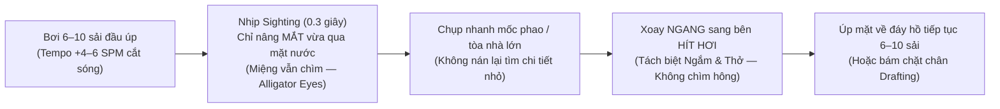

# Kỹ Thuật Bơi Nước Mở (*Open Water Skills*): Sighting, Drafting & Xử Lý Sóng

> **Thuộc phần:** `15-open-water/` | **Trình độ:** Trung cấp → Nâng cao | **Thời gian đọc:** ~12 phút

## Tổng Quan (Overview)
Nhiều người bơi đạt `1:28/100m` rất đẹp trong bể bơi nhưng khi ra biển hoặc hồ lớn (Triathlon / Open Water `1.9–5 km`) lại tụt xuống `1:50/100m` và kiệt sức nhanh chóng. Nguyên nhân: ngoài trời **không có vạch đen đáy hồ, không có thành bể để đạp tường nghỉ, có sóng đánh tạt ngang, dòng chảy và hàng trăm VĐV bơi sát nhau**. Chương này trang bị 4 vũ khí thực chiến biến tốc độ bể bơi thành tốc độ nước mở: **Sighting (Ngắm mục tiêu không chìm hông)**, **Drafting (Núp dòng tiết kiệm 20% sức)**, **Điều chỉnh nhịp tay xuyên sóng** và **Vòng phao (*Buoy Turns*)**.

- **Mục tiêu cốt lõi:** Bơi thẳng tắp tới phao với sai lệch `< 3%` quãng đường, tiết kiệm `15–25%` năng lượng nhờ Drafting và giữ nhịp thở bình tĩnh trong sóng lớn.
- **Cảm giác đúng:** Ngắm phao nhanh gọn như "mắt cá sấu" không làm chìm hông; nhịp tay hơi nhanh và dứt khoát hơn bể bơi một chút để cắt qua sóng mặt.
- **Sai lầm phổ biến nhất:** Ngẩng cả đầu và cổ lên nhìn phao suốt 2–3 giây (làm chìm hông và dừng hẳn người), hoặc bơi quá dài pha trượt (*Over-Gliding*) để sóng đánh dạt sang ngang.

---

## Lý Thuyết (Theory)
Để chinh phục Open Water, cần thích nghi **4 thông số kỹ thuật** so với bơi bể:

| Thông số | Bơi Bể (Pool) | Bơi Nước Mở (Open Water) | Lý do thủy động lực học |
| :--- | :--- | :--- | :--- |
| **Định hướng (Sighting)** | Nhìn vạch đen đáy hồ | **Alligator Eyes Sighting** mỗi `6–10 sải` | Không có vạch dẫn hướng; bơi lệch `10°` trên `1.900m` khiến bạn phải bơi dư thêm `+100–200 m`! |
| **Tempo (SPM) & Glide** | Trượt dài `0.15–0.25s`, `SPM 66–74` | **Rút ngắn Glide**, tăng `+4–6 SPM` (`72–80 SPM`) | Sóng đập trực diện sẽ đánh tụt vận tốc ngay nếu bạn dừng trượt dài phía trước |
| **Pha Recovery** | High-Elbow sát mặt nước | **Cao tay hơn một chút** (hoặc hơi mở thoáng) | Tránh cẳng tay vấp vào đỉnh sóng ngang làm mất nhịp |
| **Chiến thuật năng lượng** | Độc lập trong làn riêng | **Drafting** (núp chân hoặc núp hông đối thủ) | Tận dụng vùng áp suất thấp (*Slipstream*) giảm `15–25%` lực cản |

---

## Cơ Sở Khoa Học (Science)
### Vật Lý & Thủy Động Lực Học (Physics & Hydrodynamics)
#### 1. Vật lý của Drafting (Núp Dòng Nước Mở)
Nghiên cứu kinh điển của Chatard & Wilson (2003) đo trực tiếp mức tiêu thụ oxy ($\dot{V}O_2$) và nồng độ lactate khi Drafting trong bơi sải:
- **Núp ngay sau bàn chân (*Foot Drafting* — cách mũi chân người trước `0–50 cm`)**: Giảm lực cản thụ động **`18–26%`**, giảm tiêu thụ oxy **`11–18%`** và giảm nhịp tim `~10–15 bpm`!
- **Núp ngang hông (*Hip Drafting* — đầu bạn ngang hông/đùi người trước, cách ngang `50–80 cm`)**: Tận dụng **sóng trượt bên hông (*Bow Wave Wake*)** của họ, tiết kiệm **`10–15%`** năng lượng — đồng thời dễ quan sát đường và dễ bứt lên vượt khi cần!

#### 2. Chi phí của Sighting sai kỹ thuật
Nếu mỗi lần ngắm phao bạn ngẩng cằm lên quá cao và hít hơi luôn về phía trước (như bơi ếch), hông sẽ chìm sâu `25–30 cm`, làm mất ngay `0.3–0.5 m/s` vận tốc — lặp lại 150 lần trên chặng `1.900m` sẽ tốn thêm tương đương **`2–3 phút`**!

### Cơ Sinh Học (Biomechanics)
**Kỹ thuật "Alligator Eyes Sighting" (Tách biệt Ngắm & Thở):**
1. **KHÔNG BAO GIỜ vừa ngắm phía trước vừa hít hơi cùng lúc!** (Vì miệng nằm thấp hơn mắt `6–8 cm` — muốn đưa miệng lên khỏi mặt nước phía trước để hít, bạn buộc phải nhấc đầu cao gấp đôi làm sập hông!).
2. **Quy trình 2 nhịp siêu mượt**:
   - **Nhịp 1 (Ngắm — 0.3 giây)**: Khi tay trước đang ấn nhẹ xuống đầu pha Catch, nâng nhẹ **chỉ riêng đôi mắt vừa vượt qua mặt nước** (mũi và miệng vẫn chìm dưới nước như mắt cá sấu!), chụp nhanh hình ảnh phao/mốc lớn trên bờ.
   - **Nhịp 2 (Thở — 0.4 giây)**: Ngay lập tức xoay ngang mặt sang bên (theo đúng *One-Goggle Rule*) để **hít hơi sang ngang** rồi úp mặt nhìn đáy trở lại!

---

## Thực Hành (Practical)
### Tại Sao Kỹ Thuật Này Hiệu Quả (Why It Works)
Thành thạo **Alligator Eyes Sighting** + **Drafting** + **Thở hai bên (Bilateral / 2:2)** mang lại lợi thế khổng lồ:
- Khi sóng đánh từ bên phải tới, bạn lập tức chuyển sang **thở bên trái** (lưng quay về phía sóng) để không bao giờ bị sặc nước biển!
- Nhờ tìm được người bơi có tốc độ nhanh hơn mình `2–3 giây/100m` để **Foot/Hip Drafting**, bạn có thể đạt thành tích Open Water nhanh hơn cả bơi một mình mà bước lên bờ (chuyển sang đạp xe Triathlon) vẫn cực kỳ tỉnh táo.

### Hướng Dẫn Từng Bước & Cảm Giác Nước (Step-by-Step & Water Cues)
1. **Cách tập Sighting ngay trong bể bơi**: Dán 1 chai nước màu sáng (hoặc nón bơi) lên thành bể. Bơi `6 sải` → nâng nhẹ mắt kiểu *Alligator Eyes* nhìn đúng 0.3 giây vào chai nước → xoay ngang thở → úp mặt tiếp `6 sải`.
2. **Mẹo chọn "Mốc lớn phía sau phao"**: Phao trên biển rất nhỏ và hay bị sóng che khuất. Trước khi xuất phát, hãy đứng trên bờ căn thẳng hàng từ phao hướng tới **một tòa nhà cao, ngọn cây lớn hay cột đèn trên bờ** — khi bơi bạn chỉ cần liếc 0.2 giây thấy mốc lớn đó là biết ngay mình đang đi thẳng!
3. **Kỹ thuật Vòng Phao Gọn (*Corkscrew / Buoy Turn*)**: Khi tiến sát phao cần rẽ trái 90°, thực hiện 1 sải tay trái ôm chặt quanh phao kết hợp xoay ngửa nhẹ 1 nhịp (hoặc quạt tay phải rộng hơn 1 sải) để quay hướng tức thì không bị dạt rộng ra ngoài.
4. **Xử lý khi bị va chạm / hoảng loạn xuất phát đông người**: Giữ bình tĩnh thở ra thật sâu dưới nước, chuyển sang `10–15 sải` hơi nâng nhịp tay gọn hoặc đứng ở rìa ngoài đoàn xuất phát trong 200m đầu rồi mới cắt vào nhóm Drafting.

<!-- IMAGE_PROMPT: Dual-panel open water swimming technical diagram: Top panel shows "Alligator Eyes Sighting" waterline profile with only eyes clearing the surface while mouth stays submerged, followed by a sideways breath; Bottom panel shows Overhead View of Foot Drafting (0-50cm behind toes, -20% drag) and Hip Drafting (riding the bow wave wake, -12% drag). -->

### Mẹo Nâng Cao (Advanced Tips)
- **Kiểm tra độ lệch thẳng tự nhiên của bạn (*Blind Straight-Line Test*)**: Trong bể bơi (hoặc biển lặng), nhắm mắt bơi thử `15–20 sải` rồi mở mắt xem bạn bị trôi lệch sang trái hay sang phải. Biết hướng lệch tự nhiên giúp bạn chỉnh lại độ đối xứng tay và biết nên ngắm phao thưa hay dày hơn!
- **Bơi với bộ đồ Wetsuit**: Wetsuit tăng mạnh lực nổi ở vùng hông và đùi (tương tự Pull Buoy toàn thân), giúp bạn giữ **2-Beat Kick cực tiết kiệm sức** nhưng lại tăng nhẹ sức cản ở vai — hãy đảm bảo kéo ống tay áo Wetsuit lên thật sát nách trước khi bơi để vai thoải mái tối đa.

---

## Bài Tập Thực Hành (Drills — Tập Open Water Ngay Trong Bể Bơi)

| Tên Drill | Mục tiêu Open Water | Cự ly / Số hiệp | Cảm giác đúng (Cue) |
| :--- | :--- | :--- | :--- |
| **6-Stroke Alligator Sighting** | Tách biệt Ngắm (0.3s) và Thở ngang, không chìm hông | `4 × 100m` (ngắm chai nước ở thành bể mỗi 6 sải) | Hông không tụt, tốc độ không hề khựng ở nhịp ngắm |
| **Pool Drafting Train (Bơi nối đuôi)** | Làm quen cảm giác bọt nước & bám sát chân người trước `20–50 cm` | `4 × 100m` (2–3 người bơi chung 1 làn, đổi dẫn đầu mỗi 100m) | Cảm giác nước "kéo" mình tiến tới nhẹ hẳn khi bám đúng vùng ngọt |
| **Buoy Turn Simulation** | Tập đổi hướng 90°–180° giữa bể không chạm tường | `6 × 25m` (đặt 1 phao/ván ở giữa bể để vòng qua) | Vòng sát gọn không mất đà, tăng tốc ngay sau khi đổi hướng |

---

## Phân Tích AI & Video (AI Analysis)
- **Thiết bị / Góc quay khuyến nghị:** Đồng hồ GPS Open Water (vẽ quỹ đạo thực tế trên bản đồ vệ tinh) + Video góc ngang mặt nước cho kỹ thuật Sighting.
- **Chỉ số cần trích xuất:** Tỷ lệ **Độ thẳng đường bơi (*Route Efficiency = Quãng đường thực tế GPS / Quãng đường thẳng*)**, thời lượng nâng đầu Sighting (`t_sight`), độ sụt hông khi Sighting.
- **Ngưỡng phát hiện lỗi tự động:**
  - **Đạt chuẩn:** `Route Efficiency ≤ 1.03` (bơi dư `< 3%` tổng cự ly); `t_sight ≤ 0.40 giây`; `hip_drop` khi Sighting `< 8 cm`.
  - **Cảnh báo lỗi:** Quỹ đạo GPS hình cánh cung/ngoằn ngoèo (`Route Efficiency > 1.08` — mất hàng trăm mét vô ích); `t_sight > 0.80 giây` kèm ngẩng cằm thở trước.

---

## Lỗi Thường Gặp & Cách Sửa (Common Errors)
| Lỗi thường gặp | Triệu chứng nhận biết | Nguyên nhân gốc | Cách sửa (Correction) |
| :--- | :--- | :--- | :--- |
| **Vừa ngắm phía trước vừa hít hơi** | Hông chìm sâu, tốc độ tụt thê thảm sau mỗi lần ngắm | Không tách biệt được thao tác nhìn và thao tác thở | Thực hành quy tắc **Alligator Eyes (Ngắm trước) → Xoay ngang thở** |
| **Bơi lệch cong hình cánh cung** | Quãng đường GPS `1.9km` thành `2.15km` | Thở 1 bên mất đối xứng + ngắm phao quá thưa (`> 20 sải/lần`) | Tập Sighting đều mỗi `6–10 sải` + sửa đối xứng tay bằng Single-Arm |
| **Chỉ biết thở 1 bên khi gặp sóng ngang** | Liên tục uống nước biển, hoảng loạn hụt hơi | Không tập thở song phương trước khi ra biển | Luyện thở 2 bên (1:3 hoặc 2:2) tối thiểu 4 tuần trước ngày thi |
| **Núp chân quá xa (> 1.5 m)** | Vẫn phải bơi hết sức mà không được hưởng lợi Drafting | Sợ chạm vào chân người phía trước | Bám sát trong khoảng `20–50 cm` sau bọt chân (thỉnh thoảng chạm nhẹ mũi chân trước là đúng khoảng cách!) |

---

## Tự Đánh Giá Tại Hồ (Self Assessment)
- [ ] Tôi thành thạo kỹ thuật **Alligator Eyes Sighting** (ngắm `0.3s` phía trước → xoay ngang hít hơi) mà không làm chìm hông.
- [ ] Tôi có thể thở thoải mái ở cả hai bên trái và phải để chủ động né hướng sóng đánh.
- [ ] Tôi biết cách điều chỉnh **tăng nhẹ +4–6 SPM** và rút ngắn pha trượt khi gặp sóng hoặc dòng chảy ngược.
- [ ] Tôi tự tin bám sát **Foot Drafting (`20–50 cm`)** hoặc **Hip Drafting** trong nhóm bơi đông người.
- [ ] Độ lệch đường bơi GPS thực tế ngoài trời của tôi giữ ở mức `≤ 3–5%`.

---

## Chỉ Số Đo Lường (KPI)
| Chỉ số (Metric) | Người mới Open Water | Trung cấp | Nâng cao (`< 1:30/100m`) |
| :--- | :---: | :---: | :---: |
| **Độ lệch quỹ đạo GPS (*Route Efficiency*)** | `> 1.10` (+10% quãng đường) | `1.04–1.08` | `≤ 1.03` (gần như thẳng tắp) |
| **Thời lượng 1 lần ngắm phao (`t_sight`)** | `> 1.0 giây` | `0.5–0.7 giây` | `0.25–0.40 giây` |
| **Chênh lệch Pace Open Water vs Pool (bể 25m)** | Chậm hơn `> 15s/100m` | Chậm hơn `8–12s/100m` | Chậm hơn `≤ 5–7s/100m` (có Drafting có thể nhanh hơn!) |

---

## Câu Hỏi Thường Gặp (FAQ)
**1. Nên ngắm phao sau bao nhiêu sải tay là tối ưu nhất?**
- Nước lặng, đã có người dẫn đường để Drafting: mỗi **`10–15 sải`**.
- Biển có sóng/dòng chảy ngang, bơi độc lập: mỗi **`6–8 sải`**.
- Gần phao rẽ (`< 50 m`): mỗi **`3–4 sải`** để chọn góc cắt sát phao nhất.

**2. Khi bơi biển sóng rất to, có nên dùng 6-Beat Kick không?**
Không nên cho cự ly dài (`1.5–3.8 km`) vì sẽ kiệt sức đùi rất nhanh. Hãy giữ **2-Beat Kick** chắc nhịp kết hợp **tăng nhẹ nhịp tay (+5–8 SPM)** và **nâng cao pha Recovery** để vượt qua sóng mượt mà hơn.

**3. Làm sao hết cảm giác lo lắng, tim đập nhanh khi mới xuống nước lạnh hoặc nước sâu ngoài trời?**
Hãy luôn **khởi động 5–10 phút dưới nước trước giờ xuất phát** (úp mặt thổi bong bóng xả khí để làm quen nhiệt độ nước và nhịp thở), và bắt đầu `200m` đầu tiên chậm hơn pace mục tiêu `5 giây/100m` để nhịp tim vào quỹ đạo ổn định!

---

## Tóm Tắt (Summary)
- 4 kỹ năng cốt lõi chinh phục Open Water: **Alligator Eyes Sighting (Tách Ngắm & Thở) + Foot/Hip Drafting (-15–25% sức) + Tăng nhẹ SPM cắt sóng + Thở được cả hai bên né sóng**.
- Tập luyện toàn bộ kỹ năng Open Water ngay trong bể bơi (`Sighting`, `Pool Drafting Train`, `Buoy Turns`) ít nhất 4–6 tuần trước ngày thi đấu.

**Liên kết chéo:**
- Chương trước: [Sun Yang](../athletes/sun-yang.md)
- Chương tiếp theo: [Sprint, Pool Pacing, Starts & Flip Turns](../16-sprint/sprint-starts-and-turns.md)
- Kỹ thuật liên quan: [Tarzan Drill](../17-drills/tarzan-zipper-dog-paddle.md) · [2-Beat Kick](../08-kicking/two-beat-kick.md)
- Tra cứu thuật ngữ: [Glossary](../24-appendix/glossary.md)

---

## Tài Liệu Tham Khảo (References)
1. Chatard, J. C., & Wilson, B. (2003). *Drafting distance in swimming*. Medicine & Science in Sports & Exercise, 35(7), 1176–1181.
2. Newsome, P., & Young, A. (2012). *Swim Smooth: The Complete Coaching System for Swimmers and Triathletes*. Wiley.
3. World Aquatics — *Open Water Technical & Safety Manual*.

