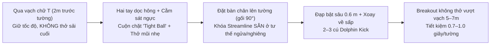
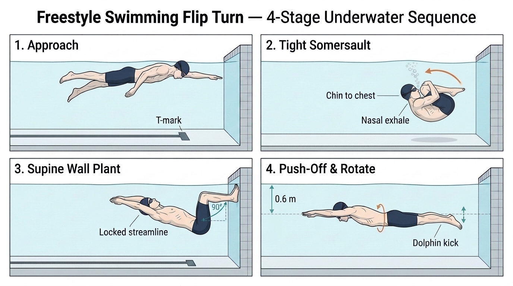

# Chiến Thuật Sprint, Pool Pacing, Starts & Flip Turns

> **Thuộc phần:** `16-sprint/` | **Trình độ:** Trung cấp → Nâng cao | **Thời gian đọc:** ~12 phút

## Overview

Trong bơi bể (`25m` và `50m`), tốc độ bơi mặt nước chỉ là một phần của bức tranh. Một cú **xuất phát (*Track Start*)** chuẩn xác giúp bạn dẫn trước `0.5–1.0 giây` ngay ở `15m` đầu tiên; và thành thạo **Lộn vòng chạm tường (*Flip Turn / Tumble Turn*)** giúp bạn tiết kiệm **`0.5–1.0 giây` ở mỗi thành bể** — tức là rút ngay **`2–3 giây` trên `100m` bể 25m** và **`20–30 giây` trên `1.500m`** mà không hề phải quạt tay mạnh hơn! Chương này hệ thống hóa toàn bộ kỹ thuật **Starts, Flip Turns, Pool Pacing và Chiến thuật Sprint** để bứt phá mốc `< 1:30/100m`.

- **Mục tiêu cốt lõi:** Làm chủ kỹ thuật **Flip Turn** không mất đà, tối ưu pha **Start & Breakout**, và áp dụng chiến thuật phân phối tốc độ **Even / Negative Split** cho từng cự ly (`50m, 100m, 400m, 1.500m`).
- **Cảm giác đúng:** Tiếp cận tường không giảm tốc độ, cuộn tròn lộn vòng gọn trong `0.8 giây`, đặt hai bàn chân đẩy bật tường ở tư thế ngửa/nghiêng sâu `0.6 m` rồi lao vút qua vạch 5m.
- **Sai lầm phổ biến nhất:** Bơi chậm lại và ngẩng đầu thở ngay ở sải cuối trước tường khi làm Flip Turn, hoặc bung hết 100% sức ở 25m đầu của bài `100m` rồi "chết cứng" ở 25m cuối.

---

## Theory

### 1. Giải Phẫu 4 Giai Đoạn Của Một Cú Flip Turn Chuẩn (`< 1.0 giây` tại tường)
1. **Tiếp cận (*Approach*)**: Giữ nguyên tốc độ tối đa khi qua vạch chữ T (cách tường `2 m`), **không lấy hơi ở sải cuối cùng** trước tường!
2. **Cuộn lộn (*Somersault*)**: Khi tay cuối hoàn tất pha đẩy ngang đùi (cả 2 tay đều nằm dọc hông, lòng bàn tay hướng xuống đáy), gập cằm sát ngực, ấn hai lòng bàn tay xoay người cuộn tròn thật chặt (*Tight Ball*) bằng cơ bụng và một cú đập Dolphin nhỏ — **thở ra nhẹ bằng mũi** để nước không tràn vào xoang mũi!
3. **Đạp tường (*Push-Off*)**: Hai bàn chân đặt vuông góc tường (cách mặt nước `30–45 cm`, gối gập `~90–100°`) ở tư thế **nằm ngửa hoặc nghiêng 45°**, hai tay đã **khóa sẵn Streamline sau tai trước khi chân đạp bật tường!**
4. **Xoay & Breakout**: Đạp thẳng song song đáy sâu `0.6 m`, xoay dần từ ngửa sang sấp trong 1–2 cú Dolphin Kick rồi Breakout không thở ở sải đầu tiên.

### 2. Kỹ Thuật Xuất Phát (*Track Start* vs *In-Water Push*)
- **Track Start (Từ bục xuất phát)**: Một chân đặt mép trước bục (ngón chân bám chắc), chân sau đặt trên bàn đạp sau (hoặc lùi `30–40 cm`), trọng tâm dồn gọn, hai tay nắm mép trước bục. Khi có còi: kéo tay mạnh về sau tạo đà + đạp bùng nổ cả hai chân, phóng cơ thể lao qua **cùng một lỗ nhỏ (*Clean Hole Entry*)** ở góc `30–35°`.
- **In-Water Push (Trong tập luyện / Test 100m từ thành bể)**: Luôn chìm xuống sâu `0.6 m`, khóa chặt Streamline trước khi đạp ngang song song đáy.

---

## Science

### Physics & Hydrodynamics

- **Bảo toàn Mô-men Động Lượng trong Flip Turn**:
  $$\omega = \frac{L}{I}$$
  Khi bạn cuộn thân thật chặt thành quả bóng nhỏ (*gối ép sát ngực, gót sát mông*), mô-men quán tính $I$ giảm mạnh → tốc độ góc cuộn $\omega$ tăng vọt gấp đôi! Nếu bạn duỗi chân thẳng lều khều khi lộn, thời gian tại tường kéo dài từ `0.8s` lên `1.8s`, làm mất trắng toàn bộ quán tính tiếp cận!
- **Lợi ích năng lượng của Flip Turn vs Open Turn (Chạm tay quay đầu)**:
  - Open Turn bắt buộc bạn phải **dừng vận tốc về `0`**, ngẩng đầu lấy hơi rồi mới chìm xuống đạp lại → mất trung bình `0.7–1.2 giây/vòng`.
  - Flip Turn chuyển hóa trực tiếp quán tính tiến tới thành động năng xoay và thế năng nén cơ đùi tại tường → nhanh hơn rõ rệt và giữ nhịp tim ổn định hơn sau khi đã quen nhịp thở.

### Biomechanics — Chiến Thuật Phân Phối Tốc Độ (*Pool Pacing*)

| Cự ly | Chiến thuật Split tối ưu | Nhịp chân & Thở | Điểm lưu ý sống còn |
| :--- | :--- | :--- | :--- |
| **50m Sprint** | `98–100%` ngay từ mét đầu tiên (*All-Out*) | **6-Beat Kick** toàn lực, thở `0–2 lần` (tối đa 3 lần ở người phong trào) | Start/Breakout 10m + không thở trong 10m cuối |
| **100m (Mục tiêu `< 1:30`)** | **Controlled Fast 50m đầu + Push 50m sau** (50m sau chậm hơn 50m đầu tối đa `1.5–2.5 giây`) | 50m đầu `4/6-beat`, thở `1:2`; 50m sau `6-beat` mạnh | Đừng bung 100% ở 25m đầu (*Fly & Die*); tận dụng 3 lần Flip Turn (bể 25m) |
| **200m–400m** | **Even Split hoặc Negative Split** (100m cuối nhanh nhất) | 75% đầu `2/4-beat`, 25% cuối `6-beat`, thở `1:2` | Kỷ luật giữ nguyên Stroke Count & nhịp CSS ở nửa đầu |
| **800m–1.500m** | **Negative Split** (nửa sau nhanh hơn nửa đầu `2–5 giây`) | `2-Beat` chủ đạo → `4/6-Beat` 200m cuối, thở `1:2` | Giữ tay cực nhẹ 500m đầu, tối đa hóa DPS |

---

## Practical

### Why It Works

Làm chủ **Flip Turn** và **Pacing 100m** là con đường ngắn nhất để bạn phá vỡ bức tường tâm lý **`1:30/100m`**:
- Giả sử bạn đang bơi `1:33/100m` bể `25m` bằng Open Turn (quay đầu chạm tay) và thở lộn xộn ở 25m đầu.
- Chỉ riêng việc chuyển sang **Flip Turn chuẩn** (3 vòng × `-0.8s` = **`-2.4 giây`**) + **Streamline Breakout qua vạch 6m** (`-1.5 giây`) + **phân phối sức 50m đầu `43.5s` / 50m sau `45.5s`** = **`1:29.0/100m`** ngay lập tức mà không cần tăng thêm 1% sức mạnh!

### Step-by-Step Execution & Water Cues

#### 4 Bước Tập Flip Turn Cho Người Mới Bắt Đầu (Chỉ Mất 2 Tuần)
1. **Bước 1 — Lộn vòng giữa bể (*Mid-Pool Somersault*)**: Bơi 3 sải giữa bể nông, đưa 2 tay về đùi, gập cằm, cuộn tròn 1 vòng lộn nhào trong nước (thở nhẹ qua mũi chống sặc) rồi đứng lên. Lặp `10 lần` cho hết chóng mặt.
2. **Bước 2 — Lộn vòng chạm chân tường (Đứng yên không đạp)**: Bơi tiến tới vạch chữ T, thực hiện 1 sải cuối rồi lộn cuộn đặt hai bàn chân lên tường ở tư thế nằm ngửa — dừng lại kiểm tra khoảng cách gối (`~90°`, không quá sát cũng không quá xa).
3. **Bước 3 — Lộn vòng + Đạp tường nằm NGỬA**: Lộn đặt chân lên tường, khóa tay Streamline và **đạp trượt thẳng trên lưng (ngửa)** `5m` — bước này giúp bạn bỏ thói quen xấu "cố xoay sấp trước khi đạp tường"!
4. **Bước 4 — Lộn vòng đầy đủ (Đạp + Xoay sấp + Dolphin + Breakout)**: Đạp tường ở tư thế ngửa/nghiêng `45°`, xoay mượt về sấp trong 2 cú Dolphin Kick rồi tung sải Breakout đầu tiên không thở!

<!-- IMAGE_PROMPT: Technical 4-stage underwater sequence diagram of a Freestyle Flip Turn: (1) Approach over the T-mark with no last-stroke breath; (2) Tight somersault ball with hands at hips and gentle nasal exhale; (3) Planted feet on wall at 90-deg knees while supine/45-deg with arms already locked in Streamline; (4) Push-off at 0.6m depth rotating to prone with 2-3 dolphin kicks into non-breathing breakout. -->

### Advanced Tips

- **Quy tắc "Chạm đích không ngẩng đầu" (*No-Breath Sprint Finish*)**: Trong `5–10m` cuối cùng của cự ly `50m` hoặc `100m`, **tuyệt đối không xoay đầu thở** và không ngẩng lên nhìn thành bể — cúi đầu, giữ nhịp 6-beat tối đa và vươn dài một tay chạm mạnh vào bảng đích!
- **Canh khoảng cách tường bằng vạch chữ T**: Mỗi bể bơi tiêu chuẩn đều có vạch chữ T cách tường đúng `2.0 m`. Tùy chiều cao, hãy đếm xem sau khi đầu bạn vừa vượt qua ngang vạch chữ T thì cần thêm **1 hay 2 sải tay** là vừa đẹp để bắt đầu cuộn lộn (không phải rướn hay co người).

---

## Drills

| Tên Drill | Mục tiêu Starts, Turns & Sprint | Cự ly / Số hiệp | Cảm giác đúng (Cue) |
| :--- | :--- | :--- | :--- |
| **Flip Turn Progression (Bước 1–4)** | Lắp ghép từng mảnh Flip Turn không sặc nước, không mất đà | `10 phút` cuối buổi khởi động | Cuộn gọn nhanh như quả bóng, đạp tường trong tư thế Streamline khóa sẵn |
| **Fast-In / Fast-Out Turns** | Rèn tốc độ tiếp cận tường & bứt tốc 10m sau tường | `6 × 25m` (12.5m cuối trước tường + Flip Turn + 12.5m sau tường @ 95%) | Không hề giảm tốc độ khi qua vạch chữ T; thoát tường vọt qua vạch 7m |
| **100m Race-Pace Split Simulation** | Tập cảm giác phân phối sức 50m đầu / 50m sau cho `< 1:30/100m` | `4 × 50m` @ mục tiêu (`43–44s`, nghỉ 15s) | Giữ kỹ thuật EVF sạch sẽ ở 50m đầu để 50m sau không bị hụt tốc |

---

## AI Analysis

- **Góc quay khuyến nghị:** Ngang dưới nước (Underwater Side View) đặt tại khu vực `0–10 m` tính từ thành bể để đo **Thời gian 5m-In / 5m-Out (*10m Turn Time*)**.
- **Keypoints cần trích xuất:** `nose`, `hip`, `knee`, `ankle`, `wrist`, tọa độ thành bể (`wall_x`).
- **Ngưỡng phát hiện lỗi tự động:**
  - **Đạt chuẩn:** Tổng thời gian từ lúc đỉnh đầu đi qua vạch `5m` vào tường → lộn vòng → đạp ra qua lại vạch `5m` (`5m-In / 5m-Out`) đạt **`≤ 6.5–7.5 giây`** (mục tiêu `< 1:30/100m`); góc gối đặt lên tường `85–110°`; hai tay khóa Streamline trước khung hình chân rời tường.
  - **Cảnh báo lỗi:** Xoay đầu thở trong `2m` cuối trước tường; cố xoay bụng úp sấp khi bàn chân vẫn còn dính tường (gây mất `0.4–0.6s`).

---

## Common Errors

| Lỗi thường gặp | Triệu chứng nhận biết | Nguyên nhân gốc | Cách sửa (Correction) |
| :--- | :--- | :--- | :--- |
| **Bị nước sộc vào mũi khi lộn vòng** | Sặc nước, sợ không dám tập Flip Turn | Nín thở hoặc hít ngược khi đang chổng đầu xuống đáy | **Thở ra nhẹ bằng mũi** (tạo bong bóng liên tục) trong suốt `0.8 giây` cuộn lộn |
| **Xoay úp sấp ngay tại tường trước khi đạp** | Mất toàn bộ quán tính, chân trượt khỏi tường | Vội vàng muốn về tư thế bơi sấp quá sớm | Tập Bước 3 (Đạp tường nằm ngửa `5m`), chỉ xoay về sấp **SAU KHI** chân đã rời tường |
| **Cuộn lộn quá xa hoặc quá sát tường** | Hoặc đạp hụt tường, hoặc gối ép gập sát ngực không bật nổi | Không căn mốc vạch chữ T (2m) cố định | Tập đếm chính xác số sải từ vạch chữ T (thường 1–1.5 sải) |
| **Thở ở sải cuối trước tường & sải đầu sau tường** | Mất `0.8–1.0 giây` ở mỗi thành bể | Thiếu kế hoạch quản lý hơi thở quanh thành bể | Lấy 1 hơi gọn trước vạch cờ `5m` → không thở khi qua chữ T → Breakout `1–2 sải` không thở |

---

## Self Assessment

- [ ] Tôi thực hiện được **Flip Turn** liên tục ở tất cả các thành bể mà không bị nước vào mũi.
- [ ] Tôi không xoay đầu lấy hơi trong `2m` cuối trước tường và ở sải Breakout đầu tiên sau tường.
- [ ] Hai tay tôi đã khóa chặt Streamline sau tai **trước khi** hai bàn chân đạp bật khỏi tường.
- [ ] Tôi đạp tường ở tư thế ngửa/nghiêng `45°` sâu `0.6 m` rồi mới xoay dần về sấp trong lúc lướt/Dolphin Kick.
- [ ] Tôi biết cách phân phối tốc độ **Even / Negative Split** cho bài test `100m` và `400m`, không bị *Fly & Die*.

---

## KPI

| Chỉ số (Metric) | Người mới | Trung cấp | Nâng cao (`< 1:30/100m`) |
| :--- | :---: | :---: | :--- |
| **Thời gian Turn (`5m-In` → `5m-Out`)** | `> 9.0 giây` (Open Turn) | `7.5–8.5 giây` | `5.8–7.0 giây` (Flip Turn sắc) |
| **Chênh lệch 50m đầu vs 50m cuối (Test 100m)** | `> 6 giây` (*Fly & Die*) | `3–5 giây` | `1.5–2.5 giây` (kiểm soát tốt) |
| **Thời gian từ tường tới vạch 15m (Start/Push)** | `> 12.5 giây` | `10.5–12.0 giây` | `< 9.8 giây` |

---

## FAQ

**1. Bị chóng mặt khi tập Flip Turn thì xử lý thế nào?**
Rất bình thường trong 1–2 tuần đầu do hệ tiền đình chưa quen xoay nhanh trong nước! Hãy chỉ tập `4–6` lần lộn mỗi buổi, **mở mắt nhìn rõ vạch đáy và tường trong lúc lộn**, không nhắm tịt mắt, và tăng dần số lần qua từng tuần — sau 2 tuần cảm giác chóng mặt sẽ biến mất hoàn toàn.

**2. Nếu tôi chỉ bơi Open Water (Triathlon) thì có cần học Flip Turn không?**
Vẫn **rất nên học**! Vì 90% thời gian tập luyện của bạn diễn ra trong bể bơi — Flip Turn giúp duy trì nhịp tim liên tục giống nước mở (không được đứng nghỉ lén ở thành bể!), rèn sức mạnh Core và tiết kiệm hàng trăm giờ tập luyện.

**3. Trong bài Test `100m < 1:30` ở bể 25m, nên xuất phát nhảy bục hay đạp tường?**
Trong thi đấu chính thức bạn được nhảy bục (**Track Start**, nhanh hơn ~`0.7–1.0 giây`). Trong tự kiểm tra tập luyện hàng ngày, hãy chuẩn hóa **đạp tường từ dưới nước (*Push Start*)** để dễ so sánh tiến bộ công bằng qua từng tháng!

---

## Summary

- **Flip Turn chuẩn** + **Breakout sâu `0.6 m`** mang lại **`2–3 giây/100m` miễn phí** trong bể 25m mà không tốn thêm lực tay.
- 4 khóa vàng của Flip Turn: **Không thở sải cuối + Cuộn chặt thở mũi + Khóa Streamline trước khi đạp + Xoay về sấp SAU khi rời tường**.
- Luôn tuân thủ kỷ luật **Even / Negative Split** để chinh phục cột mốc `< 1:30/100m` một cách thuyết phục và bền vững.

**Liên kết chéo:**
- Chương trước: [Kỹ Thuật Bơi Nước Mở](../15-open-water/open-water-skills.md)
- Chương tiếp theo (Phase 9): [Tổng Quan Giáo Án 24 Tuần & Test CSS](../22-training-plan/overview-and-css-testing.md)
- Kỹ thuật liên quan: [Streamline](../04-body-position/streamline.md) · [Dolphin Kick](../08-kicking/dolphin-and-kick-timing.md) · [Caeleb Dressel](../athletes/caleb-dressel.md)
- Tra cứu thuật ngữ: [Glossary](../24-appendix/glossary.md)

---

## References

1. Lyttle, A., & Benjanuvatra, N. (2005). *Start right? A biomechanical review of dive start performance*. Coaching Science Abstracts.
2. Blanksby, B., Gathercole, D., & Marshall, R. (1996). *Force plate and video analysis of the tumble turn by age-group swimmers*. Journal of Swimming Research.
3. USA Swimming — *Starts, Flip Turns & Race Pacing Technical Manual*.

