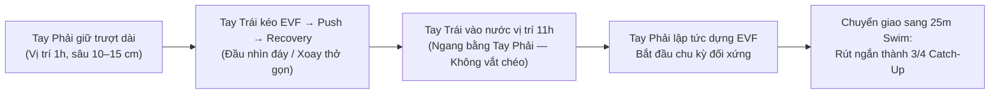
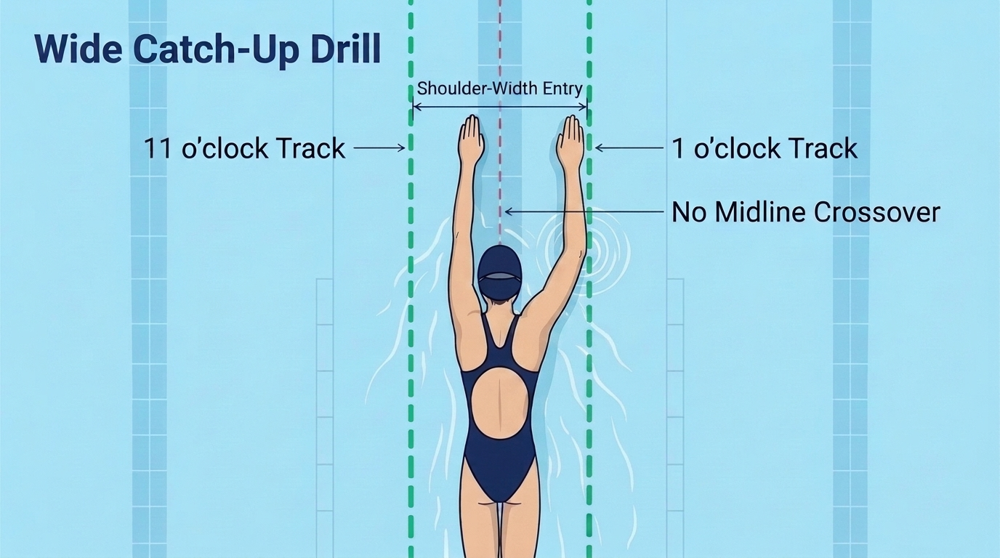

# Catch-Up Drill — Rèn Thân Dài, Front-Quadrant & Xoay Hông

> **Thuộc phần:** `17-drills/` | **Trình độ:** Cơ bản → Trung cấp | **Thời gian đọc:** ~10 phút

## Tổng Quan (Overview)
**Catch-Up Drill** (bài tập đuổi tay) là bài tập kinh điển và phổ biến nhất trong lịch sử bơi sải. Bằng cách yêu cầu một cánh tay giữ vươn dài phía trước cho đến khi cánh tay kia hoàn tất vòng rút trên không và chạm tới nó, Catch-Up Drill phóng đại tối đa tư thế **Front-Quadrant**, ép cơ thể giữ chiều dài thân tàu lớn nhất, xóa bỏ lỗi bơi "cối xay gió" (*Windmill*) và buộc bạn phải **bám nước chắc bằng EVF** mới tiến đi được.

- **Mục tiêu cốt lõi:** Xóa bỏ lỗi *Windmill Arms*, kéo dài chiều dài thân tàu ($L$), ổn định tay trượt phía trước khi xoay thở và tăng DPS.
- **Cảm giác đúng:** Cơ thể lướt dài êm ái sau mỗi sải, tay trượt phía trước giữ chắc độ sâu `10–15 cm` không tụt xuống khi tay kia kéo và xoay thở.
- **Sai lầm phổ biến nhất:** Mang nguyên xi nhịp chờ "chạm 2 bàn tay vào nhau" của Catch-Up Drill vào bơi tốc độ thực tế (gây **Over-Gliding / Dead Spot**).

---

## Lý Thuyết (Theory)
Trong bơi sải, não bộ của người mới thường mắc phản xạ **"quạt vội"**: chưa kịp vươn hết tay trước đã kéo ngay tay đó xuống, khiến cả hai tay cùng nằm phía sau đầu, làm hông sụp xuống đáy.

**Catch-Up Drill** hoạt động theo cơ chế **"Phóng đại có kiểm soát" (*Exaggeration Principle*)**:
- Nó buộc tay trượt phải "kiên nhẫn chờ" ở phía trước lâu hơn bình thường (`Full Catch-Up`), tạo đủ thời gian để bạn cảm nhận rõ sự nổi của hông, độ thẳng của trục cột sống và góc xoay `40°`.
- Sau khi não đã ghi nhớ cảm giác thân dài, bạn rút ngắn thời gian chờ sang **3/4 Catch-Up** (bắt nước ngay khi tay hồi ngang tai) để áp dụng vào bơi tốc độ `< 1:30/100m`.

---

## Cơ Sở Khoa Học (Science)
### Vật Lý & Thủy Động Lực Học (Physics & Hydrodynamics)
- **Tối đa hóa dịch chuyển COG về phía COB**: Giữ 1 tay duỗi thẳng phía trước suốt 100% thời gian kéo của tay kia giúp hông nổi cao nhất có thể (giảm Form Drag).
- **Cảnh báo mất đà (*Momentum Loss*)**: Vì Full Catch-Up có khoảng nghỉ tạo lực (`IdC ≈ -20%`), vận tốc cơ thể sẽ giảm nhẹ giữa hai sải — do đó bạn cần duy trì một **nhịp chân nhẹ ổn định (Flutter Kick hoặc Short Fins)** trong lúc tập Drill để không bị dừng hẳn.

### Cơ Sinh Học (Biomechanics)
Khi tay phải giữ cố định ở vị trí `1 giờ` (trước vai phải) và tay trái kéo từ `11 giờ` xuống đùi trái rồi rút trên không lên:
- Vai phải được vươn dài tự nhiên trong mặt phẳng xương bả vai.
- **Chú ý tránh Crossover**: Không cần ép hai bàn tay chạm nhau ngay giữa mũi! Biến thể hiện đại chuẩn cơ sinh học nhất là **Wide Catch-Up (hoặc Stick Catch-Up)**: hai tay vẫn nằm trên 2 đường ray song song **11 giờ & 1 giờ**, khi bàn tay trái vào nước ngang bằng bàn tay phải (cách nhau bằng bề rộng vai) thì tay phải lập tức bắt đầu dựng EVF!

---

## Thực Hành (Practical)
### Tại Sao Kỹ Thuật Này Hiệu Quả (Why It Works)
Catch-Up Drill là "liều thuốc đặc trị" cho 3 nhóm lỗi cùng lúc:
1. Người bơi kiểu **Windmill** (quạt tay liên hồi, `24–28 sải/25m`) → giảm ngay `4–6 sải/25m` sau vài buổi tập.
2. Người **ấn tay trượt xuống sâu khi thở** → buộc phải giữ tay trượt cố định trên "mặt bàn nước" trong lúc xoay đầu hít hơi.
3. Người **rút ngắn pha Push** → có đủ sự tập trung để đẩy tay kéo đi hết hành trình chạm mép đùi.

### Hướng Dẫn Từng Bước & Cảm Giác Nước (Step-by-Step & Water Cues)
1. **Vị trí bắt đầu**: Đạp tường Streamline, tách hai tay ra rộng bằng vai (`11 giờ & 1 giờ`) ở độ sâu `10–15 cm`.
2. **Giữ tay dẫn đường bất động**: Giữ nguyên tay trái vươn thẳng trước vai trái (lòng bàn tay úp xuống đáy, cổ tay thẳng).
3. **Thực hiện trọn vẹn 1 sải tay phải**: Dựng EVF → kéo cơ xô → đẩy tới mép đùi → rút khuỷu cao thả lỏng trên không → "xỏ kim" vào nước ở vị trí `1 giờ`.
4. **Đổi tay sạch sẽ**: Ngay khi đầu ngón tay phải xuyên qua mặt nước ngang bằng tay trái (hoặc chạm vào ống nhựa cầm ngang rộng bằng vai), **tay trái lập tức dựng EVF** bắt đầu sải kế tiếp.
5. **Chuyển ngay sang 3/4 Catch-Up & Bơi thường**: Sau `25m Catch-Up`, bơi ngay `25m` bình thường với quy tắc *"Meet at the Ear"* để không bị dính tật Over-Gliding.

<!-- IMAGE_PROMPT: Clean overhead and underwater side illustration of Wide Catch-Up Drill: showing left lead arm holding steady at 11 o'clock (10-15cm depth) while right arm finishes recovery and enters at 1 o'clock (shoulder-width apart, no midline crossover), with green parallel railroad track guides. -->

### Mẹo Nâng Cao (Advanced Tips)
- **Biến thể "Stick Catch-Up" (Cầm gậy PVC / Ống thở ngắn ngang vai)**: Cầm một đoạn ống nhẹ dài `35–40 cm` bằng hai tay ở hai đầu khi chuyển tay — công cụ vật lý tuyệt vời **chặn tuyệt đối lỗi vắt chéo trục giữa (Crossover)** khi tập Catch-Up!
- **Biến thể "3/4 Catch-Up" cho trình độ Trung cấp–Nâng cao**: Bỏ qua Full Catch-Up nếu bạn đã bơi dưới `1:40/100m`; chỉ dùng **3/4 Catch-Up** (tay trước bắt nước ngay khi tay hồi đi ngang tai) để vừa giữ thân dài vừa giữ vận tốc cao.

---

## Bài Tập Thực Hành (Drills)
| Biến thể Catch-Up | Mục tiêu cụ thể | Cự ly / Số hiệp | Cảm giác đúng (Cue) |
| :--- | :--- | :--- | :--- |
| **Wide Catch-Up (Không chạm giữa)** | Sửa Windmill & giữ 2 đường ray 11h/1h | `4 × 50m` (`25m Drill + 25m Swim`) | Hai tay luôn rộng bằng vai, hông nổi phẳng lì |
| **Stick Catch-Up (Cầm ống ngang)** | Trị dứt điểm lỗi vắt chéo trục giữa & ấn tay trượt khi thở | `4 × 25m` (nghỉ 15s) | Ống nhựa luôn nằm ngang phẳng ở độ sâu `10–15 cm`, không bị nghiêng chúc xuống |
| **3/4 Catch-Up → CSS Swim** | Chuyển giao trực tiếp sang nhịp tốc độ `< 1:30/100m` | `4 × 50m` (`25m 3/4 + 25m Swim`) | Không có Dead Spot, tốc độ lướt mượt và liên tục |

---

## Phân Tích AI & Video (AI Analysis)
- **Góc quay khuyến nghị:** Trên cao (Overhead View) để kiểm tra lỗi vắt chéo, và Ngang dưới nước (Side View) để kiểm tra độ sâu tay chờ.
- **Điểm khớp cần trích xuất (Keypoints):** `left_wrist`, `right_wrist`, `left_shoulder`, `right_shoulder`, `waterline_y`.
- **Ngưỡng phát hiện lỗi tự động:**
  - **Đạt chuẩn:** Tay chờ giữ độ sâu ổn định `10–18 cm` (dao động `< 5 cm` khi xoay thở); khoảng cách ngang hai cổ tay lúc đổi tay `≥ 25 cm` (không vắt chéo).
  - **Cảnh báo lỗi:** Hai cổ tay chụm chạm nhau ngay trước mũi (Crossover); tay chờ tụt sâu `> 30 cm` khi đầu xoay lấy hơi.

---

## Lỗi Thường Gặp & Cách Sửa (Common Errors)
| Lỗi thường gặp | Triệu chứng nhận biết | Nguyên nhân gốc | Cách sửa (Correction) |
| :--- | :--- | :--- | :--- |
| **Chạm hai bàn tay trước mũi (Crossover)** | Hông lắc ngang, vai cấn đau | Cố ép 2 bàn tay vỗ vào nhau ở đường giữa | Chuyển sang **Wide Catch-Up** (đổi tay trên 2 đường ray 11h & 1h) hoặc **Stick Catch-Up** |
| **Ấn tay chờ xuống đáy khi thở** | Đầu ngẩng cao, chân chìm sâu mỗi khi hít hơi | Thiếu cân bằng nghiêng, dùng tay chờ làm phao chống | Đeo chân vịt ngắn để giữ tốc độ nền, tưởng tượng đặt tay chờ lên mặt bàn nước |
| **Dừng hẳn người mất đà (Dead Spot)** | Phải gồng mạnh khởi động lại sau mỗi sải | Đạp chân quá yếu trong lúc chờ hoặc chờ quá lâu sau khi tay kia đã vào nước | Duy trì nhịp chân đều nhẹ & đổi tay ngay lập tức khi tay hồi chạm nước |
| **Mang Full Catch-Up vào bơi thi đấu** | Bơi rất đẹp nhưng bị kẹt pace ở `1:45–2:00/100m` | Không chuyển giao sang 3/4 Catch-Up / Opposition | Luôn kết thúc bằng `25m Swim` tốc độ thật sau mỗi `25m Drill` |

---

## Tự Đánh Giá Tại Hồ (Self Assessment)
- [ ] Tôi thực hiện Catch-Up trên 2 đường ray rộng bằng vai (11h & 1h), không chụm tay vắt chéo trước mũi.
- [ ] Tay trượt phía trước của tôi giữ vững độ sâu `10–15 cm` ngay cả khi xoay đầu lấy hơi.
- [ ] Sau `25m Catch-Up`, tôi chuyển mượt sang `25m Swim` với nhịp 3/4 Catch-Up không bị Dead Spot.
- [ ] Số sải tay (Stroke Count) của tôi ở `25m Swim` ngay sau Drill giảm rõ rệt `1–3 sải`.
- [ ] Tôi không sử dụng Full Catch-Up nếu bản thân đang thuộc nhóm *Overglider* (SPM `< 55`).

---

## Chỉ Số Đo Lường (KPI)
| Chỉ số (Metric) | Người mới | Trung cấp | Nâng cao (`< 1:30/100m`) |
| :--- | :---: | :---: | :---: |
| **Độ tụt sâu của tay chờ khi thở** | `> 20 cm` | `8–15 cm` | `< 5 cm` |
| **Khoảng cách ngang 2 cổ tay lúc đổi tay** | `0 cm` (vắt chéo) | `15–22 cm` | `28–38 cm` (chuẩn rộng vai) |
| **Mức giảm Stroke Count ở 25m Swim chuyển giao** | `-2 đến -4 sải` | `-1 đến -2 sải` | Giữ ổn định `14–17 sải` |

---

## Câu Hỏi Thường Gặp (FAQ)
**1. Người thuộc nhóm Overglider (trượt quá lâu, nhịp tay chậm) có nên tập Catch-Up Drill không?**
**Không nên tập Full Catch-Up!** Nó sẽ làm tình trạng Over-Gliding nặng hơn. Nhóm Overglider nên thay bằng **3/4 Catch-Up kết hợp Tempo Trainer** để đẩy nhịp tay lên `68–74 SPM`.

**2. Khi tập Catch-Up thì nên thở ở thời điểm nào?**
Thở đúng vào pha **Push** của tay đang kéo (ví dụ: tay trái đang giữ phía trước, tay phải kéo và đẩy ngang hông phải → xoay đầu sang phải thở rồi úp mặt về đáy trước khi tay phải chạm nước phía trước).

**3. Nên cầm ống nhựa (Stick) hay ván nhỏ khi tập Catch-Up?**
Cầm một **ống nhựa PVC mỏng/gậy gỗ nhẹ** (`35–40 cm`) tốt hơn nhiều so với cầm ván nổi, vì ván nổi tạo lực đẩy nổi giả ở tay làm sai lệch cảm giác cân bằng thật của thân người.

---

## Tóm Tắt (Summary)
- **Catch-Up Drill** là bài tập nền tảng trị lỗi *Windmill*, rèn thân dài Front-Quadrant và ổn định tay trượt khi thở.
- Luôn ưu tiên **Wide Catch-Up / Stick Catch-Up** (trên 2 đường ray 11h & 1h) để không tạo tật xấu Crossover.
- Luôn chuyển giao tức thời sang **3/4 Catch-Up & Swim** để giữ tốc độ liên tục không *Dead Spot*.

**Liên kết chéo:**
- Chương trước: [Hệ Thống TI, SwimSmooth & Olympic](training-systems.md)
- Chương tiếp theo: [Fingertip Drag Drill](fingertip-drag.md)
- Kỹ thuật liên quan: [Cân Bằng & Pha Trượt](../04-body-position/balance-and-glide.md) · [Front-Quadrant & Nhịp Điệu](../12-rhythm/rhythm-and-timing.md)
- Tra cứu thuật ngữ: [Glossary](../24-appendix/glossary.md)

---

## Tài Liệu Tham Khảo (References)
1. Newsome, P., & Young, A. (2012). *Swim Smooth*. Wiley.
2. Maglischo, E. W. (2003). *Swimming Fastest*. Human Kinetics.
3. USA Swimming — *Catch-Up Progression & Front-Quadrant Drills*.

