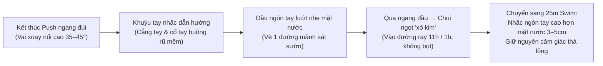
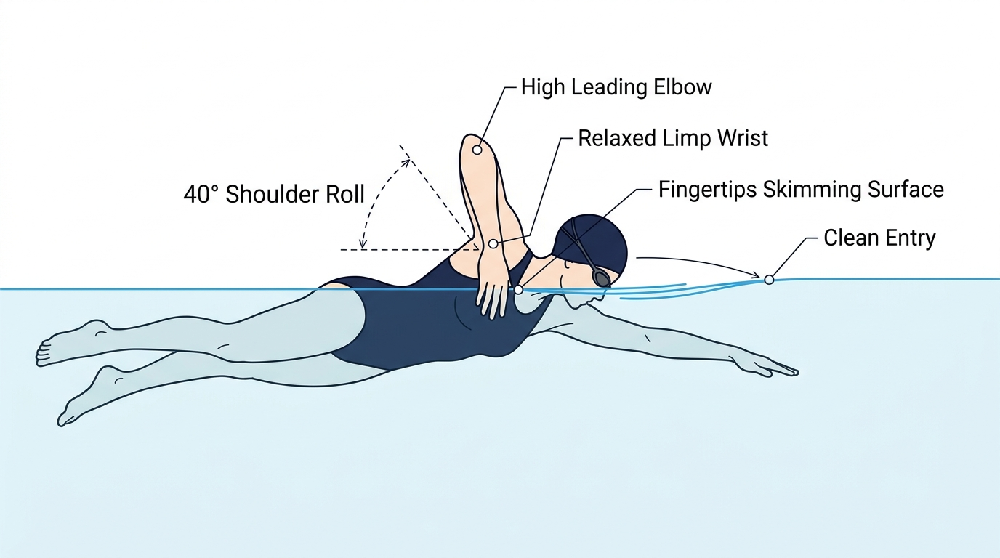

# Fingertip Drag Drill — Rút Tay Thả Lỏng & Vào Nước "Xỏ Kim"

> **Thuộc phần:** `17-drills/` | **Trình độ:** Cơ bản → Nâng cao | **Thời gian đọc:** ~10 phút

## Overview

**Fingertip Drag Drill** (bài tập lê đầu ngón tay trên mặt nước) là phương thuốc tự nhiên và hiệu quả nhất để giải phóng hoàn toàn tình trạng **gồng cứng vai, vung tay rộng ngang và đập bẹp mặt nước khi vào tay**. Chỉ với một yêu cầu đơn giản — *giữ đầu ngón tay lướt nhẹ vẽ một vệt mảnh trên mặt nước suốt pha rút tay trên không* — cơ thể bạn lập tức tự động kích hoạt xoay vai `35–45°`, nâng khuỷu tay dẫn hướng lên cao và thả lỏng toàn bộ cơ cẳng tay–bàn tay.

- **Mục tiêu cốt lõi:** Dạy hệ thần kinh trạng thái **thả lỏng 100% cẳng tay & bàn tay ở pha Recovery**, dẫn hướng bằng khuỷu tay cao và vào nước êm ái kiểu "xỏ kim".
- **Cảm giác đúng:** Cánh tay nhẹ bẫng như được sợi dây rối kéo lên từ khuỷu tay, đầu ngón tay vẽ một nét bút mảnh êm ru trên mặt nước không bắn bọt.
- **Sai lầm phổ biến nhất:** Nằm bụng phẳng lì rồi cố rụt vai lên gồng cứng để lê ngón tay, hoặc cắm cả bàn tay sâu xuống nước kéo tạo sóng cản.

---

## Theory

Trong bơi sải, lỗi **vung tay rộng ngang (*Wide Swinging Recovery*)** và **gồng cứng cánh tay trên không** khiến nhịp tim tăng nhanh, vai mỏi rã và hông lắc ngang (*Fishtailing*).

**Fingertip Drag** sử dụng **ràng buộc vật lý của mặt nước (*Environmental Constraint*)**:
- Nếu bạn vung tay thẳng rộng ra ngoài, đầu ngón tay sẽ nhấc bổng lên khỏi mặt nước (phạm luật Drill).
- Nếu bạn không xoay vai `35–45°`, cánh tay sẽ bị kẹt sâu dưới nước (không thể chỉ lê mỗi đầu ngón tay).
- Cách duy nhất để hoàn thành bài tập mượt mà là: **xoay vai cao khỏi mặt nước + nhấc khuỷu tay dẫn đường + buông lỏng cẳng tay và cổ tay rũ thẳng xuống dưới khuỷu**.

---

## Science

### Physics & Hydrodynamics

- **Thu nhỏ mô-men quán tính ($I = m \cdot r^2$)**: Giữ bàn tay đi gọn sát sườn dưới khuỷu tay giúp giảm khoảng `55%` mô-men quán tính xoay quanh khớp vai so với vung thẳng rộng, triệt tiêu phản lực làm lắc hông dưới nước (xem [Pha Rút Tay Thả Lỏng](../11-recovery/relaxed-recovery.md)).
- **Chuẩn bị góc xuyên nước `35–40°`**: Vì đầu ngón tay đang lướt sát mặt nước ngay phía dưới khuỷu tay, khi tay tiến tới trước vai (`11h / 1h`), bàn tay tự nhiên chui ngọt qua mặt nước theo góc "xỏ kim" không đập bẹp tạo bọt khí.

### Biomechanics

- **Ngắt kích hoạt cơ cẳng tay & bàn tay (EMG Drop)**: Trong pha kéo dưới nước, các cơ gấp cổ tay và cẳng tay hoạt động mạnh. Khi đầu ngón tay rũ mềm lướt mặt nước trong Fingertip Drag, mức kích hoạt điện cơ (EMG) của cẳng tay giảm về gần `0%`, cho phép máu giàu oxy bơm vào xả mỏi tức thì.
- **Lưu ý bảo vệ khớp vai**: Độ cao khuỷu tay phải đến từ **độ xoay của khung sườn và vai (`35–45°`)**, tuyệt đối không đến từ việc gồng cơ thang trên (*Upper Trapezius*) rụt vai sát mang tai!

---

## Practical

### Why It Works

Fingertip Drag là bài tập có **tỷ lệ chuyển giao sang bơi thật cao bậc nhất**: bạn không phải học một động tác kỳ dị nào cả. Khi chuyển từ `25m Fingertip Drag` sang `25m Swim` bình thường, bạn chỉ cần nhấc đầu ngón tay cao hơn mặt nước khoảng `3–5 cm` và **giữ nguyên 100% cảm giác khuỷu dẫn hướng + cẳng tay thả lỏng**!

### Step-by-Step Execution & Water Cues

1. **Hoàn tất pha Push trước khi lê tay**: Đẩy ngón cái qua sát mép đùi, xoay nhẹ vai bên đó lên `35–45°`.
2. **Dẫn đường bằng khuỷu tay (*Marionette Elbow*)**: Tưởng tượng một sợi dây vô hình kéo nhẹ khuỷu tay lên cao và lướt về phía trước.
3. **Chỉ chạm 2–3 đầu ngón tay trên mặt nước**: Cổ tay và bàn tay rũ mềm tự nhiên bên dưới khuỷu; chỉ để phần đốt ngón tay cuối cùng lướt nhẹ trên mặt nước tạo đường vân mỏng (không nhúng cả cổ tay xuống nước).
4. **Đi gọn sát thân**: Giữ bàn tay lướt cách hông và sườn chỉ khoảng `10–15 cm`.
5. **Chui ngọt qua khe cửa trước vai**: Khi bàn tay lướt tới ngang đỉnh đầu (vị trí `11h / 1h`), nhẹ nhàng duỗi cẳng tay cho đầu ngón tay xuyên thẳng xuống độ sâu `10–15 cm` không tạo tiếng đập.

<!-- IMAGE_PROMPT: Clean above-water side-oblique sports illustration of Fingertip Drag Drill: showing swimmer's right shoulder rotated 40 degrees above water, high relaxed elbow leading forward, limp wrist and fingers lightly skimming a thin ripple line across the water surface close to the ribs before threading cleanly into the 1 o'clock entry slot. -->

### Advanced Tips

- **Biến thể "Thumb-Drag / Zipper" cho người hay vung rộng**: Nếu ngón tay của bạn vẫn trôi rộng ra xa sườn khi tập Fingertip Drag, hãy đổi sang bài **Zipper Drill** (kéo ngón cái chạm sát dọc sườn lên nách) trong 2 hiệp rồi quay lại Fingertip Drag.
- **Đừng lê ngón tay quá chậm làm hỏng nhịp thở**: Giữ nhịp di chuyển cánh tay trên không mượt mà, liên tục với tốc độ vừa phải để không tạo *Dead Spot* ở tay trượt phía trước.

---

## Drills

| Biến thể Fingertip Drag | Mục tiêu cụ thể | Cự ly / Số hiệp | Cảm giác đúng (Cue) |
| :--- | :--- | :--- | :--- |
| **Classic Fingertip Drag → Swim** | Xây phản xạ khuỷu cao thả lỏng & vào nước êm | `4 × 50m` (`25m Drag + 25m Swim`) | Nghe tiếng mặt nước rẽ êm như tiếng xé giấy mỏng, vai nhẹ bẫng |
| **Fingertip Drag + Snorkel** | Tập trung 100% vào độ đối xứng 2 bên trái–phải | `4 × 25m` (nghỉ 15s) | Hai bên vẽ hai vệt nước đối xứng hoàn toàn, không bên nào bị nhúng sâu |
| **Single-Arm Fingertip Drag** | Sửa lỗi vung tay rộng ở riêng bên không thuận | `4 × 25m` (2 trái, 2 phải) | Xoay vai cao đều, cẳng tay thả lỏng tuyệt đối ở bên yếu |

---

## AI Analysis

- **Góc quay khuyến nghị:** Ngang trên mặt nước (Above-Water Side View) và Chính diện mặt nước (Front Waterline View).
- **Keypoints cần trích xuất:** `recovery_shoulder`, `recovery_elbow`, `recovery_wrist`, `finger_tips`, `waterline_y`.
- **Ngưỡng phát hiện lỗi tự động:**
  - **Đạt chuẩn:** `finger_tips` duy trì sát `waterline_y` (`± 2 cm`) suốt 80% hành trình Recovery; `recovery_elbow` luôn cao hơn `recovery_wrist` `≥ 15 cm`; góc xoay vai đạt `≥ 35°`.
  - **Cảnh báo lỗi:** Cổ tay ngập sâu dưới `waterline_y > 8 cm` (cắm tay kéo nước); `recovery_wrist` vung ngang cách thân `> 35 cm`.

---

## Common Errors

| Lỗi thường gặp | Triệu chứng nhận biết | Nguyên nhân gốc | Cách sửa (Correction) |
| :--- | :--- | :--- | :--- |
| **Cắm cả bàn tay/cổ tay xuống nước** | Tạo sóng kéo ngược, vai nặng trịch | Thiếu độ xoay vai `35–45°` nên khuỷu tay nằm quá thấp | Xoay hông và vai lên cao hơn (tập kèm 6-Kick Switch) |
| **Rụt vai sát tai để nâng khuỷu** | Đau mỏi cổ gáy và cơ thang trên sau 50m | Cố nâng khuỷu bằng cơ vai thay vì xoay khung sườn | Hạ thấp bả vai xa tai, để độ xoay thân tự nâng khuỷu tay lên |
| **Vẽ đường lê quá xa sườn** | Hông vẫn bị lắc ngang | Tay rút vòng ra ngoài theo thói quen cũ | Tập xen kẽ 25m Zipper Drill để kéo quỹ đạo sát vào thân |
| **Đập tay ở giây cuối cùng khi Entry** | Lê ngón tay rất êm nhưng tới trước đầu lại nhấc lên đập "bõm" | Mất kiểm soát khi duỗi cẳng tay về trước | Giữ đầu ngón tay chui trực tiếp từ mặt nước xuống độ sâu `10–15 cm` |

---

## Self Assessment

- [ ] Chỉ 2–3 đầu ngón tay của tôi chạm nhẹ mặt nước tạo đường vân mỏng, không bị nhúng sâu cả bàn tay.
- [ ] Cổ tay và cẳng tay tôi hoàn toàn buông lỏng mềm mại trong suốt pha rút tay.
- [ ] Khuỷu tay luôn dẫn hướng cao hơn cổ tay mà vai không bị rụt lên sát tai.
- [ ] Khi chuyển sang `25m Swim` ngay sau đó, tôi giữ được cảm giác vai cực nhẹ và vào nước không tiếng động.
- [ ] Quỹ đạo rút tay cả bên trái lẫn bên phải đều gọn và đối xứng nhau.

---

## KPI

| Chỉ số (Metric) | Người mới | Trung cấp | Nâng cao (`< 1:30/100m`) |
| :--- | :---: | :---: | :---: |
| **Độ liên tục của vệt nước ngón tay (25m)** | Đứt quãng nhiều | Đều bên thuận | Mượt liền mạch 100% cả 2 bên |
| **Độ rộng vung ngang Recovery (25m Swim sau Drill)** | `> 45 cm` | `30–40 cm` | `< 28 cm` |
| **Mức căng cơ vai/cổ sau 4 × 50m** | Căng rõ | Nhẹ | Hoàn toàn thư giãn (`0/10`) |

---

## FAQ

**1. Khi bơi tốc độ cao (`< 1:30/100m`), có cần tiếp tục lê đầu ngón tay chạm nước không?**
Không cần chạm nước (vì chạm nước nhẹ cũng tạo chút ma sát và dễ vấp sóng). Khi bơi bình thường, giữ đầu ngón tay lướt **cách mặt nước `3–8 cm`** với đúng tư thế khuỷu cao thả lỏng mà bạn đã rèn được từ Fingertip Drag.

**2. Tôi bị cứng vai nên tập Fingertip Drag thấy hơi cấn mặt ngoài khớp vai, phải làm sao?**
Đừng ép khuỷu tay dựng thẳng đứng 90° lên trời! Hãy xoay thân sâu hơn (`40–45°`) để giải phóng khớp vai, đồng thời cho phép bàn tay lướt rộng hơn sườn một chút (`20–25 cm`) để khớp vai hoàn toàn dễ chịu.

**3. Fingertip Drag có giúp sửa lỗi Crossover (vắt chéo tay) không?**
Có! Vì đầu ngón tay luôn lướt thẳng dọc theo đường ray bên sườn tiến thẳng lên phía trước vai (`11h / 1h`), nó tự động dẫn bàn tay vào nước thẳng hàng với vai mà không cắt chéo trước mặt.

---

## Summary

- **Fingertip Drag** là bài Drill số 1 để rèn **pha rút tay thả lỏng (Relaxed Recovery)**, khuỷu tay dẫn hướng tự nhiên và pha vào nước "xỏ kim" không bọt.
- Chìa khóa thành công: **Xoay vai `35–45°` làm bệ nâng** (không rụt vai sát tai) và chỉ để **đầu ngón tay chạm nhẹ mặt nước**.
- Chuyển giao ngay bằng `25m Fingertip Drag + 25m Swim` để mang trọn sự nhẹ nhàng vào sải bơi thực tế.

**Liên kết chéo:**
- Chương trước: [Catch-Up Drill](catch-up.md)
- Chương tiếp theo: [Single-Arm Freestyle Drill](single-arm.md)
- Kỹ thuật liên quan: [Pha Rút Tay Thả Lỏng](../11-recovery/relaxed-recovery.md) · [Pha Vào Nước "Xỏ Kim"](../09-catch/hand-entry-and-extension.md)
- Tra cứu thuật ngữ: [Glossary](../24-appendix/glossary.md)

---

## References

1. Newsome, P., & Young, A. (2012). *Swim Smooth*. Wiley.
2. USA Swimming — *High-Elbow Recovery & Fingertip Drag Coaching Guide*.
3. Maglischo, E. W. (2003). *Swimming Fastest*. Human Kinetics.

