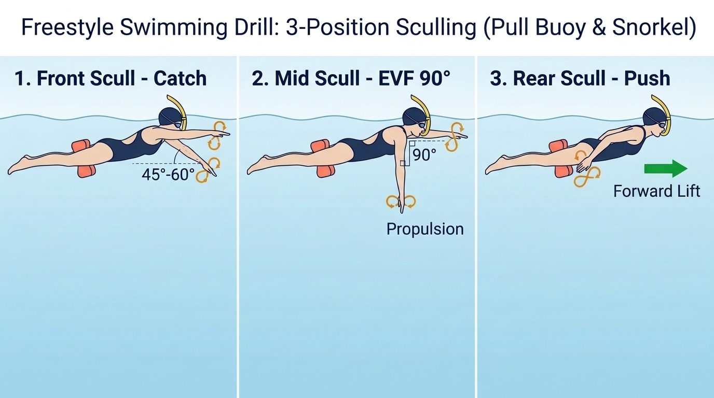

# Sculling Drill (Front, Mid, Rear) — Luyện Cảm Giác Nước & Tì Nước EVF

> **Thuộc phần:** `17-drills/` | **Trình độ:** Cơ bản → Nâng cao | **Thời gian đọc:** ~11 phút

## Tổng Quan (Overview)
Nếu hỏi các huấn luyện viên Olympic đâu là bài tập xây dựng **"cảm giác nước" (*Feel for the Water*)** và **kỹ năng ôm nước EVF** nhanh nhất thế giới, câu trả lời gần như luôn là **Sculling** (vẫy nước hình số 8 bằng cẳng tay & bàn tay). Sculling tách biệt hoàn toàn khả năng điều khiển **góc tấn (*Angle of Attack*)** của lòng bàn tay và cẳng tay — dạy não bạn cách "bắt dính" vào dòng nước đặc mà không cần gồng cơ vai.

- **Mục tiêu cốt lõi:** Thành thạo cả **3 vị trí Sculling (Front — Catch, Mid — Pull, Rear — Push)** để tối ưu hóa áp lực nước trên toàn bộ lòng bàn tay và cẳng tay xuyên suốt hành trình kéo.
- **Cảm giác đúng:** Cảm nhận một lớp áp lực nước chắc, nặng và êm đè liên tục lên lòng bàn tay–cẳng tay (như đang xoa trên bề mặt mật ong đặc), kéo cơ thể trôi tiến về trước đều đặn mà không cần đạp chân.
- **Sai lầm phổ biến nhất:** Lắc bàn tay quá nhanh tạo bọt nước (trượt nước), hoặc bẻ gập cổ tay quá mức thay vì giữ khuỷu tay cao cố định.

---

## Lý Thuyết (Theory)
**Sculling** là chuyển động lắc ngang vào–ra (hình số 8 dẹt) của bàn tay và cẳng tay với góc nghiêng mặt phẳng tay khoảng **`30–45°`** so với phương chuyển động, tạo ra **Lực nâng thủy động (Bernoulli Lift)** và lực đẩy phản lực hướng liên tục về phía trước (xem [Lực Đẩy & Lực Nâng](../03-hydrodynamics/propulsion-and-lift.md)).

### 3 Vị Trí Sculling Tương Ứng 3 Pha Dưới Nước

| Vị trí Sculling | Pha bơi tương ứng | Tư thế cánh tay | Mục tiêu cơ sinh học |
| :--- | :--- | :--- | :--- |
| **1. Front Scull (Vẫy trước)** | **Catch / EVF** | Hai tay vươn trước vai, khuỷu cao cố định, cẳng tay chúc xuống `45–70°` | Dạy khuỷu tay giữ cao bất động và tìm điểm tì nước đầu tiên |
| **2. Mid Scull (Vẫy giữa — "Windshield Wiper")** | **Mid-Pull (EVF đỉnh)** | Cẳng tay dựng thẳng đứng `90°` ngay dưới ngực/vai, khuỷu giữ rộng cao | Kích hoạt **cơ lưng rộng (Lat)** và cảm nhận diện tích mái chèo cẳng tay cực đại |
| **3. Rear Scull (Vẫy sau — ngang hông)** | **Push / Finish** | Hai cánh tay đặt dọc sát hông, cổ tay xoay lắc ngang mép đùi | Rèn cảm giác dứt điểm pha Push và sức bền cơ tam đầu (*Triceps*) |

---

## Cơ Sở Khoa Học (Science)
### Vật Lý & Thủy Động Lực Học (Physics & Hydrodynamics)
Trong Sculling, vận tốc tiến của thân người ($v_{\text{body}}$) chứng minh trực tiếp độ chính xác của **góc tấn ($\alpha$)** bàn tay:
- Nếu bàn tay để phẳng song song đáy hồ ($\alpha = 0°$): Lực nâng hướng thẳng lên trời → bạn chỉ nổi nhấp nhô tại chỗ, không tiến về trước!
- Nếu nghiêng cạnh ngón cái xuống `35–45°` khi gạt vào trong (*Insweep*) và nghiêng cạnh ngón út xuống `35–45°` khi gạt ra ngoài (*Outsweep*): Hợp lực nâng + cản hướng **thẳng về phía trước**, tạo dòng đẩy liên tục êm ru.

### Cơ Sinh Học (Biomechanics)
- **Cố định khớp vai — Cô lập cẳng tay**: Trong Front và Mid Scull, cánh tay trên (từ vai tới khuỷu) giữ gần như cố định như gác lên một thanh xà ngang; chuyển động xoay trong–ngoài diễn ra mượt mà quanh trục xương cánh tay và khớp khuỷu.
- **Khe hở ngón tay `2–4 mm`**: Giữ bàn tay mở khe cực nhẹ tự nhiên giúp các thụ thể áp suất (*Mechanoreceptors*) trên da lòng bàn tay truyền tín hiệu phản hồi tinh tế nhất lên vỏ não vận động.

---

## Thực Hành (Practical)
### Tại Sao Kỹ Thuật Này Hiệu Quả (Why It Works)
Rất nhiều người bơi tập hàng năm trời nhưng vẫn cảm thấy tay mình "cào vào không khí" khi xuống nước. Chỉ cần `100–150m` **3-Position Sculling** ở phần khởi động mỗi buổi bơi (trong 3 tuần liên tiếp), hệ thần kinh sẽ tự động hiệu chỉnh góc cổ tay và cẳng tay chuẩn xác đến từng độ — giúp mỗi sải bơi ngay sau đó có cảm giác **bám nước đặc quánh và nhẹ tay lạ thường**.

### Hướng Dẫn Từng Bước & Cảm Giác Nước (Step-by-Step & Water Cues)
1. **Thiết lập dụng cụ tối ưu**: Kẹp **Pull Buoy** giữa hai đùi (không đập chân) và đeo **Center Snorkel** (nhìn thẳng đáy hồ, không phải ngẩng đầu thở làm chìm hông).
2. **Front Scull**: Vươn hai tay trước vai rộng hơn vai một chút, giữ khuỷu tay cao gần mặt nước, chúc cẳng tay và bàn tay xuống khoảng `45–60°`. Lắc nhẹ hai bàn tay vào–ra (rộng khoảng `25–35 cm`), nghiêng lòng bàn tay `40°` hướng về phía sau–trong khi gạt vào và sau–ngoài khi gạt ra.
3. **Mid Scull (Quan trọng nhất cho EVF!)**: Kéo khuỷu tay về ngang vai, **dựng cẳng tay thẳng đứng 90° hướng xuống đáy** (giống cần gạt nước ô tô úp ngược). Lắc cẳng tay vào–ra quanh khớp khuỷu cố định, cảm nhận rõ nước đè nặng lên cả cẳng tay và cơ xô dưới nách căng lên.
4. **Rear Scull**: Duỗi hai tay dọc theo hông, khuỷu hơi cong nhẹ, lắc bàn tay vào–ra ngay sát mép đùi với lòng bàn tay hơi hướng về phía chân.
5. **Chuyển giao ngay lập tức**: Bơi ngay `25–50m` bơi sải thường sau chuỗi Sculling — bạn sẽ thấy Stroke Count giảm tức thì `1–3 sải/25m`!

<!-- IMAGE_PROMPT: Technical 3-panel underwater biomechanical illustration of Sculling Drill with Pull Buoy and Snorkel: Panel 1 Front Scull (high elbows, 50-deg forearm pitch, figure-8 hand path); Panel 2 Mid Scull (90-deg vertical EVF forearm directly under shoulders engaging lats); Panel 3 Rear Scull (hands beside hips/thighs generating forward lift), with green forward propulsion arrows. -->

### Mẹo Nâng Cao (Advanced Tips)
- **Không cần lắc quá nhanh**: Tốc độ lắc bàn tay tối ưu khoảng **`1.5–2 nhịp/giây`** — đủ nhanh để tạo áp lực nước đặc nhưng đủ chậm để bạn *cảm nhận* được dòng nước bám trên da lòng bàn tay.
- **Biến thể "Reverse Scull" (Vẫy lùi)**: Thử xoay góc tấn ngược lại để vẫy người trôi lùi về sau `10m` rồi đổi góc tấn vẫy tiến tới `15m` — bài tập cảm thụ bản thể cực mạnh giúp bạn làm chủ tuyệt đối góc bàn tay trong nước!

---

## Bài Tập Thực Hành (Drills)
| Bài Tập Sculling | Mục tiêu cụ thể | Cự ly / Số hiệp | Cảm giác đúng (Cue) |
| :--- | :--- | :--- | :--- |
| **3-Position Scull + Swim** | Kết nối áp lực nước liền mạch từ Catch → Pull → Push | `2 × 100m` (`25 Front + 25 Mid + 25 Rear + 25 Swim`) | Cơ thể trôi đều về trước ở cả 3 vị trí, không đập chân |
| **Mid-Scull EVF Hold** | Đánh thức cơ xô (Lat) và sửa triệt để lỗi sụp khuỷu | `4 × 25m` (`15m Mid Scull + 10m Swim`) | Khuỷu tay như đóng đinh trên mặt nước, cẳng tay dựng thẳng 90° |
| **Single-Arm Scull → Pull** | Kết nối trực tiếp cảm giác Scull vào sải kéo thật | `4 × 25m` (mỗi sải vẫy 3 nhịp ở Catch rồi kéo hết Push) | Cảm nhận khóa nước cực chắc ngay trước khi xoay hông kéo |

---

## Phân Tích AI & Video (AI Analysis)
- **Góc quay khuyến nghị:** Chính diện dưới nước (Underwater Front View) và Ngang dưới nước (Side View).
- **Keypoints cần trích xuất:** `shoulder`, `elbow`, `wrist`, `finger_tips`, tốc độ tịnh tiến của `hip_center`.
- **Ngưỡng phát hiện lỗi tự động:**
  - **Đạt chuẩn:** Vận tốc tiến $v_{\text{scull}} \ge 0.65\text{ m/s}$ (không đập chân); độ dịch chuyển dọc của `elbow` trong Mid Scull `< 8 cm` (khuỷu giữ cao cố định); góc tấn bàn tay $\alpha \in [30°, 50°]$.
  - **Cảnh báo lỗi:** `hip_center` đứng yên hoặc trôi lùi (góc tấn sai); `elbow` tụt xuống ngang mức `wrist` (sụp khuỷu ngay cả khi Sculling).

---

## Lỗi Thường Gặp & Cách Sửa (Common Errors)
| Lỗi thường gặp | Triệu chứng nhận biết | Nguyên nhân gốc | Cách sửa (Correction) |
| :--- | :--- | :--- | :--- |
| **Đứng yên tại chỗ không tiến lên được** | Tay vẫy rất mỏi nhưng người không nhúc nhích | Lòng bàn tay úp phẳng song song đáy ($\alpha = 0°$) chỉ đẩy nước xuống | Xoay cổ tay hướng lòng bàn tay chếch về phía bàn chân (`35–45°`) |
| **Khuỷu tay bị kéo tụt về phía bụng** | Mất tư thế EVF, không cảm nhận được cơ xô | Không khóa cố định vị trí cánh tay trên trong Front/Mid Scull | Tưởng tượng hai khuỷu tay đang gác lên một tấm ván nổi cố định |
| **Đập chân lén để tự tiến tới** | Ảo tưởng mình Scull rất nhanh | Không kẹp Pull Buoy hoặc vẫn vô thức quẫy chân | Kẹp chặt Pull Buoy (hoặc buộc dây cổ chân) để 100% lực tiến đến từ tay |
| **Lắc tay quá rộng và quá nhanh** | Nước bắn bọt, cẳng tay căng cứng chuột rút | Thiếu kiên nhẫn, muốn đẩy nhanh thay vì cảm nhận áp lực nước | Thu gọn biên độ lắc về `25–35 cm`, lắc chậm chắc và cảm nhận nước đặc |

---

## Tự Đánh Giá Tại Hồ (Self Assessment)
- [ ] Tôi có thể hoàn thành `25m` cho từng vị trí Front, Mid và Rear Scull tiến về trước liên tục mà không đập chân.
- [ ] Trong Mid Scull, khuỷu tay tôi giữ cao cố định và cẳng tay dựng gần thẳng đứng `90°`.
- [ ] Tôi cảm nhận rõ sự khác biệt áp lực nước khi xoay góc lòng bàn tay chỉ `10–15°`.
- [ ] Ngay sau chuỗi Sculling, 25m bơi sải thường của tôi có cảm giác tay bám nước chắc và nhẹ hơn rõ rệt.
- [ ] Tôi duy trì `100–150m` Sculling trong phần khởi động của ít nhất 2 buổi bơi mỗi tuần.

---

## Chỉ Số Đo Lường (KPI)
| Chỉ số (Metric) | Người mới | Trung cấp | Nâng cao (`< 1:30/100m`) |
| :--- | :---: | :---: | :---: |
| **Thời gian 25m Front Scull (Pull Buoy, không chân)** | `> 45 giây` | `32–42 giây` | `< 28 giây` |
| **Thời gian 25m Mid Scull (EVF 90°, không chân)** | `> 42 giây` | `30–38 giây` | `< 26 giây` |
| **Thời gian 25m Rear Scull (không chân)** | `> 45 giây` | `33–42 giây` | `< 30 giây` |

---

## Câu Hỏi Thường Gặp (FAQ)
**1. Không có ống thở (Snorkel) thì tập Sculling kiểu gì?**
Bạn vẫn tập bình thường bằng cách kẹp Pull Buoy, úp mặt nhìn đáy hồ, vẫy `6–8 nhịp` rồi **ngẩng nhẹ cằm lên phía trước hít 1 hơi thật nhanh** (giống thở bơi bướm) rồi úp mặt xuống ngay — tuy nhiên đeo Snorkel sẽ giúp giữ trục cột sống chuẩn và hiệu quả gấp đôi.

**2. Tại sao Mid Scull lại khó và nhanh mỏi cơ xô hơn Front Scull?**
Vì ở Mid Scull, cẳng tay dựng thẳng `90°` tạo diện tích cản nước lớn nhất và đặt tải trọng trực tiếp lên cơ lưng rộng (Lat) — đó chính xác là nhóm cơ bạn cần đánh thức cho pha kéo EVF!

**3. Người mới học bơi có nên tập Sculling ngay không?**
Rất nên! Chỉ cần biết nổi với Pull Buoy là bạn đã có thể tập Front Scull ngay từ tuần đầu tiên — giúp rút ngắn 50% thời gian xây dựng "cảm giác nước".

---

## Tóm Tắt (Summary)
- **Sculling** là bài tập số 1 phát triển **Feel for the Water**, điều chỉnh góc tấn bàn tay (`30–45°`) và khóa góc khuỷu cao EVF.
- Luyện đủ bộ 3: **Front Scull (Catch) → Mid Scull (EVF Pull) → Rear Scull (Push)** kèm Pull Buoy + Snorkel, sau đó bơi chuyển giao ngay `25m` để mang cảm giác nước đặc vào sải bơi thật.

**Liên kết chéo:**
- Chương trước: [Single-Arm Freestyle Drill](single-arm.md)
- Chương tiếp theo: [Shark Fin Drill](shark-fin.md)
- Kỹ thuật liên quan: [Lực Đẩy & Lực Nâng](../03-hydrodynamics/propulsion-and-lift.md) · [High Elbow Catch (EVF)](../09-catch/early-vertical-forearm.md)
- Tra cứu thuật ngữ: [Glossary](../24-appendix/glossary.md)

---

## Tài Liệu Tham Khảo (References)
1. Maglischo, E. W. (2003). *Swimming Fastest*. Human Kinetics.
2. Newsome, P., & Young, A. (2012). *Swim Smooth*. Wiley.
3. Sanders, R. H. (1999). *Hydrodynamic characteristics of a swimmer's hand*. Journal of Applied Biomechanics.

