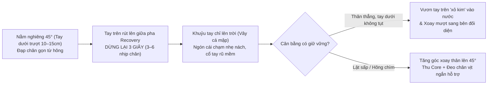

# Shark Fin Drill — Kiểm Tra Cân Bằng Nghiêng & Khóa Khuỷu Cao Recovery

> **Thuộc phần:** `17-drills/` | **Trình độ:** Trung cấp → Nâng cao | **Thời gian đọc:** ~10 phút

## Tổng Quan (Overview)
**Shark Fin Drill** (bài tập Vây Cá Mập) là bài kiểm tra sự thật tàn nhẫn nhưng cực kỳ hiệu quả về **cân bằng thân nghiêng (`40–45°`)** và **độ thả lỏng pha rút tay trên không**. Khi bạn dừng tay rút lại ở giữa không trung trong `2–3 giây` với khuỷu tay chỉ lên trời như chiếc vây cá mập còn bàn tay thả lỏng ngay sát nách, trọng lượng cánh tay trên mặt nước sẽ ngay lập tức "tố cáo" mọi điểm yếu về Core, tay trượt phía trước hay tư thế đầu của bạn!

- **Mục tiêu cốt lõi:** Giữ thân nghiêng `40–45°` vững chắc khi có tải trọng cánh tay trên mặt nước, củng cố tư thế **High-Elbow Relaxed Recovery** và loại bỏ hoàn toàn thói quen ấn tay trượt xuống đáy.
- **Cảm giác đúng:** Toàn bộ thân dưới nước cân bằng êm ái, tay trượt phía trước thẳng hàng không tụt, khuỷu tay trên dựng cao tự nhiên còn bàn tay rũ mềm không một chút gồng cứng.
- **Sai lầm phổ biến nhất:** Nằm sấp bụng phẳng rồi cố bẻ khớp vai vặn khuỷu tay lên trời (gây đau khớp vai), hoặc để hông chìm và chân cắt kéo ngay khi nhấc tay khỏi nước.

---

## Lý Thuyết (Theory)
Trong bơi sải bình thường, khi một cánh tay nặng `~3.5 kg` rời khỏi mặt nước (pha Recovery), nó mất đi lực đẩy Ác-si-mét và trở thành một **tải trọng lệch tâm đè lên mặt trên cơ thể**:
- Nếu cân bằng nghiêng kém và Core lỏng, tải trọng `3.5 kg` này lập tức làm thân bạn bị lật sấp xuống hoặc làm tay trượt phía trước bị ấn tụt xuống đáy để chống đỡ.
- **Shark Fin Drill** cố tình kéo dài khoảnh khắc chịu tải này thành `2–3 giây` (3–6 nhịp chân) để buộc hệ thần kinh phải học cách **giữ thân nghiêng ổn định bằng Core, đầu nhìn đáy và độ vươn dài của tay dưới** mà không cần gồng cánh tay trên!

---

## Cơ Sở Khoa Học (Science)
### Vật Lý & Thủy Động Lực Học (Physics & Hydrodynamics)
- **Cân bằng mô-men khi có tải trên không**: Khi vai trên xoay nổi khỏi mặt nước `45°`, trọng tâm của cánh tay "Vây cá mập" (với khuỷu gập gọn sát nách) nằm **ngay phía trên đường trục dọc của cột sống** (cánh tay đòn ngang $d \approx 0$).
- Nhờ cánh tay đòn $d \approx 0$, tải trọng cánh tay không tạo ra mô-men lật ngang — thân người vẫn đi thẳng tắp như lưỡi dao! Ngược lại, nếu bạn để cẳng tay văng rộng ra ngoài thân, mô-men lật sẽ đánh úp hông bạn ngay lập tức.

### Cơ Sinh Học (Biomechanics)
- **Tư thế khớp vai an toàn**: Góc nghiêng thân `45°` kết hợp ngón cái chạm nhẹ vào vùng nách/sườn trên (bàn tay rũ thẳng dưới khuỷu) đặt chỏm xương cánh tay ở vị trí trung tính hoàn toàn, giải phóng áp lực khỏi cơ delta và cơ thang trên.
- **Thử thách thần kinh–cơ cho tay trượt**: Tay dưới vươn dài ở độ sâu `10–15 cm` phải giữ nguyên trạng thái phẳng lặng suốt `3 giây` dù có thêm tải trọng phía trên — luyện trực tiếp sự kiên định của *Lead Arm* khi thở.

---

## Thực Hành (Practical)
### Tại Sao Kỹ Thuật Này Hiệu Quả (Why It Works)
Shark Fin Drill kết hợp **3 bài tập trong 1**:
1. Kiểm tra cân bằng nghiêng tương tự **Side-Kick**.
2. Kiểm tra sự thả lỏng pha rút tay tương tự **Fingertip Drag**.
3. Khóa đường dẫn gọn sát sườn tương tự **Zipper Drill**.
Chỉ cần làm mượt được Shark Fin Drill, pha Recovery của bạn khi bơi bình thường sẽ tự động nhẹ tênh và gọn gàng tuyệt đối.

### Hướng Dẫn Từng Bước & Cảm Giác Nước (Step-by-Step & Water Cues)
1. **Chuẩn bị tư thế nghiêng chuẩn**: Đeo chân vịt ngắn (Short Fins) khi mới tập. Đạp tường ở tư thế nghiêng trái `45°` (tay trái vươn dài phía trước sâu `10–15 cm`, mắt nhìn thẳng đáy hồ).
2. **Dựng "Vây cá mập"**: Đưa tay phải rút lên từ đùi cho đến khi **ngón cái chạm nhẹ vào vùng hõm nách / xương sườn trên**; khuỷu tay phải hướng thẳng lên trời, bàn tay và các ngón tay buông lỏng mềm mại chỉ xuống mặt nước.
3. **Giữ yên 3 giây (hoặc đếm 6 nhịp chân)**: Trong 3 giây này, kiểm tra 3 điểm:
   - Tay trái phía trước vẫn phẳng ở `10–15 cm` (không tụt xuống).
   - Mặt nhìn đáy (hoặc xoay nhẹ 1 mắt kính chạm nước để lấy hơi nếu cần).
   - Cổ tay phải hoàn toàn thả lỏng (thử lắc nhẹ bàn tay để kiểm chứng!).
4. **Hoàn tất & Đổi bên**: Từ tư thế Vây cá mập, nhẹ nhàng thả cẳng tay phải vươn về trước "xỏ kim" vào vị trí `1 giờ`, đồng thời kéo tay trái xuống, xoay mượt sang nghiêng phải `45°` và dựng Vây cá mập bên trái!

<!-- IMAGE_PROMPT: Clean above-and-underwater split-view sports illustration of Shark Fin Drill: swimmer rotated at 45 degrees with left lead arm gliding horizontally at 15cm depth, right elbow pointed straight up above water like a shark fin while right thumb gently touches the armpit/ribcage with completely limp wrist and dangling fingers. -->

### Mẹo Nâng Cao (Advanced Tips)
- **Kết hợp thở trong tư thế Shark Fin**: Khi đang giữ Vây cá mập 3 giây, hãy thử **xoay nhẹ cằm lên lấy 1 hơi (One-Goggle Rule) rồi úp mặt nhìn đáy lại** mà tay Vây cá mập trên không không hề bị rơi xuống nước! Đây là bài tập đỉnh cao giúp tách biệt hoàn toàn chuyển động cổ khỏi vai và tay.
- **Lắng nghe khớp vai**: Nếu bạn có tiền sử đau vai hoặc độ linh hoạt vai hạn chế, **không ép khuỷu dựng thẳng đứng 90°** — chỉ cần xoay thân đủ `45°` và dựng khuỷu nghiêng thoải mái `60–70°`.

---

## Bài Tập Thực Hành (Drills)
| Biến thể Shark Fin | Mục tiêu cụ thể | Cự ly / Số hiệp | Cảm giác đúng (Cue) |
| :--- | :--- | :--- | :--- |
| **Shark Fin + Short Fins (Giữ 6 nhịp chân)** | Xây nền cân bằng nghiêng & thả lỏng cổ tay | `4 × 25m` (nghỉ 15s) | Thân nổi phẳng lì, bàn tay trên không lắc nhẹ mềm như sợi mì |
| **Shark Fin + One-Goggle Breath** | Tách biệt xoay thở khỏi cánh tay trên không & tay trượt | `4 × 25m` (nghỉ 20s) | Xoay đầu hít hơi gọn mà Vây cá mập vẫn đứng yên trên trời |
| **Shark Fin → Swim Transfer** | Chuyển thẳng cảm giác gọn nhẹ vào sải bơi bình thường | `4 × 50m` (`25m Shark Fin + 25m Swim`) | Pha Recovery ở 25m bơi thường nhẹ bẫng, đi gọn sát sườn |

---

## Phân Tích AI & Video (AI Analysis)
- **Góc quay khuyến nghị:** Chính diện ngang mặt nước (Waterline Front View) và Ngang (Side View).
- **Điểm khớp cần trích xuất (Keypoints):** `lead_wrist`, `recovery_elbow`, `recovery_wrist`, `shoulder_line`, `hip_line`.
- **Ngưỡng phát hiện lỗi tự động:**
  - **Đạt chuẩn:** Góc nghiêng vai–hông duy trì `40–50°` suốt `2–3 giây` giữ Vây; `recovery_elbow` nằm thẳng phía trên `shoulder–hip` (không văng ngang); `lead_wrist` tụt `< 5 cm`.
  - **Cảnh báo lỗi:** Thân lật phẳng về `< 20°` ngay khi nhấc tay; `lead_wrist` cắm sâu `> 30 cm` để giữ nổi.

---

## Lỗi Thường Gặp & Cách Sửa (Common Errors)
| Lỗi thường gặp | Triệu chứng nhận biết | Nguyên nhân gốc | Cách sửa (Correction) |
| :--- | :--- | :--- | :--- |
| **Nằm bụng phẳng cố bẻ khuỷu lên trời** | Đau cấn mặt trước/ngoài khớp vai | Thiếu góc xoay thân `45°` | Xoay cả hông và vai lên `45°` trước khi nhấc khuỷu tay |
| **Gồng cứng bàn tay nắm chặt** | Cẳng tay căng mỏi, mất tác dụng xả lực | Quên thả lỏng sau khi kết thúc pha Push | Chủ động lắc nhẹ cổ tay rũ mềm trong lúc giữ 3 giây |
| **Mất thăng bằng, chìm hông khi dừng tay** | Chân cắt kéo rộng hoặc người chìm xuống đáy | Core thả lỏng, đạp chân quá yếu hoặc đầu ngẩng lên | Đeo chân vịt ngắn, nhìn thẳng đáy hồ, siết nhẹ Core 20–30% |
| **Bàn tay trôi ra sau lưng thay vì sát nách** | Khi đưa tay vào nước bị đập bẹp hoặc vung vòng rộng | Kéo khuỷu tay về phía sau thay vì nhấc lên theo đường sườn | Giữ ngón cái chạm nhẹ đúng vùng hõm nách/sườn trên |

---

## Tự Đánh Giá Tại Hồ (Self Assessment)
- [ ] Tôi có thể giữ tư thế Shark Fin ổn định suốt `6 nhịp chân` ở cả bên trái và bên phải mà không bị lật sấp.
- [ ] Bàn tay và cổ tay ở trên không của tôi hoàn toàn thả lỏng (có thể lắc nhẹ tự do).
- [ ] Tay trượt dưới nước của tôi giữ nguyên độ sâu `10–15 cm` trong suốt 3 giây giữ Vây.
- [ ] Tôi có thể xoay đầu lấy 1 hơi (One-Goggle Rule) trong khi vẫn giữ vững tư thế Vây cá mập.
- [ ] Khớp vai tôi hoàn toàn dễ chịu, không bị đau cấn khi thực hiện bài tập.

---

## Chỉ Số Đo Lường (KPI)
| Chỉ số (Metric) | Người mới | Trung cấp | Nâng cao (`< 1:30/100m`) |
| :--- | :---: | :---: | :---: |
| **Thời gian giữ Shark Fin ổn định (không fins)** | `< 1 giây` | `2–3 giây` | `3–5 giây` cân bằng tuyệt đối 2 bên |
| **Độ ổn định tay trượt trong lúc giữ Vây** | Tụt `> 20 cm` | Tụt `8–12 cm` | Dao động `< 5 cm` |
| **Khả năng xoay thở ngay trong tư thế Shark Fin** | Chưa đạt | Đạt bên thuận | Mượt đều cả 2 bên trái & phải |

---

## Câu Hỏi Thường Gặp (FAQ)
**1. Tôi nên tập Shark Fin có chân vịt hay không chân vịt?**
Hãy bắt đầu với **chân vịt ngắn (Short Fins)** trong 2 tuần đầu để có đủ vận tốc nền giữ hông nổi và tập trung 100% vào độ thả lỏng tay + góc xoay `45°`. Sau khi đã thuần thục, tháo chân vịt ra tập chân trần để thử thách Core ở mức cao nhất!

**2. Shark Fin khác gì với Fingertip Drag?**
**Fingertip Drag** tập trung vào chuyển động *liên tục* từ hông lên tới điểm vào nước; còn **Shark Fin** là phiên bản *dừng tĩnh (Static Pause)* ở điểm cao nhất của Recovery để kiểm tra độ vững của cân bằng nghiêng và sự thả lỏng thực sự của cổ tay.

**3. Nếu vai tôi bị cứng và đau khi dựng Shark Fin thì có bài thay thế không?**
Có! Hãy thay bằng **Zipper Drill** hoặc **Fingertip Drag** với góc khuỷu thoải mái hơn, đồng thời tập bài mở cột sống ngực (*Thoracic Mobility*) ở [Mobility](../19-mobility/shoulder-thoracic-ankle-mobility.md).

---

## Tóm Tắt (Summary)
- **Shark Fin Drill** là bài kiểm tra đỉnh cao cho **cân bằng nghiêng `45°`**, **sự ổn định của tay trượt** và **trạng thái thả lỏng tuyệt đối ở pha Recovery**.
- Quy tắc vàng: **Xoay thân `45°` trước → Khuỷu chỉ lên trời, ngón cái chạm nhẹ nách → Cổ tay rũ mềm 3 giây → Xỏ kim êm ái đổi bên**.

**Liên kết chéo:**
- Chương trước: [Sculling Drill](sculling.md)
- Chương tiếp theo: [6-Kick Switch & Side Kick Drill](six-kick-switch.md)
- Kỹ thuật liên quan: [Pha Rút Tay Thả Lỏng](../11-recovery/relaxed-recovery.md) · [Xoay Trục Dọc](../06-rotation/body-rotation.md)
- Tra cứu thuật ngữ: [Glossary](../24-appendix/glossary.md)

---

## Tài Liệu Tham Khảo (References)
1. Newsome, P., & Young, A. (2012). *Swim Smooth*. Wiley.
2. Laughlin, T. (2004). *Total Immersion*. Fireside.
3. USA Swimming — *Balance & High-Elbow Recovery Drills*.

