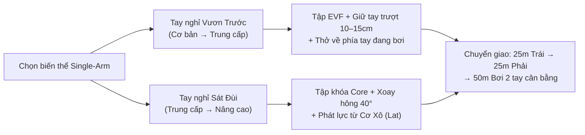

# Single-Arm Freestyle Drill — Cô Lập EVF, Xoay Hông & Cân Bằng Hai Bên

> **Thuộc phần:** `17-drills/` | **Trình độ:** Cơ bản → Nâng cao | **Thời gian đọc:** ~11 phút

## Overview

Khi bơi cả hai tay cùng lúc, não bộ phải xử lý hàng chục tín hiệu đồng thời (tay trái trượt, tay phải kéo, hông xoay, chân đập, đầu thở) — khiến các lỗi ở **bên yếu (bên nghịch)** rất dễ bị che khuất. **Single-Arm Freestyle Drill** (bơi sải 1 tay) là "kính hiển vi kỹ thuật" mạnh mẽ nhất: tách rời hoàn toàn từng cánh tay để bạn tinh chỉnh sắc nét **EVF, lực kéo cơ xô (Lat), pha Push tới đùi, xoay thân đối xứng và kỹ thuật thở bên nghịch**.

- **Mục tiêu cốt lõi:** Phát hiện và xóa bỏ sự mất cân xứng giữa tay trái & tay phải; làm chủ toàn bộ chu trình `Entry → Glide → EVF → Pull → Push → Recovery` trên từng cánh tay độc lập.
- **Cảm giác đúng:** Tay đang bơi thực hiện sải cực kỳ gọn, sâu và chắc nước; thân xoay nhịp nhàng `35–45°` về cả hai phía dù chỉ quạt một bên.
- **Sai lầm phổ biến nhất:** Nằm phẳng lì một bên khi bơi 1 tay, hoặc để tay nghỉ ở phía trước bị chìm sâu xuống đáy khi xoay đầu thở.

---

## Theory

**Single-Arm Freestyle** có **2 biến thể kinh điển** phục vụ 2 mục đích cơ sinh học khác nhau:

1. **Tay nghỉ duỗi thẳng phía trước (*Lead-Arm Extended* — Dành cho Cơ bản → Trung cấp)**:
   - Tay không bơi giữ thẳng ở vị trí `11h` (hoặc `1h`) sâu `10–15 cm` dưới nước.
   - **Lợi ích:** Giữ Trọng tâm (COG) ở phía trước giúp hông dễ nổi; cực kỳ tốt để tập **ổn định tay trượt không bị tụt khi thở** và tập **EVF chuẩn** cho tay đang bơi.
2. **Tay nghỉ áp sát dọc đùi (*Arm-at-Side* — Dành cho Trung cấp → Nâng cao)**:
   - Tay không bơi đặt thẳng dọc sát hông/đùi.
   - **Lợi ích:** Loại bỏ hoàn toàn điểm tựa phía trước → **bắt buộc Core phải khóa phẳng và hông phải xoay mạnh 40–45°** để đưa vai lên thở và kéo nước mạnh mẽ. Rất giống cảm giác truyền lực thực tế từ thân!

---

## Science

### Physics & Hydrodynamics

- **Phát hiện độ lệch công suất trái–phải (*Asymmetry Detection*)**: Đa số người bơi phong trào có sự chênh lệch tốc độ giữa tay thuận và tay nghịch lên tới `15–25%` (vì một bên bị sụp khuỷu hoặc vắt chéo trục giữa). Khi bơi `25m` tay trái rồi `25m` tay phải và so sánh **thời gian & số sải**, sự mất cân bằng lập tức lộ diện bằng con số cụ thể!
- **Tăng cường độ tập trung thần kinh (*Attentional Focus*)**: Nghiên cứu học vận động chỉ ra rằng giảm 50% số bậc tự do vận động (từ 2 tay xuống 1 tay) giúp tốc độ hiệu chỉnh góc khuỷu EVF và góc xoay hông **nhanh hơn 2–3 lần**.

### Biomechanics

Trong Single-Arm Freestyle, một điểm cực kỳ quan trọng thường bị bỏ quên là **hướng thở**:
- **Thở về phía tay ĐANG BƠI** (ví dụ: tay phải đang bơi, tay trái duỗi trước → xoay thở sang **phải**): Mô phỏng chính xác 100% nhịp thở thật khi bơi 2 tay — rèn cảm giác tay trượt phía trước bất động trong khi tay kia hoàn tất Push và xoay vai lên thở.
- **Thở về phía tay NGHỈ (bên đối diện)** (chỉ áp dụng ở biến thể *Arm-at-Side* với Snorkel/hoặc tập xoay đối xứng): Tăng biên độ xoay lồng ngực sang bên không thuận.

---

## Practical

### Why It Works

Single-Arm Freestyle giúp bạn **tự huấn luyện chính mình** ngay dưới nước:
- Khi bạn chỉ bơi tay phải (tay trái vươn trước) và đeo ống thở Snorkel, bạn có thể nhìn thẳng vào tay phải mình xuyên nước, dựng cẳng tay EVF vuông góc rồi kéo qua dưới ngực — nhận phản hồi thị giác ngay lập tức!
- Khi tập tay nghịch nhiều hơn tay thuận (tỷ lệ `2:1`), bạn san phẳng được độ lệch DPS hai bên, giúp đường bơi đi thẳng tắp và bảo vệ khớp vai bên thuận khỏi quá tải.

### Step-by-Step Execution & Water Cues

1. **Duy trì nhịp chân ổn định**: Đạp chân nhẹ đều (hoặc đeo **chân vịt ngắn — Short Fins**) để giữ vận tốc tiến ổn định giữa hai nhịp quạt của một cánh tay.
2. **Xoay thân đủ cả hai bên**: Khi tay phải vươn vào nước phía trước, xoay vai và hông phải xuống `35–40°`. Khi tay phải kéo và đẩy ngang đùi, xoay vai phải nổi lên `35–40°` (và lấy hơi sang phải nếu cần).
3. **Không vội quạt liên tục**: Dành một nhịp trượt ngắn (`0.2s`) ở phía trước để thiết lập độ dài thân rồi mới dựng EVF, kéo chắc qua cơ xô và đẩy hết tới mép đùi.
4. **Cấu trúc chuyển giao chuẩn "25-25-50"**: `25m Tay Trái` + `25m Tay Phải` + `50m Bơi 2 tay` (giữ nguyên cảm giác chắc nước và cân bằng vừa thiết lập).

<!-- IMAGE_PROMPT: Dual-panel underwater side-oblique sports illustration of Single-Arm Freestyle Drill: Top panel shows "Lead-Arm Extended" variation with left arm gliding steady at 15cm depth while right arm executes crisp 110-deg EVF catch; Bottom panel shows "Arm-at-Side" advanced variation emphasizing strong 40-degree hip-shoulder rotation and core bracing. -->

### Advanced Tips

- **Bài tập "Single-Arm bên nghịch 2:1"**: Nếu tay trái của bạn yếu hơn (cần nhiều sải hơn hoặc khó thở bên trái hơn), hãy tập chuỗi `50m Tay Trái + 25m Tay Phải + 50m Bơi 2 tay` trong suốt 3 tuần để san bằng kỹ thuật hai bên.
- **Biến thể "3-Right / 3-Left / 6-Full"**: Trong cùng 1 chiều bể `50m`, bơi 3 sải tay phải → 3 sải tay trái → 6 sải bơi bình thường lặp lại liên tục. Đây là bài tập chuyển giao thần kinh đỉnh cao của các CLB Olympic!

---

## Drills

| Biến thể Single-Arm | Mục tiêu cụ thể | Cự ly / Số hiệp | Cảm giác đúng (Cue) |
| :--- | :--- | :--- | :--- |
| **Single-Arm (Tay nghỉ trước)** | Tinh chỉnh EVF, pha Push & giữ tay trượt ổn định khi thở | `4 × 50m` (`25m Trái + 25m Phải`) | Tay nghỉ phẳng lặng trên mặt bàn nước `10–15 cm`, tay bơi bám nước đặc |
| **Single-Arm (Tay nghỉ sát đùi)** | Rèn khóa Core & xoay hông mạnh mẽ không cần điểm tựa trước | `4 × 50m` (kèm Short Fins) | Hông xoay dứt khoát `40°`, cơ xô gánh trọn lực kéo |
| **3-3-6 Single-Arm Transfer** | Chuyển giao tức thì cảm giác từng tay vào bơi 2 tay tốc độ | `4 × 50m` (nghỉ 20s) | Không cảm thấy sự thay đổi nào về độ bám nước khi chuyển từ 1 tay sang 2 tay |

---

## AI Analysis

- **Góc quay khuyến nghị:** Chính diện dưới nước (Underwater Front View) và Ngang dưới nước (Side View).
- **Keypoints cần trích xuất:** `shoulder`, `elbow`, `wrist`, `hip` của bên đang bơi và bên nghỉ.
- **Ngưỡng phát hiện lỗi tự động:**
  - **Đạt chuẩn:** Chênh lệch thời gian và số sải giữa `25m Tay Trái` và `25m Tay Phải` `< 8%`; góc EVF đạt `100–125°` ở cả hai bên; góc xoay thân đạt `35–45°` dù chỉ bơi 1 tay.
  - **Cảnh báo lỗi:** Chênh lệch thời gian trái–phải `> 15%` (mất cân bằng kỹ thuật nặng); vai bên bơi giữ phẳng `< 15°` (kéo thuần bằng vai).

---

## Common Errors

| Lỗi thường gặp | Triệu chứng nhận biết | Nguyên nhân gốc | Cách sửa (Correction) |
| :--- | :--- | :--- | :--- |
| **Quên xoay thân (Bơi phẳng 1 bên)** | Khó rút tay lên khỏi mặt nước, vai nhanh mỏi | Không có tay đối diện kéo theo nên cơ thể tự nằm phẳng | Chủ động xoay rốn hướng `40°` sang hai bên theo nhịp vào nước và đẩy tay |
| **Tay nghỉ phía trước chìm sâu khi thở** | Đầu nhô cao, người nghiêng ngả, mất đường thẳng | Dùng tay nghỉ ấn xuống nước để nâng đầu lấy hơi | Giữ 1 mắt kính chạm nước khi thở + đeo chân vịt ngắn hỗ trợ độ nổi |
| **Thở ngược về phía tay nghỉ (khi tay nghỉ vươn trước)** | Khó xoay cổ, dễ bị vặn lưng và uống nước | Nhầm hướng thở so với cơ sinh học tự nhiên | Khi tay nghỉ vươn trước, **luôn thở về phía tay ĐANG BƠI** |
| **Đạp chân quá yếu khiến thân chìm** | Bơi 1 tay rất chậm, bị khựng đứng yên giữa các sải | Chỉ có 1 tay tạo lực đẩy nhưng lại đạp chân quá thưa | Giữ nhịp chân đều liên tục hoặc dùng chân vịt ngắn khi mới tập |

---

## Self Assessment

- [ ] Tôi có thể bơi `25m` tay trái và `25m` tay phải với thời gian chênh lệch dưới `2 giây`.
- [ ] Ở biến thể tay nghỉ vươn trước, tay nghỉ của tôi giữ phẳng `10–15 cm` không tụt xuống khi tôi xoay thở.
- [ ] Tôi vẫn duy trì góc xoay hông–vai `35–45°` mượt mà dù chỉ quạt 1 bên tay.
- [ ] Tôi thực hiện được bài `3-Right / 3-Left / 6-Full` liên tục 50m không bị loạn nhịp hay chìm hông.
- [ ] Tôi cảm nhận rõ cơ xô (Lat) và pha Push tới mép đùi ở cả hai tay như nhau.

---

## KPI

| Chỉ số (Metric) | Người mới | Trung cấp | Nâng cao (`< 1:30/100m`) |
| :--- | :---: | :---: | :---: |
| **Chênh lệch thời gian 25m Tay Trái vs Tay Phải** | `> 4 giây` | `2–3 giây` | `< 1.5 giây` |
| **Góc xoay thân khi bơi Single-Arm (Arm-at-Side)** | `< 20°` | `25–35°` | `35–45°` |
| **Chênh lệch góc EVF giữa 2 tay** | `> 20°` | `10–15°` | `< 8°` |

---

## FAQ

**1. Nên bắt đầu bằng biến thể tay nghỉ vươn trước hay tay nghỉ sát đùi?**
Luôn bắt đầu bằng **tay nghỉ vươn trước** (nhất là nếu bạn chưa quen bơi 1 tay hoặc hông còn dễ chìm). Khi đã làm chủ tốt độ ổn định và EVF, hãy nâng cấp sang **tay nghỉ sát đùi** để rèn sức mạnh Core và độ sắc của nhịp xoay hông.

**2. Tôi có thể dùng Pull Buoy khi tập Single-Arm Drill không?**
Có thể dùng ở biến thể tay nghỉ vươn trước nếu bạn muốn tập trung 100% vào góc khuỷu EVF (kết hợp Snorkel). Tuy nhiên, hãy tập không Pull Buoy (chỉ dùng chân trần hoặc Short Fins) ở ít nhất 50% thời lượng để rèn khả năng tự cân bằng Core.

**3. Mỗi tuần nên tập Single-Arm Drill bao nhiêu mét?**
Khoảng `200–300m/tuần` (chia vào phần khởi động kỹ thuật theo cấu trúc `25m Trái / 25m Phải / 50m Bơi thường`) là đủ để duy trì sự sắc bén và đối xứng hoàn hảo cho cả hai tay.

---

## Summary

- **Single-Arm Freestyle** là bài tập cô lập tối ưu để sửa lệch trái–phải, tinh chỉnh **EVF**, kéo cơ xô và ổn định tay trượt khi thở.
- Kết hợp 2 cấp độ: **Tay nghỉ vươn trước** (xây nền tảng & cân bằng thở) → **Tay nghỉ sát đùi** (rèn Core & xoay hông `40°`).
- Chuyển giao nhanh nhất bằng chuỗi **`3-Right / 3-Left / 6-Full`** hoặc **`25-25-50`**.

**Liên kết chéo:**
- Chương trước: [Fingertip Drag Drill](fingertip-drag.md)
- Chương tiếp theo: [Sculling (Front, Mid, Rear)](sculling.md)
- Kỹ thuật liên quan: [High Elbow Catch (EVF)](../09-catch/early-vertical-forearm.md) · [Xoay Trục Dọc](../06-rotation/body-rotation.md)
- Tra cứu thuật ngữ: [Glossary](../24-appendix/glossary.md)

---

## References

1. Maglischo, E. W. (2003). *Swimming Fastest*. Human Kinetics.
2. Newsome, P., & Young, A. (2012). *Swim Smooth*. Wiley.
3. USA Swimming — *Single-Arm Freestyle & Symmetry Development Protocols*.

