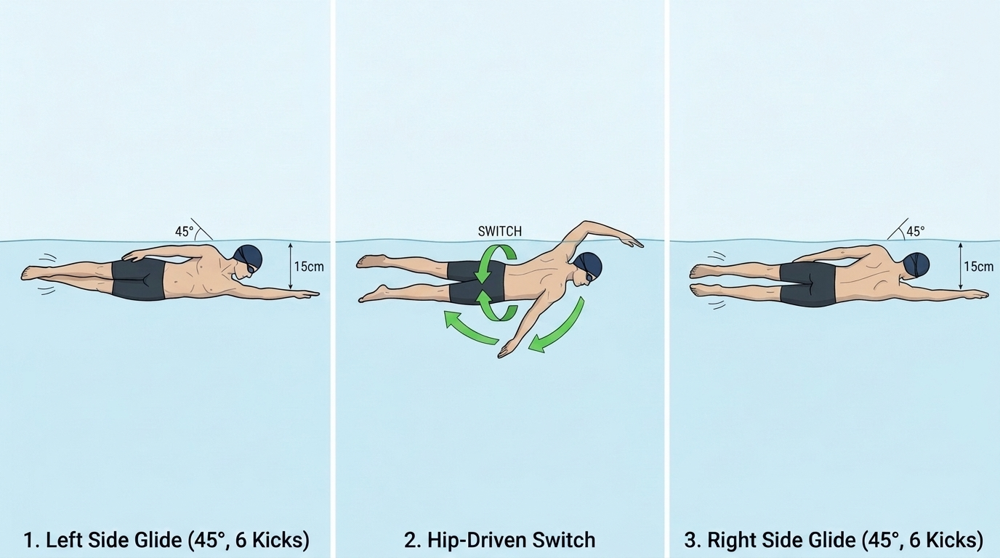

# 6-Kick Switch & Side Kick Drill — Khóa Trục Xoay Hông & Truyền Lực Từ Thân

> **Thuộc phần:** `17-drills/` | **Trình độ:** Cơ bản → Nâng cao | **Thời gian đọc:** ~11 phút

## Tổng Quan (Overview)
Nếu chỉ được giữ lại **một bài tập duy nhất** để xây dựng triết lý **"bơi bằng thân (Core + Hông), tay nhẹ như không"**, bài tập đó chính là **6-Kick Switch** (kết hợp nền tảng **Side Kick**). Đây là bài Drill xương sống của cả 3 trường phái (Total Immersion, SwimSmooth và Olympic): nó rèn đồng thời **cân bằng nghiêng `45°`, giữ đầu bất động, kích hoạt Core, xoay hông dứt khoát và đồng bộ chuỗi truyền lực** vào mỗi sải kéo.

- **Mục tiêu cốt lõi:** Thành thạo tư thế lướt nghiêng **Side Kick (`45°`)**, sau đó dùng một cú **bật xoay hông dứt khoát sau đúng 6 nhịp chân** để kéo sải tay và khóa tư thế nghiêng sang bên đối diện.
- **Cảm giác đúng:** Cơ thể lướt nghiêng sắc gọn như lưỡi dao trong 6 nhịp chân, rồi "bật" chuyển trục sang bên kia tạo cảm giác thân lao vút về trước mà tay không cần gồng sức.
- **Sai lầm phổ biến nhất:** Nằm nghiêng quá sâu (`90°` gần lật ngửa), ngẩng đầu nhấc tai khỏi nước khi thở, hoặc chỉ dùng tay quạt chuyển bên mà quên xoay hông trước.

---

## Lý Thuyết (Theory)
Hệ thống tiến trình từ **Side Kick → 6-Kick Switch → 3-Kick Switch → Full Swim** là lộ trình học vận động kinh điển giúp não bộ cài đặt tự động cơ chế **Hip-Driven Swimming**:

1. **Bước 1 — Side Kick (Đạp nghiêng 25m cố định 1 bên)**: Cô lập hoàn toàn tư thế cân bằng nghiêng `45°`, trục đầu–hông thẳng và nhịp thở *One-Goggle Rule*.
2. **Bước 2 — 6-Kick Switch (6 nhịp chân → 1 sải chuyển bên)**: Thêm pha chuyển đổi năng động (*Dynamic Switch*), dạy hông **chủ động bật xoay** dẫn động pha kéo tay EVF và pha vươn tay phía trước.
3. **Bước 3 — 3-Kick Switch (3 nhịp chân → 1 sải chuyển bên)**: Rút ngắn thời gian giữ nghiêng xuống còn một nửa — đưa nhịp xoay về gần sát với nhịp bơi 6-beat hoặc nhịp Opposition thực tế!

---

## Cơ Sở Khoa Học (Science)
### Vật Lý & Thủy Động Lực Học (Physics & Hydrodynamics)
- **Cảm nhận trực tiếp giảm Wave Drag**: Trong tư thế **Side Kick (`45°`)** với 1 tay vươn dài phía trước `10–15 cm` và 1 tay áp sát đùi, bề ngang chắn nước của bạn thu nhỏ đáng kể so với nằm sấp. Bạn sẽ cảm nhận cơ thể cắt nước nhẹ nhàng hơn hẳn chỉ với một nhịp đạp chân rất êm.
- **Bùng nổ động năng xoay (*Rotational Impulse*)**: Ở nhịp chân thứ 6 của **6-Kick Switch**, cú đạp chân đối bên kết hợp xoay hông từ `+45°` sang `-45°` (tổng biên độ `90°`) phóng thích toàn bộ thế năng của dải cơ chéo sau (*Posterior Oblique Sling*), đẩy thân người đi xa hơn **20–30%** so với một sải tay kéo phẳng!

### Cơ Sinh Học (Biomechanics)
Sự phân công nhiệm vụ chuẩn xác ở khoảnh khắc **"Switch" (nhịp chân thứ 6)**:
- **Đầu**: Giữ **bất động tuyệt đối**, mắt dán chặt vào đường gạch đen đáy hồ (trừ khi thực hiện nhịp thở gọn).
- **Hông & Core**: Hông đang ở trên xoay mạnh xuống dưới `45°`, kéo theo khung sườn xoay đồng trục.
- **Tay dưới (đang vươn trước)**: Dựng EVF và kéo mạnh theo lực xoay hông tới sát đùi (thành tay nghỉ mới).
- **Tay trên (đang áp đùi)**: Rút gọn thả lỏng trên không và "xỏ kim" vươn thẳng về trước `10–15 cm` (thành tay trượt mới).

---

## Thực Hành (Practical)
### Tại Sao Kỹ Thuật Này Hiệu Quả (Why It Works)
**6-Kick Switch** chữa dứt điểm cùng lúc **4 căn bệnh lớn nhất của người bơi phong trào**:
1. **Bơi thân phẳng (Flat Swimming)**: Ép cơ thể làm quen và yêu thích cảm giác xoay `40–45°`.
2. **Đau vai do kéo bằng tay**: Dạy não phát lực từ cú bật xoay của hông trước khi tay kéo.
3. **Mất cân bằng hai bên**: Buộc cả bên thuận lẫn bên nghịch phải giữ nghiêng đúng 6 nhịp như nhau.
4. **Hông chìm khi thở**: Tập thở ngay trong tư thế Side Kick mà không cần nâng đầu hay ấn tay trước.

### Hướng Dẫn Từng Bước & Cảm Giác Nước (Step-by-Step & Water Cues)
1. **Thiết lập Side Kick chuẩn (`45°`, KHÔNG phải `90°`)**:
   - Tay trái vươn thẳng trước vai trái sâu `10–15 cm`, tay phải đặt thoải mái dọc mép đùi phải.
   - Xoay cả vai và hông nghiêng **`45°`** (rốn hướng chéo xuống góc tường–đáy hồ, không chổng thẳng ngang tường `90°`).
   - Mắt nhìn thẳng xuống đáy hồ, tai trái áp nhẹ gần cánh tay trái.
2. **Đếm đúng 6 nhịp chân gọn**: Đạp chân sải nhỏ, nhanh và đều từ hông (hướng đạp vuông góc với mặt phẳng bụng của bạn, tức hơi chéo `45°` chứ không đá cắt kéo).
3. **Thực hiện cú "Switch" sắc bén**: Đúng nhịp chân thứ 6, xoay dứt khoát hông phải xuống `45°` đồng thời đổi vị trí hai tay, rồi **lập tức khóa im tư thế nghiêng phải** và đếm 6 nhịp tiếp theo.
4. **Thở đúng lúc**: Nếu cần thở khi đang nghiêng trái `45°`, chỉ xoay nhẹ cằm sang phải lấy hơi (One-Goggle Rule) ở nhịp chân 3–4, úp mặt nhìn đáy ở nhịp 5, rồi thực hiện cú Switch ở nhịp 6!

<!-- IMAGE_PROMPT: Technical 3-frame underwater front-quarter sequence diagram of 6-Kick Switch Drill: Frame 1 Balanced 45-deg left side glide (left arm extended 15cm deep, right arm at thigh, head looking down, 6 crisp kicks); Frame 2 Dynamic hip-driven Switch rotation transferring torque to EVF pull; Frame 3 Locked 45-deg right side glide with straight spine alignment. -->

### Mẹo Nâng Cao (Advanced Tips)
- **Đừng dừng hẳn tay trượt trước khi xoay — hãy kết hợp Snorkel trong tuần đầu**: Đeo ống thở Snorkel + chân vịt ngắn giúp bạn giữ đầu đứng yên như tượng và cảm nhận rõ cú "bật" của hông mạnh mẽ đến mức nào!
- **Chuyển từ 6-Kick Switch → 3-Kick Switch → Full Swim (`75m` hoặc `100m`)**:
  - `25m` 6-Kick Switch (xoay sâu `45°`)
  - `25m` 3-Kick Switch (tăng nhịp, xoay gọn `40°`)
  - `25–50m` Bơi thường (mang nguyên nhịp bật xoay hông vào tốc độ CSS!).

---

## Bài Tập Thực Hành (Drills)
| Biến thể | Mục tiêu cụ thể | Cự ly / Số hiệp | Cảm giác đúng (Cue) |
| :--- | :--- | :--- | :--- |
| **Side Kick (Cố định 1 bên)** | Làm chủ góc nghiêng `45°`, cân bằng nổi & thở 1 mắt kính | `4 × 25m` (2 trái, 2 phải, kèm Short Fins) | Thân thẳng tắp, tay dưới không tụt khi xoay cằm thở |
| **6-Kick Switch (Cổ điển)** | Xây phản xạ bật xoay hông dẫn động sải tay | `6 × 25m` (nghỉ 15s) | 6 nhịp êm ái → 1 cú xoay hông "bật" phóng thân lao tới |
| **6-3-Swim Progression** | Chuyển giao trực tiếp nhịp xoay vào bơi tốc độ `< 1:30/100m` | `4 × 75m` (`25m 6-KS + 25m 3-KS + 25m Swim`) | Giữ nguyên sức mạnh xoay hông và cảm giác tay nhẹ khi sang 25m Swim |

---

## Phân Tích AI & Video (AI Analysis)
- **Góc quay khuyến nghị:** Chính diện dưới nước (Underwater Front View) và Ngang dưới nước (Side View).
- **Keypoints cần trích xuất:** `shoulder_line`, `hip_line`, `nose`, `lead_wrist`, `ankle`.
- **Ngưỡng phát hiện lỗi tự động:**
  - **Đạt chuẩn:** Góc nghiêng thân giữ ổn định `40–50°` suốt 6 nhịp chân; đầu giữ góc xoay `< 5°` (ngoài khung hình thở); độ trễ giữa xoay hông và pha kéo tay `< 60 ms`.
  - **Cảnh báo lỗi:** Góc nghiêng `> 70°` (lật ngửa); tay kéo trước rồi hông mới lờ đờ xoay theo sau; chân đá cắt kéo rộng khi thực hiện cú Switch.

---

## Lỗi Thường Gặp & Cách Sửa (Common Errors)
| Lỗi thường gặp | Triệu chứng nhận biết | Nguyên nhân gốc | Cách sửa (Correction) |
| :--- | :--- | :--- | :--- |
| **Xoay quá sâu (80–90°)** | Gần như nằm ngửa nhìn trần nhà, rất khó đổi bên | Hiểu nhầm "nghiêng người" là nằm nghiêng hẳn 90° | Giới hạn góc nghiêng ở **`45°`** (rốn chiếu xuống góc giữa đáy và tường bên) |
| **Ngẩng đầu nhìn tay trước** | Chân chìm nhanh, cổ mỏi | Muốn quan sát xem tay trước có thẳng không | Tin vào cảm giác cơ thể, mắt luôn nhìn thẳng xuống gạch đáy hồ |
| **Quạt tay trước rồi mới xoay hông** | Tay cảm thấy nặng, mất hiệu ứng "bật" của thân | Chưa kết nối được chuỗi truyền lực từ hông | Nghĩ tới việc **"đập hông trên xuống"** ngay trước khi bắt đầu kéo tay dưới |
| **Chân ngừng đạp trong lúc Switch** | Hông tụt xuống, cơ thể khựng lại giữa pha chuyển | Mải tập trung đổi tay nên quên duy trì nhịp chân | Đạp chân liên tục xuyên suốt cú Switch, đặc biệt nhịp chân thứ 6 phải dứt khoát |

---

## Tự Đánh Giá Tại Hồ (Self Assessment)
- [ ] Tôi có thể thực hiện `25m Side Kick` mỗi bên ở đúng góc `45°` (không lật `90°`) với mắt nhìn thẳng đáy hồ.
- [ ] Trong **6-Kick Switch**, đầu tôi giữ bất động hoàn toàn khi xoay vai và hông chuyển bên.
- [ ] Tôi cảm nhận rõ cú xoay hông ở nhịp chân thứ 6 là nguồn lực chính đẩy tay kéo đi nhẹ nhàng.
- [ ] Góc xoay và độ ổn định của tôi ở bên trái và bên phải cân bằng như nhau.
- [ ] Khi chuyển từ `3-Kick Switch` sang `25m Swim`, cảm giác lực từ thân vẫn được giữ nguyên vẹn.

---

## Chỉ Số Đo Lường (KPI)
| Chỉ số (Metric) | Người mới | Trung cấp | Nâng cao (`< 1:30/100m`) |
| :--- | :---: | :---: | :---: |
| **Góc nghiêng thân trong 6 nhịp giữ** | `< 25°` hoặc `> 75°` | `35–55°` | `40–48°` ổn định 2 bên |
| **Số sải tay / 25m trong 6-Kick Switch** | `10–14 sải` (đếm vội) | `7–9 sải` | `5–7 sải` (lướt cực dài) |
| **Độ lệch thời gian Side Kick 25m Trái vs Phải** | `> 5 giây` | `2–4 giây` | `< 1.5 giây` |

---

## Câu Hỏi Thường Gặp (FAQ)
**1. Nên đếm 6 nhịp chân bằng 1 chân hay tổng cả 2 chân?**
Đếm **tổng cả 2 chân**: `1 (trái) - 2 (phải) - 3 (trái) - 4 (phải) - 5 (trái) - 6 (phải) → SWITCH!`. Một nhịp 6 lần chuẩn chỉ mất khoảng `2–2.5 giây`.

**2. Tại sao tôi tập 6-Kick Switch mà bị đau nhẹ vùng cổ khi xoay thở?**
Vì bạn đang xoay đầu quá nhiều sang trần nhà trong khi vai vẫn nằm quá phẳng! Khi thân đã nghiêng sẵn `45°`, bạn chỉ cần xoay nhẹ cằm thêm `20–30°` là miệng đã nằm gọn trên mặt nước để hít hơi không hề mỏi cổ.

**3. 6-Kick Switch có thể tập không cần chân vịt không?**
Hoàn toàn được! Hãy dùng chân vịt ngắn ở 2 tuần đầu để làm quen tư thế `45°` chuẩn xác, sau đó tập chân trần để rèn sức bền nhịp chân và Core tối đa.

---

## Tóm Tắt (Summary)
- **Side Kick → 6-Kick Switch → 3-Kick Switch** là lộ trình vàng để cài đặt thói quen **bơi bằng thân (Hip-Driven)** và xoay trục dọc `40–45°`.
- 3 điểm khóa thành công: **Góc nghiêng `45°` (không `90°`) + Đầu nhìn đáy bất động + Hông chủ động bật xoay trước khi tay kéo**.

**Liên kết chéo:**
- Chương trước: [Shark Fin Drill](shark-fin.md)
- Chương tiếp theo: [Tarzan, Zipper & Dog Paddle Drill](tarzan-zipper-dog-paddle.md)
- Kỹ thuật liên quan: [Xoay Trục Dọc](../06-rotation/body-rotation.md) · [Chuỗi Truyền Lực](../02-biomechanics/kinetic-chain.md)
- Tra cứu thuật ngữ: [Glossary](../24-appendix/glossary.md)

---

## Tài Liệu Tham Khảo (References)
1. Laughlin, T. (2004). *Total Immersion*. Fireside.
2. Newsome, P., & Young, A. (2012). *Swim Smooth*. Wiley.
3. USA Swimming — *6-Kick Switch & Rotational Mechanics Curriculum*.

