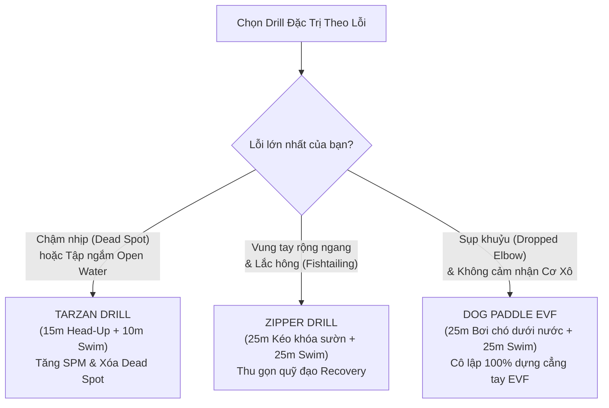

# Bộ 3 Drill Đặc Trị: Tarzan (Head-Up), Zipper & Dog Paddle

> **Thuộc phần:** `17-drills/` | **Trình độ:** Cơ bản → Nâng cao | **Thời gian đọc:** ~11 phút

## Tổng Quan (Overview)
Bên cạnh các bài tập nền tảng về cân bằng và nhịp điệu, 3 bài tập đặc trị **Tarzan (Head-Up Freestyle)**, **Zipper Drill** và **Dog Paddle (Bơi Chó EVF)** là những "công cụ phẫu thuật chính xác" giúp giải quyết dứt điểm 3 bài toán cụ thể: **(1) Tăng nhịp tay & Định hướng Open Water**, **(2) Thu gọn quỹ đạo rút tay sát sườn**, và **(3) Cô lập tuyệt đối kỹ thuật dựng cẳng tay sớm EVF**.

- **Mục tiêu cốt lõi:** Hiểu chính xác mục đích, kỹ thuật và thời điểm kê đơn cho từng bài trong bộ 3 *Tarzan*, *Zipper* và *Dog Paddle*.
- **Cảm giác đúng:** Mỗi bài tập mang lại phản hồi cơ thể ngay lập tức (*Instant Feedback*) — làm sai là thấy nặng/khựng ngay, làm đúng là người lập tức lướt vọt đi.
- **Sai lầm phổ biến nhất:** Tập *Tarzan* quá dài làm đau thắt lưng, hoặc tập *Dog Paddle* nhưng lại đẩy tay xuống đáy thay vì dựng cẳng tay EVF ra sau.

---

## Lý Thuyết (Theory)
Mỗi bài trong bộ 3 này tấn công vào một nút thắt kỹ thuật riêng biệt:

| Tên Drill | Vấn đề đặc trị | Cơ chế tác động | Đối tượng ưu tiên |
| :--- | :--- | :--- | :--- |
| **1. Tarzan (Head-Up Freestyle)** | Chậm nhịp (Over-Gliding), tay trượt yếu, kỹ năng ngắm phao Open Water | Giữ đầu nổi nhìn thẳng về trước → hông có xu hướng chìm → **buộc phải tăng nhịp tay (SPM), kích hoạt 6-beat kick mạnh và vào nước gọn trước vai** | Open Water, Triathlete, Water Polo, Overgliders |
| **2. Zipper Drill (Kéo khóa áo)** | Vung tay rộng ngang (*Wide Swinging*), lắc hông (*Fishtailing*) | Ép ngón cái trượt sát dọc đường may sườn lên nách → **buộc vai xoay `40°` và thu gọn tuyệt đối quỹ đạo Recovery** | Người bơi *Swinger*, người hay mỏi vai & lắc chân |
| **3. Dog Paddle (Underwater EVF)** | Sụp khuỷu (*Dropped Elbow*), trượt nước, không dùng cơ xô | Giữ 100% hai tay dưới nước (không rút lên không khí) → **buộc phải giữ khuỷu cao và dựng cẳng tay EVF mới tiến được về trước** | Người bị sụp khuỷu, người mới học cảm giác kéo cơ xô |

---

## Cơ Sở Khoa Học (Science)
### Vật Lý & Thủy Động Lực Học (Physics & Hydrodynamics)
1. **Tarzan Drill (Tải lực cản chủ động)**: Khi ngẩng đầu nhìn thẳng về trước, góc nghiêng thân tăng lên `15–20°`, diện tích cản $A$ tăng mạnh. Để vẫn tiến được về phía trước, hệ thần kinh bắt buộc phải **xóa bỏ mọi điểm chết (Dead Spot)**, rút ngắn pha trượt về `0` và tăng mật độ lực đẩy liên tục. Khi bạn hạ đầu xuống bơi bình thường ngay sau `15m Tarzan`, lực cản đột ngột giảm 50% khiến cơ thể lao vút đi với cảm giác nhẹ tênh!
2. **Zipper Drill (Tối thiểu hóa mô-men văng ngang)**: Kéo ngón cái sát sườn đưa khối lượng cánh tay về sát trục dọc nhất có thể ($r \to \min$), triệt tiêu hoàn toàn lực văng làm lệch hông.
3. **Dog Paddle (Tối đa hóa hiệu suất EVF $\eta_p$)**: Vì cánh tay phải đưa ngược về trước *ngay dưới nước* (tạo thêm lực cản ngược ở pha hồi), cách duy nhất để tiến về trước mượt mà là pha kéo phải có **hệ số đẩy EVF cực lớn** (dựng cẳng tay vuông góc) còn pha đưa tay về trước phải xoay nghiêng cạnh bàn tay xẻ nước thật mỏng!

### Cơ Sinh Học (Biomechanics)
- **An toàn cột sống ở Tarzan Drill**: Không bao giờ bơi Tarzan liên tục quá `15–25m/hiệp`! Giữ mắt chỉ vừa nổi ngang mặt nước (cằm vẫn chạm nước, kiểu "mắt cá sấu" *Alligator Eyes*), không nhấc cả ngực lên khỏi nước để tránh quá tải cột sống cổ và thắt lưng.
- **Kích hoạt Cơ Xô ở Dog Paddle**: Không có đà vung của pha Recovery trên không, toàn bộ lực kéo trong Dog Paddle phải xuất phát thuần túy từ **dựng cẳng tay EVF + co rút cơ lưng rộng (Lat)**.

---

## Thực Hành (Practical)
### Tại Sao Kỹ Thuật Này Hiệu Quả (Why It Works)
Cả 3 bài Drill này đều tuân theo nguyên tắc **phản hồi tự nhiên không cần HLV đứng trên bờ nhắc**:
- Làm **Tarzan** mà tay vắt chéo? Bạn nhìn thấy ngay tay mình chắn trước mặt!
- Làm **Zipper** mà quên xoay vai? Ngón cái sẽ không thể kéo sát dọc đường sườn lên tới nách!
- Làm **Dog Paddle** mà sụp khuỷu? Cơ thể lập tức đứng im tại chỗ!

### Hướng Dẫn Từng Bước & Cảm Giác Nước (Step-by-Step & Water Cues)
#### 1. Tarzan (Head-Up Freestyle)
- Giữ **cằm sát mặt nước**, mắt nhìn thẳng về phía tường đích (như cá sấu rình mồi).
- Đạp chân 6-beat nhanh gọn để giữ hông không tụt quá sâu.
- Quạt tay nhịp nhanh, dứt khoát (không trượt lâu), nhìn trực tiếp thấy hai tay vào nước rộng đúng **11 giờ & 1 giờ** (trị Crossover cực tốt!).
- Chỉ bơi **`12–15m` Tarzan**, sau đó hạ ngay đầu xuống đáy hồ bơi **`10–35m` bình thường** để tận hưởng cảm giác bùng nổ tốc độ.

#### 2. Zipper Drill
- Sau khi hoàn tất pha Push ngang đùi, giữ **đầu ngón cái chạm nhẹ vào mép quần bơi → kéo thẳng lên dọc theo đường may áo bên sườn → lên tới hõm nách** (giống động tác kéo khóa áo khoác), khuỷu tay dẫn cao hướng lên trời.
- Tại hõm nách, thả nhẹ cẳng tay vươn về trước "xỏ kim" vào vị trí `11h / 1h`.

#### 3. Dog Paddle (EVF Underwater)
- Đeo **Snorkel** và kẹp **Pull Buoy** (tập trung 100% vào tay).
- Vươn hai tay thẳng phía trước sâu `15 cm` dưới nước.
- Luân phiên từng tay: giữ khuỷu tay cao gần mặt nước, **dựng cẳng tay thẳng đứng 90°** và kéo mạnh bằng cơ xô về ngang ngực/bụng → lập tức xoay cạnh tay mỏng (ngón cái hướng lên) lướt nhẹ dưới nước đưa tay trở lại phía trước.

<!-- IMAGE_PROMPT: Clean 3-panel technical sports illustration: Panel 1 Tarzan Drill (chin at waterline, alligator eyes sighting forward, rapid high-cadence arms entering at 11 & 1 o'clock); Panel 2 Zipper Drill (thumb tracing straight up the ribcage to armpit with high elbow); Panel 3 Dog Paddle Underwater EVF (with snorkel & pull buoy, hands staying underwater executing crisp 90-degree vertical forearm catch). -->

### Mẹo Nâng Cao (Advanced Tips)
- **Tarzan cho Open Water**: Biến thể `6 sải đầu úp + 2 sải Tarzan (ngắm mục tiêu)` mô phỏng chính xác 100% kỹ thuật **Sighting** trong thi đấu Triathlon & Open Water (xem [Open Water Skills](../15-open-water/open-water-skills.md)).
- **Kết hợp Dog Paddle → Fist Swim → Regular Swim**: Chuỗi `25m Dog Paddle + 25m Fist Swim + 25m Swim` là "bài tập hủy diệt lỗi sụp khuỷu" hiệu quả nhất, thường dùng ngay đầu buổi tập EVF.

---

## Bài Tập Thực Hành (Drills)
| Tên Drill | Cấu trúc khuyến nghị | Tần suất / Cự ly | Cảm giác đúng (Cue) |
| :--- | :--- | :--- | :--- |
| **Tarzan → Fast Swim** | `4 × 25m` (`12m Tarzan + 13m Fast Swim`, nghỉ 20s) | 1 buổi/tuần | Khi hạ đầu xuống ở mét 12, cảm giác thân lao vút như tên lửa |
| **Zipper → Fingertip Drag → Swim** | `3 × 75m` (`25m Zipper + 25m Drag + 25m Swim`) | 1–2 buổi/tuần | Quỹ đạo rút tay đi thẳng tắp sát sườn, hông không hề lắc |
| **Dog Paddle EVF → Swim** | `4 × 50m` (`25m Dog Paddle + 25m Swim`, Snorkel + Pull Buoy) | 2 buổi/tuần | Nhìn rõ cẳng tay dựng 90° ngay trước mặt, cơ xô căng chắc rõ rệt |

---

## Phân Tích AI & Video (AI Analysis)
- **Góc quay khuyến nghị:** Chính diện (Front View) cho Tarzan & Dog Paddle; Ngang trên mặt nước (Above-Water Side View) cho Zipper.
- **Điểm khớp cần trích xuất (Keypoints):**
  - *Tarzan*: `chin_y` sát `waterline_y`; `entry_wrist_x` không vượt `midline_x`.
  - *Zipper*: Khoảng cách `recovery_thumb` đến `torso_side` `< 5 cm` từ hông lên nách.
  - *Dog Paddle*: Góc khuỷu EVF `95–115°`, `elbow_y` cao hơn `wrist_y` `≥ 25 cm`.

---

## Lỗi Thường Gặp & Cách Sửa (Common Errors)
| Lỗi thường gặp | Triệu chứng nhận biết | Nguyên nhân gốc | Cách sửa (Correction) |
| :--- | :--- | :--- | :--- |
| **Bơi Tarzan quá lâu (> 25m) hoặc ngẩng cả ngực** | Đau nhói thắt lưng dưới và mỏi cứng cổ | Cố nhô đầu quá cao khỏi mặt nước gây võng lưng sâu | Giữ cằm chạm mặt nước, giới hạn tối đa `12–15m` mỗi lần rồi úp đầu ngay |
| **Kéo Zipper nhưng khuỷu tay vẫn tụt thấp** | Ngón cái chạm sườn nhưng cẳng tay nằm ngang sát nước | Không xoay vai lên đủ `35–45°` | Xoay vai cao hơn và chủ động hướng mũi khuỷu tay lên trần nhà |
| **Dog Paddle nhưng đẩy tay xuống đáy** | Đầu và ngực nhấp nhô lên xuống, không tiến nhanh | Kéo thẳng tay thay vì gập khuỷu dựng cẳng tay EVF | Đeo Snorkel nhìn trực tiếp xuống tay, ép cẳng tay dựng vuông góc hướng về phía chân |
| **Dog Paddle tạo lực cản ngược khi đưa tay về trước** | Tiến được 1 bước lại bị hãm lùi nửa bước | Đưa cả lòng bàn tay úp vuông góc đẩy ngược về phía trước | Xoay cạnh bàn tay (mũi ngón tay) chém mỏng lướt êm về trước |

---

## Tự Đánh Giá Tại Hồ (Self Assessment)
- [ ] Khi tập **Tarzan** (`12–15m`), cằm tôi vẫn chạm mặt nước và lưng dưới không hề bị đau mỏi.
- [ ] Tôi nhìn thấy rõ hai bàn tay mình vào nước trên 2 đường ray rộng bằng vai trong bài Tarzan.
- [ ] Trong **Zipper Drill**, ngón cái tôi lướt thẳng dọc sườn lên nách một cách tự nhiên nhờ xoay vai `40°`.
- [ ] Trong **Dog Paddle** (với Snorkel & Pull Buoy), tôi tiến đều về trước bằng cách dựng cẳng tay EVF `90°` mà không cần đạp chân.
- [ ] Tôi luôn bơi chuyển giao ngay sau mỗi bài Drill để mang cảm giác đúng vào sải bơi thật.

---

## Chỉ Số Đo Lường (KPI)
| Chỉ số (Metric) | Người mới | Trung cấp | Nâng cao (`< 1:30/100m`) |
| :--- | :---: | :---: | :--- |
| **Tarzan 15m (duy trì nhịp tay cao, không Crossover)** | Hụt hơi sau 8m | Đạt 15m ổn định | Đạt 15m sắc gọn → bứt tốc mượt 10m cuối |
| **Zipper 25m (ngón cái sát sườn, không lắc hông)** | Chạm đứt quãng | Mượt bên thuận | Mượt đều 100% cả 2 bên |
| **Dog Paddle EVF 25m (Pull Buoy, không đạp chân)** | `> 45 giây` | `32–40 giây` | `< 28 giây` (cảm nhận cơ xô cực rõ) |

---

## Câu Hỏi Thường Gặp (FAQ)
**1. Người bị thoát vị đĩa đệm hoặc đau lưng dưới có nên tập Tarzan Drill không?**
**Không nên!** Hãy bỏ qua Tarzan Drill để bảo vệ cột sống thắt lưng; thay vào đó dùng **Tempo Trainer** để tăng nhịp tay và tập ngắm mục tiêu nhẹ nhàng (*Alligator Eyes Sighting*) trong `0.5 giây` khi cần bơi Open Water.

**2. Tập Dog Paddle có làm hỏng thói quen pha đẩy (Push) không?**
Không, miễn là bạn luôn bơi chuyển giao `25m` bơi thường (với pha Push chạm đùi đầy đủ) ngay sau `25m Dog Paddle`. Dog Paddle chỉ tập trung cô lập 50% đầu của pha dưới nước (Catch → Mid-Pull).

**3. Nên chọn Zipper Drill hay Fingertip Drag để sửa lỗi vung tay rộng?**
Nếu bạn bị vung tay rộng **rất nặng** (*Swinger*), hãy bắt đầu bằng **Zipper Drill** trong 1–2 tuần vì tín hiệu xúc giác (ngón cái chạm trực tiếp lên sườn) cực kỳ rõ ràng. Sau đó chuyển sang **Fingertip Drag** để tăng độ thả lỏng cổ tay.

---

## Tóm Tắt (Summary)
- **Tarzan (12–15m)**: Vũ khí tăng nhịp SPM, xóa *Dead Spot*, trị *Crossover* và tập ngắm mục tiêu Open Water.
- **Zipper Drill**: Tín hiệu xúc giác dọc sườn trị dứt điểm lỗi vung tay rộng và lắc hông.
- **Dog Paddle EVF**: Công cụ cô lập 100% pha dựng cẳng tay thẳng đứng và kích hoạt cơ xô (Lat) ngay trước mắt bạn.

**Liên kết chéo:**
- Chương trước: [6-Kick Switch & Side Kick Drill](six-kick-switch.md)
- Chương tiếp theo (Phase 7): [Sức Mạnh Core Chuyên Biệt](../18-strength/core-training.md)
- Kỹ thuật liên quan: [High Elbow Catch (EVF)](../09-catch/early-vertical-forearm.md) · [Open Water Skills](../15-open-water/open-water-skills.md)
- Tra cứu thuật ngữ: [Glossary](../24-appendix/glossary.md)

---

## Tài Liệu Tham Khảo (References)
1. Newsome, P., & Young, A. (2012). *Swim Smooth*. Wiley.
2. Maglischo, E. W. (2003). *Swimming Fastest*. Human Kinetics.
3. USA Swimming — *Targeted Technical Drills & Open Water Sighting*.

