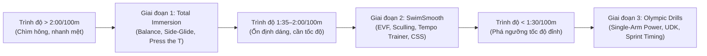

# So Sánh Hệ Thống Huấn Luyện: Total Immersion, SwimSmooth & Olympic

> **Thuộc phần:** `17-drills/` | **Trình độ:** Cơ bản → Nâng cao | **Thời gian đọc:** ~12 phút

## Overview

Hầu hết người bơi phong trào bị rối loạn kỹ thuật không phải vì thiếu bài tập, mà vì **trộn lẫn ngẫu nhiên các bài Drill từ những trường phái có mục tiêu khác nhau**. Có 3 hệ thống huấn luyện bơi sải có ảnh hưởng lớn nhất thế giới: **Total Immersion (TI)**, **SwimSmooth (SS)** và **Hệ thống Olympic (USA Swimming / Australia / Race Club)**. Hiểu rõ bản chất, điểm mạnh và giới hạn của từng trường phái giúp bạn chọn đúng bài Drill cho đúng giai đoạn phát triển từ người mới lên `< 1:30/100m`.

- **Mục tiêu cốt lõi:** Biết chính xác khi nào nên áp dụng triết lý **Total Immersion** (cân bằng & giảm cản), khi nào chuyển sang **SwimSmooth** (nhịp độ & CSS) và khi nào tích hợp **Olympic Drills** (công suất EVF & tốc độ đỉnh).
- **Cảm giác đúng:** Mọi bài Drill trong buổi tập đều có một mục đích sửa lỗi rõ ràng và được chuyển giao ngay lập tức (*Drill-to-Swim Transfer*) sang bơi bình thường.
- **Sai lầm phổ biến nhất:** Tập Drill một cách máy móc cho đủ cự ly (nhưng làm sai form) hoặc áp dụng cứng nhắc một trường phái duy nhất cho mọi mục tiêu tốc độ.

---

## Theory

Mỗi trường phái ra đời để giải quyết một bài toán khác nhau của bơi sải:

| Tiêu chí | Total Immersion (TI — Terry Laughlin) | SwimSmooth (SS — Paul Newsome) | Hệ Thống Olympic (USA / AUS / Race Club) |
| :--- | :--- | :--- | :--- |
| **Triết lý cốt lõi** | Giảm lực cản tuyệt đối, bơi như cá, tối ưu độ lướt (*Balance → Streamline → Propulsion*) | Phân loại **6 Swim Types**, cá nhân hóa kỹ thuật theo cơ địa + kết hợp **CSS & Tempo Trainer** | Tối đa hóa đồng thời lực đẩy **EVF**, **6-Beat Kick**, **Dolphin Kick** và công suất sinh lý |
| **Điểm mạnh nhất** | Cứu cánh số 1 cho người mới, người sợ nước, người chìm hông nặng (`> 2:00/100m`) | Lộ trình thực chiến nhất cho **Triathlete, Open Water & Phong trào (`2:00 → 1:20/100m`)** | Tối ưu hóa công suất bùng nổ, xuất phát, lộn vòng & tốc độ đỉnh (`< 1:15/100m`) |
| **Nhịp tay & Chân đặc trưng** | Front-Quadrant dài (`IdC < -10%`), `SPM 50–60`, 2-beat kick êm | 3/4 Catch-Up / Opposition (`IdC ≈ 0%`), `SPM 65–78`, 2/4/6-beat linh hoạt | Opposition / Superposition (`IdC ≥ 0%`), `SPM 75–105`, 6-beat + UDK mạnh |
| **Rủi ro nếu lạm dụng** | Dễ rơi vào **Over-Gliding (Dead Spot)**, nhịp tay quá chậm khó bứt tốc `< 1:30/100m` | Ít rủi ro; cần kỷ luật test CSS & quay video để tự nhận đúng nhóm Swim Type | Quá tải khớp vai/thể lực nếu người bơi phong trào chưa có nền cân bằng & Mobility |

---

## Science

### Physics & Hydrodynamics

Ba trường phái thực chất là **3 nấc thang tiến hóa** trên cùng một phương trình vật lý $v = \text{DPS} \times \frac{\text{SPM}}{60}$ và $P = \frac{1}{2}\rho C_d A v^3$:
1. **Nấc 1 — Total Immersion**: Tấn công trực diện vào mẫu số **$C_d \cdot A$** (giảm lực cản xuống mức thấp nhất bằng cân bằng, xoay hông và lướt dài).
2. **Nấc 2 — SwimSmooth**: Tối ưu hóa **tích số $\text{DPS} \times \text{SPM}$** bằng cách xóa bỏ *Dead Spot*, chuẩn hóa EVF và xây dựng động cơ hiếu khí **CSS**.
3. **Nấc 3 — Olympic System**: Tối đa hóa **tử số $F_{\text{propulsion}}$** (EVF sâu, tăng tốc pha Push, 6-beat kick, Underwater Dolphin Kick 10–15m và công suất VO2max/Anaerobic).

### Biomechanics

Trong khoa học học vận động (*Motor Learning*), quy tắc vàng để bài Drill thực sự thay đổi kiểu bơi là **Chu trình Chuyển Giao Tức Thời (*Immediate Transfer Loop*)**:
- Não bộ cần cảm giác tương phản ngay lập tức. Nếu bạn tập liên tục `400m` Drill rồi mới bơi thường, hệ thần kinh sẽ xem Drill là "một kiểu bơi khác".
- Cấu trúc tối ưu luôn là **xen kẽ ngắn**: `25m Drill + 25m Swim (giữ đúng cảm giác vừa tập)` hoặc `50m Drill + 50m Swim`.

---

## Practical

### Why It Works

Thay vì tranh cãi "Total Immersion hay SwimSmooth tốt hơn?", bộ sách này **tích hợp có chọn lọc tinh hoa của cả 3 trường phái** theo đúng thứ tự sinh học:
- Lấy **Cân bằng, Xoay thân & Cảm giác lướt êm** của **Total Immersion**.
- Lấy **EVF thực chiến, Khắc phục Dead Spot, Tempo Trainer & Giáo án CSS** của **SwimSmooth**.
- Lấy **Sculling, Single-Arm, Dolphin Kick, Starts & Flip Turns** của **Hệ thống Olympic**.

### Step-by-Step Execution & Water Cues

1. **Nguyên tắc chọn Drill (Tối đa 2 mục tiêu/buổi)**: Đừng tập 6 bài Drill khác nhau trong cùng một buổi bơi! Chọn đúng **1–2 bài Drill** nhắm thẳng vào **lỗi lớn nhất hiện tại của bạn** (ví dụ: sụp khuỷu → chỉ tập *Sculling* và *Dog Paddle*).
2. **Tỷ lệ vàng của Drill trong buổi tập**: Dành **`15–25%`** tổng cự ly buổi bơi cho Drill ở phần khởi động kỹ thuật (khi cơ thể và hệ thần kinh còn tươi tỉnh nhất — **không tập Drill kỹ thuật phức tạp khi đã kiệt sức cuối buổi**).
3. **Luôn bơi chậm và chuẩn xác khi tập Drill**: Tập Drill sai form còn hại hơn không tập, vì bạn đang khắc sâu đường dẫn thần kinh sai vào não.
4. **Dùng công cụ hỗ trợ thông minh**: Sử dụng **Center Snorkel** (tách hơi thở) và **Short Fins** (tạo vận tốc nền ổn định) để học động tác mới nhanh gấp 3 lần.

<!-- IMAGE_PROMPT: Clean MIT-style 3-tier pyramid diagram: Base tier "Total Immersion (Balance, Streamline, Drag Reduction)"; Middle tier "SwimSmooth (EVF, Tempo/SPM, CSS Threshold, Swim Types)"; Top tier "Olympic System (Peak Propulsion, 6-Beat, UDK, Starts & Turns)", with side arrows indicating progression from 2:15/100m down to <1:20/100m. -->

### Advanced Tips

- **Nhận diện 6 nhóm Swim Types của SwimSmooth**:
  - *Arnie* (gồng tay, hông chìm, nhịp nhanh) → Cần **TI Balance + Sculling + Giảm sức tay**.
  - *Overglider* (trượt quá lâu, Dead Spot, SPM thấp) → Cần **Tempo Trainer + 3/4 Catch-Up**.
  - *Bambino / Kicktastic* (đạp chân quá nhiều, mau hụt hơi) → Cần **2-Beat Kick + Pull Buoy**.
  - *Swinger* (vung tay rộng ngang, lắc hông) → Cần **Zipper + Fingertip Drag**.
  - *Smooth* (dáng đẹp, hiệu suất cao) → Sẵn sàng đẩy mạnh **CSS & Olympic Speed Drills**.

---

## Drills

| Nhóm trường phái | Bài Drill đại diện | Cự ly / Cấu trúc chuyển giao | Cảm giác đúng (Cue) |
| :--- | :--- | :--- | :--- |
| **Total Immersion** | **Superman Glide → 6-Kick Switch** | `4 × 50m` (`25m Drill + 25m Swim`) | Thân nổi phẳng lì, xoay hông êm không tiếng động |
| **SwimSmooth** | **Sculling → Fist Swim → Tempo Swim** | `4 × 50m` (`25m Drill + 25m Swim`) | Cẳng tay ôm khối nước đặc, nhịp tay đều không Dead Spot |
| **Olympic** | **Single-Arm Power + Breakout UDK** | `4 × 50m` (`25m Drill + 25m Fast Swim`) | Kéo dứt khoát bằng cơ xô, thoát tường sắc bén qua vạch 7m |

---

## AI Analysis

- **Ứng dụng AI chọn Drill cá nhân hóa (Error-to-Drill Mapping):** Hệ thống CV/AI trích xuất lỗi lớn nhất từ video (ví dụ: `hip_drop > 15°` → gợi ý nhóm TI; `elbow_angle > 150°` → gợi ý Sculling/Dog Paddle; `IdC < -18%` → gợi ý Tempo Trainer).
- **Chỉ số theo dõi chuyển giao (*Transfer Retention Rate*):** So sánh góc khớp ở `25m Drill` với `25m Swim` ngay kế tiếp — mục tiêu độ duy trì kỹ thuật đạt `≥ 80%`.

---

## Common Errors

| Lỗi thường gặp | Triệu chứng nhận biết | Nguyên nhân gốc | Cách sửa (Correction) |
| :--- | :--- | :--- | :--- |
| **Tập Drill quá nhanh cho xong bài** | Động tác méo mó, thở hổn hển ngay trong lúc tập Drill | Nhầm lẫn bài tập thần kinh–cơ với bài tập thể lực | Tập Drill chậm, chuẩn xác 100%, nghỉ đủ `15–20s` mỗi 25m |
| **Không bơi chuyển giao ngay sau Drill** | Tập Drill rất đẹp nhưng sang bài chính lại bơi y như cũ | Thiếu cầu nối thần kinh giữa Drill và bơi toàn phần | Luôn dùng định dạng `25m Drill + 25m Swim` hoặc `50m (25D/25S)` |
| **Chọn sai trường phái cho trình độ** | Người mới tập Straight-Arm Olympic gây đau vai; người bơi nhanh tập Full Catch-Up bị chậm đi | Không hiểu mục đích của từng hệ thống | Dùng ma trận chọn hệ thống theo tốc độ hiện tại ở bảng trên |
| **Tập quá nhiều bài Drill trong 1 buổi** | Não bị quá tải tín hiệu, không sửa dứt điểm được lỗi nào | Tham lam, thiếu trọng tâm | Chọn tối đa **1–2 bài Drill mục tiêu** duy trì liên tục trong 2–3 tuần |

---

## Self Assessment

- [ ] Tôi hiểu rõ điểm mạnh và giới hạn của từng hệ thống: Total Immersion, SwimSmooth và Olympic.
- [ ] Tôi biết chính xác lỗi kỹ thuật lớn nhất hiện tại của mình để chọn đúng 1–2 bài Drill trọng tâm.
- [ ] Tôi luôn áp dụng nguyên tắc chuyển giao tức thời (`25m Drill + 25m Swim`) trong buổi tập.
- [ ] Tôi đặt phần tập Drill vào đầu buổi bơi (sau khởi động nhẹ) khi hệ thần kinh còn tỉnh táo nhất.
- [ ] Tôi tập Drill chậm, tập trung vào cảm giác nước (*Proprioception*) thay vì chạy đua tốc độ.

---

## KPI

| Chỉ số (Metric) | Người mới | Trung cấp | Nâng cao (`< 1:30/100m`) |
| :--- | :---: | :---: | :---: |
| **Tỷ trọng Drill trong tổng cự ly buổi bơi** | `30–40%` | `20–25%` | `10–15%` (duy trì tinh chỉnh) |
| **Tỷ lệ duy trì form sau Drill (*Transfer Rate*)** | `< 50%` | `60–75%` | `≥ 80%` |
| **Số bài Drill trọng tâm mỗi chu kỳ 2 tuần** | `2 bài` (Balance) | `2 bài` (EVF/Rhythm) | `1–2 bài` (Speed/UDK) |
| **Mức cải thiện SWOLF sau 4 tuần tập Drill đúng** | `-4 đến -6 điểm` | `-2 đến -4 điểm` | `-1 đến -2 điểm` |

---

## FAQ

**1. Khi đã bơi được `< 1:30/100m`, tôi có cần tập lại các bài Drill cơ bản như Sculling hay 6-Kick Switch không?**
**Có!** Ngay cả các VĐV vô địch Olympic vẫn tập Sculling, Single-Arm và 6-Kick Switch trong `10–15%` phần khởi động mỗi ngày để "hiệu chuẩn lại" cảm giác nước trước khi bước vào bài tốc độ cao.

**2. Tại sao nhiều bài Drill yêu cầu dùng chân vịt ngắn (Short Fins)?**
Vì khi tập cô lập 1 kỹ thuật (như 1 tay hoặc dừng giữ tư thế nghiêng), vận tốc bơi giảm mạnh khiến hông dễ chìm. Chân vịt ngắn giữ vận tốc và độ nổi ổn định để **100% sự chú ý của não bộ tập trung vào lỗi kỹ thuật đang sửa**.

**3. Nên tập một bài Drill trong bao lâu thì đổi sang bài khác?**
Duy trì cùng một bài Drill trọng tâm trong ít nhất **2–4 tuần** (khoảng 6–12 buổi bơi) cho tới khi lỗi đó biến mất trên video hoặc trong cảm giác thực tế, rồi mới nâng cấp sang bài khó hơn.

---

## Summary

- Kết hợp thông minh 3 hệ thống: **Total Immersion** (giảm cản & cân bằng) → **SwimSmooth** (EVF, Tempo & CSS) → **Olympic** (tốc độ đỉnh, 6-beat & UDK).
- Áp dụng nguyên tắc **Chuyển giao tức thời (`25m Drill + 25m Swim`)**, tập chậm chuẩn xác ở đầu buổi với tối đa 1–2 mục tiêu mỗi chu kỳ.

**Liên kết chéo:**
- Chương trước: [SWOLF, CSS & Hệ Năng Lượng](../14-stroke-count/swolf-and-energy-systems.md)
- Chương tiếp theo: [Catch-Up Drill](catch-up.md)
- Tra cứu toàn bộ Drill: [Drills Index](../24-appendix/drills-index.md) · [Glossary](../24-appendix/glossary.md)

---

## References

1. Laughlin, T. (2004). *Total Immersion*. Fireside.
2. Newsome, P., & Young, A. (2012). *Swim Smooth*. Wiley.
3. Maglischo, E. W. (2003). *Swimming Fastest*. Human Kinetics.

