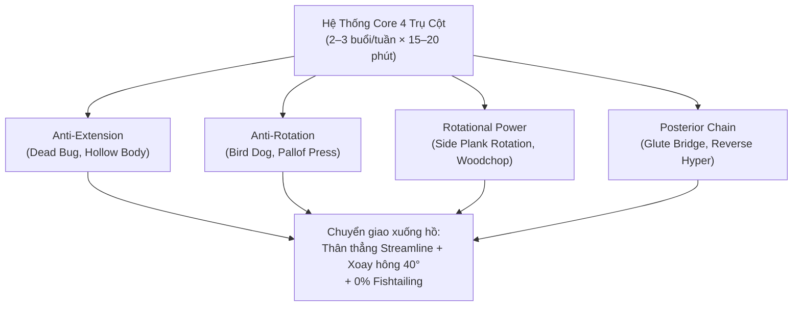
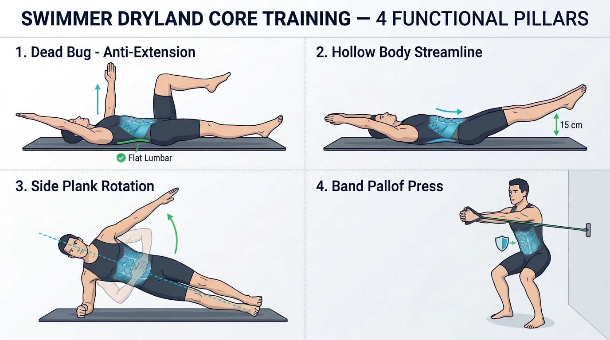

# Sức Mạnh Core Chuyên Biệt Cho Bơi Sải (*Core Training*)

> **Thuộc phần:** `18-strength/` | **Trình độ:** Cơ bản → Nâng cao | **Thời gian đọc:** ~11 phút

## Tổng Quan (Overview)
Một chương trình tập Core kiểu thể hình (gập bụng hàng trăm cái mỗi ngày) gần như **không mang lại lợi ích trực tiếp cho bơi sải** — thậm chí còn làm gù cột sống ngực và kéo căng cơ gấp hông gây võng lưng dưới nước. Trong bơi sải tốc độ (`< 1:30/100m`), Core cần **3 năng lực chức năng chuyên biệt**: **Chống duỗi (Anti-Extension)** để giữ Streamline phẳng, **Chống xoay lắc (Anti-Rotation)** để triệt tiêu *Fishtailing*, và **Phát lực xoay (Rotational Power)** để truyền mô-men từ hông lên tay.

- **Mục tiêu cốt lõi:** Xây dựng hệ thống bài tập cạn (Dryland) phát triển toàn diện hình trụ Core 360° (TVA, Obliques, Erector Spinae, Glutes) bám sát chính xác cơ sinh học trong nước.
- **Cảm giác đúng:** Cơ thể trên cạn vững như một khối thống nhất khi duỗi tay–chân đối xứng; xuống nước lập tức cảm thấy hông nổi cao hơn và trục thân cứng cáp không bị vẫy ngang.
- **Sai lầm phổ biến nhất:** Giữ Plank thụ động 3–5 phút với lưng võng, hoặc chỉ tập gập bụng (Sit-ups) mà bỏ qua cơ chéo bụng và cơ mông.

---

## Lý Thuyết (Theory)
Để chuyển hóa sức mạnh từ phòng tập xuống hồ bơi (*Dryland-to-Water Transfer*), mọi bài tập Core cho VĐV bơi sải đều phải phân loại vào **4 trụ cột chức năng**:

| Trụ cột Core | Chức năng trong nước | Nhóm cơ chủ đạo | Bài tập đại diện |
| :--- | :--- | :--- | :--- |
| **1. Anti-Extension** (Chống võng lưng) | Giữ phẳng thân trong **Streamline**, **Glide** và **6-Beat Kick** | Cơ bụng ngang (TVA), Cơ bụng thẳng | Dead Bug, Hollow Body Hold, Ab-Wheel Rollout |
| **2. Anti-Rotation** (Chống lắc ngang) | Khóa hông thẳng tắp chống **Fishtailing** khi kéo tay lệch tâm | Cơ chéo bụng (Obliques), Cơ mông nhỡ | Bird Dog, Pallof Press, Plank Shoulder Tap |
| **3. Rotational Power** (Xoay trục dọc) | Tạo mô-men xoắn **30–45°** truyền lực từ hông lên cơ xô (Lat) | Dải cơ chéo trước & sau (*Oblique Slings*) | Side Plank Rotation, Cable/Band Woodchop |
| **4. Posterior Chain** (Chuỗi cơ sau) | Giữ hông nổi, tạo lực kéo lên (*Upbeat*) ở **6-Beat & Dolphin Kick** | Cơ mông lớn (Glutes), Gân kheo, Dựng sống | Glute Bridge, Superman Hold, Single-Leg RDL |

---

## Cơ Sở Khoa Học (Science)
### Vật Lý & Thủy Động Lực Học (Physics & Hydrodynamics)
Nghiên cứu thực nghiệm của Weston et al. (2015) trên nhóm VĐV bơi trẻ cấp quốc gia cho thấy: chỉ sau **12 tuần bổ sung chương trình Core chức năng (3 buổi × 25 phút/tuần)** tập trung vào Anti-Extension và Anti-Rotation, nhóm thực nghiệm cải thiện thành tích **50m bơi sải nhanh hơn 2.0% (~0.5 giây)** và giảm rõ rệt độ dao động hông dưới nước so với nhóm chỉ bơi đơn thuần!

### Cơ Sinh Học (Biomechanics)
Tại sao **Hollow Body Hold** (tư thế thân cong lõm kiểu thể dục dụng cụ) là bài tập Anti-Extension quan trọng nhất cho bơi sải?
- Trong Hollow Body Hold, hai tay vươn thẳng qua đầu (mô phỏng Streamline), hai chân duỗi thẳng cách sàn `15–20 cm`, thắt lưng ép phẳng 100% xuống sàn.
- Cấu hình đòn bẩy dài này tạo ra mô-men uốn cực lớn lên thắt lưng — buộc cơ bụng ngang (TVA) và cơ bụng thẳng phải siết đồng bộ cùng cơ mông ở đúng tư thế nằm ngang giống hệt khi bạn đạp tường và bơi mặt nước!

---

## Thực Hành (Practical)
### Tại Sao Kỹ Thuật Này Hiệu Quả (Why It Works)
Bạn không cần đến phòng gym đắt tiền hay tập 60 phút mỗi buổi để sở hữu Core đạt chuẩn bơi `< 1:30/100m`. Chỉ với **1 tấm thảm + 1 sợi dây kháng lực**, tập đúng **15–20 phút chất lượng cao (`2–3 buổi/tuần`)** theo quy tắc *chất lượng từng nhịp lặp > số lượng*, bạn sẽ cảm nhận rõ sự chắc chắn của trục thân dưới nước chỉ sau 3 tuần.

### Hướng Dẫn Từng Bước & Cảm Giác Nước (Step-by-Step & Water Cues)
1. **Dead Bug (Khởi động thần kinh–cơ số 1)**:
   - Nằm ngửa, ép chặt thắt lưng không để khe hở lọt bàn tay.
   - Duỗi chậm tay phải qua đầu + chân trái cách sàn `5 cm` trong `3 giây` (thở ra chậm) → thu về → đổi bên.
2. **Hollow Body Hold (Chuẩn Streamline)**:
   - Nằm ngửa, ép chặt thắt lưng xuống sàn, nhấc vai và hai chân thẳng lên cách sàn `15–20 cm`, hai tay kẹp chặt sau tai tư thế Streamline. Giữ `20–45 giây` không để thắt lưng bật lên!
3. **Side Plank Rotation (Chuẩn xoay trục `40°`)**:
   - Chống khuỷu tay ở tư thế Side Plank thẳng trục `đầu–vai–hông–mắt cá`.
   - Tay trên luồn chậm xuống dưới sườn xoay thân `45°` rồi mở thẳng lên trần nhà, giữ hông tuyệt đối không sụp xuống sàn.
4. **Pallof Press (Khóa chống lắc ngang với dây kháng lực)**:
   - Móc dây kháng lực ngang ngực, đứng vuông góc với điểm neo, đẩy thẳng hai tay ra trước ngực giữ `3 giây` chống lại lực kéo xoay của dây.

<!-- IMAGE_PROMPT: Clean 4-panel dryland exercise anatomy sheet for swimmers: (1) Dead Bug with flat lumbar spine; (2) Hollow Body Streamline Hold with biceps behind ears; (3) Side Plank Rotation highlighting oblique slings; (4) Standing Band Pallof Press resisting lateral rotation, with green alignment lines and engaged core muscles highlighted. -->

### Mẹo Nâng Cao (Advanced Tips)
- **Quy tắc "Không võng lưng" (Zero Lumbar Arch Rule)**: Ngay giây phút thắt lưng bạn bắt đầu nhấc khỏi sàn trong bài Dead Bug hay Hollow Body, **hãy dừng hiệp đó ngay lập tức** — cố giữ thêm chỉ làm tăng tải lên khớp cột sống và tập sai nhóm cơ gấp hông!
- **Tập "Streamline Flutter Kick" trên cạn**: Từ tư thế Hollow Body Hold, thực hiện các cú đạp chân sải nhỏ, nhanh (`20–30 giây`) trong khi lưng dưới vẫn dán chặt xuống thảm — mô phỏng trực tiếp bài tập 6-Beat Kick không võng lưng.

---

## Bài Tập Thực Hành (Drills — Bài Tập Dryland Chuẩn Hóa)

| Bài Tập | Trụ cột | Số hiệp × Lần / Thời gian | Lỗi cần tránh |
| :--- | :--- | :--- | :--- |
| **Dead Bug (Chậm có kiểm soát)** | Anti-Extension + Phối hợp chéo | `3 × 10–12 lần/bên` | Hở thắt lưng khỏi sàn khi duỗi chân |
| **Hollow Body Streamline Hold** | Anti-Extension (Chuẩn Streamline) | `3 × 25–45 giây` | Gập cổ nhìn chân hoặc võng lưng dưới |
| **Side Plank Rotation** | Rotational Power + Anti-Lateral | `3 × 10 lần/bên` | Sụp hông xuống sàn hoặc vặn thắt lưng |
| **Band Pallof Press** | Anti-Rotation (Chống Fishtailing) | `3 × 12 lần/bên` (giữ 2s) | Xoay vai theo lực kéo của dây |
| **Single-Leg Glute Bridge** | Posterior Chain (Nâng hông & Upbeat) | `3 × 12 lần/bên` | Ưỡn cong thắt lưng thay vì siết mông |

---

## Phân Tích AI & Video (AI Analysis)
- **Góc quay khuyến nghị (Dryland Self-Check):** Góc ngang mặt sàn (Floor-Level Side View) cho Hollow Body / Dead Bug / Plank.
- **Keypoints cần trích xuất:** `ear`, `shoulder`, `hip`, `knee`, `ankle`, khoảng hở thắt lưng (`lumbar_gap`).
- **Ngưỡng phát hiện lỗi tự động:**
  - **Đạt chuẩn:** Đường nối `shoulder–hip–ankle` trong Side Plank tạo góc `175–180°`; không có khe hở giữa thắt lưng và sàn trong Dead Bug/Hollow Body.
  - **Cảnh báo lỗi:** Hông sụp `> 10°` trong Side Plank; xương chậu đổ trước làm hở lưng dưới.

---

## Lỗi Thường Gặp & Cách Sửa (Common Errors)
| Lỗi thường gặp | Triệu chứng nhận biết | Nguyên nhân gốc | Cách sửa (Correction) |
| :--- | :--- | :--- | :--- |
| **Chỉ tập gập bụng (Sit-ups / Crunches)** | Đau cổ, gù lưng trên, xuống hồ vẫn lắc hông | Thiếu bài chống duỗi và chống xoay | Thay 100% bằng 4 trụ cột: Dead Bug, Hollow Body, Side Plank, Pallof Press |
| **Nín thở khi giữ Plank / Hollow Body** | Mặt đỏ bừng, nhanh mệt, xuống nước bị cứng bụng | Không tách biệt được kích hoạt TVA khỏi cơ hoành | Tập hít thở đều nhịp nhàng bằng lồng ngực trong khi giữ Core siết nhẹ |
| **Tập Core quá nặng ngay trước buổi bơi tốc độ** | Xuống hồ cảm thấy hông nặng, khó giữ Streamline | Mỏi cơ lõi cục bộ trước khi vào nước | Chỉ tập kích hoạt nhẹ 5 phút trước bơi; tập Core nặng vào **sau buổi bơi** hoặc ngày nghỉ bơi |
| **Giữ Plank quá lâu (> 2 phút) sai form** | Đau thắt lưng dưới, vai sụp xuống | Chọn thời gian dài thay vì độ căng chất lượng | Giảm xuống `30–45 giây` ở tư thế khó hơn (Hollow Body / RKC Plank) với form hoàn hảo |

---

## Tự Đánh Giá Tại Hồ (Self Assessment)
- [ ] Tôi có thể giữ tư thế **Hollow Body Streamline Hold** với thắt lưng áp phẳng hoàn toàn xuống sàn trong tối thiểu `30 giây`.
- [ ] Tôi thực hiện được `3 × 12` **Dead Bug** chậm rãi, phối hợp chéo tay–chân mà không hở lưng dưới.
- [ ] Tôi giữ được **Side Plank** thẳng trục `45–60 giây` mỗi bên đồng đều giữa trái và phải.
- [ ] Tôi tập Core chức năng đều đặn `2–3 buổi/tuần` và luôn thở đều trong lúc giữ tư thế.
- [ ] Khi xuống nước, tôi dễ dàng duy trì trục thân phẳng không bị đau mỏi thắt lưng.

---

## Chỉ Số Đo Lường (KPI)
| Chỉ số (Metric) | Người mới | Trung cấp | Nâng cao (`< 1:30/100m`) |
| :--- | :---: | :---: | :---: |
| **Hollow Body Streamline Hold (chuẩn phẳng lưng)** | `15–20 giây` | `30–45 giây` | `60+ giây` |
| **Side Plank chuẩn trục mỗi bên** | `20–30 giây` | `45–60 giây` | `75–90 giây` (lệch trái–phải `< 10%`) |
| **Dead Bug chuẩn form liên tục** | `8 lần/bên` | `12 lần/bên` | `15+ lần/bên` (kèm dây kháng lực nhẹ) |

---

## Câu Hỏi Thường Gặp (FAQ)
**1. Nên tập Core trước hay sau khi bơi?**
- **Trước khi bơi (5 phút)**: Chỉ tập *kích hoạt thần kinh–cơ* nhẹ (ví dụ `1 hiệp × 8 lần Dead Bug + 1 hiệp × 8 lần Bird Dog`) để đánh thức Core mà không gây mỏi.
- **Sau khi bơi hoặc ngày không bơi (15–20 phút)**: Tập trọn vẹn `3–4 hiệp` phát triển sức mạnh và sức bền Core.

**2. Tôi mới tập Hollow Body thấy lưng dưới cứ bị bật lên khỏi sàn thì làm sao?**
Hãy thu nhẹ độ khó bằng cách **gập nhẹ 1 hoặc 2 đầu gối (Tuck Hollow)** hoặc đưa hai tay xuôi về phía trước đùi trước. Khi nào giữ được `30 giây` thắt lưng dán chặt sàn không hở mới duỗi dần chân và đưa tay qua đầu Streamline!

**3. Tập Core trên cạn bao lâu thì thấy hiệu quả dưới nước?**
Bạn sẽ cảm nhận rõ khả năng kiểm soát hông tốt hơn ngay sau **2–3 tuần**, và thấy giảm rõ rệt độ suy giảm kỹ thuật (DPS Drop-off) ở 200m cuối sau **6–8 tuần**.

---

## Tóm Tắt (Summary)
- Core cho bơi sải là **Core chức năng 4 trụ cột**: *Anti-Extension, Anti-Rotation, Rotational Power* và *Posterior Chain* — không phải gập bụng truyền thống.
- Bộ 5 bài tập vàng: **Dead Bug, Hollow Body Streamline Hold, Side Plank Rotation, Pallof Press** và **Single-Leg Glute Bridge**.
- Luôn tuân thủ nguyên tắc **"Zero Lumbar Arch"** (không võng lưng) và thở đều trong suốt bài tập.

**Liên kết chéo:**
- Chương trước: [Tarzan, Zipper & Dog Paddle](../17-drills/tarzan-zipper-dog-paddle.md)
- Chương tiếp theo: [Phát Triển Cơ Xô (Lat) & Sức Mạnh Kéo Nước](lat-and-pull-strength.md)
- Kỹ thuật liên quan: [Kích Hoạt Core Dưới Nước](../05-core/core-engagement.md) · [Lịch Tập Cạn Dryland](dryland-programs.md)
- Tra cứu thuật ngữ: [Glossary](../24-appendix/glossary.md)

---

## Tài Liệu Tham Khảo (References)
1. Weston, M., Hibbs, A. E., Thompson, K. G., & Spears, I. R. (2015). *Isolated core training improves sprint performance in national-level junior swimmers*. IJSPP, 10(2), 204–210.
2. McGill, S. M. (2015). *Ultimate Back Fitness and Performance*. Backfitpro.
3. McLeod, I. (2010). *Swimming Anatomy*. Human Kinetics.

