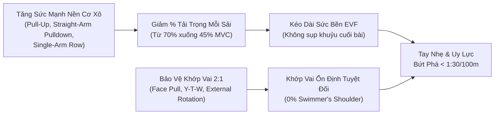

# Phát Triển Cơ Xô (*Latissimus Dorsi*) & Sức Mạnh Kéo Nước

> **Thuộc phần:** `18-strength/` | **Trình độ:** Cơ bản → Nâng cao | **Thời gian đọc:** ~11 phút

## Tổng Quan (Overview)
Sau khi bạn đã sở hữu tư thế giảm cản tốt và kỹ thuật dựng cẳng tay sớm (**EVF**), yếu tố quyết định tốc độ tiến bộ tiếp theo hướng tới `< 1:30/100m` là **sức mạnh tương đối và sức bền công suất của nhóm cơ kéo chính**: **Cơ lưng rộng (*Latissimus Dorsi*)**, **Cơ ngực lớn**, **Cơ tam đầu (*Triceps*)** và **Nhóm cơ ổn định xương bả vai (*Scapular Stabilizers*)**. Tập sức mạnh cho bơi sải không nhằm mục tiêu "tăng cân phì đại cơ bắp nặng nề", mà nhằm **tăng lực phát trên mỗi kg trọng lượng cơ thể (*Relative Power-to-Weight Ratio*)** và giữ khớp vai bền bỉ như thép.

- **Mục tiêu cốt lõi:** Xây dựng sức mạnh kéo chuyên biệt (Pull-Up, Straight-Arm Lat Pulldown, Single-Arm Row) đi kèm cân bằng cơ chóp xoay vai (*External Rotation*) để kéo nước mạnh mà vai vẫn nhẹ và an toàn.
- **Cảm giác đúng:** Cảm nhận rõ cơ lưng bên dưới nách dẫn động mọi bài kéo; khi xuống hồ thấy pha Mid-Pull và Push cực kỳ uy lực và duy trì được tốc độ cao ở nửa sau bài tập.
- **Sai lầm phổ biến nhất:** Chỉ tập đẩy ngực nặng (*Bench Press*) gây co rút vai đổ trước và cứng khớp vai, hoặc tập tạ nặng mất kiểm soát xương bả vai.

---

## Lý Thuyết (Theory)
Để tập sức mạnh trên cạn chuyển hóa trực tiếp thành tốc độ bơi, cần tuân thủ **3 nguyên tắc vàng của Sinh lý Sức mạnh Bơi lội**:

1. **Nguyên tắc Tỷ Lệ Kéo / Đẩy `2:1` (*2:1 Pull-to-Push Ratio*)**:
   - Bơi sải là môn thể thao có tính chất kéo và xoay trong vai rất cao. Do đó, chương trình phòng gym phải ưu tiên **2 bài kéo lưng / ổn định bả vai** cho mỗi **1 bài đẩy ngực/vai** để giữ tư thế mở ngực và bảo vệ khoảng trống dưới mỏm cùng vai.
2. **Sức Mạnh Tương Đối > Phì Đại Cơ Bắp (*Relative Strength > Hypertrophy*)**:
   - Tăng thêm `5 kg` cơ bắp không chức năng làm tăng diện tích mặt cắt cản $A$ và giảm độ nổi tự nhiên. Tập trung vào dải lặp **`4–6 lần` (tăng sức mạnh thần kinh–cơ)** hoặc **`12–15 lần` (tăng sức bền cơ bắp chuyên biệt)** với tốc độ kéo dứt khoát (*Explosive Concentric*).
3. **Ổn Định Xương Bả Vai Trước Khi Tăng Tạ (*Scapular Control First*)**:
   - Cơ lưng rộng (Lat) chỉ phát huy 100% lực kéo khi xương bả vai được neo vững bởi cơ thang dưới (*Lower Trapezius*) và cơ răng trước (*Serratus Anterior*).

---

## Cơ Sở Khoa Học (Science)
### Vật Lý & Thủy Động Lực Học (Physics & Hydrodynamics)
Trong nước, lực cản tăng theo $v^2$ — khi bạn muốn bứt tốc từ `1:40/100m` xuống `1:25/100m`, lực đỉnh trên mỗi sải tay (*Peak Propulsive Force*) cần tăng thêm `~30–40%`.
- Nếu sức mạnh tuyệt đối của cơ xô (Lat) yếu, mỗi sải tay ở tốc độ `1:25/100m` đòi hỏi tới **`65–75%` sức tối đa** → cơ nhanh chóng chuyển sang kỵ khí và mỏi rã chỉ sau 50–100m!
- Khi bạn nâng sức mạnh nền cơ xô lên **+30%** qua tập Dryland (ví dụ từ 2 cái lên 10 cái Pull-Up chuẩn), cùng một tốc độ `1:25/100m` giờ đây chỉ tiêu tốn **`45–50%` sức tối đa** — đó là lý do cơ sinh học khiến bạn cảm thấy **"tay nhẹ hơn hẳn ở tốc độ cao"**!

### Cơ Sinh Học (Biomechanics)
Các bài tập sức mạnh có **độ tương đồng cơ sinh học cao nhất (*High Biomechanical Specificity*)** với pha kéo bơi sải:
- **Pull-Up / Assisted Pull-Up (Hít xà đơn rộng vừa bằng vai)**: Mô phỏng trực tiếp động tác khép và duỗi vai (*Shoulder Adduction & Extension*) bằng cơ xô (Lat) ở tỷ lệ sức mạnh trên trọng lượng cơ thể chuẩn xác nhất.
- **Straight-Arm Cable / Band Lat Pulldown**: Mô phỏng gần như 100% đường kéo từ pha Catch → Mid-Pull → Push ngang đùi với cánh tay đòn dài.
- **Single-Arm Dumbbell / Cable Row (Kéo tạ 1 tay)**: Rèn sức mạnh bất đối xứng từng bên (giống bơi sải luân phiên tay trái–phải) đồng thời bắt buộc Core phải chống xoay (*Anti-Rotation*).
- **Face Pull & Band External Rotation**: Tăng cường cơ dưới gai (*Infraspinatus*) và cơ tròn bé (*Teres Minor*) — "áo giáp sinh học" ngăn ngừa *Swimmer's Shoulder*.

---

## Thực Hành (Practical)
### Tại Sao Kỹ Thuật Này Hiệu Quả (Why It Works)
Rất nhiều người bơi tập chăm chỉ 4–5 buổi/tuần dưới nước nhưng vẫn bị chững tốc độ vì **nước có giới hạn sức cản tối đa** — bạn không thể tăng tải trọng cơ bắp đủ lớn chỉ bằng cách quạt tay trong nước. Bổ sung **2 buổi sức mạnh cạn/tuần (35–45 phút/buổi)** giải quyết nút thắt công suất cực nhanh mà không làm mất cảm giác nước.

### Hướng Dẫn Từng Bước & Cảm Giác Nước (Step-by-Step & Water Cues)
1. **Pull-Up / Lat Pulldown chuẩn bơi sải**:
   - Nắm tay rộng hơn vai một chút, lòng bàn tay hướng về trước (*Pronated Grip*).
   - Trước khi gập khuỷu, **hạ xương bả vai xuống xa tai (*Scapular Depression*)**, sau đó kéo khuỷu tay hướng thẳng xuống hông (tưởng tượng đang kéo nước trong pha Mid-Pull).
2. **Straight-Arm Lat Pulldown (Cáp hoặc dây kháng lực)**:
   - Đứng hơi gập hông `30°`, hai tay cầm thanh/dây duỗi gần thẳng (khuỷu hơi mềm `15°`).
   - Giữ lưng thẳng, siết cơ xô kéo mạnh thanh từ ngang đầu thẳng xuống chạm đùi trước, giữ `1 giây` rồi thả chậm có kiểm soát.
3. **Single-Arm Cable/Dumbbell Row**:
   - Tựa tay còn lại lên ghế, giữ vai và hông phẳng ngang sàn, kéo khuỷu tay trượt sát sườn về phía hông (không nhún vai lên tai).
4. **Face Pull + External Rotation (Cuối mỗi buổi)**:
   - Kéo dây ngang tầm trán, tách hai tay ra hai bên sao cho cuối động tác hai cánh tay tạo hình chữ "W" (xoay ngoài vai hoàn toàn).

<!-- IMAGE_PROMPT: Clean 4-panel strength training biomechanical guide for swimmers: (1) Pull-Up highlighting Latissimus Dorsi depression; (2) Straight-Arm Cable Lat Pulldown mirroring freestyle underwater pull; (3) Single-Arm Row with neutral spine; (4) Cable Face Pull with external rotation for rotator cuff health. -->

### Mẹo Nâng Cao (Advanced Tips)
- **Chuyển từ Sức mạnh sang Công suất Bùng nổ (*Power Phase*)**: Trong 4–6 tuần cuối trước khi test mốc `< 1:30/100m`, giảm mức tạ xuống ~60–70% và kéo pha phát lực thật nhanh, sắc gọn (*Explosive Pull*, hạ chậm 2 giây) để tối ưu tốc độ phát lực (*Rate of Force Development — RFD*) phù hợp pha Push.
- **Tránh tập tạ nặng đến mức thất bại cơ bắp (*Training to Failure*)**: Luôn chừa lại **`2 lần lặp dự trữ` (*2 Reps in Reserve — RIR 2*)** để hệ thần kinh và cơ bắp phục hồi nhanh, không bị cứng tay khi xuống hồ ngày hôm sau.

---

## Bài Tập Thực Hành (Drills — Bài Tập Phòng Gym / Tại Nhà Chuẩn Hóa)

| Bài Tập | Nhóm cơ đích | Số hiệp × Lần | Nghỉ | Ghi chú kỹ thuật |
| :--- | :--- | :---: | :---: | :--- |
| **Pull-Up (hoặc Assisted / Lat Pulldown)** | Cơ xô (Lat), Cơ tròn lớn | `4 × 6–10 lần` | `90s` | Hạ bả vai trước khi kéo, không đung đưa người |
| **Straight-Arm Lat Pulldown** | Lat + Triceps (đúng góc bơi) | `3 × 12–15 lần` | `60s` | Kéo dứt khoát tới đùi, thả lên chậm 2–3 giây |
| **Single-Arm Dumbbell / Cable Row** | Lat, Cơ trám, Anti-Rotation Core | `3 × 10 lần/bên` | `60s` | Khuỷu kéo về hông, giữ khung sườn thẳng |
| **Push-Up (hoặc Incline Dumbbell Press)** | Cơ ngực lớn, Cơ răng trước | `3 × 12–15 lần` | `60s` | Đẩy hết biên độ cuối (*Push-Up Plus*) kích hoạt Serratus |
| **Cable / Band Face Pull** | Chóp xoay vai, Cơ thang giữa/dưới | `3 × 15 lần` | `45s` | Xoay ngoài vai ở cuối động tác, không rụt vai |

---

## Phân Tích AI & Video (AI Analysis)
- **Góc quay khuyến nghị:** Góc sau lưng (Rear View) cho Pull-Up / Row để kiểm tra độ đối xứng chuyển động hai xương bả vai (*Scapular Symmetry*).
- **Keypoints cần trích xuất:** `left_shoulder`, `right_shoulder`, `left_elbow`, `right_elbow`, `spine_mid`.
- **Ngưỡng phát hiện lỗi tự động:**
  - **Đạt chuẩn:** Hai vai giữ ngang bằng nhau suốt hành trình kéo (`|y_L - y_R| < 3 cm`); khuỷu tay di chuyển gọn trong mặt phẳng `30–45°` so với thân.
  - **Cảnh báo lỗi:** Nhún vai sát tai (cơ thang trên lấn át cơ xô); ưỡn võng lưng dưới khi kéo Straight-Arm Pulldown.

---

## Lỗi Thường Gặp & Cách Sửa (Common Errors)
| Lỗi thường gặp | Triệu chứng nhận biết | Nguyên nhân gốc | Cách sửa (Correction) |
| :--- | :--- | :--- | :--- |
| **Kéo bằng tay trước (Biceps) thay vì Cơ Xô** | Bắp tay trước căng cứng nhưng lưng không cảm nhận gì | Cầm quá hẹp hoặc nghĩ tới việc "kéo bàn tay" thay vì "kéo khuỷu tay" | Hình dung bàn tay chỉ là chiếc móc, tập trung **kéo khuỷu tay xuống túi quần** |
| **Tập đẩy ngực (Bench Press) quá nhiều** | Vai cuộn tròn về trước, giảm độ mở Streamline & đau vai | Mất cân bằng tỷ lệ Kéo/Đẩy, cơ ngực co rút ngắn | Tuân thủ nghiêm ngặt tỷ lệ **2 bài kéo lưng : 1 bài đẩy ngực** |
| **Tập tạ nặng sát giờ bơi** | Xuống hồ cảm thấy tay nặng như chì, mất cảm giác nước | Suy giảm glycogen cục bộ và tổn thương vi cơ | Cách buổi bơi tốc độ ít nhất `6–24 giờ`, hoặc tập sau buổi bơi |
| **Bỏ qua bài tập chóp xoay vai (Rotator Cuff)** | Đau nhói khớp vai khi tăng khối lượng bơi lên `> 8 km/tuần` | Cơ phát lực (Lat/Pec) mạnh lên nhưng cơ ổn định vai bị yếu | Luôn kết thúc buổi tập bằng Face Pull + External Rotation |

---

## Tự Đánh Giá Tại Hồ (Self Assessment)
- [ ] Tôi cảm nhận rõ cơ lưng rộng (Lat) co rút trong bài Pull-Up và Straight-Arm Pulldown, không chỉ mỏi bắp tay trước.
- [ ] Chương trình tập cạn của tôi đảm bảo tỷ lệ kéo lưng gấp đôi đẩy ngực (`2:1`).
- [ ] Tôi luôn chừa lại `1–2 lần lặp dự trữ` (không tập kiệt sức) để giữ tay tươi mới khi xuống hồ.
- [ ] Tôi duy trì đều đặn các bài bảo vệ khớp vai (Face Pull, External Rotation) tối thiểu 2 lần/tuần.
- [ ] Sau 6 tuần tập sức mạnh cơ xô, tôi cảm nhận pha Pull–Push dưới nước chắc và bền hơn rõ rệt.

---

## Chỉ Số Đo Lường (KPI)
| Chỉ số (Metric) | Người mới | Trung cấp | Nâng cao (`< 1:30/100m`) |
| :--- | :---: | :---: | :---: |
| **Pull-Up chuẩn form (Nam / Nữ)** | `0–3 / Assisted` | `6–10 / 2–5` | `12–15+ / 6–10+` |
| **Push-Up chuẩn form (không võng lưng)** | `10–15 lần` | `20–30 lần` | `35–45+ lần` |
| **Straight-Arm Pulldown kiểm soát chuẩn** | Nhẹ, tập form | `3 × 15` ổn định | `3 × 15` kéo bùng nổ, giữ trục Core phẳng |

---

## Câu Hỏi Thường Gặp (FAQ)
**1. Tập tạ có làm tôi bị "cứng người" và bơi chậm đi không?**
Chỉ khi bạn tập sai cách (tập phì đại cơ kiểu thể hình, tập biên độ ngắn, không kéo giãn và không tập Mobility). Tập sức mạnh chức năng biên độ đầy đủ (*Full Range of Motion*) kết hợp Mobility giúp **tăng tốc độ bơi, giảm chấn thương và giữ tay nhẹ hơn** — 100% VĐV Olympic hiện đại đều tập tạ chuyên biệt 2–3 buổi/tuần!

**2. Tôi chưa hít được cái Pull-Up nào thì tập gì thay thế?**
Hãy dùng **Lat Pulldown** ở phòng gym, hoặc **Band-Assisted Pull-Up** (móc dây kháng lực hỗ trợ dưới chân) và **Negative Pull-Up** (nhảy lên xà rồi hạ người xuống thật chậm trong `5 giây`). Chỉ sau 4–6 tuần bạn sẽ hít được những cái Pull-Up đầu tiên!

**3. Có cần tập chân nặng (Squat / Deadlift) cho bơi sải không?**
Nên có **1–2 bài sức mạnh chân cơ bản** (như *Goblet Squat, Bulgarian Split Squat, Box Jump*) để tăng lực **đạp tường xuất phát và lộn vòng (Starts & Turns)** — nhưng giữ ở mức tải vừa phải, không tập quá nặng gây cứng đùi và giảm độ nổi.

---

## Tóm Tắt (Summary)
- Sức mạnh cơ xô (Lat) lớn hơn giúp **giảm % nỗ lực trên mỗi sải tay**, biến tốc độ cao `< 1:30/100m` thành cảm giác tay nhẹ và bền bỉ.
- Tuân thủ tỷ lệ **2 Kéo : 1 Đẩy**, ưu tiên **Pull-Up, Straight-Arm Pulldown, Single-Arm Row** và luôn khóa an toàn bằng **Face Pull / External Rotation**.

**Liên kết chéo:**
- Chương trước: [Sức Mạnh Core Chuyên Biệt](core-training.md)
- Chương tiếp theo: [Dây Kháng Lực & Medicine Ball](resistance-band-and-medball.md)
- Kỹ thuật liên quan: [Cơ Sinh Học Khớp Vai & Cơ Xô](../02-biomechanics/shoulder-and-lat-mechanics.md) · [Lịch Tập Cạn Dryland](dryland-programs.md)
- Tra cứu thuật ngữ: [Glossary](../24-appendix/glossary.md)

---

## Tài Liệu Tham Khảo (References)
1. Crowley, E., Harrison, A. J., & Lyons, M. (2017). *The impact of resistance training on swimming performance: A systematic review*. Sports Medicine, 47(11), 2285–2307.
2. Aspenes, S. T., & Karlsen, T. (2012). *Exercise-training intervention studies in competitive swimming*. Sports Medicine.
3. McLeod, I. (2010). *Swimming Anatomy*. Human Kinetics.

