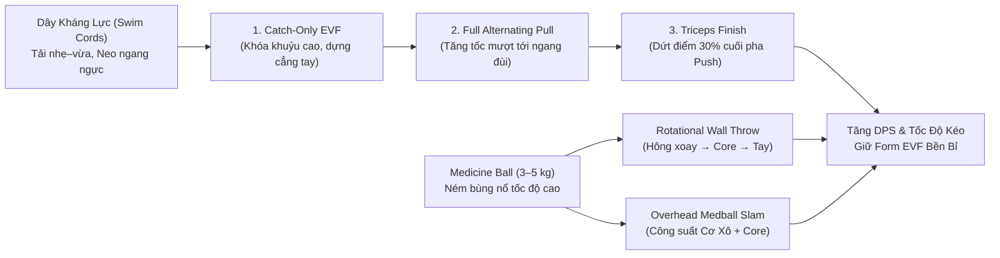

# Bài Tập Dây Kháng Lực (*Resistance Band*) & Bóng Tạ (*Medicine Ball*)

> **Thuộc phần:** `18-strength/` | **Trình độ:** Cơ bản → Nâng cao | **Thời gian đọc:** ~11 phút

## Tổng Quan (Overview)
Nếu phòng gym xây dựng sức mạnh nền tảng, thì **Dây kháng lực (*Swim Cords / Resistance Bands*)** và **Bóng tạ (*Medicine Ball*)** chính là **cầu nối hoàn hảo nhất** chuyển hóa sức mạnh đó thành **kỹ thuật EVF sắc nét, sức bền cơ xô và công suất xoay hông bùng nổ** ngay trên bờ hồ hoặc tại nhà. Chỉ cần `10–15 phút` với dây kháng lực mô phỏng sải tay, bạn có thể khắc sâu góc khuỷu EVF `110°` vào trí nhớ cơ bắp nhanh gấp nhiều lần so với chỉ bơi dưới nước.

- **Mục tiêu cốt lõi:** Thành thạo chuỗi bài kéo dây kháng lực mô phỏng chính xác **Catch (EVF) → Mid-Pull → Push**, kết hợp các bài ném/xoay Medicine Ball phát triển **tốc độ phát lực chuỗi truyền lực (`Chân → Hông → Core → Tay`)**.
- **Cảm giác đúng:** Ở bài dây kháng lực, cảm nhận lực căng tăng dần đều từ đầu pha Catch tới cuối pha Push (giống hệt quy luật tăng tốc lũy tiến trong nước); ở bài Medicine Ball, cảm nhận lực bật phát ra từ hông và bụng chéo.
- **Sai lầm phổ biến nhất:** Dùng dây kháng lực quá nặng khiến khuỷu tay bị sụp ngay lập tức (luyện tập sai kỹ thuật EVF trên cạn!), hoặc ném bóng tạ bằng lực cánh tay mà không xoay hông.

---

## Lý Thuyết (Theory)
Tại sao **Dây kháng lực (*Elastic Resistance*)** lại phù hợp với bơi sải hơn tạ đơn truyền thống ở góc độ vật lý?
1. **Đường cong lực tăng dần (*Ascending Resistance Curve*)**: Khi kéo dây cao su giãn ra, lực cản $F = k \cdot \Delta x$ tăng dần từ nhỏ (lúc vươn tay phía trước) lên lớn nhất (lúc đẩy qua hông). Điều này **khớp 100% với đường cong lực tự nhiên của sải tay bơi sải**: nhẹ–chậm để ôm nước ở EVF Catch, tăng tốc mạnh nhất ở Mid-Pull và Push!
2. **Đa mặt phẳng không bị giới hạn bởi trọng lực**: Tạ đơn luôn kéo thẳng xuống đất, còn dây kháng lực có thể neo ngang tầm ngực để tạo lực cản **song song mặt sàn** — trùng khớp hoàn toàn phương kéo ngang của cơ thể trong nước.
3. **Vai trò của Medicine Ball**: Phát triển **Công suất Bùng nổ (*Rotational & Overhead Power*)** thông qua chu kỳ Kéo giãn – Co rút (*Stretch-Shortening Cycle — SSC*) cho hông, Core và cơ xô.

---

## Cơ Sở Khoa Học (Science)
### Vật Lý & Thủy Động Lực Học (Physics & Hydrodynamics)
- **Định luật Hooke & Chuyển giao Thần kinh–Cơ**:
  $$F_{\text{band}} = k \cdot (x - x_0)$$
  Khi đứng cách điểm neo đủ xa để dây hơi căng ở vị trí vươn tay trước, góc khớp khuỷu `110°` được giữ cố định dưới áp lực nhẹ rồi chịu tải tăng tiến dọc hành trình kéo `60–80 cm` tới ngang đùi. Lặp lại `3 hiệp × 20 lần` chuẩn form trước gương tạo ra **phản hồi thị giác 100%** (thứ mà dưới nước bạn rất khó thấy) để não bộ khóa cứng bản đồ vận động EVF!
- **Tốc độ phát lực (*RFD*) với Medicine Ball**: Sử dụng bóng tạ nhẹ–vừa (`2–4 kg` cho nữ, `3–6 kg` cho nam) ném với tốc độ tối đa giúp tuyển dụng các sợi cơ nhanh loại II (*Type II Fast-Twitch Fibers*) ở cơ xô và cơ chéo bụng mà không gây phì đại cơ nặng nề.

### Cơ Sinh Học (Biomechanics)
- **Chuỗi bài "Swim Cord 3-Phase"**:
  1. *Phase 1 (Catch Isolation)*: Chỉ tập động tác gập cổ tay và dựng cẳng tay EVF (`110°`) giữ khuỷu tay bất động trên cao — đánh thức cơ dưới vai và cơ xô.
  2. *Phase 2 (Full Freestyle Pull)*: Kéo luân phiên trái–phải từ Catch → Mid-Pull → Push ngang đùi với **xoay thân nhẹ tự nhiên**.
  3. *Phase 3 (Triceps Push-Back)*: Giữ cánh tay trên áp sát sườn, chỉ duỗi bùng nổ cơ tam đầu ở 30% cuối cùng (sửa lỗi cắt cụt pha Push).

---

## Thực Hành (Practical)
### Tại Sao Kỹ Thuật Này Hiệu Quả (Why It Works)
Rất nhiều người bơi bận rộn chỉ có thể xuống hồ `2–3 buổi/tuần` vẫn phá được mốc `< 1:30/100m` nhờ dành **`10–15 phút` kéo Swim Cords tại nhà vào 2–3 ngày còn lại**. Dây kháng lực duy trì cảm giác cơ xô và sức bền EVF liên tục, giúp bạn không bị "mất nước" khi bận công việc hay đi công tác!

### Hướng Dẫn Từng Bước & Cảm Giác Nước (Step-by-Step & Water Cues)
1. **Tư thế đứng chuẩn cho Swim Cords**:
   - Neo dây cao ngang ngực hoặc thắt lưng (có tay cầm hoặc *paddles*).
   - Gập hông về trước góc **`60–80°`** (lưng giữ phẳng hoàn toàn như đang nằm ngang trên mặt nước, đầu nhìn xuống sàn, Core siết nhẹ).
2. **Thực hiện kéo EVF chuẩn trước gương**:
   - **Bước 1**: Hai tay vươn thẳng về trước ngang vai.
   - **Bước 2**: Giữ khuỷu tay cố định trên cao, **chúc cổ tay và dựng cẳng tay thẳng đứng vuông góc với sàn** (tự liếc nhìn gương kiểm tra góc `100–120°`!).
   - **Bước 3**: Dùng cơ xô kéo mạnh thẳng về phía sau cho tới khi hai bàn tay đi qua ngang đùi, giữ `0.5 giây` cảm nhận cơ tam đầu căng chắc, rồi đưa tay về chậm có kiểm soát.
3. **Rotational Medicine Ball Throw (Ném bóng xoay hông vào tường)**:
   - Đứng ngang cách tường cứng `1.5–2 m`, cầm bóng `3–5 kg` ngang hông xa tường.
   - Xoay mạnh hông sau (bật gót chân sau) truyền lực qua Core ném bóng dứt khoát vào tường rồi bắt lại êm ái, lặp lại liên tục `8–10 lần/bên`.
4. **Overhead Medicine Ball Slam (Đập bóng qua đầu)**:
   - Giơ bóng thẳng qua đầu (mô phỏng góc vươn Streamline), siết Core và **dùng cơ xô đập mạnh bóng xuống sàn** ngay trước mũi chân — phát triển sức mạnh kéo dọc siêu hiệu quả!

<!-- IMAGE_PROMPT: Dual-panel dryland coaching diagram: Left panel shows swimmer hinged at 75 degrees pulling resistance swim cords with green vertical forearm EVF alignment at 110 degrees elbow angle and flat back; Right panel shows dynamic Rotational Medicine Ball Wall Throw with kinetic chain force arrows flowing from back foot -> hips -> obliques -> arms. -->

### Mẹo Nâng Cao (Advanced Tips)
- **Chọn đúng độ nặng dây kháng lực**:
  - Người mới / Tập kỹ thuật EVF & Khởi động: Dây **Nhẹ (Light / Yellow–Green, ~5–8 kg lực kéo)**.
  - Trung cấp / Sức bền cơ xô (`3 × 30–60 giây`): Dây **Trung bình (Medium / Red–Blue, ~8–12 kg)**.
  - **Tuyệt đối không dùng dây quá nặng** làm bạn phải sụp khuỷu tay hoặc gù lưng để kéo!
- **Bài tập "Swim Cord CSS Intervals" khi không thể ra hồ**: Cài đồng hồ kéo luân phiên liên tục `10 hiệp × 45 giây kéo nhịp CSS (70 SPM)` nghỉ `15 giây` — mô phỏng gần giống nhất bài tập `10 × 100m @ CSS` dưới nước!

---

## Bài Tập Thực Hành (Drills — Chuỗi Bài Tập Dây Kháng Lực & Bóng Tạ)

| Bài Tập | Mục tiêu | Số hiệp × Lần / Thời gian | Nghỉ | Cảm giác đúng (Cue) |
| :--- | :--- | :---: | :---: | :--- |
| **Band EVF Catch-Only** | Khóa phản xạ dựng cẳng tay & khuỷu cao | `3 × 15 lần` (2 tay cùng lúc) | `30s` | Khuỷu tay bất động như gác lên bàn, chỉ cẳng tay gập xuống |
| **Band Full Freestyle Pull** | Sức bền kéo toàn pha + tăng tốc cuối Push | `3 × 45 giây` (nhịp ~65–70 SPM) | `20s` | Kéo luân phiên trái–phải, tay đi hết ngang đùi |
| **Band External Rotation (90/90)** | Bảo vệ cơ chóp xoay vai | `2 × 15 lần/bên` | `30s` | Khuỷu giữ ngang vai 90°, xoay cẳng tay lên vuông góc |
| **Medball Rotational Throw** | Công suất xoay hông–core truyền lực | `3 × 8 lần/bên` (bóng 3–5 kg) | `60s` | Hông bật xoay trước, tay phóng bóng theo sau |
| **Medball Overhead Slam** | Công suất nổ cơ xô (Lat) & Core | `3 × 10 lần` (bóng 4–6 kg) | `60s` | Đập bóng dứt khoát từ cơ xô và bụng, không gập tròn lưng |

---

## Phân Tích AI & Video (AI Analysis)
- **Góc quay khuyến nghị:** Ngang (Side View) cho bài kéo dây kháng lực EVF để đo chính xác góc khuỷu và độ phẳng lưng.
- **Keypoints cần trích xuất:** `shoulder`, `elbow`, `wrist`, `hip`, `knee`.
- **Ngưỡng phát hiện lỗi tự động:**
  - **Đạt chuẩn:** Cẳng tay dựng góc `80–100°` so với phương ngang trước khi `elbow` lùi qua `shoulder`; cột sống giữ thẳng trung tính (`∠ear–shoulder–hip ≥ 170°`).
  - **Cảnh báo lỗi:** `elbow` kéo lùi ra sau lưng trước khi cẳng tay dựng đứng (mô phỏng sai lỗi Dropped Elbow ngay trên cạn!).

---

## Lỗi Thường Gặp & Cách Sửa (Common Errors)
| Lỗi thường gặp | Triệu chứng nhận biết | Nguyên nhân gốc | Cách sửa (Correction) |
| :--- | :--- | :--- | :--- |
| **Dùng dây quá nặng gây sụp khuỷu** | Khuỷu tay tụt thẳng về sau giống động tác kéo xà ngang | Chọn dây nặng vượt khả năng giữ EVF | Đổi sang dây nhẹ hơn hoặc bước gần điểm neo hơn, tập trước gương |
| **Đứng quá thẳng lưng khi kéo dây** | Góc kéo không giống hướng nước, chỉ mỏi tay sau | Không gập hông đủ `60–80°` | Gập hông sâu (gối hơi trùng nhẹ), lưng phẳng song song sàn |
| **Đung đưa người lấy đà khi kéo dây** | Lưng dưới mỏi, mất kiểm soát Core | Cố kéo quá nhanh khi cơ xô đã mệt | Siết chặt Core 30%, giữ thân bất động chỉ xoay nhẹ khung sườn |
| **Chọn bóng tạ quá nặng (> 8 kg)** | Động tác ném chậm chạp, mất tính bùng nổ, dễ chấn thương lưng | Nhầm lẫn bài tập công suất (Power) với bài nâng tạ nặng | Dùng bóng nhẹ `3–5 kg` và tập trung vào **tốc độ xoay hông tối đa** |

---

## Tự Đánh Giá Tại Hồ (Self Assessment)
- [ ] Tôi có thể tập kéo dây kháng lực EVF trước gương với góc khuỷu `100–120°` chuẩn xác không bị sụp khuỷu.
- [ ] Tôi dành `5 phút` kéo dây kháng lực nhẹ (EVF + External Rotation) để khởi động khớp vai trước mỗi buổi bơi.
- [ ] Khi kéo dây luân phiên trong `45 giây`, tôi duy trì được lưng phẳng và hoàn tất pha đẩy ngang đùi ở mọi nhịp.
- [ ] Trong bài Medicine Ball Rotational Throw, lực ném bắt nguồn từ cú bật xoay của hông và Core thay vì cánh tay.
- [ ] Tôi chọn độ nặng dây vừa phải để ưu tiên **chất lượng form EVF 100%**.

---

## Chỉ Số Đo Lường (KPI)
| Chỉ số (Metric) | Người mới | Trung cấp | Nâng cao (`< 1:30/100m`) |
| :--- | :---: | :---: | :---: |
| **Kéo dây EVF liên tục giữ chuẩn form** | `20–30 giây` | `45–60 giây` | `90–120 giây` (không sụp khuỷu) |
| **Số hiệp Swim Cord CSS (45s kéo / 15s nghỉ)** | `4 hiệp` | `6–8 hiệp` | `10–12 hiệp` ổn định nhịp 70 SPM |
| **Medball Overhead Slam (3 × 10 lần, bóng 4–5kg)** | Tập form chậm | Đều, dứt khoát | Bùng nổ tốc độ cao, Core khóa cứng |

---

## Câu Hỏi Thường Gặp (FAQ)
**1. Nên mua loại dây kháng lực nào tốt nhất cho bơi sải?**
Tốt nhất là bộ **Swim Cords chuyên dụng có bàn tay paddles** (như *Finis Dryland Cords*, *StrechCordz* hoặc dây kháng lực ống tròn có tay cầm gắn cửa mức nhẹ–trung bình `10–25 lbs`). Bàn tay paddles giúp bạn mở lỏng ngón tay và cảm nhận góc cổ tay y hệt dưới nước.

**2. Kéo dây kháng lực tại nhà có thay thế hoàn toàn được việc ra hồ bơi không?**
Không thể thay thế 100% cảm giác nổi và thủy động lực học trong nước, nhưng nó có thể **bảo toàn `80–85%` sức mạnh kéo và phản xạ EVF** trong những tuần bạn bận rộn hoặc hồ bơi đóng cửa.

**3. Không có tường cứng để ném Medicine Ball thì tập bài gì thay thế?**
Bạn có thể dùng **dây kháng lực neo ngang hông** tập bài **Explosive Band Woodchop / Rotational Punch** (xoay hông kéo dây bùng nổ rồi thu về chậm) — hiệu quả gần tương đương và hoàn toàn an toàn trong căn hộ!

---

## Tóm Tắt (Summary)
- **Dây kháng lực (Swim Cords)** có đường cong lực tăng dần trùng khớp hoàn hảo với pha kéo `EVF → Pull → Push`, là công cụ luyện trí nhớ cơ bắp EVF nhanh nhất trên cạn.
- **Medicine Ball** (bóng nhẹ `3–5 kg`, tốc độ cao) phát triển công suất xoay hông và cơ xô bùng nổ.
- Nguyên tắc bất di bất dịch: **Ưu tiên dây nhẹ–vừa để giữ chuẩn 100% góc khuỷu EVF trước gương**.

**Liên kết chéo:**
- Chương trước: [Phát Triển Cơ Xô & Sức Mạnh Kéo Nước](lat-and-pull-strength.md)
- Chương tiếp theo: [Lịch Tập Cạn Phối Hợp Lịch Bơi](dryland-programs.md)
- Kỹ thuật liên quan: [High Elbow Catch (EVF)](../09-catch/early-vertical-forearm.md) · [Chuỗi Truyền Lực](../02-biomechanics/kinetic-chain.md)
- Tra cứu thuật ngữ: [Glossary](../24-appendix/glossary.md)

---

## Tài Liệu Tham Khảo (References)
1. Girold, S., Calmels, P., Maurin, D., Milhau, N., & Chatard, J. C. (2006). *Assisted and resisted sprint training in swimming*. Journal of Strength and Conditioning Research.
2. McLeod, I. (2010). *Swimming Anatomy*. Human Kinetics.
3. USA Swimming — *Dryland Swim Cord & Rotational Power Guidelines*.

