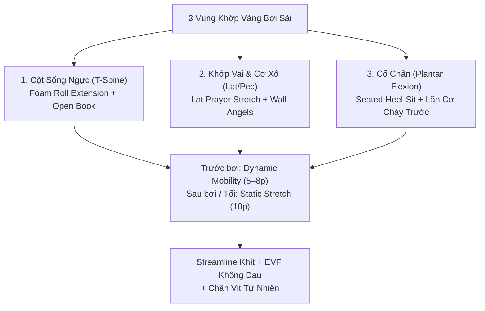

# Linh Hoạt Khớp Vai, Cột Sống Ngực & Cổ Chân (*Mobility & Flexibility*)

> **Thuộc phần:** `19-mobility/` | **Trình độ:** Cơ bản → Nâng cao | **Thời gian đọc:** ~12 phút

## Tổng Quan (Overview)
Bạn không thể ép cơ thể thực hiện một kỹ thuật mà **biên độ khớp của bạn chưa cho phép**. Rất nhiều lỗi kỹ thuật dai dẳng trong bơi sải — như không thể kẹp tay sau tai khi **Streamline**, bị đau nhói vai khi dựng **EVF**, khó xoay thân `45°` bên nghịch, hay đạp chân mãi không tiến — thực chất **không phải do bạn chưa hiểu kỹ thuật**, mà do hạn chế **Mobility** ở 3 vùng khớp trọng yếu: **Cột sống ngực (*Thoracic Spine*), Khớp vai (*Shoulder Complex*) và Cổ chân (*Ankle*)**.

- **Mục tiêu cốt lõi:** Phân biệt rõ **Flexibility (Độ dẻo thụ động)** với **Mobility (Độ linh hoạt chủ động có kiểm soát sức mạnh)** và thực hành lộ trình `10–15 phút/ngày` mở khóa hoàn toàn 3 vùng khớp vàng của bơi sải.
- **Cảm giác đúng:** Đưa hai tay khóa Streamline sau tai nhẹ tênh không võng lưng, xoay vai `45°` mượt mà không đau cấn, cổ chân duỗi mềm tự nhiên như chân vịt.
- **Sai lầm phổ biến nhất:** Kéo giãn tĩnh (*Static Stretching*) giữ 60 giây cho vai **trước** khi xuống hồ (làm giảm ổn định khớp và giảm lực kéo), hoặc nhầm tưởng cứ bẻ khớp vai càng lỏng càng tốt!

---

## Lý Thuyết (Theory)
### 1. Phân biệt Flexibility vs Mobility
- **Flexibility (Độ dẻo thụ động)**: Khả năng kéo dài cơ bắp nhờ ngoại lực (ví dụ dùng tay kéo ép chân hoặc dựa vào khung cửa).
- **Mobility (Độ linh hoạt chủ động)**: Khả năng **chủ động di chuyển khớp qua toàn bộ biên độ vận động và giữ được lực kiểm soát ở góc cuối cùng**.
- **Nghịch lý khớp vai trong bơi lội**: Khớp vai người bơi thường **quá lỏng ở mặt trước (*Anterior Laxity*)** nhưng lại **cứng ở mặt sau (*Posterior Capsule Tightness*) và cột sống ngực**. Nếu bạn chỉ kéo giãn thụ động mạnh mặt trước vai (như ép hai tay ra sau lưng quá đà), bạn có thể làm khớp vai mất ổn định và **dễ chấn thương hơn**! Thay vào đó, hãy tập trung **mở cột sống ngực (T-Spine), giãn cơ ngực nhỏ (*Pec Minor*) & cơ xô (Lat), và tăng Mobility chủ động**.

### 2. Ba Vùng Khớp Vàng Của Bơi Sải

| Vùng khớp | Biên độ chuẩn bơi sải | Hậu quả nếu bị cứng |
| :--- | :--- | :--- |
| **1. Cột sống ngực (*T-Spine*)** | Duỗi thẳng dễ dàng + Xoay mỗi bên `≥ 50°` | Võng lưng dưới khi Streamline, cứng xoay thân bên nghịch, quá tải khớp vai |
| **2. Khớp vai & Cơ Xô (*Shoulder & Lat*)** | Gập vai chủ động `≥ 180°` không võng lưng; Xoay trong/ngoài cân bằng | Không kẹp được tay sau tai, sụp khuỷu EVF, đau chèn ép *Impingement* |
| **3. Cổ chân (*Ankle Plantar Flexion*)** | Duỗi mu bàn chân thẳng hàng ống chân (`165–185°`) | Bàn chân biến thành tấm phanh nước, đạp 6-beat cực nặng và dễ chuột rút |

---

## Cơ Sở Khoa Học (Science)
### Vật Lý & Thủy Động Lực Học (Physics & Hydrodynamics)
- **Mỗi `10°` mở thêm ở Cột sống ngực & Khớp vai** giúp hạ thấp góc tấn của cánh tay trong Streamline và pha Glide, giảm trực tiếp diện tích mặt cắt cản $A$ xuống `8–12%` và kéo dài tầm với DPS thêm `5–8 cm/sải`.
- **Mỗi `15°` mở thêm ở Cổ chân (Plantar Flexion)** giảm lực cản đuôi (*Wake Drag*) và tăng lực đẩy Flutter/Dolphin Kick lên `25–40%` (xem [Ankle Mobility](../08-kicking/ankle-mobility.md)).

### Cơ Sinh Học (Biomechanics)
**Thời điểm vàng của Giãn Động vs Giãn Tĩnh (*Dynamic vs Static Timing*):**
- **TRƯỚC khi bơi (`5–8 phút`)**: Chỉ dùng **Dynamic Mobility** (di chuyển liên tục qua biên độ khớp: *Arm Circles, Thoracic Open Book, Inchworm, Cat-Cow, Band Dislocates*) để tăng dịch khớp và độ nhạy thần kinh–cơ.
- **SAU khi bơi hoặc buổi tối (`10–15 phút`)**: Dùng **Static Stretching & Myofascial Release (Foam Rolling)** (giữ `45–60 giây`: *Lat Stretch, Doorway Pec Stretch, Seated Heel-Sit, Sleeper Stretch nhẹ*) khi cơ bắp đang ấm và cần xả căng thẳng.

---

## Thực Hành (Practical)
### Tại Sao Kỹ Thuật Này Hiệu Quả (Why It Works)
Cơ thể con người hiện đại ngồi trước màn hình máy tính và điện thoại `8–10 giờ/ngày` — tư thế này lập trình sẵn **"Hội chứng Chéo Trên" (*Upper Crossed Syndrome*)**: lưng trên gù, ngực co rút, vai đổ trước, cổ vươn ra — **trái ngược 100% với tư thế Streamline bơi sải!** Chỉ cần `10 phút` chuỗi bài Mobility đúng đích mỗi tối, bạn sẽ đảo ngược hoàn toàn tư thế văn phòng và mở khóa dáng bơi thanh thoát chỉ sau 4 tuần.

### Hướng Dẫn Từng Bước & Cảm Giác Nước (Step-by-Step & Water Cues)
#### 1. Mở Cột Sống Ngực (*T-Spine*) — 3 phút
- **Thoracic Foam Roll Extension**: Đặt con lăn xốp ngang giữa lưng trên (vùng bả vai, **không lăn thắt lưng dưới**), hai tay đỡ gáy, thở ra từ từ ngả lưng trên mở ngực qua con lăn `10 lần`.
- **Open Book (Mở Sách)**: Nằm nghiêng, gối trên gập `90°` ép xuống sàn/con lăn cố định hông; tay trên mở rộng vòng qua đầu sang phía đối diện sao cho hai bả vai tiến sát xuống sàn (`8 lần/bên`).

#### 2. Mở Khớp Vai & Cơ Xô (*Shoulder & Lat*) — 4 phút
- **Lat Prayer Stretch (Kéo giãn cơ xô trên ghế/bóng)**: Quỳ trước ghế/bàn thấp, đặt hai khuỷu tay lên mép ghế, hai lòng bàn tay chắp lại đưa ra sau gáy, từ từ hạ ngực thấp xuống sàn giữ lưng dưới thẳng (`45–60 giây`).
- **Wall Angels (Thiên thần áp tường — Mobility chủ động)**: Đứng tựa gót, mông, lưng dưới, bả vai và gáy sát tường; áp mu bàn tay và khuỷu tay sát tường trượt lên tư thế chữ Y (Streamline) rồi kéo xuống chữ W mà **thắt lưng không được hở khỏi tường** (`2 × 10 lần`).
- **Band Pass-Throughs (Vòng dây mở vai)**: Cầm dây kháng lực rộng hơn vai, giữ khuỷu thẳng đưa vòng mượt từ trước đùi qua đỉnh đầu ra sau lưng rồi quay lại (`15 lần`).

#### 3. Mở Cổ Chân (*Ankle Plantar Flexion*) — 3 phút
- **Foam Roll Tibialis Anterior**: Lăn chậm mặt ngoài ống chân `60 giây/bên`.
- **Seated Heel-Sit Stretch**: Quỳ ngồi mông lên gót chân với mu bàn chân áp phẳng xuống thảm (`2 × 60 giây`).

<!-- IMAGE_PROMPT: Clean 5-panel mobility routine guide for swimmers: (1) Thoracic Extension on foam roller; (2) Side-lying Open Book T-spine rotation; (3) Bench Lat Prayer Stretch opening overhead flexion; (4) Wall Angels showing flat lumbar spine and full overhead reach; (5) Seated Heel-Sit ankle plantar flexion stretch. -->

### Mẹo Nâng Cao (Advanced Tips)
- **Bài tự kiểm tra 30 giây (*3-Zone Mobility Screen*) mỗi đầu tháng**:
  1. *Vai & T-Spine*: Đứng áp sát lưng tường (**Wall Streamline Test**) — hai bắp tay có chạm tường sau tai mà thắt lưng vẫn ép sát tường không?
  2. *Xoay T-Spine*: Ngồi khoanh chân, đặt gậy ngang vai xoay tối đa sang trái và phải — góc xoay có đạt `≥ 50°` và đều 2 bên không?
  3. *Cổ chân*: **Seated Heel-Sit** — mu bàn chân có áp phẳng 100% xuống sàn không đau không?
- **Chú ý an toàn cho bài *Doorway Pec Stretch***: Chỉ kéo giãn nhẹ nhàng ở mức căng `5/10` (tuyệt đối không đẩy người về trước quá mạnh gây căng giãn quá mức bao khớp trước vai!).

---

## Bài Tập Thực Hành (Drills — Lộ Trình Mobility 10 Phút Hàng Ngày)

| Thời điểm | Chuỗi bài tập | Thời lượng | Mục tiêu |
| :--- | :--- | :---: | :--- |
| **Trước khi bơi (Dynamic)** | Arm Circles → Band Pass-Throughs → Thoracic Windmills → Wall Angels → Xoay cổ chân | `5–8 phút` | Bôi trơn khớp, đánh thức biên độ chủ động |
| **Sau khi bơi / Buổi tối (Static)** | Foam Roll T-Spine → Open Book → Lat Prayer Stretch → Seated Heel-Sit | `10 phút` | Xả co rút cơ xô/ngực, tăng sâu biên độ Streamline & Cổ chân |
| **Ngay tại bàn làm việc (Dân văn phòng)** | Ngồi ưỡn mở ngực trên lưng ghế + xoay vai sau mỗi 2 giờ | `2 phút` | Chống hội chứng gù lưng văn phòng phá dáng bơi |

---

## Phân Tích AI & Video (AI Analysis)
- **Góc quay khuyến nghị:** Ngang (Side View) cho bài *Wall Streamline Test* & *Seated Heel-Sit*; Trên cao cho *Seated T-Spine Rotation*.
- **Điểm khớp cần trích xuất (Keypoints):** `wrist`, `elbow`, `shoulder`, `hip`, `ankle`, `toe_tip`.
- **Ngưỡng phát hiện lỗi tự động:**
  - **Đạt chuẩn:** `Wall Streamline` đạt góc vai `≥ 178°` với khoảng hở thắt lưng `< 2 cm`; `T-Spine Rotation ≥ 50°` đều 2 bên; `Ankle Plantar Flexion ≥ 165°`.
  - **Cảnh báo lỗi:** Hở thắt lưng `> 5 cm` khi đưa tay lên đầu (cứng cơ xô/T-Spine — tự động gợi ý *Lat Prayer Stretch* & *Thoracic Foam Roll*).

---

## Lỗi Thường Gặp & Cách Sửa (Common Errors)
| Lỗi thường gặp | Triệu chứng nhận biết | Nguyên nhân gốc | Cách sửa (Correction) |
| :--- | :--- | :--- | :--- |
| **Kéo giãn tĩnh (giữ 60s) ngay trước khi bơi** | Xuống hồ thấy vai lỏng lẻo, mất lực kéo mạnh ở 200m đầu | Giãn tĩnh kéo dài tạm thời làm giảm phản xạ căng cơ & sức mạnh tức thời | Chuyển toàn bộ giãn tĩnh sang **sau buổi bơi / buổi tối**; trước bơi chỉ tập **Dynamic** |
| **Lăn con lăn xốp trực tiếp lên thắt lưng dưới** | Đau nhói vùng lưng dưới | Thắt lưng cần sự *ổn định*, không cần ép duỗi bằng con lăn | Chỉ đặt con lăn từ **ngang xương bả vai lên đốt sống ngực** |
| **Ép giãn quá đau (> 8/10) để nhanh dẻo** | Đau rát khớp, cơ phản xạ co cứng ngược lại mạnh hơn | Kích hoạt phản xạ căng bảo vệ (*Stretch Reflex*) của hệ thần kinh | Giữ cường độ căng êm ái ở mức **`5–6/10`**, kết hợp thở ra chậm sâu |
| **Tập 1 lần/tuần rồi bỏ bẵng** | Không thấy tiến triển rõ rệt về độ mở vai hay cổ chân | Mô liên kết cần tín hiệu lặp lại thường xuyên | Tập **10 phút mỗi ngày** (đều đặn hiệu quả hơn tập 1 tiếng vào cuối tuần) |

---

## Tự Đánh Giá Tại Hồ (Self Assessment)
- [ ] Tôi vượt qua bài kiểm tra **Wall Streamline Test** (hai tay áp sát tường sau tai mà lưng dưới không bị võng hở).
- [ ] Góc xoay cột sống ngực (*Open Book*) của tôi thoải mái và cân bằng giữa bên trái và bên phải.
- [ ] Tôi thực hiện **Dynamic Mobility** trước khi bơi và **Static Stretching** sau khi bơi (hoặc buổi tối).
- [ ] Tôi hoàn thành `10 phút` Mobility ít nhất `5 ngày/tuần` để chống lại tư thế ngồi văn phòng.
- [ ] Khớp vai tôi hoàn toàn êm ái khi thực hiện Streamline chặt và dựng EVF `110°`.

---

## Chỉ Số Đo Lường (KPI)
| Chỉ số (Metric) | Người mới | Trung cấp | Nâng cao (`< 1:30/100m`) |
| :--- | :---: | :---: | :--- |
| **Góc gập vai chủ động không võng lưng (Wall Test)** | `< 160°` | `165–175°` | `180°` (chạm tường dễ dàng) |
| **Độ xoay cột sống ngực (T-Spine) mỗi bên** | `< 35°` | `40–48°` | `≥ 50°` (lệch 2 bên `< 5°`) |
| **Độ duỗi cổ chân (Seated Heel-Sit)** | Hở `> 4 cm` | Hở `1–3 cm` | `0 cm` áp phẳng hoàn toàn |

---

## Câu Hỏi Thường Gặp (FAQ)
**1. Tôi làm văn phòng 9 tiếng/ngày, chỉ cần chọn đúng 3 bài tập hiệu quả nhất thì nên tập bài nào?**
3 bài "đáng tiền" nhất cho dân văn phòng bơi sải là: **(1) Thoracic Foam Roll Extension**, **(2) Lat Prayer Stretch**, và **(3) Seated Heel-Sit Stretch** — tổng cộng chỉ mất đúng `6–8 phút` mỗi tối trước khi ngủ!

**2. Tập Yoga có tốt cho người bơi sải không?**
Rất tốt cho T-Spine, hông và hô hấp! Chỉ cần lưu ý tránh ép quá mức các tư thế bẻ ngửa vai ra sau (nếu vai bạn vốn đã lỏng mặt trước) và ưu tiên các tư thế mở ngực, xoay cột sống ngực và kéo giãn cơ xô (*Puppy Pose, Downward Dog, Thread the Needle*).

**3. Tại sao tôi tập giãn cổ chân và vai nhưng hôm sau lại thấy cứng lại như cũ?**
Vì giãn thụ động chỉ tạo thay đổi tạm thời nếu không đi kèm **kích hoạt cơ chủ động trong biên độ mới** (như *Wall Angels* cho vai và *Short-Fin Kick* cho cổ chân). Hãy luôn kết hợp giãn xong → dùng ngay biên độ đó trong bài tập chủ động!

---

## Tóm Tắt (Summary)
- **Mobility (Linh hoạt chủ động)** ở 3 vùng khớp vàng (**Cột sống ngực – Khớp vai/Cơ xô – Cổ chân**) là nền tảng vật lý để thực hiện Streamline khít, EVF không đau và chân vịt tự nhiên.
- Quy tắc vàng: **Dynamic Mobility (`5–8p`) trước khi bơi** và **Static Stretch + Foam Roll (`10p`) sau khi bơi / buổi tối**.
- Kiểm tra định kỳ bằng **3-Zone Mobility Screen** mỗi tháng để theo dõi tiến bộ rõ ràng.

**Liên kết chéo:**
- Chương trước: [Lịch Tập Cạn Dryland](../18-strength/dryland-programs.md)
- Chương tiếp theo (Phase 8): [Phân Tích VĐV Olympic — Caeleb Dressel](../athletes/caleb-dressel.md)
- Kỹ thuật liên quan: [Streamline](../04-body-position/streamline.md) · [Độ Dẻo Cổ Chân](../08-kicking/ankle-mobility.md)
- Tra cứu thuật ngữ: [Glossary](../24-appendix/glossary.md)

---

## Tài Liệu Tham Khảo (References)
1. Starrett, K., & Cordoza, G. (2015). *Becoming a Supple Leopard*. Victory Belt Publishing.
2. McLeod, I. (2010). *Swimming Anatomy*. Human Kinetics.
3. Wanivenhaus, F., et al. (2012). *Epidemiology of injuries and prevention strategies in competitive swimmers*. Sports Health.

