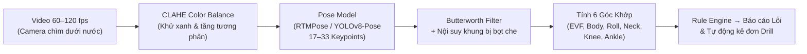
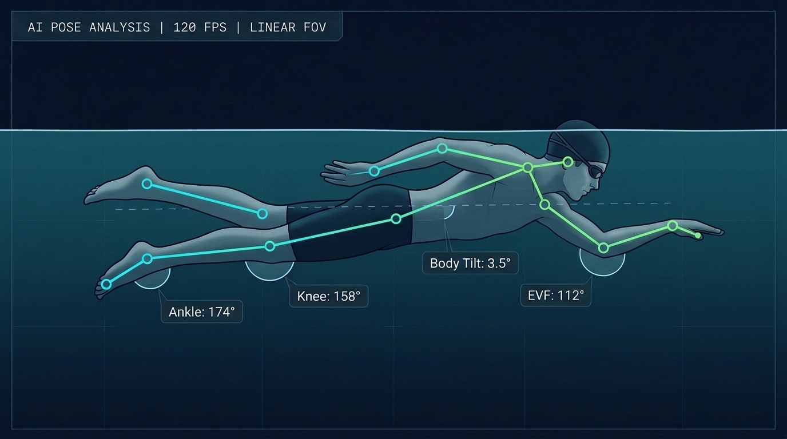

# Pose Detection & Đo Góc Khớp Dưới Nước (*Pose & Joint Angle Analysis*)

> **Thuộc phần:** `20-ai-analysis/` | **Trình độ:** Trung cấp → Nâng cao | **Thời gian đọc:** ~12 phút

## Tổng Quan (Overview)
Mắt thường trên bờ hồ chỉ bắt được khoảng 20–30% sai lệch cơ sinh học vì cơ thể người bơi di chuyển nhanh và bị khúc xạ bởi mặt nước. **Computer Vision Pose Estimation (Nhận diện khung xương AI)** biến một chiếc điện thoại thông thường hoặc Action Cam (`60–120 fps`) thành một **phòng thí nghiệm cơ sinh học di động**: tự động trích xuất tọa độ các khớp vai, khuỷu, cổ tay, hông, gối, cổ chân trên từng khung hình và tính chính xác từng độ của góc **EVF**, góc **nghiêng thân**, góc **xoay trục** và góc **duỗi cổ chân**.

- **Mục tiêu cốt lõi:** Hiểu kiến trúc pipeline AI phân tích bơi sải (`Video → Keypoints 2D/3D → Lọc nhiễu → Tính góc khớp → Cảnh báo lỗi`), biết chọn mô hình phù hợp môi trường nước và ngưỡng góc chuẩn quốc tế.
- **Cảm giác đúng:** Mọi đánh giá kỹ thuật đều dựa trên **con số định lượng khách quan** (ví dụ: góc khuỷu EVF giảm từ `152°` ở Tuần 1 xuống `114°` ở Tuần 8) thay vì lời khen cảm tính.
- **Sai lầm phổ biến nhất:** Chạy thẳng mô hình Pose thông thường trên video đầy bọt khí, góc quay chéo méo phối cảnh (*Perspective Distortion*) mà không hiệu chỉnh góc máy và lọc mượt tín hiệu.

---

## Lý Thuyết (Theory)
Một hệ thống **Swimming Pose & Joint Angle Pipeline** chuẩn công nghiệp gồm 5 tầng xử lý tuần tự:

1. **Tầng 1 — Tiền xử lý hình ảnh dưới nước (*Underwater Preprocessing*)**: Khử nhiễu xanh lam (*Color Balance / CLAHE*), cân bằng tương phản để tách rõ đường viền cơ thể khỏi nền gạch bể và dải bọt khí.
2. **Tầng 2 — Phát hiện khung xương (*2D/3D Pose Estimation*)**: Sử dụng các mô hình chuẩn COCO-17 hoặc MediaPipe-33 (như **YOLOv8-Pose, RTMPose, ViTPose, MediaPipe BlazePose** — ưu tiên bản fine-tuned trên dữ liệu bơi lội để chống che khuất *Occlusion* do bọt nước).
3. **Tầng 3 — Làm mượt chuỗi thời gian (*Temporal Smoothing*)**: Áp dụng bộ lọc **Savitzky-Golay** hoặc **Butterworth Low-Pass (`fc = 6–10 Hz`)** để triệt tiêu hiện tượng rung giật tọa độ khớp (*Jitter*) khi bàn tay bị bọt khí che khuất 2–3 khung hình.
4. **Tầng 4 — Tính toán góc khớp & Véc-tơ (*Kinematic Calculation*)**: Tính góc giữa 3 điểm khớp $A, B, C$ theo tích vô hướng véc-tơ:
   $$\theta_B = \arccos\left(\frac{\overrightarrow{BA} \cdot \overrightarrow{BC}}{\|\overrightarrow{BA}\| \cdot \|\overrightarrow{BC}\|}\right)$$
5. **Tầng 5 — Đối chiếu ngưỡng & Kê đơn Drill (*Rule Engine*)**: So sánh các góc cực trị với bảng chuẩn cơ sinh học và tự động ánh xạ sang bài Drill sửa lỗi tương ứng trong `17-drills/`.

---

## Cơ Sở Khoa Học (Science)
### Vật Lý & Thủy Động Lực Học (Physics & Hydrodynamics)
Thách thức vật lý đặc thù của **Thị giác máy tính dưới nước**:
- **Khúc xạ ánh sáng (*Snell's Law*, $n_{\text{water}} \approx 1.333$)**: Khi camera đặt trên bờ nhìn xuyên qua mặt nước, hình ảnh dưới nước bị bẻ cong và nông giả ~25% → **sai lệch hoàn toàn góc khớp!** Do đó, **bắt buộc phải đặt ống kính chìm hoàn toàn dưới nước** (qua vỏ chống nước) để đo chính xác góc EVF, góc thân và góc cổ chân.
- **Hiện tượng che khuất bọt khí (*Bubble Occlusion*)**: Bọt khí ở pha Entry và Kick làm tụt điểm tin cậy (*Confidence Score*) của cổ tay và cổ chân. Giải pháp: nội suy tuyến tính/spline (*Cubic Spline Interpolation*) qua các khung hình có `confidence < 0.4`.

### Cơ Sinh Học (Biomechanics) — 6 Góc Khớp Cốt Lõi Cần Trích Xuất

| Chỉ số Góc Khớp | 3 Điểm Keypoints | Góc Quay Yêu Cầu | Ngưỡng Đạt Chuẩn (`< 1:30/100m`) | Cảnh Báo Lỗi |
| :--- | :--- | :---: | :---: | :--- |
| **1. Góc khuỷu EVF ($\theta_{\text{EVF}}$)** | `shoulder – elbow – wrist` | Side + Front Underwater | **`100–120°`** (tại giữa Catch) | `> 145°` (Sụp khuỷu / Kéo thẳng tay) |
| **2. Góc nghiêng thân ($\theta_{\text{body}}$)** | `shoulder – ankle` vs phương ngang | Side Underwater | **`0–5°`** | `> 12°` (Chìm hông nặng) |
| **3. Góc xoay vai/hông ($\theta_{\text{roll}}$)** | `L_shoulder – R_shoulder` vs ngang | Front Underwater | **`30–45°`** (lệch trái–phải `< 8°`) | `< 15°` (Phẳng) hoặc `> 60°` (Xoay lố) |
| **4. Góc cổ trung tính ($\theta_{\text{neck}}$)** | `ear – shoulder – hip` | Side Underwater | **`170–180°`** | `< 155°` (Ngẩng đầu nhìn trước) |
| **5. Góc gập gối Kick ($\theta_{\text{knee}}$)** | `hip – knee – ankle` | Side Underwater | **`150–165°`** | `< 130°` (Đạp xe bằng gối) |
| **6. Góc duỗi cổ chân ($\theta_{\text{ankle}}$)** | `knee – ankle – toe_tip` | Side Underwater | **`165–185°`** | `< 140°` (Cổ chân cứng phanh nước) |



---

## Thực Hành (Practical)
### Tại Sao Kỹ Thuật Này Hiệu Quả (Why It Works)
Thay vì phải thuê phòng lab trị giá hàng chục nghìn USD, ngày nay bất kỳ người bơi hoặc HLV nào cũng có thể chạy pipeline Pose Estimation bằng **Python (MediaPipe / Ultralytics YOLOv8-Pose)** hoặc các ứng dụng chuyên dụng (như *SwimSmooth Guru, OnForm, Kinovea*) để theo dõi tiến bộ từng tháng bằng đồ thị góc khớp trực quan!

### Hướng Dẫn Từng Bước & Cảm Giác Nước (Step-by-Step & Water Cues)
1. **Bước 1 — Quay đúng góc vuông góc `90°` với làn bơi**: Camera di chuyển song song dọc làn bơi (hoặc đặt cố định giữa bể quay đoạn `5–15 m`) để tránh sai số phối cảnh.
2. **Bước 2 — Đảm bảo độ sáng và trang phục tương phản**: Mặc đồ bơi màu tối (đen/xanh đậm) trên nền gạch bể sáng để mô hình AI nhận diện chính xác khớp hông, vai và khuỷu với `confidence > 0.85`.
3. **Bước 3 — Chạy trích xuất khung xương & xuất đồ thị góc theo thời gian**: Vẽ đồ thị góc $\theta_{\text{EVF}}(t)$ và $\theta_{\text{body}}(t)$ qua 3 chu kỳ sải liên tiếp để lấy giá trị trung bình ổn định.
4. **Bước 4 — Đọc báo cáo theo thứ tự ưu tiên**: Luôn sửa lỗi **Body Angle ($\theta_{\text{body}}$)** và **Neck Angle** trước → tiếp theo là **Roll Angle** → sau đó mới tinh chỉnh **EVF Angle** và **Ankle/Knee Angle**.


<!-- IMAGE_PROMPT: Technical computer vision overlay diagram on a clean underwater side view of a freestyle swimmer showing glowing cyan skeleton keypoints (ear, shoulder, elbow, wrist, hip, knee, ankle, toe), with crisp geometric angle arcs labeled "EVF: 112 deg", "Body Tilt: 3.5 deg", "Knee: 158 deg", "Ankle: 174 deg" and a sleek minimal telemetry HUD bar. -->

### Mẹo Nâng Cao (Advanced Tips)
- **Ví dụ cấu trúc tính góc khớp nhanh (Pseudocode Python chuẩn xác):**
  ```python
  import numpy as np

  def joint_angle(a, b, c):
      ba = np.array(a) - np.array(b)
      bc = np.array(c) - np.array(b)
      cos_val = np.dot(ba, bc) / (np.linalg.norm(ba) * np.linalg.norm(bc) + 1e-8)
      return float(np.degrees(np.arccos(np.clip(cos_val, -1.0, 1.0))))
  ```
- **Dùng mốc dán màu phản quang (Color Markers) khi tự quay nghiên cứu**: Dán băng keo thể thao màu neon lên khớp vai, khuỷu, cổ tay và hông giúp độ chính xác tracking dưới nước tăng từ `~85%` lên **`> 97%`** ngay cả trong điều kiện ánh sáng bể trong nhà!

---

## Bài Tập Thực Hành (Drills — Quy Trình Tự Kiểm Tra Bằng AI Tại Hồ)

| Quy Trình | Tần suất | Góc quay cần lấy | Đầu ra mong đợi |
| :--- | :---: | :--- | :--- |
| **Baseline AI Audit** | Tuần 01 | Side + Front Underwater (`25m` mỗi góc) | Báo cáo 6 góc khớp nền + Top 2 lỗi ưu tiên sửa |
| **Mid-Plan Check** | Tuần 08 & 16 | Giữ nguyên góc quay & tốc độ CSS | Đồ thị so sánh Trước/Sau của góc EVF & Body Tilt |
| **Pre-Taper Fine Tune** | Tuần 20 | Side Underwater tốc độ `< 1:30/100m` | Xác nhận góc EVF không vỡ ở `25m` cuối khi mệt |

---

## Phân Tích AI & Video (AI Analysis)
- **Độ chính xác tiêu chuẩn (*PCK@0.2*):** Mô hình fine-tuned trên tập dữ liệu bơi dưới nước đạt `PCK ≥ 90%` cho vai/hông/gối và `≥ 82%` cho cổ tay/cổ chân (vùng nhiều bọt khí nhất).
- **Khuyến nghị phần cứng tối thiểu:** Quay `1080p @ 60fps` (tối ưu `120fps` cho Sprint) với tốc độ màn trập nhanh (`Shutter Speed ≥ 1/500s`) để không bị nhòe chuyển động (*Motion Blur*) ở bàn tay pha Push.

---

## Lỗi Thường Gặp & Cách Sửa (Common Errors)
| Lỗi thường gặp | Triệu chứng nhận biết | Nguyên nhân gốc | Cách sửa (Correction) |
| :--- | :--- | :--- | :--- |
| **Quay từ trên bờ nhìn chéo xuống nước** | AI báo góc khuỷu và góc hông sai lệch `15–25°` | Khúc xạ mặt nước và méo phối cảnh 3D → 2D | Bắt buộc nhúng camera chìm dưới nước, quay vuông góc `90°` với làn bơi |
| **Không lọc nhiễu tọa độ (No Smoothing)** | Đồ thị góc khuỷu nhảy răng cưa loạn xạ | Bọt khí che khớp cổ tay vài khung hình | Áp dụng lọc **Butterworth (`6–8 Hz`)** + nội suy khung có `conf < 0.4` |
| **Quay ở tốc độ khung hình quá thấp (24–30 fps)** | Bàn tay nhòe mờ ở pha Pull–Push, mất keypoint | Tốc độ bàn tay đạt `2.5–3.5 m/s` gây Motion Blur | Chuyển cài đặt camera lên tối thiểu **`60 fps`** (tốt nhất `120 fps`) |
| **Phân tích trên 1 sải duy nhất** | Kết quả sai lệch do trùng đúng sải thở hoặc sải đầu tiên sau tường | Cỡ mẫu quá nhỏ không đại diện nhịp bơi thực tế | Luôn lấy trung bình của tối thiểu **3–5 chu kỳ sải liên tiếp** ở đoạn giữa bể |

---

## Tự Đánh Giá Tại Hồ (Self Assessment)
- [ ] Tôi hiểu rõ 5 tầng của một pipeline AI Pose Estimation cho bơi sải.
- [ ] Tôi nắm thuộc lòng ngưỡng chuẩn của **6 góc khớp vàng** (EVF `100–120°`, Body `< 5°`, Roll `30–45°`, Neck `170–180°`, Knee `150–165°`, Ankle `165–185°`).
- [ ] Khi quay video tự phân tích, tôi luôn đặt camera chìm dưới nước, vuông góc làn bơi ở `≥ 60 fps`.
- [ ] Tôi biết cách dùng kết quả đo góc khớp để đối chiếu và chọn đúng 1–2 bài Drill trong `17-drills/`.

---

## Chỉ Số Đo Lường (KPI)
| Chỉ số hệ thống AI | Mức Cơ bản (Phone + App) | Mức Chuyên nghiệp (Fine-tuned CV) |
| :--- | :---: | :---: |
| **Tốc độ khung hình đầu vào** | `60 fps` (1080p) | `120–240 fps` (Sync 2–3 góc) |
| **Độ tin cậy Keypoints trung bình** | `> 0.75` | `> 0.90` |
| **Sai số đo góc khuỷu EVF (MAE)** | `± 5–7°` | `± 2–3°` |

---

## Câu Hỏi Thường Gặp (FAQ)
**1. Người bơi phong trào không biết lập trình thì dùng công cụ nào để phân tích Pose AI ngay?**
Bạn có thể dùng các ứng dụng di động có sẵn vẽ góc khớp và AI Pose như **OnForm**, **Kinovea** (miễn phí trên Windows, cực kỳ chính xác để đo góc thủ công/bán tự động), **Dartfish**, hoặc gửi video theo chuẩn góc quay ở chương `21-video-analysis` cho HLV phân tích.

**2. Tại sao mô hình AI nhận diện người trên cạn (như MediaPipe mặc định) đôi khi bị mất khớp dưới nước?**
Vì dữ liệu huấn luyện gốc (COCO) 99% là người đứng thẳng trên cạn trong không khí. Khi người nằm ngang dưới nước có bọt khí và phản chiếu mặt nước, mô hình dễ nhầm vai trái–vai phải. Giải pháp là xoay ảnh `90°` hoặc dùng các mô hình đã fine-tune trên bộ dữ liệu bơi (xem [Dataset Schema](../datasets/dataset-schema.md)).

---

## Tóm Tắt (Summary)
- **Pose Detection & Joint Angle Tracking** lượng hóa toàn bộ kỹ thuật bơi sải thành **6 góc khớp cốt lõi** không cảm tính.
- Luôn bảo đảm **camera chìm dưới nước `≥ 60 fps`**, **khử nhiễu Butterworth**, và **tính trung bình trên 3–5 chu kỳ** để ra quyết định sửa lỗi chính xác tuyệt đối.

**Liên kết chéo:**
- Chương trước: [Block 6 — Tuần 21–24](../22-training-plan/weeks-21-24.md)
- Chương tiếp theo: [Nhận Diện Tự Động Stroke, Kick & Breathing](stroke-kick-breathing-detection.md)
- Tài liệu liên quan: [Schema Dữ Liệu AI](../datasets/dataset-schema.md) · [Glossary](../24-appendix/glossary.md)

---

## Tài Liệu Tham Khảo (References)
1. Cao, Z., et al. (2019). *OpenPose / Realtime Multi-Person 2D Pose Estimation*. IEEE TPAMI.
2. Einfalt, M., Zecha, D., & Lienhart, R. (2018). *Activity-conditioned continuous human pose estimation for performance analysis of athletes using the example of swimming*. IEEE WACV.
3. Mooney, R., et al. (2016). *Analysis of swimming performance: perceptions and practices of US-based swimming coaches*. Journal of Sports Sciences.

