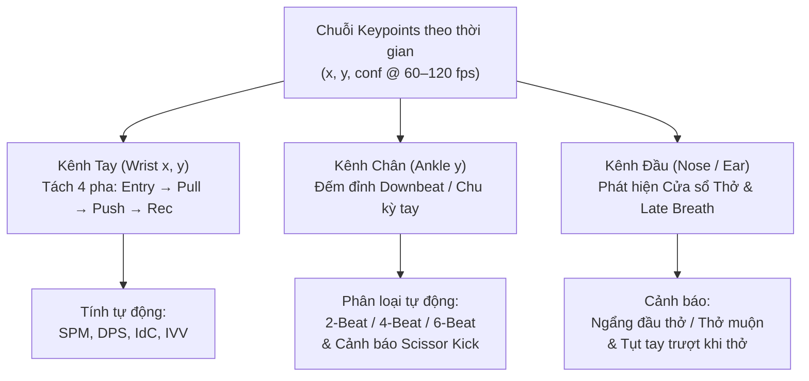

# Tự Động Nhận Diện Stroke, Kick & Breathing (*Event Detection AI*)

> **Thuộc phần:** `20-ai-analysis/` | **Trình độ:** Trung cấp → Nâng cao | **Thời gian đọc:** ~11 phút

## Tổng Quan (Overview)
Sau khi trích xuất được tọa độ khung xương từng khung hình (chương trước), bước nâng cấp tiếp theo của AI phân tích bơi lội là **Event Detection (Nhận diện sự kiện chuỗi thời gian)**: tự động phát hiện chính xác từng khoảnh khắc **Hand Entry, Catch, Pull, Push, Recovery**, đếm số nhịp **2/4/6-Beat Kick**, đánh dấu **nhịp thở (Breathing Window)** và tính toán tự động toàn bộ bộ chỉ số **SPM, DPS, IdC và SWOLF** mà không cần con người ngồi bấm đồng hồ thủ công!

- **Mục tiêu cốt lõi:** Hiểu các thuật toán tín hiệu học (*Signal Processing & Temporal AI*) phát hiện tự động chu kỳ tay, nhịp chân và cửa sổ thở từ cả **Video Pose** lẫn **Cảm biến IMU (đồng hồ bơi)**.
- **Cảm giác đúng:** Chỉ cần thả một đoạn video `25m` hoặc file `.FIT` từ đồng hồ vào hệ thống là lập tức nhận được biểu đồ đầy đủ: `SPM = 71`, `DPS = 1.48 m`, `IdC = -1.5%`, `Kick = 4-Beat`, `Late Breath = 0`.
- **Sai lầm phổ biến nhất:** Chỉ đếm số đỉnh cổ tay thô mà không tách biệt pha kéo dưới nước với pha rút trên không, dẫn tới tính sai chỉ số phối hợp `IdC`.

---

## Lý Thuyết (Theory)
Mọi chu kỳ bơi sải là một **tín hiệu tuần hoàn đa kênh (*Multi-Channel Periodic Signal*)**:
1. **Kênh Tay (*Stroke Phase Segmentation*)**: Quỹ đạo tọa độ cổ tay theo trục ngang tiến tới $x_{\text{wrist}}(t)$ và trục dọc độ sâu $y_{\text{wrist}}(t)$ vẽ nên một đường cong khép kín chia rõ 4 mốc sự kiện:
   - **Entry ($t_{\text{entry}}$)**: Điểm $x_{\text{wrist}}$ tiến xa nhất về phía trước và $y_{\text{wrist}}$ cắt xuống qua đường mặt nước (`waterline_y`).
   - **Catch / Pull Start ($t_{\text{pull}}$)**: Điểm $x_{\text{wrist}}$ đạt cực đại trước vai và bắt đầu đổi chiều vận tốc $\dot{x}_{\text{wrist}} < 0$ (lùi về phía hông so với thân).
   - **Push End / Release ($t_{\text{push}}$)**: Điểm $x_{\text{wrist}}$ đạt cực tiểu sau hông và cắt ngược lên trên `waterline_y`.
   - **Recovery**: Đoạn $y_{\text{wrist}} < y_{\text{waterline}}$ (trên mặt nước).
2. **Kênh Chân (*Kick Beat Detection*)**: Tín hiệu độ sâu hai cổ chân $y_{\text{ankle\_L}}(t), y_{\text{ankle\_R}}(t)$ dao động hình sin; đếm tổng số cực đại địa phương (*Local Maxima — Downbeats*) trong 1 chu kỳ tay $T_{\text{cycle}}$ sẽ phân loại ngay **2-Beat, 4-Beat hay 6-Beat Kick**!
3. **Kênh Thở (*Breathing Detection*)**: Phát hiện thông qua sự thay đổi đột ngột của góc xoay đầu (*Head Yaw/Roll Angle*) hoặc khoảng cách `ear – nose` vượt ngưỡng `> 35°`, đối chiếu trực tiếp thời điểm kết thúc thở với $t_{\text{entry}}$ của tay cùng bên để bắt lỗi **Thở Muộn (*Late Breathing*)**.

---

## Cơ Sở Khoa Học (Science)
### Vật Lý & Thủy Động Lực Học (Physics & Hydrodynamics)
Từ các mốc thời gian tự động phát hiện được, hệ thống lập tức tính toán chính xác bộ **5 chỉ số thủy động học vàng**:
- **Tempo (SPM)**: $\text{SPM} = \frac{60}{t_{\text{entry}}(i+1) - t_{\text{entry}}(i)}$
- **Distance Per Stroke (DPS)**: $\text{DPS} = x_{\text{hip}}(t_{\text{entry}, i+1}) - x_{\text{hip}}(t_{\text{entry}, i})$ (hiệu chuẩn theo tỷ lệ pixel/mét của vạch đáy bể 5m).
- **Index of Coordination (IdC)**: $\text{IdC} = \frac{t_{\text{pull}}(2) - t_{\text{push}}(1)}{T_{\text{cycle}}} \times 100\%$
- **Intra-cyclic Velocity Variation (IVV)**: $\text{IVV} = \frac{\text{std}(v_{\text{hip}}(t))}{\text{mean}(v_{\text{hip}}(t))} \times 100\%$
- **Kick-to-Stroke Ratio**: $R_{\text{kick}} = \frac{N_{\text{downbeats}}}{N_{\text{arm\_cycles}}}$ (`≈ 2, 4, hoặc 6`).

### Cơ Sinh Học (Biomechanics) — Kết Hợp Cảm Biến Đeo (IMU) & Thị Giác Máy Tính (CV)

| Nguồn dữ liệu | Ưu điểm nổi bật | Hạn chế | Ứng dụng tốt nhất |
| :--- | :--- | :--- | :--- |
| **Đồng hồ / Kính IMU** (Gia tốc kế + Con quay hồi chuyển) | Theo dõi liên tục cả buổi `3.000m`, tự tính `SWOLF, SPM, Pace, Split` tức thời | Không đo được chính xác góc EVF, góc gối hay lỗi Crossover | Quản trị tải 24 tuần, theo dõi `Tempo Drift` & `CSS` |
| **Video Pose CV** (Camera chìm 60–120 fps) | Đo chính xác từng độ của EVF, Body Roll, IdC, Scissor Kick, Late Breathing | Chỉ quay được từng đoạn mẫu `15–25m` | Kiểm định kỹ thuật định kỳ (Tuần 1, 8, 16, 20) & sửa lỗi gốc |
| **Hybrid (IMU + Video Sync)** | Toàn diện 100% cả sinh lý lẫn cơ sinh học | Cần đồng bộ thời gian | Huấn luyện đỉnh cao & nghiên cứu khoa học |

---

## Thực Hành (Practical)
### Tại Sao Kỹ Thuật Này Hiệu Quả (Why It Works)
Con người rất khó đếm chính xác cùng lúc **nhịp chân (4-beat hay 6-beat?)**, **thời điểm mặt úp lại so với tay chạm nước** và **sự chênh lệch `0.15 giây` của pha IdC**. Hệ thống nhận diện sự kiện AI tự động đánh dấu trực tiếp lên dòng thời gian (*Timeline Annotation*), giúp HLV và người bơi nhìn thấy ngay lập tức mối liên hệ nhân quả — ví dụ: *"Mỗi lần thở muộn `0.25s`, vận tốc hông $v_{\text{hip}}$ lập tức tụt `18%` và chân tách rộng thành Scissor Kick!"*.

### Hướng Dẫn Từng Bước & Cảm Giác Nước (Step-by-Step & Water Cues)
1. **Hiệu chuẩn không gian (*Spatial Calibration*)**: Dùng khoảng cách cố định giữa các vạch đen đáy hồ hoặc vạch cờ `5m` (hoặc chiều dài phao làn tiêu chuẩn) để quy đổi chính xác `pixels → mét` khi tính `DPS` và vận tốc $v_{\text{hip}}$.
2. **Phát hiện tự động pha tay bằng thuật toán Peak Detection**: Tìm các điểm cực đại/cực tiểu của tín hiệu $x_{\text{wrist}} - x_{\text{shoulder}}$ (vị trí cổ tay tương đối so với vai) để không bị ảnh hưởng bởi chuyển động di chuyển của máy quay.
3. **Kiểm tra đồng bộ Thở – Tay (*Breath Timing Check*)**: So sánh mốc khung hình đầu quay về nhìn đáy ($t_{\text{head\_return}}$) với mốc khung hình tay cùng bên chạm mặt nước ($t_{\text{entry}}$):
   - Nếu $t_{\text{head\_return}} < t_{\text{entry}}$ → **Đạt chuẩn (Early Head Return)**.
   - Nếu $t_{\text{head\_return}} > t_{\text{entry}}$ → **Lỗi Thở Muộn (Late Breathing)**.
4. **Xuất báo cáo tổng hợp sau mỗi buổi quay**: Lưu bảng chỉ số theo ngày để so sánh xuyên suốt 24 tuần.

<!-- IMAGE_PROMPT: Clean MIT-style synchronized multi-channel waveform telemetry chart for freestyle swimming AI analysis: Channel 1 Left/Right Wrist X-trajectory segmented into Entry/Catch/Pull/Push/Recovery with IdC gap highlighted; Channel 2 Ankle vertical sine wave counting 4-Beat/6-Beat kicks; Channel 3 Head Roll pulse flagging optimal Breathing Window vs Late Breathing warning. -->

### Mẹo Nâng Cao (Advanced Tips)
- **Dùng mô hình chuỗi thời gian (1D-CNN / Bi-LSTM / Temporal Convolutional Network — TCN)**: Thay vì chỉ dựa vào quy tắc ngưỡng cứng (dễ nhiễu khi người bơi đổi kiểu), các hệ thống AI hiện đại đưa chuỗi véc-tơ góc khớp và vận tốc `60 frames` vào một mạng **TCN nhẹ** để phân loại pha động tác đạt độ chính xác **`> 94%`** theo thời gian thực!

---

## Bài Tập Thực Hành (Drills — Kiểm Chứng Chỉ Số AI Qua Bài Tập Thực Tế)

| Bài Tập Kiểm Chứng | Chỉ số AI theo dõi | Mục tiêu xác thực |
| :--- | :--- | :--- |
| **Kick Gear-Shift (`2 → 4 → 6`)** | `Kick-to-Stroke Ratio` | AI nhận diện chính xác bước nhảy từ `2.0 → 4.0 → 6.0` |
| **Ramp Test SPM (`8 × 50m`)** | `SPM`, `DPS`, `IdC` | Quan sát `IdC` chuyển từ `-8%` (Catch-Up) lên `0%` (Opposition) khi tăng nhịp |
| **One-Goggle Breathing Check** | `t_head_return - t_entry` | Xác nhận đầu úp về đáy trước khi tay chạm nước (`< 0 ms`) |

---

## Phân Tích AI & Video (AI Analysis)
- **Độ trễ & Độ chính xác chuẩn:** Sai số phát hiện thời điểm `Entry` và `Push End` `≤ ± 2 khung hình` (`± 33 ms` ở `60 fps`); độ chính xác phân loại `2/4/6-Beat Kick` `≥ 92%`.

---

## Lỗi Thường Gặp & Cách Sửa (Common Errors)
| Lỗi thường gặp | Triệu chứng nhận biết | Nguyên nhân gốc | Cách sửa (Correction) |
| :--- | :--- | :--- | :--- |
| **Tính DPS bằng tọa độ pixel không hiệu chuẩn** | Sai số vận tốc và DPS lên tới `30–50%` | Camera di chuyển theo người bơi hoặc đặt xa/gần khác nhau | Luôn hiệu chuẩn theo mốc chiều dài cố định (phao làn/chiều cao cơ thể người bơi) |
| **Đồng hồ đeo tay đếm sai Stroke Count** | Đồng hồ báo 11 sải thay vì 16 sải | Dừng tay giữa bể hoặc đạp tường nhẹ không đủ gia tốc kích hoạt lap | Đạp tường dứt khoát bằng Streamline và không dừng giữa làn |
| **Nhầm lẫn cú đá cắt kéo (Scissor Kick) với 4-Beat** | AI báo 4-Beat nhưng thực tế là 2-Beat + 1 cú đá kéo | Chỉ đếm số đỉnh dọc mà không kiểm tra độ mở ngang/góc gối | Thêm điều kiện kiểm tra `knee_angle ≥ 140°` và độ mở hai gối `< 30 cm` |

---

## Tự Đánh Giá Tại Hồ (Self Assessment)
- [ ] Tôi hiểu cách hệ thống AI tự động tách 4 pha tay (`Entry, Pull, Push, Recovery`) và tính chỉ số `IdC`.
- [ ] Tôi biết cách dùng đồng hồ bơi (IMU) kết hợp với video định kỳ để theo dõi toàn diện `SPM, DPS, SWOLF` và lỗi kỹ thuật.
- [ ] Tôi hiểu tiêu chí toán học của lỗi **Thở Muộn (`t_head_return > t_entry`)** để tự kiểm tra trên video quay chậm.
- [ ] Tôi có thói quen lưu trữ chỉ số định kỳ qua từng Block 4 tuần.

---

## Chỉ Số Đo Lường (KPI)
| Chỉ số hệ thống nhận diện | Ngưỡng đạt chuẩn |
| :--- | :---: |
| **Sai số phát hiện mốc pha tay (`Entry/Push`)** | `≤ ± 35 ms` (ở `60 fps`) |
| **Độ chính xác phân loại nhịp chân (`2/4/6-Beat`)** | `≥ 92%` |
| **Độ chính xác phát hiện khung hình thở (`Breathing F1-Score`)** | `≥ 95%` |

---

## Câu Hỏi Thường Gặp (FAQ)
**1. Đồng hồ Garmin / Apple Watch có đo được chỉ số IdC và góc EVF không?**
Chưa. Đồng hồ chỉ đeo ở 1 cổ tay (cảm biến IMU đơn điểm) nên đo rất tốt **Pace, Split, Stroke Count, SPM và SWOLF**, nhưng **không thể thấy được vị trí khuỷu tay hay độ sâu hông**. Do đó, kết hợp **Đồng hồ hàng ngày + Video AI mỗi 4–8 tuần** là công thức hoàn hảo nhất!

**2. Kính bơi thông minh (FORM Smart Swim Goggles) hỗ trợ gì cho Event Detection?**
Kính bơi thông minh gắn IMU ngay trên thái dương, đo cực kỳ chính xác **Head Pitch (độ ngẩng đầu)**, **Head Roll (góc xoay khi thở)** và hiển thị trực tiếp **Pace, SPM, thời gian** ngay trước mắt bạn khi đang bơi!

---

## Tóm Tắt (Summary)
- **Event Detection AI** tự động phân tách chu kỳ tay (`IdC, SPM, DPS, IVV`), đếm nhịp chân (`2/4/6-Beat`) và kiểm tra chuẩn thời điểm thở (`Early Head Return`).
- Kết hợp **Cảm biến đeo (IMU)** theo dõi hàng ngày với **Video Pose AI** kiểm định định kỳ tạo nên hệ thống phản hồi khép kín chuẩn Olympic.

**Liên kết chéo:**
- Chương trước: [Pose Detection & Đo Góc Khớp](pose-and-joint-angle.md)
- Chương tiếp theo: [Quy Trình Quay Đa Góc & Video Annotation](../21-video-analysis/filming-and-annotation-workflow.md)
- Tài liệu liên quan: [Dataset Schema](../datasets/dataset-schema.md) · [Glossary](../24-appendix/glossary.md)

---

## Tài Liệu Tham Khảo (References)
1. Chollet, D., et al. (2000). *Index of coordination in front crawl*. International Journal of Sports Medicine.
2. Guignard, B., Rouard, A., Chollet, D., & Seifert, L. (2017). *Behavioral dynamics in swimming: The appropriate use of inertial measurement units*. Frontiers in Psychology.
3. Victor, Z., et al. (2019). *Deep learning for automatic stroke phase detection in swimming*. Sports Engineering.

