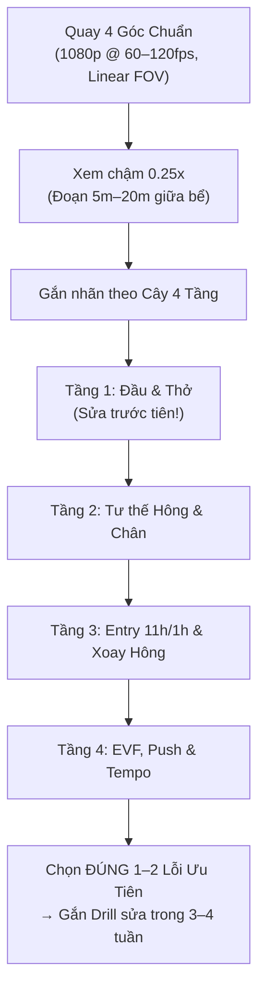

# Quy Trình Quay Video Đa Góc & Gắn Nhãn Lỗi (*Filming & Annotation Workflow*)

> **Thuộc phần:** `21-video-analysis/` | **Trình độ:** Cơ bản → Nâng cao | **Thời gian đọc:** ~11 phút

## Tổng Quan (Overview)
Một mô hình AI mạnh đến đâu cũng trở nên vô dụng nếu video đầu vào bị rung lắc, ngược sáng, quay sai góc hoặc mờ nhòe (*Garbage In, Garbage Out*). Chương này cung cấp **quy trình chuẩn 4 góc quay tại hồ bơi** (chỉ cần 1 chiếc điện thoại có túi/vỏ chống nước hoặc Action Cam như GoPro/DJI Osmo Action), cách **đọc lỗi từng khung hình quay chậm (0.25x)** và quy trình **Video Annotation** để bạn hoặc HLV chẩn đoán chính xác 100% lỗi kỹ thuật trong vòng 10 phút.

- **Mục tiêu cốt lõi:** Tự quay được bộ **4 góc video chuẩn mực (Underwater Side, Underwater Front, Above-Water Side, Overhead/Rear)** và áp dụng quy trình gắn nhãn lỗi 5 bước không bỏ sót nguyên nhân gốc.
- **Cảm giác đúng:** Chỉ sau 1 buổi quay `15 phút`, bạn nhìn thấy rõ ràng như ban ngày những lỗi kỹ thuật mà mình bơi nhiều năm không hề hay biết!
- **Sai lầm phổ biến nhất:** Chỉ quay 1 góc trên bờ nhìn xuống (không thấy gì dưới mặt nước), hoặc quay ở quá gần thành bể (đúng lúc người bơi đang giảm tốc để quay đầu).

---

## Lý Thuyết (Theory)
### Bộ 4 Góc Quay Chuẩn Vàng (Multi-Angle Capture Protocol)

Không có một góc quay duy nhất nào nhìn thấy hết mọi lỗi của bơi sải. Chuẩn phân tích chuyên nghiệp yêu cầu **4 góc quay bổ trợ nhau**:

| Góc quay | Vị trí đặt Camera | Phát hiện chính xác nhất những lỗi nào? |
| :--- | :--- | :--- |
| **1. Ngang Dưới Nước (*Underwater Side View*)** | Chìm `30–50 cm`, cách người bơi `2.5–3.5 m`, đi bộ song song dọc làn (hoặc cố định giữa bể) | Góc nghiêng thân, chìm hông, độ sâu trượt (`10–15 cm`), **góc khuỷu EVF**, pha Push tới đùi, góc gối & cổ chân, `IdC` |
| **2. Chính Diện Dưới Nước (*Underwater Front View*)** | Người quay đứng ở đầu bể (đoạn `5m` cuối), nhúng camera chìm `30–40 cm` hướng thẳng vào người bơi tiến tới | **Lỗi Crossover (vắt chéo)**, đường ray 11h/1h, góc xoay vai–hông (`30–45°`), độ sâu EVF mặt trước, **Scissor Kick**, quy tắc *One-Goggle* |
| **3. Ngang Mặt Nước (*Above-Water Side View*)** | Cao hơn mặt nước `30–50 cm`, đi song song làn bơi | Pha **Recovery** (High-Elbow vs vung rộng), đầu nhô cao khi thở, **Late Breathing**, bọt sóng khi Entry |
| **4. Trên Cao / Phía Sau (*Overhead / Rear View*)** | Đứng trên bục cao / ban công nhìn xuống làn | Đường bơi thẳng hay ngoằn ngoèo (**Fishtailing**), độ vung ngang tay Recovery, độ đối xứng 2 bên, **DPS & Stroke Count** |

---

## Cơ Sở Khoa Học (Science)
### Vật Lý & Thủy Động Lực Học (Physics & Hydrodynamics)
- **Cài đặt Quang học Tối ưu Dưới Nước**:
  - **Độ phân giải & Tốc độ khung hình**: `1080p @ 60fps` (tiêu chuẩn) hoặc `1080p @ 120fps` (cho Sprint & Dolphin Kick).
  - **Góc ống kính (*Field of View — FOV*)**: Chọn chế độ **Linear (Tuyến tính)** — **tuyệt đối tắt chế độ Wide / SuperView / Fisheye** vì ống kính mắt cá làm cong các đường thẳng và sai lệch `10–20°` khi đo góc khớp bằng AI!
  - **Ánh sáng**: Ưu tiên bơi hướng **thuận sáng** (mặt trời/đèn ở phía sau lưng người quay) để tránh bị lóa bóng đen (*Silhouette*) không nhìn thấy chi tiết khuỷu tay và bàn tay.

### Cơ Sinh Học (Biomechanics) — Nguyên Tắc Gắn Nhãn Theo Thứ Tự "Nguyên Nhân → Hệ Quả"

Khi xem lại video quay chậm `0.25x`, **đừng liệt kê 10 lỗi cùng lúc**! Hãy gắn nhãn theo **cây ưu tiên 4 tầng (Root-Cause Hierarchy)** của SwimSmooth & USA Swimming:
1. **Tầng 1 (Gốc rễ — Thở & Đầu)**: Ngẩng đầu thở? Thở muộn? Nhìn thẳng phía trước?
2. **Tầng 2 (Khung thân — Tư thế & Cân bằng)**: Hông chìm `> 10°`? Võng lưng? Đá cắt kéo (*Scissor Kick*)?
3. **Tầng 3 (Đường vào & Trục xoay)**: Tay vắt chéo (*Crossover*)? Xoay hông không đều 2 bên? Tay trượt tụt sâu khi thở?
4. **Tầng 4 (Tạo lực & Hiệu suất)**: Sụp khuỷu EVF? Cắt cụt pha Push? Quạt trượt nước / Over-Gliding?

---

## Thực Hành (Practical)
### Tại Sao Kỹ Thuật Này Hiệu Quả (Why It Works)
Rất nhiều lỗi ở Tầng 4 (như sụp khuỷu EVF hay lắc hông) sẽ **tự động biến mất 70%** ngay sau khi bạn nhìn thấy và sửa dứt điểm lỗi ở Tầng 1–2 (như ngẩng đầu thở và ấn tay trượt)! Quy trình quay 4 góc + gắn nhãn 4 tầng giúp bạn tiết kiệm hàng tháng trời tập sai trọng tâm.

### Hướng Dẫn Từng Bước & Cảm Giác Nước (Step-by-Step & Water Cues)
1. **Chuẩn bị trước khi quay (3 phút)**:
   - Dùng gậy tự sướng chống nước dài `60–100 cm` (gắn Action Cam hoặc điện thoại có vỏ chống nước) để người quay đứng trên bờ vẫn có thể nhúng camera chìm sâu `40 cm` đi dọc theo thành bể cực kỳ êm!
   - Lau sạch mặt kính ống kính (nhúng ướt nhẹ chống đọng giọt nước khi quay trên mặt nước).
2. **Kịch bản quay nhanh 10 phút (Chỉ cần 4 chiều bể `25m`)**:
   - *Chiều 1 (Pace CSS thoải mái)*: Quay **Góc 1 (Ngang dưới nước)** đi dọc làn bơi.
   - *Chiều 2 (Pace CSS thoải mái)*: Quay **Góc 2 (Chính diện dưới nước)** — bơi thẳng về phía camera cho tới cách camera `1.5 m`.
   - *Chiều 3 (Pace CSS thoải mái)*: Quay **Góc 3 (Ngang trên mặt nước)**.
   - *Chiều 4 (Pace nhanh 90%)*: Quay **Góc 1 (Ngang dưới nước)** lần 2 để xem **lỗi nào chỉ xuất hiện khi bơi nhanh**!
3. **Gắn nhãn Video Annotation (15 phút trên Kinovea / OnForm / AI Tool)**:
   - Dừng tại 4 khung hình chốt (*Keyframes*): `(1) Đỉnh pha thở`, `(2) Hand Entry`, `(3) Giữa pha Catch EVF`, `(4) Kết thúc Push`.
   - Kẻ đường ngang mặt nước, đo góc thân, đo góc khuỷu EVF, đánh dấu vị trí tay so với trục giữa và ghi chú tối đa **2 hành động sửa lỗi** cho 4 tuần tới.

<!-- IMAGE_PROMPT: Clean architectural top-down and cross-section pool filming diagram showing a 25m swimming lane with 4 numbered camera stations: Cam 1 Underwater Side Tracking (depth 40cm, 3m away), Cam 2 Underwater Front at 5m mark, Cam 3 Above-Water Side, Cam 4 Overhead/Rear, highlighting the 5m-20m clean analysis zone away from walls and Linear FOV cones. -->

### Mẹo Nâng Cao (Advanced Tips)
- **Đừng bao giờ chỉ quay lúc bạn đang "cố diễn cho đẹp" ở 25m đầu buổi**: Hãy quay 1 lượt lúc đầu buổi (tươi tỉnh) và **1 lượt thứ 2 sau khi đã bơi `1.000m` mệt** — video lúc mệt mới phơi bày chính xác 100% những lỗi thực sự kìm hãm tốc độ của bạn trong ngày thi đấu!
- **Dùng chân máy gắn thành bể (*Suction Cup / Clamp Mount*) nếu đi bơi một mình**: Kẹp Action Cam vào thang bể hoặc đặt trên giá chìm góc bể (có tạ nhỏ giữ vững), bật quay `4K/60fps Linear`, rồi bơi qua trước ống kính 3–4 lượt!

---

## Bài Tập Thực Hành (Drills — Quy Trình Tự Quay & Đọc Lỗi Định Kỳ)

| Hoạt Động | Tần suất | Thời lượng | Đầu ra |
| :--- | :---: | :---: | :--- |
| **Quay 4 Góc Chuẩn** | Mỗi `4–6 tuần` | `10–15 phút` | 4 clip ngắn (`15–20 giây/clip`) |
| **Tự Chấm Video Evaluation** | Ngay sau buổi quay | `15 phút` | Hoàn thành bảng [Video Evaluation Checklist](../23-checklists/video-evaluation.md) |
| **So Sánh Split-Screen Trước/Sau** | Cuối Block 2, 4, 6 | `10 phút` | Đặt clip Tuần 1 cạnh clip Tuần 16 để kiểm chứng tiến bộ |

---

## Phân Tích AI & Video (AI Analysis)
- **Chuẩn định dạng file đầu vào cho Pipeline AI:** Container `.MP4 (H.264/H.265)`, độ phân giải tối thiểu `1920×1080`, `60 fps` cố định (*Constant Frame Rate — CFR*), FOV `Linear`, đặt tên file chuẩn: `YYYYMMDD_<SwimmerID>_<Angle>_<Pace>.mp4` (ví dụ: `20261125_user01_sideUW_CSS.mp4`).

---

## Lỗi Thường Gặp & Cách Sửa (Common Errors)
| Lỗi thường gặp | Triệu chứng nhận biết | Nguyên nhân gốc | Cách sửa (Correction) |
| :--- | :--- | :--- | :--- |
| **Bật chế độ góc siêu rộng (SuperView / Fisheye)** | Thân người và vạch đáy bể bị uốn cong, đo góc EVF sai hết | Cài đặt mặc định của GoPro/Action Cam | Chuyển sang chế độ **Linear / Dewarp** trước khi quay |
| **Quay đoạn 0–5m sát tường** | Không thấy nhịp bơi bình thường vì người bơi đang Breakout hoặc chuẩn bị quay đầu | Đứng cố định sai vị trí | Chỉ phân tích đoạn giữa bể (**`5m → 20m`** ở bể 25m) |
| **Đứng quá gần (< 1.5 m) khi quay góc ngang** | Chỉ thấy nửa thân trên, bị cắt mất chân và cổ chân | Thiếu khoảng cách lấy toàn thân | Đứng cách làn bơi ít nhất `2.5–3.5 m` (quay từ làn bên cạnh nếu bể vắng) |
| **Cố sửa 6 lỗi cùng lúc sau khi xem video** | Xuống hồ rối trí, bơi còn tệ hơn trước | Quá tải nhận thức (*Paralysis by Analysis*) | Chọn đúng **1–2 lỗi gốc ở tầng cao nhất** (Đầu/Thở → Tư thế → Entry → EVF) |

---

## Tự Đánh Giá Tại Hồ (Self Assessment)
- [ ] Tôi biết cách thiết lập đủ **4 góc quay chuẩn** (hoặc tối thiểu 2 góc bắt buộc: Ngang dưới nước + Chính diện dưới nước).
- [ ] Camera của tôi luôn đặt ở chế độ `Linear FOV` và `≥ 60 fps`.
- [ ] Tôi biết cách phân tích video theo **Cây 4 tầng (Nguyên nhân → Hệ quả)** thay vì sửa lỗi ngọn.
- [ ] Tôi chỉ chọn tối đa **1–2 lỗi trọng tâm** sau mỗi lần phân tích video để tập trung sửa trong 3–4 tuần.

---

## Chỉ Số Đo Lường (KPI)
| Chỉ số quy trình Video Analysis | Mức Cơ bản | Mức Chuẩn Chuyên Nghiệp |
| :--- | :---: | :---: |
| **Số góc quay thu được mỗi đợt** | `2 góc` (Side + Front UW) | `4 góc` đầy đủ + 2 mức tốc độ (Easy & CSS) |
| **Tần suất quay kiểm định** | `2–3 tháng/lần` | Mỗi `4–6 tuần` (khớp cuối Block) |
| **Độ nét khung hình bàn tay pha Push** | Hơi mờ nhẹ | Sắc nét 100% (`≥ 60–120 fps`, Linear) |

---

## Câu Hỏi Thường Gặp (FAQ)
**1. Bể bơi công cộng chỗ tôi cấm quay phim thì phải làm sao?**
Hãy xin phép quản lý bể bơi quay nhanh `5 phút` vào giờ vắng khách (ví dụ 6h sáng hoặc đầu giờ chiều) ở làn ngoài cùng, cam kết **chỉ quay dưới nước hướng vào riêng bạn và không dính mặt khách bơi khác** — đa số hồ bơi sẽ đồng ý nếu bạn giải thích rõ mục đích tập luyện cá nhân.

**2. Phần mềm miễn phí nào tốt nhất để tự gắn nhãn và đo góc trên máy tính?**
**Kinovea** (hoàn toàn miễn phí, mã nguồn mở trên Windows) là tiêu chuẩn vàng của các HLV bơi trên toàn thế giới: hỗ trợ phát chậm từng khung hình, vẽ góc khuỷu EVF, theo dõi quỹ đạo bàn tay tự động và so sánh 2 video song song (*Side-by-Side Sync*)!

---

## Tóm Tắt (Summary)
- **4 góc quay vàng** (*Underwater Side, Underwater Front, Above-Water Side, Overhead*) ở `1080p @ 60–120fps Linear` phơi bày toàn bộ sự thật kỹ thuật.
- Luôn gắn nhãn lỗi theo **Cây ưu tiên 4 tầng** (*Đầu/Thở → Hông/Chân → Entry/Xoay → EVF/Push*) và chỉ chọn **1–2 lỗi gốc** để sửa mỗi chu kỳ.

**Liên kết chéo:**
- Chương trước: [Nhận Diện Tự Động Stroke, Kick & Breathing](../20-ai-analysis/stroke-kick-breathing-detection.md)
- Chương tiếp theo: [Schema Dữ Liệu AI](../datasets/dataset-schema.md)
- Tài liệu liên quan: [Video Evaluation Checklist](../23-checklists/video-evaluation.md) · [Glossary](../24-appendix/glossary.md)

---

## Tài Liệu Tham Khảo (References)
1. Newsome, P., & Young, A. (2012). *Swim Smooth: Video Analysis Methodology*. Wiley.
2. Kinovea Open-Source Sports Analysis Documentation (https://www.kinovea.org).
3. USA Swimming — *Underwater Video Capture & Technical Feedback Standards*.

