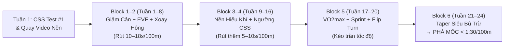

# Tổng Quan Giáo Án 24 Tuần, Test CSS & Chọn Lịch 3 / 4 / 5 / 6 Buổi

> **Thuộc phần:** `22-training-plan/` | **Mục tiêu:** Tiến tới `< 1:30/100m` (Tay nhẹ – Lực từ thân) | **Thời gian đọc:** ~12 phút

## Tổng Quan (Overview)
Giáo án 24 tuần (6 tháng) này là **lộ trình thực chiến hóa toàn bộ kiến thức khoa học của `swim-book`** thành từng buổi bơi cụ thể theo tuần. Thay vì bơi "càng nhiều càng tốt", chương trình sử dụng kiến trúc **Phân kỳ Khối 6 × 4 tuần (3 tuần tăng tải + 1 tuần giảm tải & kiểm tra)**, kết hợp **Kiến trúc Lịch Tập Mô-đun (3, 4, 5 hoặc 6 buổi/tuần)** để mọi người bơi — từ dân văn phòng bận rộn, Triathlete cho tới VĐV Masters — đều có thể theo sát và chinh phục cột mốc **`< 1:30/100m`** một cách an toàn, bền vững.

- **Mục tiêu cốt lõi:** Xác định chính xác **Pace CSS** ban đầu, chọn đúng tần suất **3 / 4 / 5 / 6 buổi/tuần** phù hợp quỹ thời gian và nắm vững cách đọc ký hiệu bài tập.
- **Cảm giác đúng:** Mỗi buổi bơi đều có mục tiêu rõ ràng, kết thúc buổi cảm thấy cơ thể được kích thích tích cực nhưng khớp vai vẫn nhẹ nhàng, không kiệt quệ.
- **Sai lầm phổ biến nhất:** Nhảy cóc bỏ qua Block 1–2 (kỹ thuật & giảm cản) để bơi tốc độ cao ngay tuần đầu, hoặc chọn lịch 6 buổi/tuần khi nền thể lực mới chịu được 3 buổi.

---

## Lý Thuyết (Theory)
### 1. Kiến Trúc 6 Block × 4 Tuần (24 Tuần)

Mỗi Block dài **4 tuần** theo nhịp sinh học **3:1** (*3 tuần tiến bộ tải + 1 tuần Deload giảm 25% khối lượng để cơ thể siêu bù trừ và test lại chỉ số*):

| Block | Tuần | Trọng tâm chính | Test định kỳ |
| :---: | :---: | :--- | :--- |
| **Block 1** | `Tuần 01–04` | **Tư thế, Cân bằng & Cảm giác nước** (Giảm Form Drag, Streamline, Thở) | Tuần 1: CSS Test #1 & Quay video nền |
| **Block 2** | `Tuần 05–08` | **Xoay thân 40°, EVF & Giảm Stroke Count** (Ôm nước bằng Cơ Xô) | Tuần 8: CSS Test #2 + SWOLF Check |
| **Block 3** | `Tuần 09–12` | **Nền Hiếu Khí (Aerobic Base) & 2-Beat/4-Beat Kick** (Bền bỉ 1.500m+) | Tuần 12: Ramp Test SPM + 400m Even Split |
| **Block 4** | `Tuần 13–16` | **Ngưỡng CSS & DPS Ở Tốc Độ Cao** (Xóa Dead Spot, giữ DPS khi nhanh) | Tuần 16: CSS Test #3 + Quay video giữa kỳ |
| **Block 5** | `Tuần 17–20` | **Tốc Độ Chuyên Biệt (Threshold & VO2max)** (Kéo trần tốc độ `< 1:30/100m`) | Tuần 20: Test 100m mô phỏng + 5m Turn Time |
| **Block 6** | `Tuần 21–24` | **Taper, Chiến Thuật & Phá Mốc `< 1:30/100m`** (Siêu bù trừ đỉnh phong) | Tuần 24: **FINAL TEST 100m / 400m / CSS #4** |

### 2. Kiến Trúc Lịch Mô-Đun: Chọn 3, 4, 5 hay 6 Buổi/Tuần?

Mỗi tuần trong cả 6 Block được thiết kế gồm **3 Buổi Lõi Bắt Buộc (`S1, S2, S3`)** + **3 Buổi Mở Rộng (`S4, S5, S6`)**:

| Lịch tập | Các buổi thực hiện | Tổng khối lượng/tuần | Đối tượng phù hợp nhất |
| :---: | :--- | :---: | :--- |
| **3 buổi/tuần** | `S1` (Kỹ thuật/EVF) + `S2` (Ngưỡng CSS) + `S3` (Hiếu khí/DPS) | `4.5 – 7.5 km` | Dân văn phòng bận rộn, Triathlete 70.3/Ironman (cần giữ sức đạp/chạy) |
| **4 buổi/tuần** *(Khuyến nghị tối ưu)* | `S1 + S2 + S3` + **`S4`** (Tốc độ / VO2max / Flip Turn) | `6.5 – 10.5 km` | Người bơi phong trào & Masters muốn tiến nhanh nhất tới `< 1:30/100m` |
| **5 buổi/tuần** | `S1..S4` + **`S5`** (Hồi phục kỹ thuật / Sculling / Kick) | `8.5 – 13.0 km` | Người bơi có nền tảng > 1 năm muốn phá sâu `< 1:25/100m` |
| **6 buổi/tuần** | `S1..S5` + **`S6`** (Đường dài / Open Water / Tốc độ đua) | `11.0 – 16.5 km` | VĐV bán chuyên / Masters đỉnh cao (cần ngủ ≥ 8h & dinh dưỡng chuẩn) |

---

## Cơ Sở Khoa Học (Science)
### Vật Lý & Thủy Động Lực Học (Physics & Hydrodynamics)
Tại sao cần tới **24 tuần** để cải thiện bền vững từ `1:50–2:00/100m` xuống `< 1:30/100m`?
- **Tuần 01–08 (Tối ưu Thần kinh–Cơ & Thủy động lực học)**: Giảm diện tích cản $A$ và xây dựng phản xạ EVF giúp bạn rút ngay **`10–18 giây/100m`** (đây là giai đoạn tiến bộ nhanh nhất!).
- **Tuần 09–16 (Thích nghi Ti thể & Mao mạch Hiếu khí)**: Cơ thể cần tối thiểu 8–12 tuần tập luyện đúng vùng Zone 2–3 để tăng mật độ ty thể trong sợi cơ lưng rộng (Lat) và đẩy ngưỡng Lactate (CSS) tăng lên rõ rệt.
- **Tuần 17–24 (Thích nghi VO2max & Siêu bù trừ Taper)**: Kéo trần tốc độ lên cao hơn mục tiêu `1:30/100m` khoảng `3–5 giây`, sau đó giảm tải (Taper) để hệ thần kinh và cơ bắp bùng nổ đúng ngày kiểm tra.

### Cơ Sinh Học & Hệ Năng Lượng (Biomechanics & Quy Ước Đọc Giáo Án

Mọi buổi tập trong 6 Block đều ghi theo ký hiệu chuẩn quốc tế:
- `4 × 100m @ CSS (r:15s)` = Bơi 4 lần cự ly 100m ở tốc độ bằng Pace CSS, nghỉ đúng 15 giây sau mỗi 100m.
- `4 × 50m (25D/25S)` = Mỗi 50m gồm 25m tập Drill + 25m bơi bình thường giữ nguyên cảm giác Drill.
- `Descend 1–4` = Hiệp sau nhanh hơn hiệp trước (hiệp 4 nhanh nhất).
- `Negative Split` = Nửa sau quãng đường nhanh hơn nửa đầu.
- `PB` = Pull Buoy | `Fins` = Chân vịt ngắn | `Snk` = Ống thở Center Snorkel | `TT` = Tempo Trainer.

---

## Thực Hành (Practical)
### Tại Sao Kỹ Thuật Này Hiệu Quả (Why It Works)
Hệ thống **3 Buổi Lõi + 3 Buổi Mở Rộng** giúp bạn không bao giờ bị "vỡ giáo án" khi bận đột xuất: nếu một tuần bạn đang theo lịch 5 buổi nhưng có việc công tác, bạn chỉ cần hoàn thành đủ **`S1 + S2 + S3`** là vẫn giữ nguyên `85%` giá trị sinh lý và kỹ thuật của tuần đó!

### Hướng Dẫn Từng Bước & Cảm Giác Nước (Step-by-Step & Water Cues)
1. **Bước 1 — Chuẩn bị 4 dụng cụ tối thiểu**: Kính bơi kín nước + Mũ silicon + **Center Snorkel** + **Short Silicone Fins** + **Pull Buoy** *(Khuyến nghị thêm: Finis Tempo Trainer Pro & Dây kháng lực Swim Cords)*.
2. **Bước 2 — Thực hiện CSS Test #1 ngay ở Buổi 2 của Tuần 1**:
   - Khởi động `400m` nhẹ nhàng.
   - Bơi `400m` hết sức đều nhịp → ghi `T400`.
   - Thả lỏng nghỉ `8–10 phút`.
   - Bơi `200m` hết sức đều nhịp → ghi `T200`.
   - Tính `Pace CSS = (T400 - T200) / 2` (xem chi tiết tại [SWOLF & CSS](../14-stroke-count/swolf-and-energy-systems.md)).
3. **Bước 3 — Luôn dành 8–10 phút Khởi động cạn (Kịch bản A)** trước khi xuống nước (xem [Dryland Programs](../18-strength/dryland-programs.md)).
4. **Bước 4 — Ghi chép Nhật ký Bơi**: Sau mỗi buổi tập, ghi lại đúng 3 con số: **Tổng cự ly**, **Stroke Count trung bình/25m** và **Pace trung bình bài chính CSS**.

<!-- IMAGE_PROMPT: Clean 24-week periodization Gantt roadmap graphic showing 6 four-week blocks (3:1 load-to-deload wave bars), CSS Test milestones at Weeks 1, 8, 16, and 24, paired with the modular session matrix (Core S1-S3 + Add-on S4-S6) and Dryland phase alignment targeting <1:30/100m. -->

### Mẹo Nâng Cao (Advanced Tips)
- **Điều kiện thực tế để đạt `< 1:30/100m` trong 24 tuần**:
  - Nếu bạn xuất phát ở mức **`1:45–2:00/100m`**: Khả năng đạt `< 1:30/100m` sau 24 tuần với lịch **3–4 buổi/tuần** là **rất cao (`> 85%`)**.
  - Nếu bạn xuất phát ở mức **`2:10–2:30/100m`** (hoặc trên 50 tuổi mới tập): Hãy xem 24 tuần đầu là hành trình tiến tới `1:40–1:45/100m` cực kỳ vững chắc, sau đó lặp lại từ Block 3–6 để phá `< 1:30/100m` an toàn không chấn thương!

---

## Bài Tập Thực Hành (Drills — Bài Kiểm Tra Đầu Vào Tuần 1)

| Bài Test Đầu Vào | Cách Thực Hiện | Chỉ Số Cần Ghi Lại |
| :--- | :--- | :--- |
| **CSS Test #1** | `400m TT` + nghỉ 10p + `200m TT` | `T400`, `T200`, `Pace CSS` |
| **SWOLF Baseline** | `4 × 50m` thoải mái (Zone 2), đo ở chiều 25m thứ 2 | `Thời gian 25m` + `Stroke Count` = `SWOLF` |
| **Streamline Glide Test** | Đạp tường sâu `0.6 m` không đập chân | Khoảng cách trượt (`mét`) |
| **Video Baseline** | Nhờ bạn quay `25m` góc ngang dưới nước & chính diện | Góc thân, góc EVF, lỗi Crossover/Scissor Kick |

---

## Phân Tích AI & Video (AI Analysis)
- **Quản trị dữ liệu 24 tuần:** Nhập dữ liệu `CSS`, `SWOLF`, `DPS` và `SPM` sau mỗi Block 4 tuần vào bảng theo dõi (hoặc app đồng hồ bơi) để vẽ đường cong tiến bộ.
- **Cảnh báo tự động:** Nếu `Pace CSS` không cải thiện sau 2 Block liên tiếp nhưng khối lượng tăng, hệ thống kiểm tra ngay **Video Analysis** (thường do kẹt ở lỗi kỹ thuật EVF hoặc hông chìm chứ không phải do thiếu thể lực!).

---

## Lỗi Thường Gặp & Cách Sửa (Common Errors)
| Lỗi thường gặp | Triệu chứng nhận biết | Nguyên nhân gốc | Cách sửa (Correction) |
| :--- | :--- | :--- | :--- |
| **Tăng khối lượng quá nhanh (> 15%/tuần)** | Đau khớp vai, mệt mỏi kéo dài, mất hứng thú bơi | Nóng vội chọn lịch 5–6 buổi ngay từ đầu | Chọn lịch thấp hơn 1 bậc trong 4 tuần đầu, chỉ tăng tải tối đa `10%/tuần` |
| **Bỏ qua tuần Deload (Tuần 4, 8, 12, 16, 20)** | Chững thành tích, dễ ốm vặt hoặc căng cơ | Sợ giảm tải sẽ mất thể lực | Tuân thủ nghiêm chu kỳ **3 tuần tăng + 1 tuần giảm 25%** để cơ thể siêu bù trừ |
| **Bơi sai vùng tốc độ (Quá nhanh ở Zone 2)** | Hết sức ở các buổi CSS chính | Thiếu kỷ luật nhìn đồng hồ tường/đồng hồ đeo tay | Giữ đúng `CSS + 5–8s` ở Zone 2 để chân tay tươi mới cho buổi CSS & VO2max |

---

## Tự Đánh Giá Tại Hồ (Self Assessment)
- [ ] Tôi đã hoàn thành **CSS Test #1** và ghi lại chính xác Pace 5 vùng tập luyện của mình.
- [ ] Tôi đã chọn được lịch tập phù hợp thực tế cuộc sống (`3, 4, 5 hay 6 buổi/tuần`).
- [ ] Tôi đã chuẩn bị đầy đủ dụng cụ tối thiểu (Snorkel, Short Fins, Pull Buoy, dây kháng lực).
- [ ] Tôi cam kết tuân thủ tuần giảm tải (Deload) sau mỗi 3 tuần và ghi chép nhật ký SWOLF/CSS.

---

## Chỉ Số Đo Lường (KPI — Lộ Trình Giảm Pace Dự Kiến Qua 24 Tuần — Ví Dụ Xuất Phát `1:52/100m`)

| Mốc thời gian | Pace CSS mục tiêu | SWOLF (bể 25m) | Thành tích 100m hết sức dự kiến |
| :--- | :---: | :---: | :---: |
| **Tuần 01 (Đầu vào)** | `1:52/100m` | `46` | `1:44` |
| **Tuần 08 (Hết Block 2)** | `1:42/100m` | `41` | `1:36` |
| **Tuần 16 (Hết Block 4)** | `1:35/100m` | `38` | `1:31` |
| **Tuần 24 (Hoàn thành)** | **`1:28–1:32/100m`** | **`34–36`** | **`1:24–1:28` (`< 1:30/100m`)** |

---

## Câu Hỏi Thường Gặp (FAQ)
**1. Nếu tôi bị ốm hoặc đi công tác nghỉ mất 1 tuần thì quay lại thế nào?**
Nếu nghỉ `< 7 ngày`, hãy lặp lại tuần trước đó với khối lượng giảm `15%` rồi tiếp tục bình thường. **Tuyệt đối không cố bơi bù gấp đôi** khối lượng của tuần đã lỡ!

**2. Bể chỗ tôi dài 50m (Long Course) chứ không phải 25m thì điều chỉnh thế nào?**
Giữ nguyên tổng cự ly buổi tập; với các bài `25m Drill`, bạn đổi thành `50m (25m Drill + 25m Swim)` hoặc dừng nghỉ nhẹ ở giữa bể nếu cần; và lưu ý Pace CSS ở bể 50m thường chậm hơn bể 25m khoảng `2–3 giây/100m`.

---

## Tóm Tắt (Summary)
- Giáo án 24 tuần chia thành **6 Block × 4 tuần (nhịp 3:1)** với kiến trúc mô-đun **3 buổi lõi (`S1–S3`) + 3 buổi mở rộng (`S4–S6`)**.
- Bắt đầu bằng **CSS Test #1** tại Tuần 1, ưu tiên kỹ thuật giảm cản trước rồi mới đẩy ngưỡng CSS và VO2max.

**Liên kết chéo:**
- Chương trước: [Sprint, Starts & Flip Turns](../16-sprint/sprint-starts-and-turns.md)
- Chương tiếp theo: [Block 1 — Tuần 01–04: Tư Thế, Cân Bằng & Cảm Giác Nước](weeks-01-04.md)
- Tra cứu thuật ngữ: [Glossary](../24-appendix/glossary.md)

---

## Tài Liệu Tham Khảo (References)
1. Newsome, P., & Young, A. (2012). *Swim Smooth: Training Plans & CSS Methodology*. Wiley.
2. Olbrecht, J. (2000). *The Science of Winning*. F&G Partners.
3. Maglischo, E. W. (2003). *Swimming Fastest*. Human Kinetics.

