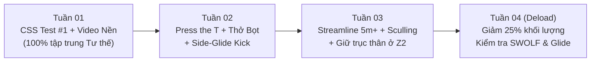

# Block 1 (Tuần 01–04): Tư Thế, Cân Bằng & Cảm Giác Nước

> **Thuộc phần:** `22-training-plan/` | **Giai đoạn:** Xây Móng Thủy Động Lực Học | **Dryland:** Giai đoạn 1 (Mobility + Core nền)

## Tổng Quan (Overview)
**Block 1 (Tuần 01–04)** là giai đoạn quan trọng nhất toàn bộ hành trình 24 tuần. Ở 4 tuần đầu tiên này, **tốc độ tuyệt đối chưa phải mục tiêu** — mục tiêu số 1 là **cắt giảm 30–50% lực cản Form Drag** bằng cách thiết lập tư thế thân ngang `< 5°`, khóa chặt Streamline ở mọi thành bể, xóa bỏ lỗi nín hơi khi thở và xây dựng "cảm giác nước" (*Feel for the Water*) qua Sculling.

- **Mục tiêu cốt lõi:** Hoàn thành **CSS Test #1**, làm chủ *Press the T*, *One-Goggle Breathing*, *Streamline 5m+* và kéo giảm SWOLF ban đầu `2–4 điểm`.
- **Cảm giác đúng:** Bơi chậm rãi, êm ái, không thở dốc; cuối mỗi buổi tập thấy đầu cổ hoàn toàn thư giãn và hông tự nổi cao hơn rõ rệt.
- **Sai lầm phổ biến nhất:** Nóng ruột muốn bơi nhanh ngay ở tuần 2 khiến đầu lại ngẩng lên, hông chìm và phá vỡ toàn bộ nền tảng đang xây.

---

## Lý Thuyết (Theory)
Theo quy luật học vận động (*Motor Skill Acquisition*), não bộ chỉ có thể ghi đè thói quen bơi sai cũ khi tốc độ bơi đủ chậm (Zone 1–2) để hệ thần kinh kịp cảm nhận và hiệu chỉnh từng khớp. Do đó, trong Block 1:
- **70% khối lượng** diễn ra ở **Zone 1–2** (Drill, kỹ thuật, hiếu khí nhẹ).
- **20% khối lượng** ở **Zone 3 (CSS nhẹ)** để làm quen cảm giác giữ dáng ở tốc độ trung bình.
- **10% khối lượng** cho **Streamline & Đạp chân gọn** (không dùng quá sức).

---

## Cơ Sở Khoa Học (Science)
### Vật Lý & Thủy Động Lực Học (Physics & Hydrodynamics)
Khi bạn hạ góc nghiêng thân từ `15°` xuống `< 6°` và xóa lỗi *Scissor Kick* trong 4 tuần đầu, diện tích mặt cắt cản $A$ giảm `~35%`. Theo $P = \frac{1}{2}\rho C_d A v^3$, điều này tương đương bạn vừa nhận được **+15% tốc độ miễn phí** mà không cần tốn thêm 1% thể lực!

### Cơ Sinh Học (Biomechanics) — Phân Bổ Tải Block 1 (Nhịp 3:1)

| Tuần | Đặc điểm tải | Lịch 3 buổi (`S1–S3`) | Lịch 4 buổi (`+S4`) | Lịch 5 buổi (`+S5`) | Lịch 6 buổi (`+S6`) |
| :---: | :--- | :---: | :---: | :---: | :---: |
| **Tuần 01** | Đánh giá & CSS Test #1 | `4.5 km` | `6.0 km` | `7.5 km` | `9.0 km` |
| **Tuần 02** | Cân bằng & Thở liên tục | `5.0 km` | `6.8 km` | `8.5 km` | `10.0 km` |
| **Tuần 03** | Tích hợp Streamline & Scull | `5.5 km` | `7.4 km` | `9.2 km` | `11.0 km` |
| **Tuần 04** | **Deload (-25%) & Đánh giá** | `4.2 km` | `5.6 km` | `7.0 km` | `8.5 km` |

---

## Thực Hành (Practical)
### Tại Sao Kỹ Thuật Này Hiệu Quả (Why It Works)
Các buổi tập được chia rõ **3 Buổi Lõi (`S1, S2, S3`)** và **3 Buổi Mở Rộng (`S4, S5, S6`)**. Mọi buổi đều bắt đầu bằng **8–10 phút Khởi động cạn (Kịch bản A)** và kết thúc bằng **5 phút giãn cổ chân & vai**.

### Hướng Dẫn Từng Bước (Step-by-Step) — Chi Tiết Giáo Án 6 Buổi/Tuần (Tuần 01–04)

*(Tăng thêm `+10–15%` số hiệp ở Main Set vào Tuần 2–3, và giảm `-25%` số hiệp vào Tuần 4 Deload).*

#### Buổi S1 — Lõi 1: Tư Thế, Cân Bằng & Thở (`~1.500–1.800m`)
- **Warm-up (300m):** `200m` bơi nhẹ Z1 (nhìn đáy hồ, thở bọt đều) + `4 × 25m` Push & Glide Streamline (đo khoảng cách trượt).
- **Drill Set (400m — dùng Short Fins):**
  - `4 × 25m` Press the T (Torpedo Kick, ấn nhẹ ngực nâng hông, `r:15s`)
  - `4 × 25m` Side-Glide One-Goggle Breathing (`r:15s`, giữ 1 mắt kính chạm nước)
  - `4 × 50m` (`25m Wide Catch-Up + 25m Swim` giữ nguyên hông nổi, `r:20s`)
- **Main Set (600–900m — Z2 `CSS + 6s`):**
  - `6–9 × 100m` (nghỉ `20s`), tập trung tuyệt đối vào **thở ra liên tục dưới nước** và **đầu nhìn đáy** (luân phiên 100m thở 1:3 / 100m thở 2:2 đổi bên).
- **Cool-down (200m):** `100m` ngửa thả lỏng + `100m` bơi sải cực êm không tiếng động.

#### Buổi S2 — Lõi 2: Test CSS (Tuần 1) / Cảm Giác Nước & Pace Nền (`~1.500–1.900m`)
- **Lưu ý Tuần 01:** Thực hiện **CSS Test #1** (`400m Warm-up` → `400m TT` → nghỉ 10p thả lỏng `200m` → `200m TT` → `200m Cool-down`).
- **Tuần 02–04:**
  - **Warm-up (300m):** `300m` nhẹ nhàng (thay đổi 50m sải / 25m ngửa).
  - **Pre-Set Sculling (300m — PB + Snk):** `3 × 100m` (`25m Front Scull + 25m Mid Scull + 25m Rear Scull + 25m Swim`, `r:20s`).
  - **Main Set (700–1.000m — Z2/Z3 nhẹ):** `7–10 × 100m @ CSS + 3s` (`r:20s`), đếm Stroke Count chiều 25m cuối mỗi hiệp, giữ không tăng sải.
  - **Cool-down (200m):** Bơi thả lỏng Z1.

#### Buổi S3 — Lõi 3: Bền Bỉ Thư Giãn & Đếm Sải (`~1.600–2.000m`)
- **Warm-up (300m):** `200m` Z1 + `4 × 25m` Silent Swimming (`r:15s`).
- **Drill Set (300m):** `6 × 50m` (`25m Fingertip Drag + 25m Swim`, `r:15s`) — xả mỏi vai, vào nước "xỏ kim".
- **Main Set (800–1.200m — Z2 `CSS + 6–8s`):**
  - `4–6 × 200m` (`r:25s`), bơi đều 2-Beat Kick êm ái, giữ SWOLF ổn định suốt 200m (hiệp chẵn dùng Pull Buoy để cảm nhận hông nổi chuẩn).
- **Cool-down (200m):** Thả lỏng Z1.

#### Buổi S4 — Mở Rộng (Cho Lịch 4–6 buổi): Chân Gọn, Streamline & Nhịp Nhanh Ngắn (`~1.600–1.900m`)
- **Warm-up (300m):** `300m` Z1 (Streamline vượt vạch 5m ở mọi thành bể).
- **Kick & Core Set (400m):** `4 × 25m` Streamline Snorkel Kick (`r:20s`) + `4 × 25m` Short-Fin Dolphin Kick (`r:20s`) + `4 × 50m` (`25m Side Kick + 25m Swim`).
- **Main Set (700–1.000m):** `14–20 × 50m` (`r:15s`) xen kẽ: 1 hiệp `@ CSS` chuẩn dáng + 1 hiệp `@ Z2` đếm SWOLF giảm 1 điểm.
- **Cool-down (200m):** Z1 thả lỏng.

#### Buổi S5 — Mở Rộng (Cho Lịch 5–6 buổi): Hồi Phục Kỹ Thuật & Độ Đối Xứng (`~1.500–1.800m`)
- **Warm-up (300m):** Z1 cực nhẹ.
- **Symmetry Set (600m):** `6 × 100m` (`25m Single-Arm Trái + 25m Single-Arm Phải + 50m Swim` thở 1:3, `r:20s`).
- **Aerobic Easy (400–700m):** Bơi liên tục Z1–Z2 cực êm với Pull Buoy + Snorkel, tập trung vào đường ray 11h/1h.
- **Cool-down (200m):** Ngửa + Sải nhẹ.

#### Buổi S6 — Mở Rộng (Cho Lịch 6 buổi): Đường Dài Hiếu Khí Nền (`~1.800–2.200m`)
- **Warm-up (400m):** `200m` Z1 + `4 × 50m` (25m Scull + 25m Swim).
- **Main Set (1.200–1.600m — Z2):** `3–4 × 400m @ CSS + 8s` (`r:30s`), bơi 2-beat kick, giữ nhịp thở đều đặn và cảm giác tay nhẹ tênh.
- **Cool-down (200m):** Z1.

<!-- IMAGE_PROMPT: Clean bar chart showing Block 1 (Weeks 1-4) weekly swim volume progression across 3, 4, 5, and 6 session plans with the Week 4 Deload drop clearly highlighted, paired with key focus badges: Head-Down Alignment, Streamline 5m+, One-Goggle Breathing, and Sculling. -->

### Mẹo Nâng Cao (Advanced Tips — Dryland & Mobility Đi Kèm Block 1)
- **Dryland (`2 buổi/tuần × 25p`)**: Tập Kịch bản B nhẹ (Dead Bug, Hollow Body Hold, Band EVF nhẹ, Seated Heel-Sit).
- **Mobility (`10p/ngày`)**: Ưu tiên mở Cột sống ngực (*Thoracic Foam Roll*), *Lat Prayer Stretch* và *Seated Heel-Sit*.

---

## Bài Tập Thực Hành (Drills — Trọng Tâm Block 1)

| Tên Drill | Tần suất/Tuần | Mục tiêu sửa lỗi Block 1 |
| :--- | :---: | :--- |
| **Push & Glide Streamline** | Mọi buổi bơi | Kéo quãng trượt không đạp chân lên `≥ 6–7 m` |
| **Side-Glide One-Goggle Breathing** | `2–3 buổi` | Xóa hoàn toàn thói quen ngẩng đầu thở & ấn tay trượt |
| **3-Position Sculling (PB + Snk)** | `2 buổi` | Đánh thức cảm giác nước đặc trên lòng bàn tay |
| **Wide Catch-Up & Fingertip Drag** | `2 buổi` | Giữ thân dài Front-Quadrant & thả lỏng Recovery |

---

## Phân Tích AI & Video (AI Analysis)
- **Quay Video Nền (Tuần 01) & Kiểm Tra Lại (Tuần 04):** So sánh góc nghiêng trục thân ($\theta$) và độ tụt tay trượt khi thở giữa Tuần 1 và Tuần 4.
- **Chỉ số mục tiêu hết Tuần 04:** Góc nghiêng thân giảm tối thiểu `3–5°`; độ mở gối Scissor Kick giảm xuống `< 30 cm`.

---

## Lỗi Thường Gặp & Cách Sửa (Common Errors)
| Lỗi thường gặp | Triệu chứng nhận biết | Nguyên nhân gốc | Cách sửa (Correction) |
| :--- | :--- | :--- | :--- |
| **Cố bơi nhanh trong bài tập Drill** | Thở dốc, không cảm nhận được độ nổi hông | Sợ cảm giác "tập quá nhẹ" | Nhắc bản thân: Block 1 là **cắt giảm 50% lực cản** — nền móng cho mọi tốc độ sau này |
| **Bỏ qua CSS Test #1 ở Tuần 1** | Không biết pace Zone 2, Zone 3 của mình là bao nhiêu | Ngại mệt hoặc nghĩ chưa cần thiết | Thực hiện ngay Mini Test (`200m + 100m`) nếu chưa đủ sức bơi `400m` |
| **Đạp tường cẩu thả trong buổi tập** | Lướt chỉ được 3m, mất cơ hội luyện trục cột sống | Mệt nên quên khóa Streamline | Đặt luật: **100% thành bể đều khóa chặt Streamline** |

---

## Tự Đánh Giá Tại Hồ (Self Assessment)
- [ ] Tôi đã hoàn thành **CSS Test #1** và quay được video nền ban đầu.
- [ ] Hết Tuần 4, tôi cảm thấy hông mình nổi cao hơn rõ rệt và cổ gáy hoàn toàn thả lỏng.
- [ ] Tôi thở ra liên tục dưới nước (không nín hơi) và không còn bị hụt hơi sau 200m bơi Z2.
- [ ] Quãng trượt Streamline không đạp chân của tôi tăng thêm ít nhất `1–2 m` so với Tuần 1.
- [ ] Tôi tuân thủ đúng tuần Deload (Tuần 4) giảm 25% khối lượng để chuẩn bị cho Block 2.

---

## Chỉ Số Đo Lường (KPI — Hết Tuần 04)

| Chỉ số (Metric) | Đạt chuẩn Block 1 | Xuất sắc |
| :--- | :---: | :---: |
| **Quãng trượt Streamline (không đập chân)** | `≥ 6 m` | `≥ 7.5 m` |
| **Mức cải thiện SWOLF (25m, Zone 2)** | `-2 điểm` | `-3 đến -4 điểm` |
| **Bơi liên tục Z2 không hụt hơi** | `400 m` | `800–1.000 m` |

---

## Câu Hỏi Thường Gặp (FAQ)
**1. Tuần 1–4 thấy tổng cự ly hơi ít so với thói quen bơi 3km/buổi cũ của tôi thì sao?**
Chất lượng kỹ thuật trong Block 1 quan trọng hơn khối lượng! Nếu bạn đã có nền thể lực rất tốt, hãy chọn **Lịch 5 hoặc 6 buổi/tuần** nhưng vẫn **giữ trọn vẹn phần Drill và bơi Z2 chuẩn form**, không biến nó thành *Junk Miles*.

**2. Tôi dùng Pull Buoy thấy bơi dễ hơn hẳn nhưng tháo ra lại hơi chìm chân ở Tuần 2?**
Rất bình thường! Hãy dùng bài tương phản `25m Pull Buoy + 25m Không phao` (giữ nguyên tư thế ấn ngực *Press the T* và siết Core 20%) — não sẽ tự học cách giữ hông nổi không cần phao vào Tuần 3–4.

---

## Tóm Tắt (Summary)
- **Block 1 (Tuần 01–04)** đặt viên gạch nền móng: **CSS Test #1 + Tư thế thân ngang `< 6°` + Streamline 6m+ + Thở bọt liên tục + Sculling**.
- Luôn tuân thủ cấu trúc **3 buổi lõi (`S1–S3`) + mở rộng (`S4–S6`)** và tuần giảm tải Deload ở Tuần 4.

**Liên kết chéo:**
- Chương trước: [Tổng Quan & Test CSS](overview-and-css-testing.md)
- Chương tiếp theo: [Block 2 — Tuần 05–08: Xoay Thân, EVF & Giảm Stroke Count](weeks-05-08.md)
- Tra cứu thuật ngữ: [Glossary](../24-appendix/glossary.md)

---

## Tài Liệu Tham Khảo (References)
1. Newsome, P., & Young, A. (2012). *Swim Smooth*. Wiley.
2. Laughlin, T. (2004). *Total Immersion*. Fireside.
3. USA Swimming — *Foundational Technical Block Programming*.

