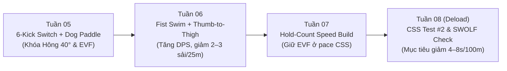

# Block 2 (Tuần 05–08): Xoay Thân 40°, EVF & Giảm Stroke Count

> **Thuộc phần:** `22-training-plan/` | **Giai đoạn:** Kích Hoạt Động Cơ Thân & Cơ Xô | **Dryland:** Chuyển sang Sức mạnh Cơ Xô & Core

## Tổng Quan (Overview)
Sau khi đã thiết lập được khung thân phẳng và hơi thở êm ở Block 1, **Block 2 (Tuần 05–08)** tập trung vào bước nhảy vọt kỹ thuật lớn nhất của bơi sải: **kết nối xoay hông `35–45°` với kỹ thuật dựng cẳng tay sớm (EVF `100–120°`) và hoàn tất pha đẩy ngang đùi (*Thumb-to-Thigh*)**. Đây là 4 tuần bạn sẽ chứng kiến **Stroke Count giảm mạnh `2–4 sải/25m`** trong khi cảm giác tay ngày càng nhẹ và chắc nước!

- **Mục tiêu cốt lõi:** Tự động hóa góc khuỷu EVF, xóa bỏ lỗi sụp khuỷu và vắt chéo trục giữa, kết thúc Block bằng **CSS Test #2** (kỳ vọng cải thiện `4–8 giây/100m`).
- **Cảm giác đúng:** Cảm nhận rõ nước "đặc quánh" trên cả cẳng tay và cơ xô dưới nách co rút mạnh mẽ mỗi khi hông bật xoay `40°`.
- **Sai lầm phổ biến nhất:** Vội dùng bàn quạt tay (Hand Paddles) cỡ lớn khi góc EVF chưa ổn định, gây quá tải khớp vai.

---

## Lý Thuyết (Theory)
Block 2 chuyển hóa cơ thể từ trạng thái **"biết lướt êm"** sang trạng thái **"tạo lực đẩy hiệu suất cao ($\eta_p \ge 0.55$)"**:
- Kết hợp **6-Kick Switch / 3-Kick Switch** (cài đặt chuỗi truyền lực từ hông) + **Dog Paddle / Fist Swim / Sculling** (cô lập dựng cẳng tay EVF) + **Thumb-to-Thigh** (khóa trọn 30% lực đẩy cuối).
- Đồng thời bắt đầu đưa các bài tập **ngưỡng CSS ngắn (`50m–100m`)** vào buổi `S2` để tập giữ nguyên góc EVF dưới áp lực tốc độ trung bình–cao.

---

## Cơ Sở Khoa Học (Science)
### Vật Lý & Thủy Động Lực Học (Physics & Hydrodynamics)
Khi bạn tăng diện tích mái chèo hiệu dụng từ chỉ bàn tay (`160 cm²`) lên toàn bộ bàn tay + cẳng tay dựng EVF (`380 cm²`), lực đẩy trên mỗi sải tăng gấp đôi ở cùng một nhịp kéo — trực tiếp đẩy **DPS** tăng thêm `+15–25 cm/sải` và cắt giảm **Stroke Count** ngay lập tức mà không làm chậm tốc độ!

### Cơ Sinh Học (Biomechanics) — Phân Bổ Tải Block 2 (Nhịp 3:1)

| Tuần | Đặc điểm tải | Lịch 3 buổi (`S1–S3`) | Lịch 4 buổi (`+S4`) | Lịch 5 buổi (`+S5`) | Lịch 6 buổi (`+S6`) |
| :---: | :--- | :---: | :---: | :---: | :---: |
| **Tuần 05** | Khóa xoay hông & Dog Paddle EVF | `5.4 km` | `7.2 km` | `9.0 km` | `11.0 km` |
| **Tuần 06** | Fist → Open Hand & Thumb-to-Thigh | `6.0 km` | `8.0 km` | `10.0 km` | `12.2 km` |
| **Tuần 07** | Giữ Stroke Count ở tốc độ CSS | `6.5 km` | `8.6 km` | `10.8 km` | `13.2 km` |
| **Tuần 08** | **Deload (-25%) & CSS Test #2** | `4.8 km` | `6.4 km` | `8.0 km` | `9.8 km` |

---

## Thực Hành (Practical)
### Tại Sao Kỹ Thuật Này Hiệu Quả (Why It Works)
Cấu trúc bài tập trong Block 2 luôn đặt **Drill EVF ngay trước Main Set** (kèm khởi động `5 phút` kéo dây kháng lực EVF trên bờ hồ), tạo hiệu ứng mồi thần kinh (*Neural Priming*) khiến não bộ lập tức kích hoạt cơ xô (Lat) ngay khi nhảy xuống nước!

### Hướng Dẫn Từng Bước (Step-by-Step) — Chi Tiết Giáo Án 6 Buổi/Tuần (Tuần 05–08)

#### Buổi S1 — Lõi 1: Kỹ Thuật EVF & Xoay Hông (`~1.800–2.200m`)
- **Warm-up (300m):** `200m` Z1 + `4 × 25m` 3-Position Sculling (Snk + PB).
- **EVF & Rotation Set (500m):**
  - `4 × 50m` (`25m 6-Kick Switch + 25m 3-Kick Switch`, `r:15s`)
  - `4 × 50m` (`25m Dog Paddle EVF + 25m Swim` giữ khuỷu cao, `r:20s`, dùng Snk)
  - `2 × 50m` (`25m Fist Swim + 25m Open Hand` đếm sải, `r:20s`)
- **Main Set (800–1.200m — Stroke-Count Lock):**
  - `8–12 × 100m @ CSS + 4s` (`r:15s`), yêu cầu: giữ cố định số sải/25m (thấp hơn Tuần 1 tối thiểu `1–2 sải`) và chạm nhẹ ngón cái mép đùi ở mọi sải!
- **Cool-down (200m):** Z1 thả lỏng.

#### Buổi S2 — Lõi 2: Ngưỡng CSS Ngắn & Test CSS #2 (Tuần 8) (`~1.800–2.200m`)
- **Lưu ý Tuần 08:** Thực hiện **CSS Test #2** (`400m TT` + nghỉ 10p + `200m TT`) để cập nhật lại toàn bộ Pace 5 vùng cho Block 3–4!
- **Tuần 05–07:**
  - **Warm-up (400m):** `200m` Z1 + `4 × 50m` (`25m Thumb-to-Thigh + 25m Swim`).
  - **Main Set (1.000–1.400m — CSS Building):**
    - `10–14 × 100m @ CSS` (`r:15s`), tập trung giữ nguyên góc EVF ở 3 hiệp cuối khi cơ xô bắt đầu mỏi (không được sụp khuỷu!).
  - **Speed Touch (200m):** `4 × 50m` (`25m Fast 90% + 25m Easy`, `r:25s`).
  - **Cool-down (200m):** Z1.

#### Buổi S3 — Lõi 3: Giảm Stroke Count & Bền Bỉ DPS (`~1.900–2.300m`)
- **Warm-up (300m):** Z1 + `4 × 25m` Fingertip Drag.
- **Pre-Set Golf (300m):** `6 × 50m` Stroke-Count Golf (`r:25s`), hạ điểm SWOLF xuống mức thấp nhất có thể.
- **Main Set (1.100–1.500m — Z2 DPS Endurance):**
  - `3–5 × 300m` (`r:25s`): 100m đầu Z2 thường + 100m giữa kẹp **Pull Buoy** (tập trung cảm nhận cơ xô & đẩy hết pha Push) + 100m cuối không phao giữ đúng số sải như 100m có phao.
- **Cool-down (200m):** Z1.

#### Buổi S4 — Mở Rộng (Lịch 4–6 buổi): Hold-Count Speed & Flip Turn Nền (`~1.800–2.100m`)
- **Warm-up (300m):** Z1 + `10 phút` tập **Flip Turn Progression** (Bước 1–3).
- **Main Set (1.000–1.300m):**
  - `3 vòng × (4 × 50m Hold-Count Speed Build, r:20s)` — giữ cứng số sải/25m nhưng bơi nhanh dần `1 giây` từ hiệp 1 đến hiệp 4! (Nghỉ `60s` giữa mỗi vòng).
- **Kick Set (300m):** `6 × 50m` (`25m Streamline Kick + 25m Swim`, `r:20s`).
- **Cool-down (200m):** Z1.

#### Buổi S5 — Mở Rộng (Lịch 5–6 buổi): Đối Xứng Single-Arm & Finger Paddles (`~1.800–2.000m`)
- **Warm-up (300m):** Z1 + `4 × 25m` Zipper Drill.
- **Symmetry Set (600m):** `6 × 100m` (`25m Single-Arm Trái + 25m Single-Arm Phải + 50m Swim`, `r:20s`).
- **EVF Feel Set (700–900m):** `7–9 × 100m` (dùng **Finger Paddles** cỡ nhỏ + Pull Buoy, `r:15s`) — tăng phản hồi áp lực nước lên ngón tay mà không gây quá tải khớp vai.
- **Cool-down (200m):** Z1.

#### Buổi S6 — Mở Rộng (Lịch 6 buổi): Hiếu Khí Đường Dài & 2-Beat Kick (`~2.000–2.400m`)
- **Warm-up (400m):** Z1 + `4 × 50m` (25m Mid Scull + 25m Swim).
- **Main Set (1.400–1.800m):** `2–3 × 600m @ CSS + 6–8s` (`r:35s`), bơi 2-beat kick, kiểm tra số sải ở 25m cuối mỗi 200m không tăng quá `+1 sải`.
- **Cool-down (200m):** Z1.

<!-- IMAGE_PROMPT: Clean training progression diagram for Block 2 (Weeks 5-8) connecting Pre-Pool Resistance Band EVF -> 6-Kick Switch & Dog Paddle -> Hold-Count Speed Build -> CSS Test #2, showing Stroke Count dropping by 2-4 strokes/25m while pace improves by 4-8s/100m. -->

### Mẹo Nâng Cao (Advanced Tips — Dryland & Mobility Đi Kèm Block 2)
- **Dryland (`2–3 buổi/tuần × 35p`)**: Bắt đầu chuyển sang **Giai đoạn 2 (Sức mạnh Cơ Xô)** — Pull-Up / Lat Pulldown, Straight-Arm Pulldown, Single-Arm Row, Face Pull và Side Plank Rotation.
- **Pre-Pool**: Bắt buộc `1 × 15` Band EVF Pull chuẩn góc `110°` trước khi nhảy xuống nước!

---

## Bài Tập Thực Hành (Drills — Trọng Tâm Block 2)

| Tên Drill | Tần suất/Tuần | Mục tiêu sửa lỗi Block 2 |
| :--- | :---: | :--- |
| **6-Kick Switch → 3-Kick Switch** | `2 buổi` | Bật xoay hông `40°` dẫn động sải tay |
| **Dog Paddle EVF + Fist Swim** | `2–3 buổi` | Dựng cẳng tay `100–120°`, xóa sụp khuỷu |
| **Thumb-to-Thigh + Stroke-Count Golf** | `2 buổi` | Đẩy hết pha Push, giảm `2–3 sải/25m` |

---

## Phân Tích AI & Video (AI Analysis)
- **Đối chiếu Video Tuần 08 vs Tuần 01:** Kiểm tra góc khuỷu tại giữa pha Catch (`∠shoulder–elbow–wrist`) đã thu hẹp về `105–130°` chưa; kiểm tra vị trí rời nước `release_wrist_x` đã đi qua khớp hông chưa.

---

## Lỗi Thường Gặp & Cách Sửa (Common Errors)
| Lỗi thường gặp | Triệu chứng nhận biết | Nguyên nhân gốc | Cách sửa (Correction) |
| :--- | :--- | :--- | :--- |
| **Giảm Stroke Count bằng cách lướt chết (Over-Gliding)** | Giảm được 3 sải nhưng thời gian 50m lại chậm hơn 4 giây | Chạy theo con số sải mà quên thời gian | Luôn đo **SWOLF** và tập **Hold-Count Speed Build** |
| **Đau mỏi mặt trước vai khi mới tập EVF** | Đau nhói nhẹ sau buổi S2 hoặc S5 | Vắt chéo trục giữa (Crossover) hoặc dùng bàn quạt quá to | Bỏ Hand Paddles lớn, kiểm tra đường ray 11h/1h và tập Face Pull |
| **Quên xoay hông bên không thở** | Chỉ tay thuận kéo chắc, tay nghịch trượt nước | Mất đối xứng thân | Dành thêm `2 × 50m` Single-Arm cho riêng bên nghịch ở buổi S1 & S5 |

---

## Tự Đánh Giá Tại Hồ (Self Assessment)
- [ ] Tôi cảm nhận rõ cơ lưng rộng (Lat) làm việc chính trong pha kéo và vai hoàn toàn không đau.
- [ ] Stroke Count trung bình / 25m của tôi đã giảm ít nhất `2 sải` so với Tuần 1 ở cùng hoặc nhanh hơn tốc độ cũ.
- [ ] Tôi hoàn thành **CSS Test #2 (Tuần 8)** với tốc độ cải thiện rõ rệt (`-4 đến -8 giây/100m`).
- [ ] Tôi đã bắt đầu thực hiện được các bước nền tảng của **Flip Turn** không bị nước vào mũi.

---

## Chỉ Số Đo Lường (KPI — Hết Tuần 08)

| Chỉ số (Metric) | Đạt chuẩn Block 2 | Xuất sắc |
| :--- | :---: | :---: |
| **Cải thiện Pace CSS (so với Tuần 1)** | `-4 giây/100m` | `-6 đến -10 giây/100m` |
| **Giảm Stroke Count / 25m (giữ tốc độ)** | `-2 sải/25m` | `-3 đến -4 sải/25m` |
| **Góc khuỷu EVF dưới nước** | `≤ 130°` | `105–120°` |

---

## Câu Hỏi Thường Gặp (FAQ)
**1. Nên dùng Hand Paddles (bàn quạt) loại nào trong Block 2?**
Chỉ nên dùng **Finger Paddles** (quạt nhỏ chỉ che đầu ngón tay) hoặc **Agility Paddles** (quạt không dây buộc cổ tay — sẽ tự rơi ra nếu bạn sụp khuỷu hoặc vào nước sai góc!). Tránh hoàn toàn quạt cỡ lớn cho tới Block 4–5.

**2. Nếu ở CSS Test #2 (Tuần 8) tôi cải thiện tới 8 giây/100m thì có nên dùng ngay Pace CSS mới cho Block 3 không?**
**Có!** Luôn cập nhật ngay Pace 5 vùng theo kết quả **CSS Test #2** để giáo án Block 3 tiếp tục tạo đúng kích thích sinh lý tối ưu.

---

## Tóm Tắt (Summary)
- **Block 2 (Tuần 05–08)** lắp đặt động cơ chính: **Xoay hông `40°` + Dựng cẳng tay EVF + Đẩy hết pha Push tới đùi**.
- Kết thúc Tuần 8 bằng **Deload + CSS Test #2** để ghi nhận bước nhảy vọt đầu tiên về tốc độ và SWOLF.

**Liên kết chéo:**
- Chương trước: [Block 1 — Tuần 01–04](weeks-01-04.md)
- Chương tiếp theo: [Block 3 — Tuần 09–12: Nền Hiếu Khí & Phối Hợp Chân](weeks-09-12.md)
- Tra cứu thuật ngữ: [Glossary](../24-appendix/glossary.md)

---

## Tài Liệu Tham Khảo (References)
1. Newsome, P., & Young, A. (2012). *Swim Smooth*. Wiley.
2. Maglischo, E. W. (2003). *Swimming Fastest*. Human Kinetics.
3. Olbrecht, J. (2000). *The Science of Winning*. F&G Partners.

