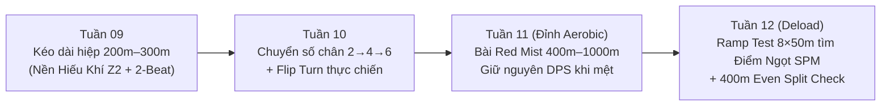

# Block 3 (Tuần 09–12): Xây Nền Hiếu Khí (*Aerobic Base*) & Phối Hợp Chân 2/4-Beat

> **Thuộc phần:** `22-training-plan/` | **Giai đoạn:** Xây Động Cơ Bền Bỉ & Tìm Điểm Ngọt Tempo | **Dryland:** Sức mạnh Cơ Xô & Core Chống Xoay

## Tổng Quan (Overview)
Bạn đã có kỹ thuật sạch (Block 1) và lực bám nước EVF chắc (Block 2). **Block 3 (Tuần 09–12)** là giai đoạn **xây dựng "bình xăng" hiếu khí khổng lồ** để bạn có thể duy trì kỹ thuật hoàn hảo đó không chỉ trong `100m`, mà xuyên suốt `1.000m–2.500m` mà không bị rơi nhịp hay sụp khuỷu. Song song đó, Block 3 giúp bạn làm chủ **2-Beat / 4-Beat Kick tiết kiệm năng lượng**, tìm ra **Điểm ngọt Tempo (SPM)** qua **Ramp Test** và hoàn thiện **Flip Turn**.

- **Mục tiêu cốt lõi:** Nâng dần khối lượng hiếu khí Zone 2–3 lên mức cao nhất một cách êm ái, thành thạo chuyển số chân `2 → 4 → 6-beat`, và xác định chính xác trần SPM qua **Ramp Test (Tuần 12)**.
- **Cảm giác đúng:** Bơi các bài lặp dài (`200m–400m`) với nhịp tim rất ổn định, hơi thở dồi dào (nhịp 1:2 hoặc 2:2), cảm giác "có thể bơi mãi không mệt".
- **Sai lầm phổ biến nhất:** Bơi các bài đường dài quá nhanh (lấn sang Zone 4) làm cơ thể mệt mỏi tích tụ, hoặc để số sải tay tăng vọt ở 100m cuối mỗi hiệp.

---

## Lý Thuyết (Theory)
Trong sinh lý học thể thao (Jan Olbrecht — *The Science of Winning*), **dung tích hiếu khí (*Aerobic Capacity*)** là nền móng quyết định bạn có thể hấp thụ được các bài tập tốc độ cao ở Block 4–5 hay không:
- Cự ly mỗi hiệp trong Main Set được kéo dài từ `100m` (Block 1–2) lên **`200m, 300m và 400m`** với thời gian nghỉ ngắn (`15–25 giây`).
- Tích hợp **2-Beat Kick** cho toàn bộ cự ly Zone 2 để bảo toàn oxy, và **4-Beat Kick** cho các đoạn giữ pace CSS.

---

## Cơ Sở Khoa Học (Science)
### Vật Lý & Thủy Động Lực Học (Physics & Hydrodynamics)
Bơi bền bỉ ở Zone 2–3 với **Even Split** (tốc độ đều tăm tắp từng 50m) tối ưu hóa sự phát triển mật độ mao mạch quanh sợi cơ loại I (*Slow-Twitch*) ở cơ lưng rộng và cơ vai, giúp tốc độ đào thải axit lactic tăng lên `20–30%` — tiền đề sinh học trực tiếp để giữ pace `< 1:30/100m` ở Block 4–6!

### Cơ Sinh Học (Biomechanics) — Phân Bổ Tải Block 3 (Nhịp 3:1)

| Tuần | Đặc điểm tải | Lịch 3 buổi (`S1–S3`) | Lịch 4 buổi (`+S4`) | Lịch 5 buổi (`+S5`) | Lịch 6 buổi (`+S6`) |
| :---: | :--- | :---: | :---: | :---: | :---: |
| **Tuần 09** | Tăng chiều dài hiệp (`200m–300m`) | `6.0 km` | `8.0 km` | `10.0 km` | `12.5 km` |
| **Tuần 10** | Phối hợp 2-Beat/4-Beat & Flip Turn | `6.6 km` | `8.8 km` | `11.0 km` | `13.8 km` |
| **Tuần 11** | Đỉnh khối lượng Hiếu khí Block 3 | `7.2 km` | `9.6 km` | `12.0 km` | `15.0 km` |
| **Tuần 12** | **Deload (-25%) & Ramp Test SPM** | `5.4 km` | `7.2 km` | `9.0 km` | `11.2 km` |

---

## Thực Hành (Practical)
### Tại Sao Kỹ Thuật Này Hiệu Quả (Why It Works)
Block 3 trang bị cho bạn **hai năng lực cốt tử**: (1) **Độ bền kỹ thuật** (không vỡ dáng EVF sau 1.000m) và (2) **Làm chủ nhịp chân & nhịp tay** (biết chính xác `SPM` ngọt của bản thân từ Ramp Test để bước vào giai đoạn tăng tốc Block 4).

### Hướng Dẫn Từng Bước (Step-by-Step) — Chi Tiết Giáo Án 6 Buổi/Tuần (Tuần 09–12)

#### Buổi S1 — Lõi 1: Kỹ Thuật Giữ DPS & Chuyển Số Chân (`~2.000–2.400m`)
- **Warm-up (400m):** `200m` Z1 + `4 × 50m` (`25m Scull + 25m Swim`).
- **Kick & Timing Set (450m):**
  - `3 × 75m` **Kick Gear-Shift** (`25m 2-beat + 25m 4-beat + 25m 6-beat`, giữ nguyên số sải tay, `r:20s`)
  - `3 × 75m` (`25m 3/4 Catch-Up + 25m Fingertip Drag + 25m Swim`, `r:15s`)
- **Main Set (1.000–1.400m — Aerobic Pull/Swim):**
  - `5–7 × 200m` (`r:20s`): Hiệp lẻ bơi tự do `Z2` (2-beat kick, đếm sải 25m cuối); Hiệp chẵn kẹp **Pull Buoy + Finger Paddles** giữ cảm giác EVF cực chắc.
- **Cool-down (200m):** Z1 thả lỏng.

#### Buổi S2 — Lõi 2: Ngưỡng CSS Dài & Ramp Test (Tuần 12) (`~2.000–2.400m`)
- **Lưu ý Tuần 12:** Thực hiện **Ramp Test SPM** (`8 × 50m`, tăng `0.05s/sải` mỗi 50m, `r:20s`) để tìm Điểm Ngọt Tempo + `400m Even Split Check`.
- **Tuần 09–11:**
  - **Warm-up (400m):** `300m` Z1 + `4 × 25m` Breakout 7m sau Flip Turn.
  - **Main Set (1.200–1.600m — CSS Pyramid):**
    - `100m + 200m + 300m + 300m + 200m + 100m` (Tuần 11 nâng đỉnh lên `400m`), tất cả bơi đúng **`@ CSS`** (nghỉ `15s` cho 100m, `20s` cho 200m, `25–30s` cho 300–400m). Dùng 2-beat hoặc 4-beat kick.
  - **Speed Finish (200m):** `4 × 50m` (`r:25s`, 25m cuối bật 6-beat kick mạnh).
  - **Cool-down (200m):** Z1.

#### Buổi S3 — Lõi 3: Xây Nền Hiếu Khí Liên Tục (`~2.100–2.600m`)
- **Warm-up (400m):** `200m` Z1 + `4 × 50m` (`25m 6-Kick Switch + 25m Swim`).
- **Main Set (1.500–2.000m — Z2 Aerobic Endurance):**
  - Tuần 09: `4 × 400m @ CSS + 6s` (`r:30s`)
  - Tuần 10: `3 × 500m @ CSS + 6s` (`r:35s`)
  - Tuần 11: `2 × 800m` hoặc `1 × 1.500m` liên tục `@ CSS + 7s` (thở 1:2/2:2, 2-beat kick, cố gắng Negative Split nửa sau!).
  - Tuần 12 (Deload): `3 × 300m` thả lỏng kỹ thuật.
- **Cool-down (200m):** Z1.

#### Buổi S4 — Mở Rộng (Lịch 4–6 buổi): Flip Turn Thực Chiến & Sức Mạnh Chân (`~2.000–2.300m`)
- **Warm-up (400m):** Z1 + `6 × 25m` Fast-In/Fast-Out Flip Turns (`r:20s`).
- **Kick Endurance Set (400m):** `8 × 50m` (`25m Streamline Kick + 25m 6-Beat Swim`, `r:20s`, xen kẽ 2 hiệp có Fins / 2 hiệp không Fins).
- **Main Set (1.000–1.300m):** `10–13 × 100m` (`r:15s`), bơi **Negative Split** (50m sau nhanh hơn 50m đầu `1–2 giây`, 100% Flip Turn sắc gọn).
- **Cool-down (200m):** Z1.

#### Buổi S5 — Mở Rộng (Lịch 5–6 buổi): Hồi Phục Chủ Động & Kỹ Thuật Tinh Chỉnh (`~2.000–2.200m`)
- **Warm-up (300m):** Z1 cực êm.
- **Drill & Symmetry (700m):** `4 × 50m` Single-Arm + `4 × 50m` Sculling + `6 × 50m` (`25m Shark Fin + 25m Swim`).
- **Easy Aerobic (800–1.000m):** `4–5 × 200m` Z1–Z2 cực nhẹ (tập thở 1:3 cân bằng vai, đếm SWOLF).
- **Cool-down (200m):** Z1.

#### Buổi S6 — Mở Rộng (Lịch 6 buổi): Đường Dài Open Water / Endurance (`~2.400–2.800m`)
- **Warm-up (400m):** Z1 + `4 × 50m` Alligator Eyes Sighting (nếu hướng tới Open Water/Triathlon).
- **Main Set (1.800–2.200m):** `4–5 × 400m` (`r:25s`, 300m đầu `@ CSS + 6s` bằng 2-beat + 100m cuối `@ CSS` bật 4/6-beat — mô phỏng chiến thuật Sun Yang!).
- **Cool-down (200m):** Z1.

<!-- IMAGE_PROMPT: Clean sports training chart for Block 3 (Weeks 9-12) showing CSS Pyramid intervals (100-200-300-400-300-200-100m), 2-Beat/4-Beat heart rate stability zone, and Week 12 Ramp Test SPM Sweet Spot discovery. -->

### Mẹo Nâng Cao (Advanced Tips — Dryland & Mobility Đi Kèm Block 3)
- **Dryland (`2–3 buổi/tuần × 40p`)**: Đỉnh giai đoạn **Sức mạnh Cơ Xô & Chân** (Pull-Up 4×6–10, Single-Arm Row, Pallof Press, Bulgarian Split Squat, Face Pull).

---

## Bài Tập Thực Hành (Drills — Trọng Tâm Block 3)

| Tên Drill | Tần suất/Tuần | Mục tiêu Block 3 |
| :--- | :---: | :--- |
| **Kick Gear-Shift (`2 → 4 → 6`)** | `2 buổi` | Làm chủ chuyển số chân theo cự ly |
| **Fast-In / Fast-Out Flip Turns** | `2–3 buổi` | Đưa Flip Turn vào thực chiến 100% thành bể |
| **Ramp Test SPM (Tuần 12)** | Tuần 12 | Tìm chính xác trần SPM không trượt nước |

---

## Phân Tích AI & Video (AI Analysis)
- **Phân tích dữ liệu đồng hồ bơi (Tuần 11–12):** Kiểm tra **Pace Drift** và **DPS Drop-off** trong bài `400m` và `1.000m` liên tục — mục tiêu chênh lệch giữa nửa đầu và nửa sau `< 5%`.

---

## Lỗi Thường Gặp & Cách Sửa (Common Errors)
| Lỗi thường gặp | Triệu chứng nhận biết | Nguyên nhân gốc | Cách sửa (Correction) |
| :--- | :--- | :--- | :--- |
| **Bơi quá nhanh ở buổi đường dài S3/S6** | Mỏi rã vai vào buổi CSS hôm sau | Biến Zone 2 thành Zone 3–4 | Kỷ luật giữ đúng `CSS + 6–8s`, thở êm ái, tay nhẹ |
| **Vỡ kỹ thuật ở 100m cuối bài 400m** | Stroke Count tăng `+3–4 sải/25m` | Thiếu sức bền Core & cơ xô | Kích hoạt lại Core ở mỗi lần Flip Turn, chuyển lên 4-beat ở 100m cuối |
| **Bỏ qua Ramp Test ở Tuần 12** | Sang Block 4 không biết cài Tempo Trainer ở mức nào | Ngại đếm thông số | Dành đúng 15 phút buổi S2 Tuần 12 để đo chính xác Điểm Ngọt SPM |

---

## Tự Đánh Giá Tại Hồ (Self Assessment)
- [ ] Tôi có thể bơi liên tục **`1.000–1.500m`** ở Zone 2 với 2-beat kick mà không bị hụt hơi hay mỏi vai.
- [ ] Tôi đã thực hiện **Flip Turn** thành thạo trong hầu hết các buổi tập bể 25m.
- [ ] Tôi đã hoàn thành **Ramp Test (Tuần 12)** và biết chính xác **Điểm Ngọt SPM** của bản thân.
- [ ] Tôi giữ được tốc độ đều (*Even Split*) trong bài kiểm tra `400m` cuối Tuần 12.

---

## Chỉ Số Đo Lường (KPI — Hết Tuần 12)

| Chỉ số (Metric) | Đạt chuẩn Block 3 | Xuất sắc |
| :--- | :---: | :---: |
| **Bơi liên tục Zone 2 không vỡ dáng** | `1.000 m` | `1.500–2.000 m` |
| **Độ suy giảm DPS trong bài 400m** | `< 8%` | `< 5%` |
| **Điểm Ngọt SPM xác định từ Ramp Test** | `64–70 SPM` | `68–76 SPM` (giữ chắc EVF) |

---

## Câu Hỏi Thường Gặp (FAQ)
**1. Trong Block 3 tôi thấy khối lượng khá lớn, nếu thấy quá mệt thì điều chỉnh thế nào?**
Luôn lắng nghe cơ thể: nếu nhịp tim nghỉ buổi sáng tăng `> 5–7 bpm` hoặc vai mỏi kéo dài 2 ngày liên tiếp, hãy **cắt bỏ 1 buổi mở rộng (`S5` hoặc `S6`)** trong tuần đó và ngủ thêm 1 giờ/đêm.

**2. Tôi có thể thay buổi S6 bằng 1 buổi bơi nước mở (Open Water) ngoài biển/hồ không?**
Tuyệt vời! Buổi S6 (Hiếu khí đường dài) là buổi lý tưởng nhất để ra nước mở luyện tập Sighting, Drafting và 2-beat kick thực tế.

---

## Tóm Tắt (Summary)
- **Block 3 (Tuần 09–12)** mở rộng "bình xăng" hiếu khí (`200m–1.500m`), hoàn thiện **Flip Turn thực chiến**, thành thạo **2-Beat/4-Beat Kick** và chốt **Điểm Ngọt SPM** qua Ramp Test.

**Liên kết chéo:**
- Chương trước: [Block 2 — Tuần 05–08](weeks-05-08.md)
- Chương tiếp theo: [Block 4 — Tuần 13–16: Ngưỡng CSS & DPS Tốc Độ Cao](weeks-13-16.md)
- Tra cứu thuật ngữ: [Glossary](../24-appendix/glossary.md)

---

## Tài Liệu Tham Khảo (References)
1. Olbrecht, J. (2000). *The Science of Winning*. F&G Partners.
2. Newsome, P., & Young, A. (2012). *Swim Smooth*. Wiley.
3. Maglischo, E. W. (2003). *Swimming Fastest*. Human Kinetics.

