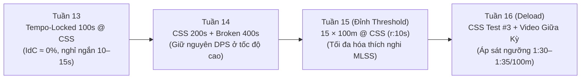

# Block 4 (Tuần 13–16): Ngưỡng CSS & Tối Ưu DPS Ở Tốc Độ Cao

> **Thuộc phần:** `22-training-plan/` | **Giai đoạn:** Đẩy Ngưỡng Lactate & Khóa Tempo Ngọt | **Dryland:** Chuyển từ Sức mạnh sang Công suất (Power)

## Tổng Quan (Overview)
Bước sang nửa sau của hành trình 24 tuần, **Block 4 (Tuần 13–16)** là giai đoạn **chuyển hóa nền hiếu khí (Block 3) thành tốc độ ngưỡng thực sự**. Bạn sẽ sử dụng chính xác **Điểm Ngọt SPM** vừa tìm được từ Ramp Test để tập các bài lặp ngưỡng **CSS (`100m–400m`) với thời gian nghỉ cực ngắn (`10–15 giây`)**, xóa bỏ hoàn toàn *Dead Spot*, chuyển sang nhịp liên hoàn **Opposition (`IdC ≈ 0%`)** và kết thúc bằng **CSS Test #3 (Tuần 16)**.

- **Mục tiêu cốt lõi:** Duy trì **DPS cao** ở đúng **Điểm Ngọt Tempo (`68–76 SPM`)**, nâng mật độ bài tập Zone 3 (CSS) lên `30–35%` khối lượng tuần và đẩy Pace CSS áp sát mốc `1:30–1:35/100m`.
- **Cảm giác đúng:** Guồng tay sắc gọn, mạnh mẽ nhưng có kiểm soát; nghỉ chỉ `10–15 giây` giữa các hiệp `100m–200m` nhưng vẫn giữ được tốc độ và số sải tay đều như máy.
- **Sai lầm phổ biến nhất:** Bỏ quên kỹ thuật EVF khi đẩy Tempo lên cao, hoặc không tuân thủ đúng thời gian nghỉ ngắn `10–15s` (nghỉ quá lâu làm mất kích thích ngưỡng Lactate).

---

## Lý Thuyết (Theory)
Để nâng trần tốc độ bền vững (CSS), hệ tim mạch và cơ bắp cần được đặt trong trạng thái **"Cân bằng Lactate Tối Đa" (*Maximal Lactate Steady State — MLSS*)**:
- Các bài tập như **`12–15 × 100m @ CSS (r:10–15s)`** hay **`5 × 200m @ CSS (r:15–20s)`** giữ nồng độ lactate máu ổn định quanh `3.5–4.5 mmol/L` trong `20–30 phút` — đây là vùng kích thích sinh lý mạnh nhất để đẩy ngưỡng tốc độ `< 1:30/100m` đi lên từng tuần!
- Kết hợp **Tempo Trainer** khóa đúng điểm ngọt SPM giúp ngăn chặn não bộ "trượt chậm lại" ở 30% cuối bài tập.

---

## Cơ Sở Khoa Học (Science)
### Vật Lý & Thủy Động Lực Học (Physics & Hydrodynamics)
Ở ngưỡng vận tốc tiến gần `1:30/100m` ($v \approx 1.11\text{ m/s}$), lực cản sóng (*Wave Drag*) bắt đầu tăng nhanh. Việc rút ngắn pha trượt từ `0.25s` xuống `0.10–0.15s` (**Opposition `IdC ≈ 0%`**) giúp duy trì vận tốc liên tục không sụt giảm (*Low IVV*), giảm đáng kể năng lượng tiêu hao cho mỗi lần gia tốc lại sau từng sải!

### Cơ Sinh Học (Biomechanics) — Phân Bổ Tải Block 4 (Nhịp 3:1)

| Tuần | Đặc điểm tải | Lịch 3 buổi (`S1–S3`) | Lịch 4 buổi (`+S4`) | Lịch 5 buổi (`+S5`) | Lịch 6 buổi (`+S6`) |
| :---: | :--- | :---: | :---: | :---: | :---: |
| **Tuần 13** | Khóa Tempo Ngọt + CSS `100m` | `6.2 km` | `8.4 km` | `10.5 km` | `13.0 km` |
| **Tuần 14** | Tăng cường CSS `200m` & DPS Speed | `6.8 km` | `9.2 km` | `11.5 km` | `14.2 km` |
| **Tuần 15** | Đỉnh Threshold Block 4 (`1.500m CSS`) | `7.2 km` | `9.8 km` | `12.2 km` | `15.2 km` |
| **Tuần 16** | **Deload (-25%) & CSS Test #3 + Video** | `5.4 km` | `7.2 km` | `9.0 km` | `11.2 km` |

---

## Thực Hành (Practical)
### Tại Sao Kỹ Thuật Này Hiệu Quả (Why It Works)
Block 4 kết hợp hoàn hảo giữa **khoa học sinh lý (CSS Threshold)** và **khoa học cơ học (Tempo-Locked DPS)**: bạn không chỉ bơi nhanh hơn vì "gồng khỏe hơn", mà vì hệ cơ–thần kinh đã quen vận hành ở nhịp `Opposition (IdC ≈ 0%)` với hiệu suất kéo EVF cao nhất!

### Hướng Dẫn Từng Bước (Step-by-Step) — Chi Tiết Giáo Án 6 Buổi/Tuần (Tuần 13–16)

#### Buổi S1 — Lõi 1: Kỹ Thuật Tốc Độ Cao & Tempo-Locked DPS (`~2.000–2.400m`)
- **Warm-up (400m):** `200m` Z1 + `4 × 50m` (`25m 3/4 Catch-Up + 25m Swim`, `r:15s`).
- **Pre-Set EVF & Tempo (400m):** `8 × 50m` (`r:15s`, cài **Tempo Trainer** đúng Điểm Ngọt SPM), giữ Stroke Count không tăng.
- **Main Set (1.000–1.400m — Hold-Count CSS):**
  - `5–7 × 200m` (`r:20s`): 100m đầu `@ CSS + 3s` + 100m sau tăng tốc `@ CSS - 1s` (**Negative Split**) nhưng **giữ nguyên số sải/25m**!
- **Cool-down (200m):** Z1 thả lỏng.

#### Buổi S2 — Lõi 2: Threshold CSS Nòng Cốt & Test CSS #3 (Tuần 16) (`~2.100–2.500m`)
- **Lưu ý Tuần 16:** Thực hiện **CSS Test #3** (`400m TT` + nghỉ 10p + `200m TT`) + quay lại Video góc ngang & chính diện để so sánh với Tuần 1!
- **Tuần 13–15 (Bài tập Lõi nâng cấp mỗi tuần):**
  - **Warm-up (400m):** `200m` Z1 + `4 × 50m` (`25m Scull + 25m Build 90%`).
  - **Main Set (1.200–1.600m — Threshold MLSS):**
    - Tuần 13: `12 × 100m @ CSS` (`r:15s`)
    - Tuần 14: `6–7 × 200m @ CSS` (`r:20s`, thở 1:2 hoặc 2:2)
    - Tuần 15: `15 × 100m @ CSS` (`r:10s` — thử thách kỷ luật đỉnh cao!)
  - **Breakout Speed (200m):** `8 × 25m` (8m UDK + 17m Fast 95%, `r:25s`).
  - **Cool-down (200m):** Z1.

#### Buổi S3 — Lõi 3: Broken 400s & Sức Bền Kéo Cơ Xô (`~2.100–2.600m`)
- **Warm-up (400m):** Z1 + `4 × 50m` (`25m Fist + 25m Open Hand`).
- **Main Set (1.500–2.000m):**
  - `3–4 × Broken 400m` (`4 × 100m @ CSS - 1s`, nghỉ đúng `10s` giữa mỗi 100m; nghỉ `60s` giữa mỗi Broken 400m). Hiệp chẵn dùng **Pull Buoy + Small/Medium Paddles** để xây sức bền cơ xô ở tốc độ cao!
- **Cool-down (200m):** Z1.

#### Buổi S4 — Mở Rộng (Lịch 4–6 buổi): Tốc Độ Ngắn (VO2max Touch) & 6-Beat (`~2.000–2.400m`)
- **Warm-up (400m):** Z1 + `4 × 25m` Vertical Kick (`20s`) / Streamline Kick.
- **Kick Speed (300m):** `6 × 50m` (`25m Fast Kick + 25m Easy`, `r:20s`).
- **Main Set (1.000–1.300m — Z4 Introduction):**
  - `2–3 vòng × (4 × 75m @ CSS - 3s, r:25s)` — 50m đầu 4-beat chuẩn EVF + 25m cuối bật 6-beat bứt tốc! (Nghỉ `60s` giữa các vòng).
- **Cool-down (300m):** Z1.

#### Buổi S5 — Mở Rộng (Lịch 5–6 buổi): Hồi Phục Kỹ Thuật & Tinh Chỉnh SWOLF (`~2.000–2.200m`)
- **Warm-up (300m):** Z1.
- **Drill & Feel (600m):** `6 × 100m` (`25m Single-Arm + 25m Mid Scull + 50m Silent Swim`, `r:15s`).
- **Aerobic SWOLF (900–1.100m):** `9–11 × 100m @ CSS + 6s` (`r:15s`), tập trung hạ SWOLF thấp nhất có thể, thở 1:3 cân bằng vai.
- **Cool-down (200m):** Z1.

#### Buổi S6 — Mở Rộng (Lịch 6 buổi): Đường Dài Chuyển Tốc (*Fast-Finish Endurance*) (`~2.400–2.800m`)
- **Warm-up (400m):** Z1.
- **Main Set (1.800–2.200m):** `3–4 × 500m` (`r:30s`), mỗi 500m bơi `300m @ CSS + 5s` (2-beat) → `150m @ CSS` (4-beat) → `50m @ CSS - 3s` (6-beat).
- **Cool-down (200m):** Z1.

<!-- IMAGE_PROMPT: Clean sports physiology progression diagram for Block 4 (Weeks 13-16) showing MLSS threshold workouts (12x100m -> 7x200m -> 15x100m @ CSS r:10s), Tempo Trainer lock at Sweet Spot SPM, and CSS Test #3 milestone. -->

### Mẹo Nâng Cao (Advanced Tips — Dryland & Mobility Đi Kèm Block 4)
- **Dryland (`2 buổi/tuần × 35p`)**: Bắt đầu chuyển sang **Giai đoạn 3 (Công suất Bùng nổ — Power)** vào Tuần 15–16: giảm tạ còn ~65–70% nhưng kéo Pull-Up/Row/Band thật nhanh và sắc, thêm **Medball Rotational Throw** & **Overhead Slam**!

---

## Bài Tập Thực Hành (Drills — Trọng Tâm Block 4)

| Tên Drill | Tần suất/Tuần | Mục tiêu Block 4 |
| :--- | :---: | :--- |
| **Tempo-Locked 50s/100s** | `2 buổi` | Khóa chặt Điểm Ngọt SPM, xóa Dead Spot |
| **Broken 400m @ CSS (r:10s)** | `1–2 buổi` | Xây khả năng duy trì pace CSS trên cự ly dài |
| **8m UDK + 17m Fast Breakout** | `2 buổi` | Tối ưu hóa tốc độ thoát tường sau Flip Turn |

---

## Phân Tích AI & Video (AI Analysis)
- **So sánh Video Giữa Kỳ (Tuần 16 vs Tuần 01):**
  - Kiểm tra **IdC** ở pace CSS đã tiến về `[-3%, +2%]` (Opposition) chưa.
  - Kiểm tra **Stroke Index ($\text{SI} = v \times \text{DPS}$)** đã tăng tối thiểu `+15–25%` so với Tuần 1 chưa.

---

## Lỗi Thường Gặp & Cách Sửa (Common Errors)
| Lỗi thường gặp | Triệu chứng nhận biết | Nguyên nhân gốc | Cách sửa (Correction) |
| :--- | :--- | :--- | :--- |
| **Bơi hiệp 1–3 nhanh hơn CSS `3–4s`** | Sụp đổ hoàn toàn ở hiệp 10–15 trong bài `15 × 100m` | Quá hưng phấn đầu bài (*Red Mist*) | Dùng Tempo Trainer hoặc đồng hồ tường khóa đúng từng giây ngay từ 50m đầu |
| **Kéo dài thời gian nghỉ từ `10s` thành `30s`** | Mất hiệu ứng kích thích ngưỡng Lactate MLSS | Thấy mệt nên đứng thở thêm ở tường | Nếu không giữ nổi pace với `r:10–15s`, hãy chỉnh pace chậm lại `1–2s/100m` thay vì nghỉ dài hơn |
| **Mỏi vai khi bắt đầu thêm Paddles ở S3** | Căng tức mặt trước vai | Chọn cỡ Paddles quá lớn hoặc quên thả lỏng Recovery | Chỉ dùng Paddles cỡ vừa bằng bàn tay (hoặc Finger Paddles), luôn thả lỏng trên không |

---

## Tự Đánh Giá Tại Hồ (Self Assessment)
- [ ] Tôi hoàn thành được bài `12–15 × 100m @ CSS` với thời gian nghỉ ngắn `10–15 giây` mà pace không bị tụt ở 3 hiệp cuối.
- [ ] Tôi duy trì được nhịp **Opposition (`IdC ≈ 0%`)** và góc EVF chắc ở đúng Điểm Ngọt SPM.
- [ ] Tôi hoàn thành **CSS Test #3 (Tuần 16)** và quay video giữa kỳ đối chiếu tiến bộ với Tuần 1.
- [ ] Stroke Count của tôi khi bơi ở pace CSS chỉ cao hơn tối đa `+1 sải/25m` so với khi bơi Z2.

---

## Chỉ Số Đo Lường (KPI — Hết Tuần 16)

| Chỉ số (Metric) | Đạt chuẩn Block 4 | Xuất sắc |
| :--- | :---: | :---: |
| **Cải thiện Pace CSS (tích lũy từ Tuần 1)** | `-8 đến -12s/100m` | `-12 đến -18s/100m` |
| **Độ lệch pace trong `12 × 100m @ CSS (r:15s)`** | `< 3 giây/100m` | `< 1.5 giây/100m` |
| **Thời gian Turn (`5m-In / 5m-Out`)** | `≤ 7.5 giây` | `≤ 6.8 giây` |

---

## Câu Hỏi Thường Gặp (FAQ)
**1. Trong bài `15 × 100m @ CSS (r:10s)`, tôi mới bơi hết 10 hiệp đã thấy đuối quá thì sao?**
Với lịch 3 buổi/tuần hoặc người mới bước lên Block 4, bạn hoàn toàn có thể dừng ở **`10–12 × 100m @ CSS (r:15s)`** — điều quan trọng là **100% số hiệp đều đạt chuẩn kỹ thuật EVF và đều tốc độ**, không bơi thêm hiệp rác khi dáng đã vỡ!

**2. Tại sao Tuần 16 lại phải quay video giữa kỳ?**
Vì khi tốc độ của bạn đã tăng thêm `10–15 giây/100m`, những lỗi nhỏ ẩn giấu ở tốc độ cao (như hơi cắt cụt pha Push hay ngẩng đầu nhẹ khi mệt) sẽ xuất hiện — phát hiện và sửa ngay ở Tuần 16 giúp Block 5–6 bứt phá an toàn.

---

## Tóm Tắt (Summary)
- **Block 4 (Tuần 13–16)** là giai đoạn đột phá ngưỡng tốc độ bền vững thông qua **MLSS Threshold (`12–15 × 100m`, `6–7 × 200m`, `Broken 400m @ CSS`)** kết hợp **Tempo Trainer**.
- Kết thúc bằng **Deload + CSS Test #3 + Video Giữa Kỳ** để cập nhật pace mới trước khi bước vào Block 5 tốc độ đỉnh.

**Liên kết chéo:**
- Chương trước: [Block 3 — Tuần 09–12](weeks-09-12.md)
- Chương tiếp theo: [Block 5 — Tuần 17–20: Tốc Độ Chuyên Biệt (Threshold & VO2max)](weeks-17-20.md)
- Tra cứu thuật ngữ: [Glossary](../24-appendix/glossary.md)

---

## Tài Liệu Tham Khảo (References)
1. Olbrecht, J. (2000). *The Science of Winning*. F&G Partners.
2. Newsome, P., & Young, A. (2012). *Swim Smooth*. Wiley.
3. Wakayoshi, K., et al. (1992). *Critical swim speed and lactate threshold*. European Journal of Applied Physiology.

