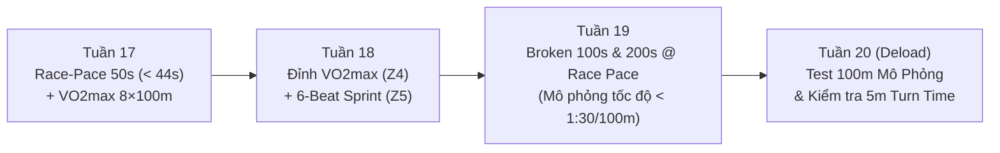

# Block 5 (Tuần 17–20): Tốc Độ Chuyên Biệt (*Threshold & VO2max*)

> **Thuộc phần:** `22-training-plan/` | **Giai đoạn:** Kéo Trần Tốc Độ Vượt Mốc `< 1:30/100m` | **Dryland:** Công Suất Bùng Nổ (*Power Phase*)

## Tổng Quan (Overview)
**Block 5 (Tuần 17–20)** là giai đoạn **đẩy trần tốc độ tối đa và sức bền tốc độ (VO2max — Zone 4 & Sprint — Zone 5)** lên cao hơn mục tiêu `< 1:30/100m` khoảng **`3–5 giây/100m`**. Khi hệ tim mạch và cơ xô của bạn đã quen vận hành mượt mà ở pace `1:24–1:28/100m` trong các bài lặp `50m–100m`, việc duy trì `< 1:30/100m` trong ngày kiểm tra sẽ trở nên chủ động, tự tin và nhẹ tay hơn rất nhiều!

- **Mục tiêu cốt lõi:** Phát triển công suất **VO2max** (`50m–100m @ CSS - 4s`), độ sắc của **6-Beat Kick**, tốc độ **Flip Turn & Breakout 8m+**, và hoàn thành **Bài Test 100m Mô Phỏng** ở cuối Tuần 20.
- **Cảm giác đúng:** Bứt tốc mạnh mẽ nhưng vẫn giữ thân dài, mắt nhìn đáy, không bị hoảng loạn hay quạt trượt nước khi nhịp tim lên vùng 85–95% tối đa.
- **Sai lầm phổ biến nhất:** Bỏ qua ngày hồi phục Zone 1–2 giữa các buổi VO2max/Sprint (gây cạn kiệt hệ thần kinh trung ương), hoặc nín thở quá mức ở các bài `50m` nhanh.

---

## Lý Thuyết (Theory)
Để phá vỡ một cột mốc tốc độ mới, bạn phải tác động đồng thời vào **2 giới hạn sinh lý đỉnh**:
1. **VO2max / Aerobic Power (Zone 4 — `CSS - 3 đến -5s/100m`)**: Các bài lặp `50m–100m` nghỉ vừa (`20–30s`) ép tim bơm lưu lượng máu tối đa và dạy cơ bắp chịu đựng + tái sử dụng axit lactic ở tốc độ đua thực tế (*Race Pace*).
2. **Anaerobic Speed & Neuromuscular Power (Zone 5 — `95–100%`)**: Các đoạn `25m–50m` nghỉ dài (`45–60s`) tuyển dụng tối đa sợi cơ nhanh loại II (*Type II Fibers*), tăng tốc độ xoay hông, độ sắc của pha Push và tần suất 6-Beat Kick mà không làm suy giảm kỹ thuật EVF.

---

## Cơ Sở Khoa Học (Science)
### Vật Lý & Thủy Động Lực Học (Physics & Hydrodynamics)
Ở tốc độ mục tiêu **`< 1:30/100m`** (và các đoạn Race Pace `1:22–1:28/100m`, tức $v \approx 1.15–1.22\text{ m/s}$), công suất cơ học $P \propto v^3$ tăng rất nhanh. Block 5 tối ưu hóa **3 lợi thế vật lý tốc độ cao**:
- Chuyển pha linh hoạt sang **Opposition / Superposition nhẹ (`IdC: 0% đến +4%`)**.
- Bật **6-Beat Kick gọn sắc** tạo hiệu ứng nâng thân giảm diện tích ướt.
- Tối ưu **10m Turn Time (`5m-In / 5m-Out ≤ 6.5s`)** để mỗi chiều bể 25m chỉ cần bơi mặt nước thực tế `~17–18 m`.

### Cơ Sinh Học (Biomechanics) — Phân Bổ Tải Block 5 (Nhịp 3:1)

*(Lưu ý: Khối lượng tổng giảm nhẹ ~5–10% so với đỉnh Block 3–4 để dồn toàn bộ chất lượng vào cường độ tốc độ Zone 4–5!)*

| Tuần | Đặc điểm tải | Lịch 3 buổi (`S1–S3`) | Lịch 4 buổi (`+S4`) | Lịch 5 buổi (`+S5`) | Lịch 6 buổi (`+S6`) |
| :---: | :--- | :---: | :---: | :---: | :---: |
| **Tuần 17** | Race-Pace `50m` & VO2max `100m` | `5.8 km` | `7.8 km` | `9.8 km` | `12.0 km` |
| **Tuần 18** | Đỉnh VO2max & 6-Beat Speed | `6.2 km` | `8.4 km` | `10.5 km` | `12.8 km` |
| **Tuần 19** | Đỉnh Race-Pace Simulation (`100m/400m`) | `6.5 km` | `8.8 km` | `11.0 km` | `13.5 km` |
| **Tuần 20** | **Deload (-25%) & Test 100m Mô Phỏng** | `4.8 km` | `6.5 km` | `8.2 km` | `10.0 km` |

---

## Thực Hành (Practical)
### Tại Sao Kỹ Thuật Này Hiệu Quả (Why It Works)
Cấu trúc **"Race-Pace Training" (USRPT — Ultra-Short Race-Pace Training điều chỉnh)** ở buổi `S2` và `S4` giúp hệ thần kinh của bạn thuộc lòng chính xác từng giây của tốc độ mục tiêu `< 1:30/100m` (`≤ 22.0s/25m` hoặc `≤ 44.0s/50m`), đồng thời giữ đủ quãng nghỉ để **không bao giờ phải tập bơi trong trạng thái vỡ form**!

### Hướng Dẫn Từng Bước (Step-by-Step) — Chi Tiết Giáo Án 6 Buổi/Tuần (Tuần 17–20)

#### Buổi S1 — Lõi 1: Kỹ Thuật Sắc Bén & Race-Pace 50s (`~1.900–2.200m`)
- **Warm-up (400m):** `200m` Z1 + `4 × 50m` (`25m Mid Scull + 25m Swim`).
- **Pre-Set Breakout (200m):** `8 × 25m` (8m UDK + 17m Fast, `r:25s`).
- **Main Set (1.000–1.300m — Race-Pace 50s):**
  - `12–16 × 50m` @ **Tốc độ mục tiêu `< 1:30/100m`** (tức `42–44s/50m`, hoặc `CSS - 3s/100m`), nghỉ `20–25s`. Dừng tăng tốc ngay nếu dáng EVF bắt đầu vỡ!
  - Xen kẽ `200m` bơi cực nhẹ Z1 giữa 2 block (ví dụ `2 × (6–8 × 50m)`).
- **Cool-down (300m):** Z1 thả lỏng kỹ xả lactate.

#### Buổi S2 — Lõi 2: VO2max Nòng Cốt & Test 100m Mô Phỏng (Tuần 20) (`~1.900–2.300m`)
- **Lưu ý Tuần 20:** Thực hiện **Test 100m Mô Phỏng** (đạp tường hoặc Track Start, phân phối 50m đầu/50m sau đúng chiến thuật) + đo `5m-In / 5m-Out Turn Time`.
- **Tuần 17–19:**
  - **Warm-up (400m):** `300m` Z1 + `4 × 25m` Build to 95%.
  - **Main Set (1.000–1.400m — VO2max Zone 4):**
    - Tuần 17: `8 × 100m @ CSS - 3s` (`r:30s`)
    - Tuần 18: `10 × 100m @ CSS - 4s` (`r:30s`, giữ Even/Negative Split trong từng 100m)
    - Tuần 19: `4 × Broken 100m` (`4 × 25m` @ `20–21.5s`, nghỉ `10s` giữa mỗi 25m; nghỉ `90s` giữa mỗi Broken 100m) + `4 × 100m @ CSS` (`r:15s`).
  - **Cool-down (400m):** Bơi cực chậm Z1 (bắt buộc xả sạch axit lactic!).

#### Buổi S3 — Lõi 3: Duy Trì Ngưỡng CSS & Hiệu Suất DPS (`~2.000–2.400m`)
- **Warm-up (400m):** Z1 + `4 × 50m` (`25m 3/4 Catch-Up + 25m Swim`).
- **Main Set (1.400–1.800m — CSS Maintenance):**
  - `3–4 × 300m @ CSS` (`r:25s`, 200m đầu 2/4-beat nhẹ tay + 100m cuối bật 6-beat tăng tốc) + `4 × 50m` Pull Buoy + Paddles giữ EVF chắc (`r:15s`).
- **Cool-down (200m):** Z1.

#### Buổi S4 — Mở Rộng (Lịch 4–6 buổi): Tốc Độ Tối Đa (Sprint Z5) & 6-Beat Power (`~1.900–2.200m`)
- **Warm-up (400m):** Z1 + `4 × 25m` Fast-In/Fast-Out Flip Turns.
- **Kick Power (300m):** `6 × 25m` All-Out Streamline Kick (`r:30s`) + `6 × 25m` Easy.
- **Main Set (800–1.100m — Zone 5 Speed):**
  - `8–12 × 25m @ 98–100% Sprint` (`r:45–60s` — nghỉ thật đủ để mỗi 25m đều nhanh hết cỡ!), không thở trong 10m cuối, Flip Turn/chạm đích dứt khoát.
  - `200m` thả lỏng giữa set + `4 × 50m` Descend 1–4 (`r:35s`).
- **Cool-down (400m):** Z1 thả lỏng kỹ.

#### Buổi S5 — Mở Rộng (Lịch 5–6 buổi): Hồi Phục Chủ Động & Xả Mỏi Vai (`~1.800–2.100m`)
- **Warm-up (300m):** Z1 cực êm.
- **Recovery Drills (600m):** `4 × 50m` Fingertip Drag + `4 × 50m` Sculling + `4 × 50m` Backstroke (bơi ngửa mở ngực cân bằng khớp vai).
- **Easy Swim (700–1.000m):** Z1–Z2 cực nhẹ (nhịp tim `< 65%` tối đa), tập trung giữ tay nhẹ và SWOLF thấp.
- **Cool-down (200m):** Z1.

#### Buổi S6 — Mở Rộng (Lịch 6 buổi): Tốc Độ Đường Dài / Race Simulation (`~2.200–2.600m`)
- **Warm-up (400m):** Z1.
- **Main Set (1.500–1.900m):** `3 × 400m` (`r:45s`, mỗi 400m bơi `Negative Split`: 200m đầu `@ CSS + 2s` → 200m sau `@ CSS - 2s`) + `3 × 100m` Easy.
- **Cool-down (300m):** Z1.

<!-- IMAGE_PROMPT: Clean sports science intensity chart for Block 5 (Weeks 17-20) showing reduced total volume paired with sharp Zone 4 (VO2max 100s) and Zone 5 (25m Sprint & Broken 100s) peaks, emphasizing full recovery cool-downs and Week 20 100m Race Simulation Test. -->

### Mẹo Nâng Cao (Advanced Tips — Dryland & Mobility Đi Kèm Block 5)
- **Dryland (`2 buổi/tuần × 30p`)**: **Power Phase** — `3 × 5–6` Explosive Pull-Up / Band Pull tốc độ cao + `3 × 6` Box Jump (bật đạp tường) + `3 × 8/bên` Medball Rotational Throw + Face Pull. Tuyệt đối **không tập tới mệt cơ**, giữ hệ thần kinh sắc bén!

---

## Bài Tập Thực Hành (Drills — Trọng Tâm Block 5)

| Tên Drill | Tần suất/Tuần | Mục tiêu Block 5 |
| :--- | :---: | :--- |
| **Broken 100m @ Race Pace (r:10s)** | `1 buổi` | Cảm nhận chính xác tốc độ `< 1:30/100m` với kỹ thuật nguyên vẹn |
| **25m All-Out Sprint (r:50s)** | `1–2 buổi` | Đẩy trần tốc độ tối đa & nhịp 6-Beat sắc bén |
| **No-Breath 10m Finish** | Mọi buổi tốc độ | Chạm đích mạnh mẽ không ngẩng đầu mất `0.5s` cuối |

---

## Phân Tích AI & Video (AI Analysis)
- **Phân tích Video Test 100m Mô Phỏng (Tuần 20):**
  - Đo chính xác **Split 25m #1, #2, #3, #4** (mục tiêu độ chênh 50m đầu vs 50m sau `≤ 2.5 giây`).
  - Đo **10m Turn Time (`5m-In / 5m-Out`)** và kiểm tra góc EVF ở `25m` cuối cùng (có bị sụp khuỷu khi lactate cao không).

---

## Lỗi Thường Gặp & Cách Sửa (Common Errors)
| Lỗi thường gặp | Triệu chứng nhận biết | Nguyên nhân gốc | Cách sửa (Correction) |
| :--- | :--- | :--- | :--- |
| **Bỏ qua 300–400m Cool-down Z1 sau buổi VO2max** | Hôm sau cơ vai & đùi cứng nặng như chì | Không xả axit lactic khỏi cơ bắp sau cường độ Z4–Z5 | Luôn dành ít nhất `10 phút` (`300–400m`) bơi cực chậm sau buổi S2 & S4 |
| **Nghỉ quá ít ở buổi Sprint Z5** | Tốc độ tụt mạnh từ hiệp 4 trở đi (biến thành tập sức bền) | Sợ đứng nghỉ `45–60s` trông "lười" | Hệ năng lượng ATP-CP cần tối thiểu `45–60s` để tái tạo `> 90%` công suất nổ |
| **Quạt trượt nước khi cố bơi nhanh hơn CSS** | Nhịp tay lên `> 88 SPM`, bọt trắng xóa nhưng vẫn `45s/50m` | Vượt quá Điểm Ngọt SPM, phá góc EVF | Giữ vững EVF sâu `110°` và dùng **6-Beat Kick + Flip Turn** tạo thêm tốc độ |

---

## Tự Đánh Giá Tại Hồ (Self Assessment)
- [ ] Tôi có thể hoàn thành bài lặp **`12 × 50m`** ở pace `≤ 44 giây/50m` (tốc độ `< 1:30/100m`) với form EVF nguyên vẹn.
- [ ] Tôi luôn thực hiện `300–400m` Cool-down thả lỏng sau mỗi buổi VO2max/Sprint.
- [ ] Tôi hoàn thành **Test 100m Mô Phỏng (Tuần 20)** đạt sát hoặc phá luôn mốc `1:30/100m` (dù cơ thể vẫn đang trong giai đoạn tích tải chưa Taper!).
- [ ] Khớp vai tôi vẫn khỏe mạnh, không đau nhói dù cường độ tốc độ đang ở mức cao nhất.

---

## Chỉ Số Đo Lường (KPI — Hết Tuần 20)

| Chỉ số (Metric) | Đạt chuẩn Block 5 | Xuất sắc |
| :--- | :---: | :---: |
| **Race-Pace `12 × 50m` (r:25s)** | `44–45s/50m` | `≤ 42–43s/50m` |
| **Test 100m Mô Phỏng (Chưa Taper)** | `1:31–1:34` | `≤ 1:29–1:30` |
| **25m All-Out Sprint (đạp tường)** | `≤ 20.0 giây` | `≤ 18.5 giây` |

---

## Câu Hỏi Thường Gặp (FAQ)
**1. Ở Tuần 20 tôi test 100m mô phỏng đạt `1:32` — liệu sang Block 6 (Taper) tôi có phá được `< 1:30` không?**
**Rất cao!** Ở Tuần 20, cơ thể bạn vẫn đang mang mệt mỏi tích lũy từ 19 tuần tập liên tục. Quá trình **Taper chuẩn khoa học ở Tuần 21–24** thường mang lại mức tăng hiệu suất **`2–4%`** (tương đương **`2–3.5 giây` trên `100m`**) — đưa bạn vượt qua mốc `< 1:30/100m` cực kỳ ngoạn mục!

**2. Tôi là Triathlete hướng tới 1.9km chứ không chỉ 100m, có cần tập Block 5 không?**
Có! Nâng trần **VO2max (Zone 4)** giống như "nâng trần nhà lên cao hơn" để tốc độ ngưỡng CSS (`1.9km`) có thêm dư địa tăng trưởng. Chỉ cần giảm bớt số hiệp `25m Sprint` và tập trung nhiều hơn vào `8–10 × 100m @ CSS - 3s` và `Race-Pace 50s`.

---

## Tóm Tắt (Summary)
- **Block 5 (Tuần 17–20)** kéo trần tốc độ vượt ngưỡng mục tiêu qua **Race-Pace 50s**, **VO2max 100s**, **Broken 100s** và **25m Sprint Z5**.
- Luôn đi kèm **Cool-down 300–400m**, **nghỉ đủ ở Sprint** và **Dryland Power** không mỏi cơ để sẵn sàng bước vào Block 6 Taper bùng nổ!

**Liên kết chéo:**
- Chương trước: [Block 4 — Tuần 13–16](weeks-13-16.md)
- Chương tiếp theo: [Block 6 — Tuần 21–24: Taper, Chiến Thuật & Phá Mốc `< 1:30/100m`](weeks-21-24.md)
- Tra cứu thuật ngữ: [Glossary](../24-appendix/glossary.md)

---

## Tài Liệu Tham Khảo (References)
1. Mujika, I. (2009). *Tapering and Peaking for Optimal Performance*. Human Kinetics.
2. Rushall, B. S. (2013). *Ultra-Short Race-Pace Training (USRPT) in Swimming*. Swimming Science Bulletin.
3. Olbrecht, J. (2000). *The Science of Winning*. F&G Partners.

