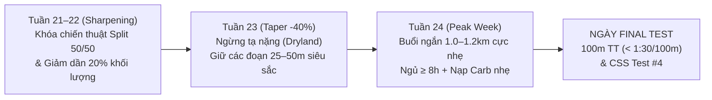

# Block 6 (Tuần 21–24): Taper, Chiến Thuật & Kiểm Tra Mốc `< 1:30/100m`

> **Thuộc phần:** `22-training-plan/` | **Giai đoạn:** Siêu Bù Trừ Đỉnh Phong (*Peak & Taper*) | **Dryland:** Giảm tải & Dừng tạ trước ngày Test 7 ngày

## Tổng Quan (Overview)
Bạn đã đi qua 20 tuần kỷ luật xây dựng tư thế, EVF, nền hiếu khí, ngưỡng CSS và tốc độ VO2max. **Block 6 (Tuần 21–24)** là giai đoạn **thu hoạch thành quả**: tinh chỉnh chiến thuật thi đấu ở Tuần 21–22, rồi bước vào **2 tuần Taper khoa học (Tuần 23–24)** — **giảm sâu khối lượng (`-40 đến -60%`) nhưng giữ nguyên độ sắc bén của cường độ Race-Pace** để cơ thể giải phóng toàn bộ mệt mỏi tích lũy, đạt trạng thái **Siêu bù trừ (*Supercompensation*)** và chinh phục ngoạn mục cột mốc **`< 1:30/100m`**!

- **Mục tiêu cốt lõi:** Tinh chỉnh chi tiết nhỏ (Start, Flip Turn, Split 50m/50m), thực hiện Taper đúng chuẩn khoa học (Mujika, 2009) và hoàn thành **FINAL TEST Tuần 24 (`100m TT` / `400m TT` / `CSS Test #4`)**.
- **Cảm giác đúng:** Vào Tuần 24, mỗi sải tay cảm thấy nhẹ bẫng, nước cực kỳ "dính" vào lòng bàn tay, cơ thể đầy năng lượng và chỉ muốn lao vút đi.
- **Sai lầm phổ biến nhất:** Sợ "mất thể lực" trong tuần Taper nên lén bơi thêm khối lượng hoặc thử sức bơi hết ga 100m trước ngày Test chính thức chỉ 2–3 ngày!

---

## Lý Thuyết (Theory)
Khoa học về **Taper (Giảm tải đỉnh phong)** của Iñigo Mujika & Sabino Padilla (nghiên cứu trên hàng trăm VĐV bơi Olympic) chứng minh công thức vàng cho **hiệu suất tăng thêm `+2% đến +4%`**:
1. **Giảm Khối Lượng theo hàm mũ (*Exponential Volume Reduction*)**: Giảm `-20%` ở Tuần 22 → `-40%` ở Tuần 23 → `-55–60%` ở Tuần 24.
2. **GIỮ NGUYÊN Cường Độ (*Maintain Intensity*)**: Vẫn giữ các đoạn ngắn `25m–50m` ở đúng tốc độ Race-Pace (`< 1:30/100m`) với thời gian nghỉ thật dài để hệ thần kinh và sợi cơ nhanh không bị "ngủ quên".
3. **Giữ Tần Suất buổi bơi (*Maintain Frequency ≥ 80%*)**: Vẫn xuống nước đều (ví dụ lịch 4 buổi giữ 3–4 buổi ngắn, mỗi buổi chỉ `1.000–1.400m`) để **không bị mất cảm giác nước (*Feel for the Water*)**!

---

## Cơ Sở Khoa Học (Science)
### Vật Lý & Thủy Động Lực Học (Physics & Hydrodynamics)
Trong 14 ngày Taper:
- Dự trữ **Glycogen trong cơ lưng rộng (Lat) và cơ đùi** tăng lên mức bão hòa tối đa (`+20–30%`).
- Các tổn thương vi mô trong sợi cơ lành hoàn toàn, tốc độ phát lực (*Rate of Force Development*) của sợi cơ nhanh loại IIa tăng vọt `+10–15%`.
- Kết quả: Tại cùng một nhịp tim và cảm giác nỗ lực, **lực bám nước EVF và độ bật của Flip Turn tăng rõ rệt**, giúp bạn vượt qua vạch `100m` nhanh hơn `2–4 giây` so với Tuần 20!

### Cơ Sinh Học (Biomechanics) — Phân Bổ Tải Block 6 (Đường Cong Taper Chuẩn)

| Tuần | Đặc điểm tải | Lịch 3 buổi (`S1–S3`) | Lịch 4 buổi (`+S4`) | Lịch 5 buổi (`+S5`) | Lịch 6 buổi (`+S6`) |
| :---: | :--- | :---: | :---: | :---: | :---: |
| **Tuần 21** | Tinh chỉnh Chiến thuật & Race-Pace | `5.8 km` | `7.8 km` | `9.5 km` | `11.5 km` |
| **Tuần 22** | Tiền Taper (`-20%` khối lượng, giữ sắc) | `4.8 km` | `6.4 km` | `7.8 km` | `9.4 km` |
| **Tuần 23** | **Taper Chính (`-40%` khối lượng)** | `3.6 km` | `4.8 km` | `5.8 km` | `7.0 km` |
| **Tuần 24** | **Tuần Thi Đấu / FINAL TEST (`-55%`)** | `2.6 km` | `3.4 km` | `4.2 km` | `5.0 km` |

---

## Thực Hành (Practical)
### Tại Sao Kỹ Thuật Này Hiệu Quả (Why It Works)
Rất nhiều người bơi tập rất chăm chỉ nhưng chưa bao giờ được trải nghiệm cảm giác **"bơi trong trạng thái đã Taper 100%"** — khi mà mọi mệt mỏi biến mất nhưng toàn bộ kỹ thuật EVF, Streamline, Flip Turn và sức mạnh cơ xô đang ở đỉnh cao nhất cuộc đời!

### Hướng Dẫn Từng Bước (Step-by-Step) — Lịch Chi Tiết Block 6

#### Tuần 21–22: Tinh Chỉnh Chiến Thuật (*Race Sharpening*)
- **Buổi S1 (Lõi 1 — Race-Pace Precision, `~1.700–1.900m`)**:
  - `400m` Warm-up + `4 × 25m` Sculling + `4 × 25m` Breakout 8m.
  - **Main Set:** `8–10 × 50m` đúng tốc độ mục tiêu `42–43.5s` (`r:30s`), tập trung tuyệt đối vào **Flip Turn không thở sải cuối** và giữ nguyên Stroke Count.
  - `300m` Cool-down Z1.
- **Buổi S2 (Lõi 2 — Pacing Dress Rehearsal, `~1.800–2.000m`)**:
  - `400m` Warm-up + `4 × 25m` Build.
  - **Main Set:** `3 × 100m` (`r:3 phút` nghỉ hoàn toàn) — bơi mô phỏng **chính xác chiến thuật ngày thi**: 50m đầu điềm tĩnh `43.0–43.5s` (nhẹ tay, thở 1:2) + 50m sau bật 6-beat về đích `44.5–45.5s` (không thở 10m cuối)!
  - `400m` Cool-down Z1.
- **Buổi S3 (Lõi 3 — Easy Aerobic & Feel, `~1.800–2.000m`)**:
  - `400m` Warm-up + `4 × 200m @ CSS + 5s` (2-beat cực êm, kiểm tra SWOLF) + `4 × 50m` Fingertip Drag + `200m` Cool-down.
- **Buổi S4–S6 (Mở rộng cho Lịch 4–6 buổi)**: Giảm `20–25%` khối lượng so với Block 5; ưu tiên `6 × 25m Fast Breakout (r:45s)`, `4 × 50m` Sculling/Single-Arm và bơi Z1 thả lỏng.

#### Tuần 23: Taper Chính (`-40%` Khối Lượng, Dừng Tập Tạ Nặng)
- **Mọi buổi tập rút gọn còn `1.100–1.400m`** (chỉ mất `30–40 phút` dưới nước):
  - **S1**: `300m` Z1 + `4 × 50m` Sculling/Fingertip Drag + `6 × 50m @ Race Pace` (`r:40s`) + `300m` Z1.
  - **S2**: `300m` Z1 + `4 × 25m` Flip Turn sắc gọn + `4 × 50m` (`25m Race Pace + 25m Easy`, `r:45s`) + `300m` Z1.
  - **S3 (và S4–S6 nếu có)**: `1.000–1.200m` bơi cực nhẹ Z1–Z2, giữ cảm giác nước đặc và ngủ đủ `≥ 8 giờ/đêm`.

#### Tuần 24: Tuần Kiểm Tra Đỉnh Phong (*FINAL TEST WEEK*)
- **Ngày 1 (Thứ 2 — `1.000m` Feel & Sharpness)**: `300m` Z1 + `4 × 50m` Scull/Swim + `4 × 25m @ Race Pace` (`r:60s`) + `300m` Z1.
- **Ngày 2 (Thứ 3)**: Nghỉ ngơi hoàn toàn (chỉ giãn nhẹ 10 phút).
- **Ngày 3 (Thứ 4 — `800m` Pre-Test Activation)**: `300m` Z1 + `4 × 25m` Breakout 8m + `2 × 25m @ 95%` (`r:60s`) + `350m` Z1 cực êm.
- **Ngày 4 (Thứ 5)**: Nghỉ ngơi hoàn toàn, uống đủ nước & điện giải, ăn bữa tối giàu Carb dễ tiêu.
- **Ngày 5 (Thứ 6 hoặc Thứ 7 — NGÀY FINAL TEST `< 1:30/100m`!)**:
  1. **Khởi động cạn (10 phút)**: Kịch bản A đầy đủ (dây kháng lực EVF nhẹ + mở khớp động).
  2. **Khởi động nước (`500m`, hoàn thành trước giờ bấm giờ 10–15 phút)**: `200m` Z1 cực êm + `4 × 50m` (`25m Scull + 25m Build`) + `2 × 25m @ Race Pace` (`r:60s`) + `50m` thả lỏng.
  3. **BÀI TEST CHÍNH — `100m Freestyle Time Trial`**:
     - *0–25m*: Thoát tường Streamline + 3 Dolphin Kick (không thở sải đầu), giữ cảm giác 80% sức, tay cực dài & nhẹ (`~21.0–21.5s`).
     - *25–50m*: Flip Turn sắc, duy trì nhịp thở 1:2, giữ đúng Điểm Ngọt SPM (`chạm mốc 50m ~43.0–43.5s`).
     - *50–75m*: Bắt đầu tăng lực đẩy EVF & chuyển lên 4/6-beat kick (`~22.5s`).
     - *75–100m*: Flip Turn cuối cùng bùng nổ, bật **6-Beat Kick hết công suất**, **KHÔNG THỞ 10m cuối**, vươn mạnh chạm đích (`~22.5–23.0s`) → **TỔNG THÀNH TÍCH: `1:28.0 – 1:29.5`!**
  4. *(Tùy chọn sau 1–2 ngày nghỉ hoặc sau 15 phút thả lỏng)*: Thực hiện **CSS Test #4 (`400m + 200m`)** để ghi nhận toàn bộ bước nhảy vọt sau 24 tuần!
  5. **Cool-down (`300m`)**: Bơi cực chậm ăn mừng thành tích!

<!-- IMAGE_PROMPT: Clean race-strategy & taper graphic: Left shows 4-week exponential volume drop (-20% -> -40% -> -55%) paired with rising freshness/performance supercompensation curve; Right shows a 100m Pool Pacing Blueprint (4 x 25m splits: 21.0s -> 22.0s -> 22.5s -> 22.5s = 1:28.0) with turn, breathing, and 6-beat kick callouts. -->

### Mẹo Nâng Cao (Advanced Tips — Tâm Lý Trong Tuần Taper)
- **Hội chứng "Taper Tantrums" (Cảm giác nặng người giả vào đầu Tuần 23)**: Rất nhiều VĐV cảm thấy người hơi ì ạch, mất ngủ nhẹ hoặc lo lắng "mình đang mất thể lực" vào giữa tuần Taper đầu tiên. Đó là dấu hiệu **sinh lý hoàn toàn bình thường** khi cơ bắp đang tích nước cùng Glycogen! Hãy tin tưởng vào quy trình — sang đầu Tuần 24 cảm giác nhẹ bẫng sẽ ập tới.

---

## Bài Tập Thực Hành (Drills — Trọng Tâm Tuần Taper)

| Tên Bài Tập | Mục tiêu Block 6 | Cự ly / Nghỉ | Cảm giác đúng (Cue) |
| :--- | :--- | :--- | :--- |
| **25m Race-Pace Rehearsal** | Khóa chặt cảm giác tốc độ `21.5–22.0s/25m` | `4 × 25m` (`r:60s`) | Nhanh sắc nhưng cực kỳ thả lỏng, không gồng vai |
| **50m Split Calibration** | Canh chuẩn mốc 50m đầu `43.0–43.5s` không bị *Fly & Die* | `3 × 50m` (`r:90s`) | Chạm tường 50m đúng sai số `± 0.5 giây` không cần nhìn đồng hồ giữa chừng |

---

## Phân Tích AI & Video (AI Analysis)
- **Báo Cáo Tổng Kết 24 Tuần (Tuần 01 vs Tuần 24):** So sánh trực tiếp 6 chỉ số cốt lõi trên bảng điều khiển KPI: `100m TT`, `Pace CSS`, `SWOLF (25m)`, `DPS`, `Góc EVF` và `5m Turn Time`.

---

## Lỗi Thường Gặp & Cách Sửa (Common Errors)
| Lỗi thường gặp | Triệu chứng nhận biết | Nguyên nhân gốc | Cách sửa (Correction) |
| :--- | :--- | :--- | :--- |
| **Bơi "thử sức 100m" 3 ngày trước ngày Test** | Ngày Test chính thức bị đuối ở 25m cuối | Lo lắng muốn kiểm tra sớm, đốt sạch glycogen & hệ thần kinh | Tuyệt đối tin tưởng giáo án; chỉ bơi tối đa `25–50m` sắc trong Tuần 24 |
| **Bung hết 100% sức ở 25m đầu ngày Test** | 25m đầu `19.5s`, 25m cuối lết `27s` (`Tổng 1:32`) | Quên chiến thuật phân phối sức (*Fly & Die*) | Bơi 25m đầu cảm giác **80–85% sức**, tập trung vào độ dài DPS & Streamline |
| **Quên khởi động đủ 500m trước giờ Test** | 50m đầu cảm thấy ngộp hơi, cơ cứng | Nhảy xuống bơi Test ngay khi mới khởi động 100m | Hoàn thành trọn vẹn `10p` khởi động cạn + `500m` khởi động nước trước giờ bấm giờ `10–15p` |

---

## Tự Đánh Giá Tại Hồ (Self Assessment)
- [ ] Tôi đã giảm khối lượng đúng theo đường cong Taper Tuần 22–24 và ngừng tập tạ nặng trước ngày Test tối thiểu `7 ngày`.
- [ ] Tôi đã thuộc lòng kịch bản Split `4 × 25m` (hoặc `2 × 50m`) cho ngày **FINAL TEST**.
- [ ] Tôi ngủ đủ `≥ 8 giờ/đêm` và bù đủ nước–điện giải trong 3 ngày trước ngày kiểm tra.
- [ ] Tôi đã hoàn thành **FINAL TEST Tuần 24** và ghi lại toàn bộ thông số đối chiếu với Tuần 1!

---

## Chỉ Số Đo Lường (KPI — Đánh Giá Hoàn Thành Hành Trình 24 Tuần)

| Chỉ số (Metric) | Tuần 01 (Ví dụ nền) | Đạt Chuẩn Tuần 24 | Vượt Mục Tiêu |
| :--- | :---: | :---: | :---: |
| **100m Freestyle Time Trial** | `1:45–1:55` | **`< 1:30.0`** | **`≤ 1:25.0`** |
| **Pace CSS (`400m + 200m`)** | `1:50–2:00/100m` | **`1:30–1:36/100m`** | **`< 1:30/100m`** |
| **SWOLF (Bể 25m, Zone 2)** | `46–52` | **`35–38`** | **`≤ 34`** |
| **Cảm giác vai & tay sau 1.000m** | Mỏi vai, hụt hơi | Nhẹ tay, vai khỏe | Tự tin tiến tới `< 1:20/100m` |

---

## Câu Hỏi Thường Gặp (FAQ)
**1. Sau khi hoàn thành 24 tuần và chinh phục `< 1:30/100m`, tôi nên làm gì tiếp theo?**
Hãy dành **1–2 tuần nghỉ ngơi chủ động** (bơi nhẹ Z1 tự do không nhìn đồng hồ, chơi thể thao khác) để cơ thể và tâm trí tái tạo hoàn toàn. Sau đó, bạn có thể bắt đầu chu kỳ mới từ **Block 2 hoặc Block 3** với **Pace CSS mới** để chinh phục cột mốc tiếp theo (`< 1:20/100m` hoặc cự ly `1.500m / 1.9km / 3.8km Open Water`)!

**2. Nếu ngày Final Test tôi đạt `1:30.5` (chỉ thiếu 0.5 giây) thì sao?**
Xin chúc mừng vì bạn đã tiến bộ vượt bậc! Hãy nghỉ hồi phục nhẹ 3–4 ngày (chỉ bơi `1.000m` Z1 + vài đoạn 25m sắc), kiểm tra lại video 100m vừa rồi để tinh chỉnh 1 điểm nhỏ (như Flip Turn hoặc 10m cuối không thở) rồi **test lại lần 2 sau 5–7 ngày** — 90% người bơi sẽ phá sâu mốc `1:29` ngay ở lần 2!

---

## Tóm Tắt (Summary)
- **Block 6 (Tuần 21–24)** hoàn tất hành trình 24 tuần bằng **Sharpening (Tuần 21–22)** và **Taper khoa học (Tuần 23–24: giảm 40–60% khối lượng, giữ sắc cường độ, giữ tần suất)**.
- Kỷ luật phân phối tốc độ **Controlled 50m đầu + 6-Beat Fast Finish 50m sau + Không thở 10m cuối** là chìa khóa vàng mở cánh cửa **`< 1:30/100m`**!

**Liên kết chéo:**
- Chương trước: [Block 5 — Tuần 17–20](weeks-17-20.md)
- Chương tiếp theo (Phase 10): [Phân Tích AI — Pose Detection & Đo Góc Khớp](../20-ai-analysis/pose-and-joint-angle.md)
- Kỹ thuật liên quan: [Sprint, Starts & Flip Turns](../16-sprint/sprint-starts-and-turns.md) · [Bảng Chuẩn Hiệu Suất](../benchmarks/performance-benchmarks.md)
- Tra cứu thuật ngữ: [Glossary](../24-appendix/glossary.md)

---

## Tài Liệu Tham Khảo (References)
1. Mujika, I., & Padilla, S. (2003). *Scientific bases for precompetition tapering strategies*. Medicine & Science in Sports & Exercise, 35(7), 1182–1187.
2. Mujika, I. (2009). *Tapering and Peaking for Optimal Performance*. Human Kinetics.
3. Newsome, P., & Young, A. (2012). *Swim Smooth*. Wiley.

