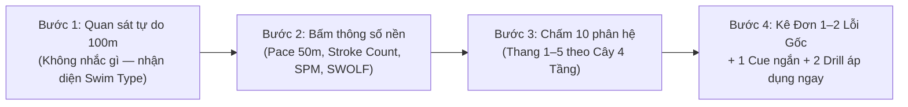

# Bảng Chấm Điểm Chuyên Môn Dành Cho Huấn Luyện Viên (*Coach Evaluation*)

> **Thuộc phần:** `23-checklists/` | **Đối tượng:** Huấn luyện viên (Coach) & Đánh giá chuyên sâu | **Thời lượng đánh giá:** ~20 phút/học viên

## Tổng Quan (Overview)
Một Huấn luyện viên xuất sắc không bao giờ đổ lên đầu học viên 10 lời phê bình cùng lúc trên bờ hồ. Tài liệu này chuẩn hóa **quy trình quan sát 4 bước trên bờ hồ**, **bảng chấm điểm 10 phân hệ cơ sinh học (Thang 1–5)** và **mẫu Phiếu Kê Đơn Kỹ Thuật (*Coaching Prescription Card*)** giúp HLV chẩn đoán nhanh nguyên nhân gốc (*Root Cause*) và chọn chính xác tối đa 2 điểm sửa mang lại hiệu quả lớn nhất cho học viên.

---

## Quy Trình Quan Sát 4 Bước Trên Bờ Hồ (15 Phút)



---

## Bảng Chấm Điểm 10 Phân Hệ Cơ Sinh Học (Thang 1 – 5)

*(Quy ước: `1` = Lỗi nặng cản trở lớn | `2` = Lỗi thường xuyên | `3` = Đạt cơ bản, vỡ khi mệt | `4` = Tốt, ổn định ở CSS | `5` = Chuẩn mực tối ưu `< 1:30/100m`)*

| # | Phân hệ đánh giá | Quan sát chính từ bờ / dưới nước | Điểm (1–5) | Lỗi đặc trưng cần ghi chú |
| :-: | :--- | :--- | :---: | :--- |
| **1** | **Vị trí Đầu & Ánh mắt** | Đường nước qua đỉnh trán; đầu bất động giữa các nhịp thở | `[ ]` | Ngẩng đầu / Lắc đầu / Cúi gập cổ |
| **2** | **Tư thế Hông & Core** | Góc thân `< 5°`; gót chân sát mặt nước; không võng lưng | `[ ]` | Chìm hông / Banana Back / Fishtailing |
| **3** | **Kỹ thuật Thở** | Thở bọt liên tục; *One-Goggle*; úp mặt trước khi tay chạm nước | `[ ]` | Nín hơi / Nhấc đầu / Thở muộn |
| **4** | **Streamline & Turns** | Khóa tay sau tai sâu `0.6 m`; qua vạch `5m+`; Flip Turn mượt | `[ ]` | Tay chữ V / Thở sải cuối / Breakout sớm |
| **5** | **Xoay Thân (Rotation)** | Xoay vai–hông đồng trục `30–45°`; đối xứng trái–phải | `[ ]` | Phẳng (`< 15°`) / Xoay lố (`> 60°`) / Lệch 1 bên |
| **6** | **Hand Entry & Glide** | Vào nước "xỏ kim" đường ray 11h/1h; trượt `10–15 cm` không tụt | `[ ]` | Crossover / Đập bọt / Ấn tay trượt khi thở |
| **7** | **Catch (EVF)** | Khuỷu cao cố định; dựng cẳng tay `100–120°`; cổ tay thẳng | `[ ]` | Dropped Elbow / Kéo thẳng tay / Trượt nước |
| **8** | **Pull & Push** | Tăng tốc lũy tiến bằng cơ xô; đẩy hết ngang mép đùi | `[ ]` | Short Finish / Múc nước lên / Giật đầu pha |
| **9** | **Recovery** | Khuỷu dẫn hướng gọn sát sườn; bàn tay thả lỏng hoàn toàn | `[ ]` | Wide Swinging / Gồng cứng vai / Rụt vai |
| **10** | **Kick & Rhythm (IdC)** | Đạp từ hông, cổ chân mềm ít bọt; không Scissor Kick; không Dead Spot | `[ ]` | Đạp xe / Đá kéo / Windmill / Over-Gliding |

---

## Phân Loại Nhanh Nhóm Học Viên (*SwimSmooth Swim Types*)

- [ ] **Arnie:** Thể lực khỏe nhưng gồng cứng, hông chìm, nhịp nhanh, mau hụt hơi → *Ưu tiên: Thở bọt, Press the T, Sculling, thả lỏng lực tay.*
- [ ] **Overglider:** Bơi êm, số sải ít nhưng nhịp quá chậm (`SPM < 55`), bị Dead Spot → *Ưu tiên: 3/4 Catch-Up, Tempo Trainer, Tarzan Drill.*
- [ ] **Bambino / Kicktastic:** Đạp chân quá nhiều & sâu, nhanh đuối hơi → *Ưu tiên: 2-Beat Kick, Pull Buoy + Ankle Band, nâng hông bằng tư thế đầu.*
- [ ] **Swinger:** Vung tay rộng ngang, vắt chéo trục giữa, hay đau vai → *Ưu tiên: Zipper Drill, Fingertip Drag, Wide-Track 11h/1h, tăng xoay vai `40°`.*
- [ ] **Smooth / Bambino-Fast:** Nền tảng cân bằng tốt → *Ưu tiên: EVF sâu, CSS Threshold, Flip Turn & 6-Beat Finish.*

---

## Mẫu Phiếu Kê Đơn Kỹ Thuật (*Coaching Prescription Card*)

```markdown
- Học viên: _____________________ | Ngày: __/__/20__ | Bể: 25m / 50m
- Thông số nền: Pace CSS: ___/100m | SC/25m: ___ | SPM: ___ | SWOLF: ___
- Tổng điểm 10 phân hệ: ___ / 50 điểm | Nhóm Swim Type: _______________

1. LỖI GỐC ƯU TIÊN #1 (Tầng cao nhất): _________________________________
   - 1 Tín hiệu cảm giác (Cue): ________________________________________
   - Bài Drill chỉ định: ______________________ (25m Drill + 25m Swim)

2. LỖI GỐC ƯU TIÊN #2: _________________________________________________
   - 1 Tín hiệu cảm giác (Cue): ________________________________________
   - Bài Drill chỉ định: ______________________

3. MỤC TIÊU KIỂM TRA SAU 4 TUẦN: _______________________________________
```

---

## Nguyên Tắc Giao Tiếp Huấn Luyện Hiệu Quả

- **Quy tắc "1 Cue — 1 Thời điểm"**: Đưa đúng 1 tín hiệu hình ảnh ngắn gọn dễ nhớ (*"Mắt nhìn đáy"*, *"Vươn qua thùng gỗ"*, *"Quẹt túi quần"*) thay vì giải thích giải phẫu dài dòng khi học viên đang lạnh trên bờ.
- **Tín hiệu Ngoại sinh (*External Focus of Attention*)** hiệu quả hơn Tín hiệu Nội sinh (*Internal Focus*): Ví dụ nói *"Đẩy nước mạnh về phía tường sau"* hiệu quả hơn *"Co cơ tam đầu duỗi khớp khuỷu 160°"*.

---

## Tóm Tắt & Tài Liệu Tham Khảo (Summary & References)
- Sử dụng bảng chấm 10 phân hệ + Phiếu Kê Đơn mỗi 4–6 tuần để biến quá trình huấn luyện thành chu trình khoa học đo lường được.
- **Liên kết chéo:** [Self Evaluation](self-evaluation.md) · [Video Evaluation](video-evaluation.md) · [Coach Field Notes](../coach-notes/field-notes.md) · [Glossary](../24-appendix/glossary.md)

