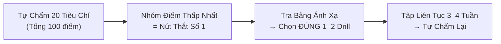

# Bảng Tự Đánh Giá Kỹ Thuật Tại Hồ (*Self Evaluation Checklist*)

> **Thuộc phần:** `23-checklists/` | **Tần suất sử dụng:** Mỗi 2–4 tuần | **Thời gian thực hiện:** ~5 phút sau buổi bơi

## Tổng Quan (Overview)
Tài liệu này là **bảng kiểm tự chấm điểm thực chiến (Thang 100 điểm)** dành cho người bơi tự rèn luyện tại hồ mà không có HLV đứng bên cạnh. Bằng cách trả lời trung thực 20 tiêu chí cảm thụ bản thể (*Proprioception*) và chỉ số định lượng chia theo 5 nhóm, bạn sẽ xác định ngay lập tức **nút thắt lớn nhất đang kìm hãm tốc độ của mình** và mở đúng chương sửa lỗi tương ứng.

- **Mục tiêu cốt lõi:** Tự chấm điểm định kỳ sau mỗi Block 4 tuần để theo dõi sự tiến bộ từ mức Cơ bản (`< 50 điểm`) lên mức Nâng cao `< 1:30/100m` (`≥ 85 điểm`).
- **Quy tắc sử dụng:** Mỗi tiêu chí đạt **5 điểm** (hoàn thành ổn định 90% thời gian = `5đ`, thỉnh thoảng = `2.5đ`, chưa đạt = `0đ`).

---

## Lý Thuyết (Theory) & Cách Chấm Điểm

---

## Checklist Tự Đánh Giá 20 Tiêu Chí (100 Điểm)

### Nhóm 1 — Tư Thế, Cân Bằng & Streamline (20 điểm)
- [ ] **1. Đường nước & Ánh mắt (5đ):** Mặt nước cắt qua đỉnh trán/chân tóc, mắt nhìn thẳng đáy hồ (`0–15°`), gáy hoàn toàn thả lỏng. → *Chưa đạt xem:* [Body Position](../04-body-position/body-position-and-alignment.md)
- [ ] **2. Hông & Gót chân nổi (5đ):** Gót chân thỉnh thoảng lướt chạm mặt nước khi bơi chậm mà không cần đập chân mạnh. → *Chưa đạt xem:* [COG & COB](../01-foundation/center-of-gravity-and-buoyancy.md)
- [ ] **3. Streamline chặt mọi thành bể (5đ):** Đạp tường sâu `0.5–0.7 m`, bắp tay khóa sau tai, trượt không đập chân qua mốc `6m+`. → *Chưa đạt xem:* [Streamline](../04-body-position/streamline.md)
- [ ] **4. Core phẳng chống võng lưng (5đ):** Thắt lưng phẳng êm, không đau mỏi lưng dưới sau `1.500m`, không lắc hông ngang. → *Chưa đạt xem:* [Core Engagement](../05-core/core-engagement.md)

### Nhóm 2 — Kỹ Thuật Thở & Xoay Thân (20 điểm)
- [ ] **5. Thở ra liên tục dưới nước (5đ):** Xả bọt khí đều đặn bằng mũi/miệng suốt lúc mặt úp (không nín hơi), không bị ngộp sau `400m`. → *Chưa đạt xem:* [Breathing Mechanics](../07-breathing/breathing-mechanics.md)
- [ ] **6. Quy tắc 1 Mắt Kính Chạm Nước (5đ):** Xoay đầu theo trục dọc lấy hơi trong hõm sóng mũi (*Bow Wave*), không ngẩng đầu. → *Chưa đạt xem:* [Breathing Mechanics](../07-breathing/breathing-mechanics.md)
- [ ] **7. Xoay trục dọc đối xứng `30–45°` (5đ):** Vai và hông xoay đều cả hai bên trái–phải (kể cả bên không thở), đầu bất động giữa các nhịp thở. → *Chưa đạt xem:* [Body Rotation](../06-rotation/body-rotation.md)
- [ ] **8. Tay trượt ổn định khi thở (5đ):** Tay phía trước giữ vững độ sâu `10–15 cm`, không bị ấn tụt xuống đáy lúc xoay đầu hít hơi. → *Chưa đạt xem:* [Balance & Glide](../04-body-position/balance-and-glide.md)

### Nhóm 3 — Tay Nhẹ: Entry, EVF, Push & Recovery (25 điểm)
- [ ] **9. Vào nước "Xỏ kim" 11h & 1h (5đ):** Đầu ngón tay giữa chạm trước, không đập nước tạo bọt, không vắt chéo qua trục giữa. → *Chưa đạt xem:* [Hand Entry](../09-catch/hand-entry-and-extension.md)
- [ ] **10. Dựng cẳng tay sớm EVF (5đ):** Cảm nhận nước "đặc" trên cả cẳng tay lẫn lòng bàn tay, khuỷu luôn cao hơn cổ tay khi bắt nước. → *Chưa đạt xem:* [EVF Catch](../09-catch/early-vertical-forearm.md)
- [ ] **11. Lực kéo từ Cơ Xô (Lat) (5đ):** Mỏi đều vùng lưng dưới nách khi bơi dài, **0/10 điểm đau nhói** ở mặt trước khớp vai. → *Chưa đạt xem:* [Shoulder & Lat](../02-biomechanics/shoulder-and-lat-mechanics.md)
- [ ] **12. Tăng tốc Push tới mép đùi (5đ):** Nhịp kéo *Chậm → Vừa → Nhanh*, ngón cái lướt qua ngang đùi rồi xoay cạnh tay cắt nước sạch. → *Chưa đạt xem:* [Pull & Push](../10-pull/pull-and-push-phase.md)
- [ ] **13. Pha Recovery thả lỏng 100% (5đ):** Khuỷu dẫn hướng tự nhiên gọn sát sườn, cổ tay và bàn tay rũ mềm như được nghỉ ngơi trên không. → *Chưa đạt xem:* [Relaxed Recovery](../11-recovery/relaxed-recovery.md)

### Nhóm 4 — Kỹ Thuật Chân & Phối Hợp Nhịp (15 điểm)
- [ ] **14. Đạp từ hông, cổ chân mềm ít bọt (5đ):** Không gập gối kiểu đạp xe, không đá cắt kéo khi thở, mặt nước phía sau êm gọn. → *Chưa đạt xem:* [Ankle Mobility](../08-kicking/ankle-mobility.md)
- [ ] **15. Làm chủ 2-Beat / 4-Beat / 6-Beat (5đ):** Dùng 2-beat tiết kiệm sức cho đường dài và chủ động bật 4/6-beat khi tăng tốc. → *Chưa đạt xem:* [2-Beat Kick](../08-kicking/two-beat-kick.md)
- [ ] **16. Nhịp Front-Quadrant không Dead Spot (5đ):** Luôn có 1 tay phía trước nhưng chuyển mượt sang EVF ngay khi tay hồi ngang tai (*Meet at the Ear*). → *Chưa đạt xem:* [Rhythm & Timing](../12-rhythm/rhythm-and-timing.md)

### Nhóm 5 — Hiệu Suất, Lộn Vòng & Quản Trị Tập Luyện (20 điểm)
- [ ] **17. Duy trì DPS & Stroke Count ổn định (5đ):** Số sải/25m ở 100m cuối bài `400m` không tăng quá `+1 sải` so với 100m đầu. → *Chưa đạt xem:* [DPS](../13-dps/distance-per-stroke.md)
- [ ] **18. Kiểm soát Pace CSS & SWOLF (5đ):** Đã test CSS trong 6 tuần gần nhất và phân chia đúng vùng tập Z1–Z5. → *Chưa đạt xem:* [SWOLF & CSS](../14-stroke-count/swolf-and-energy-systems.md)
- [ ] **19. Flip Turn & Breakout sắc gọn (5đ):** Thực hiện Flip Turn liên tục không thở sải cuối và Breakout `1–2 sải` không thở. → *Chưa đạt xem:* [Starts & Turns](../16-sprint/sprint-starts-and-turns.md)
- [ ] **20. Khởi động cạn 10p & Dryland đều đặn (5đ):** Thực hiện khởi động vai/EVF trước buổi bơi và duy trì `2 buổi` Dryland/Mobility mỗi tuần. → *Chưa đạt xem:* [Dryland Programs](../18-strength/dryland-programs.md)

---

## Xếp Loại & Hành Động Tiếp Theo

| Tổng điểm | Cấp độ kỹ thuật | Hành động khuyến nghị |
| :---: | :--- | :--- |
| **`< 50 điểm`** | **Giai đoạn Nền tảng** | Tập trung 100% vào Nhóm 1 & 2 (Block 1: Tư thế, Streamline, Thở bọt). Chưa vội tập tốc độ! |
| **`50 – 69 điểm`** | **Giai đoạn Phát triển** | Khóa chặt Nhóm 3 (EVF, Xoay hông, Thumb-to-Thigh) kết hợp giáo án Block 2–3. |
| **`70 – 84 điểm`** | **Giai đoạn Đột phá** | Đẩy mạnh Nhóm 4 & 5 (Tempo Trainer, CSS MLSS, Flip Turn) theo Block 4–5. |
| **`85 – 100 điểm`** | **Đẳng cấp `< 1:30/100m`** | Duy trì tinh chỉnh vi mô, Taper bứt phá mốc `< 1:25/100m` hoặc Open Water đường dài! |

---

## Tóm Tắt & Tài Liệu Tham Khảo (Summary & References)
- Thực hiện lại bảng tự đánh giá này sau mỗi **4 tuần** để đảm bảo bạn luôn tập đúng nút thắt quan trọng nhất.
- **Liên kết chéo:** [Coach Evaluation](coach-evaluation.md) · [Video Evaluation](video-evaluation.md) · [Bảng Chuẩn Benchmarks](../benchmarks/performance-benchmarks.md) · [Glossary](../24-appendix/glossary.md)

