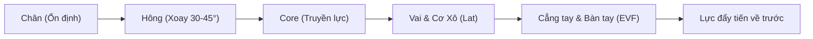

# {{TITLE}}

> **Thuộc phần:** `{{CHAPTER_FOLDER}}` | **Trình độ:** Cơ bản → Nâng cao | **Thời gian đọc:** ~10 phút

## Overview

<!-- Tóm tắt mục tiêu chương, giá trị thực chiến và 3–5 điểm cốt lõi (TL;DR) gắn với triết lý: Tốc độ – Tay nhẹ – Lực từ thân. -->

- **Mục tiêu cốt lõi:** ...
- **Cảm giác đúng:** ...
- **Sai lầm phổ biến nhất:** ...

---

## Theory

<!-- Giải thích bản chất kỹ thuật từ nguyên lý gốc (First Principles). Không lan man. -->

---

## Science

### Physics & Hydrodynamics

<!-- Định luật vật lý chất lưu, lực cản (Form/Friction/Wave Drag), lực đẩy, công thức LaTeX nếu có. -->

### Biomechanics

<!-- Nhóm cơ tham gia (Core, Lat, Rotator Cuff, Glutes...), góc khớp tối ưu và chuỗi truyền lực. -->

---

## Practical

### Why It Works

<!-- Giải thích tại sao kỹ thuật này giúp tăng tốc độ nhưng vẫn giữ tay nhẹ, ít tốn sức. -->

### Step-by-Step Execution & Water Cues

1. **Bước 1:** ...
2. **Bước 2:** ...
3. **Bước 3:** ...

<!-- IMAGE_PROMPT: Góc quay dưới nước nhìn ngang/chéo trước, hiển thị trục thân thẳng, góc khuỷu EVF và vector lực đẩy. -->

### Advanced Tips

- ...

---

## Drills

| Tên Drill | Mục tiêu chính | Cự ly / Số hiệp | Cảm giác đúng (Cue) |
| :--- | :--- | :--- | :--- |
| Drill 1 | ... | `4 × 25m` (nghỉ 15s) | ... |
| Drill 2 | ... | `4 × 50m` (nghỉ 20s) | ... |

*(Mô tả chi tiết cách thực hiện từng drill ở bên dưới bảng)*

---

## AI Analysis

- **Góc quay khuyến nghị:** Ngang dưới nước (Underwater Side View) & Trước mặt (Front View).
- **Keypoints cần trích xuất:** Vai (`shoulder`), Khuỷu (`elbow`), Cổ tay (`wrist`), Hông (`hip`), Cổ chân (`ankle`).
- **Ngưỡng phát hiện lỗi tự động:**
  - Góc/tọa độ đạt chuẩn: ...
  - Cảnh báo lỗi: ...

---

## Common Errors

| Lỗi thường gặp | Triệu chứng nhận biết | Nguyên nhân gốc | Cách sửa (Correction) |
| :--- | :--- | :--- | :--- |
| Lỗi 1 | ... | ... | ... |
| Lỗi 2 | ... | ... | ... |
| Lỗi 3 | ... | ... | ... |
| Lỗi 4 | ... | ... | ... |

---

## Self Assessment

- [ ] Tiêu chí tự kiểm tra 1 tại hồ bơi
- [ ] Tiêu chí tự kiểm tra 2
- [ ] Tiêu chí tự kiểm tra 3
- [ ] Tiêu chí tự kiểm tra 4
- [ ] Tiêu chí tự kiểm tra 5

---

## KPI

| Chỉ số (Metric) | Người mới | Trung cấp | Nâng cao (`< 1:30/100m`) |
| :--- | :---: | :---: | :---: |
| Chỉ số 1 | ... | ... | ... |
| Chỉ số 2 | ... | ... | ... |

---

## FAQ

**1. Câu hỏi thực tế 1?**
Trả lời ngắn gọn, dựa trên cơ sinh học.

**2. Câu hỏi thực tế 2?**
Trả lời ngắn gọn, dựa trên thực tế tập luyện.

---

## Summary

- Ý chốt 1.
- Ý chốt 2.
- Ý chốt 3.

**Liên kết chéo:**
- Chương trước: [{{PREV_TITLE}}]({{PREV_PATH}})
- Chương tiếp theo: [{{NEXT_TITLE}}]({{NEXT_PATH}})
- Tra cứu thuật ngữ: [Glossary](../24-appendix/glossary.md)

---

## References

1. Maglischo, E. W. — *Swimming Fastest* (Human Kinetics).
2. USA Swimming / World Aquatics Technical Guidelines.
3. SwimSmooth & Total Immersion Methodology.

